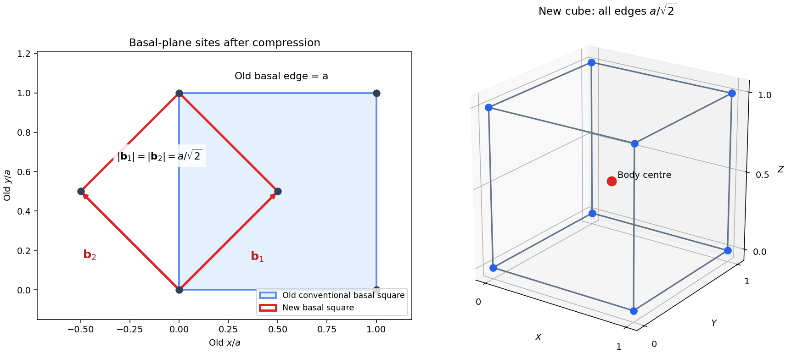
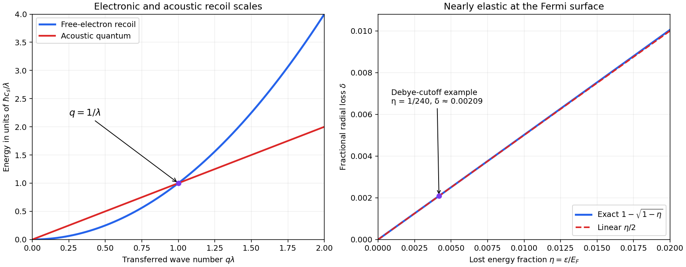
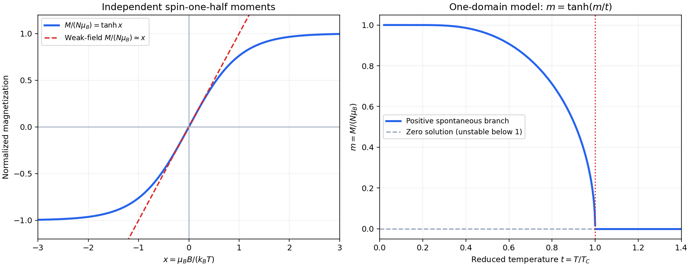

# 2014

↑ **Parent:** [Past exam of the condensed matter physics course of the University of Oxford](../past-exam-of-the-condensed-matter-physics-course-of-the-university-of-oxford.md)

Source paper: [https://www-thphys.physics.ox.ac.uk/people/SteveSimon/condmat2015/B62014.pdf](https://www-thphys.physics.ox.ac.uk/people/SteveSimon/condmat2015/B62014.pdf)

**Table of contents**

- [1](#1)
  - [a](#1/a)
    - [Solution](#1/a/solution)
  - [b](#1/b)
    - [Solution](#1/b/solution)
  - [c](#1/c)
    - [Solution](#1/c/solution)
  - [d](#1/d)
    - [Solution](#1/d/solution)
- [2](#2)
  - [a](#2/a)
    - [Solution](#2/a/solution)
  - [b](#2/b)
    - [Solution](#2/b/solution)
  - [c](#2/c)
    - [Solution](#2/c/solution)
  - [d](#2/d)
    - [Solution](#2/d/solution)
- [3](#3)
  - [a](#3/a)
    - [Solution](#3/a/solution)
  - [b](#3/b)
    - [i](#3/b/i)
      - [Solution](#3/b/i/solution)
    - [ii](#3/b/ii)
      - [Solution](#3/b/ii/solution)
  - [c](#3/c)
    - [Solution](#3/c/solution)
  - [d](#3/d)
    - [Solution](#3/d/solution)
  - [e](#3/e)
    - [Solution](#3/e/solution)
- [4](#4)
  - [a](#4/a)
    - [Solution](#4/a/solution)
  - [b](#4/b)
    - [Solution](#4/b/solution)
  - [c](#4/c)
    - [Solution](#4/c/solution)
  - [d](#4/d)
    - [Solution](#4/d/solution)

## 1

↑ **Parent:** [2014](2014.md)

<h3 id="1/a">a</h3>

↑ **Parent:** [1](#1)

<h4 id="1/a/solution">Solution</h4>

↑ **Parent:** [A](#1/a)

A [Bravais lattice](../quantum-scattering.md#bravais-lattice) is an infinite periodic set of equivalent points $\mathbf R=n_1\mathbf a_1+n_2\mathbf a_2+n_3\mathbf a_3$, with integer $n_i$ and independent primitive translations $\mathbf a_i$. It describes translation symmetry, without assigning a chemical species to a point. An [atomic basis of a crystal](../physical-chemistry.md#atomic-basis-of-a-crystal) is the motif of atoms, with their species and relative positions, repeated identically at every [lattice point](../quantum-scattering.md#lattice-point). The resulting [crystal structure](../physical-chemistry.md#crystal-structure) consists of the lattice decorated by that basis; the basis can contain several atoms even when the lattice is primitive.

A [primitive unit cell](../quantum-scattering.md#primitive-unit-cell) tiles space under lattice translations and contains exactly one [lattice point](../quantum-scattering.md#lattice-point), counting shared boundary points fractionally. Its [volume](../geometry-and-topology.md#volume) is $|\mathbf a_1\cdot(\mathbf a_2\times\mathbf a_3)|$. A [conventional unit cell](../quantum-scattering.md#conventional-unit-cell) is chosen to display useful crystal symmetry and may contain several [lattice points](../quantum-scattering.md#lattice-point). Thus a centered conventional cell is not primitive, but the crystal still has a primitive cell. Neither cell size nor the number of dots drawn on its boundary should be confused with the number of atoms in the crystal basis.

<h3 id="1/b">b</h3>

↑ **Parent:** [1](#1)

<h4 id="1/b/solution">Solution</h4>

↑ **Parent:** [B](#1/b)

Use fractional coordinates relative to conventional cubic vectors $(a\hat x,a\hat y,a\hat z)$. A [body-centered cubic lattice](../quantum-scattering.md#body-centered-cubic-lattice) has representative points

$$
(0,0,0),\quad(\tfrac12,\tfrac12,\tfrac12),
$$

so its conventional cell contains two [lattice points](../quantum-scattering.md#lattice-point): eight shared corners contribute one and the interior point contributes one. A [face-centered cubic lattice](../quantum-scattering.md#face-centered-cubic-lattice) has

$$
(0,0,0),\quad(0,\tfrac12,\tfrac12),\quad(\tfrac12,0,\tfrac12),\quad(\tfrac12,\tfrac12,0),
$$

so its conventional cell contains four: one from the shared corners and three from six half-shared faces.

For $N$ atoms at fractional positions $(x_j,y_j,z_j)$, the geometric [structure factor](../quantum-scattering.md#structure-factor) and the atomic-factor-weighted amplitude are respectively

$$
G_{hkl}=\sum_{j=1}^N e^{2\pi i(hx_j+ky_j+lz_j)},\qquad
F_{hkl}=\sum_{j=1}^N f_j(\mathbf G)e^{2\pi i(hx_j+ky_j+lz_j)}.
$$

For identical atoms $F=fG$. Applying the conventional-cell lattice factors gives

$$
\boxed{G_{\rm BCC}=1+(-1)^{h+k+l}=\begin{cases}2,&h+k+l\text{ even},\\0,&h+k+l\text{ odd},\end{cases}}
$$

and

$$
\boxed{G_{\rm FCC}=1+(-1)^{k+l}+(-1)^{h+l}+(-1)^{h+k}
=\begin{cases}4,&h,k,l\text{ all even or all odd},\\0,&\text{mixed parity}.\end{cases}}
$$

These are lattice selection rules; an additional nontrivial [crystal basis structure factor](../quantum-scattering.md#crystal-basis-structure-factor) can extinguish further allowed reflections.

Of the eight equally represented parity triples, four satisfy the BCC condition and two the FCC condition. Thus the fractions among integer index triples are $1/2$ and $1/4$, respectively. This reflects the two and four equivalent [lattice points](../quantum-scattering.md#lattice-point) in the conventional cells: their reciprocal lattices occupy corresponding subsets of the conventional reciprocal grids. In primitive reciprocal coordinates every integer triple denotes a reciprocal-lattice vector; lattice-centering absences are then built into the grid rather than an extra rule. A multi-atom chemical basis can still cause genuine additional absences. If permutations means merely reordering one fixed triple, its allowedness never changes: the quoted fractions concern all index triples, not reordering a chosen $(h,k,l)$.

<h3 id="1/c">c</h3>

↑ **Parent:** [1](#1)

<h4 id="1/c/solution">Solution</h4>

↑ **Parent:** [C](#1/c)

After compression along $z$, let the original conventional edges be $a,a,c$ with $c=a/\sqrt2$. This gives exactly the specified [volume](../geometry-and-topology.md#volume) reduction. The compressed FCC points admit the alternative translation vectors

$$
\mathbf b_1=\frac a2(1,1,0),\qquad
\mathbf b_2=\frac a2(-1,1,0),\qquad
\mathbf b_3=(0,0,a/\sqrt2).
$$

They are mutually perpendicular, have equal length $b=a/\sqrt2$, and form a right-handed cube. Besides its corners, the lattice has the point

$$
\frac{\mathbf b_1+\mathbf b_2+\mathbf b_3}{2}
=(0,a/2,a/(2\sqrt2)),
$$

which is the compressed image of an original FCC face centre. All compressed FCC sites are generated by the cube's integer translations and this body-centre coset. Therefore

$$
\boxed{\text{compressed FCC}\equiv\text{BCC with conventional edge }b=a/\sqrt2.}
$$

The old compressed tetragonal conventional cell has [volume](../geometry-and-topology.md#volume) $a^3/\sqrt2$ and four sites; the new BCC cube has half that [volume](../geometry-and-topology.md#volume) and two sites. This verifies the same physical site density rather than silently losing atoms during the change of cell. The continuous uniaxial deformation is the [Bain path](../physical-chemistry.md#bain-path), named for [Edgar Bain](../engineering.md#edgar-bain).

**[Figure 1](#1/c/image-the-bain-path-a-rotated-conventional-cell-exposes-bcc-geometry). The Bain path: a rotated conventional cell exposes BCC geometry**. Original geometric construction. The basal panel shows the old square and a new square generated by the two diagonal half-translations. The spatial panel uses new-cell coordinates, with corner sites and a body centre. The compressed vertical edge and both new basal edges all have length $a/\sqrt2$. Dots are lattice sites rather than hard-sphere atomic surfaces.

<h3 id="1/d">d</h3>

↑ **Parent:** [1](#1)

<h4 id="1/d/solution">Solution</h4>

↑ **Parent:** [D](#1/d)

The FCC parity rule forbids $(100)$ and $(110)$ and allows $(200)$ and $(111)$. To follow each same plane family through the deformation, use fractional coordinates $(x,y,z)$ in the compressed old cell and $(X,Y,Z)$ in the new cube. The preceding vectors give

$$
x=(X-Y)/2,\qquad y=(X+Y)/2,\qquad z=Z.
$$

Thus $hx+ky+lz=m$ becomes $HX+KY+LZ=m$, with

$$
\boxed{(H,K,L)=\left(\frac{h+k}{2},\frac{k-h}{2},l\right).}
$$

Crucially, this transformation retains the plane spacing and diffraction order, not just a normal direction:

| Old FCC reflection | New-cell reciprocal coordinates | Status |
| --- | --- | --- |
| $(100)$ | $(\tfrac12,-\tfrac12,0)$ | Not a new reciprocal-lattice vector; absent |
| $(110)$ | $(1,0,0)$ | Odd index sum; absent |
| $(200)$ | $(1,-1,0)$ | Even index sum; allowed |
| $(111)$ | $(1,0,1)$ | Even index sum; allowed |

The two physically allowed reflections remain allowed, and the two absent ones remain absent. Their angles and spacings change under strain; their allowedness as tracked reciprocal vectors does not.

The half-integer entry is deliberate. It cannot be relabeled as the ordinary BCC $(1\bar10)$ reflection while claiming to track the same diffraction order. Multiplying its indices by two doubles the reciprocal vector and halves the spacing; that new allowed reflection is the image of old FCC $(200)$, not old $(100)$. If only an orientation label is wanted, the old $(100)$ and $(200)$ planes both have the new $(1\bar10)$ orientation, but are distinct orders. This is the distinction between [diffraction indexing under a cell change](../physical-chemistry.md#diffraction-indexing-under-a-cell-change) and merely reducing a plane normal to the smallest integer ratio.

## 2

↑ **Parent:** [2014](2014.md)

<h3 id="2/a">a</h3>

↑ **Parent:** [2](#2)

<h4 id="2/a/solution">Solution</h4>

↑ **Parent:** [A](#2/a)

In the spin-degenerate [free electron model](../physics.md#free-electron-model), a monovalent metal has conduction-electron [number density](../statistical-physics.md#number-density) $n$. The density of wave-vector states is $1/(2\pi)^3$ per unit real-space [volume](../geometry-and-topology.md#volume), with two [spin](../angular-momentum-operator.md#spin) states at each [wave vector](../elasticity-physics.md#wavevector). Filling a sphere at zero [temperature](../temperature.md) gives

$$
n=\frac{2}{(2\pi)^3}\frac{4\pi k_F^3}{3}=\frac{k_F^3}{3\pi^2},\qquad
\boxed{T_F=\frac{E_F}{k_B}=\frac{\hbar^2}{2m_ek_B}(3\pi^2n)^{2/3}.}
$$

For the [Debye model](../quantum-ideal-gas-statistics.md#debye-model), there are three acoustic polarizations and $3n$ modes per unit [volume](../geometry-and-topology.md#volume) in total. Replacing their dispersions by $\omega=ck$ with the effective [Debye sound speed](../quantum-ideal-gas-statistics.md#debye-sound-speed), mode counting gives

$$
3\frac{1}{(2\pi)^3}\frac{4\pi k_D^3}{3}=3n,
\qquad k_D=(6\pi^2n)^{1/3},
\qquad \boxed{\theta_D=\frac{\hbar c}{k_B}(6\pi^2n)^{1/3}.}
$$

The factor two in the [electron](../physics.md#electron) count is [spin](../angular-momentum-operator.md#spin), whereas the factor three in the [phonon](../quantum-ideal-gas-statistics.md#phonon) count is polarization; the two counts are not interchangeable. If branch speeds differ, the Debye effective average obeys $c^{-3}=(c_l^{-3}+2c_t^{-3})/3$ in the isotropic approximation.

Dividing gives $T_F/\theta_D=\lambda(3\pi^2n/2)^{1/3}$, where $\lambda=\hbar/(2m_ec)$. A monatomic FCC conventional cell contains four atoms, so $n=4/a^3$. Therefore

$$
\boxed{\frac{T_F}{\theta_D}=(6\pi^2)^{1/3}\frac\lambda a.}
$$

Here and below $c$ is the **speed of sound**, not the speed of light. The Debye cutoff counts acoustic modes in a spherical approximation to the [Brillouin zone](../bloch-s-theorem.md#brillouin-zone); it is not an electron-state cutoff.

<h3 id="2/b">b</h3>

↑ **Parent:** [2](#2)

<h4 id="2/b/solution">Solution</h4>

↑ **Parent:** [B](#2/b)

Using $c=2700\,\mathrm{m\,s^{-1}}$ gives the [electron-acoustic recoil length](../quantum-ideal-gas-statistics.md#electron-acoustic-recoil-length)

$$
\lambda=\frac{\hbar}{2m_ec}=2.1438\times10^{-8}\,\mathrm m.
$$

The [temperature](../temperature.md) ratio therefore fixes

$$
\boxed{a=\frac{(6\pi^2)^{1/3}\lambda}{240}=3.482\times10^{-10}\,\mathrm m=0.3482\,\mathrm{nm}.}
$$

It follows that $n=4/a^3=9.48\times10^{28}\,\mathrm{m^{-3}}$, $k_F=1.4105\times10^{10}\,\mathrm{m^{-1}}$ and $k_D=1.7771\times10^{10}\,\mathrm{m^{-1}}$. Substitution gives

$$
\boxed{\theta_D\simeq366.5\,\mathrm K,\qquad T_F\simeq8.796\times10^4\,\mathrm K.}
$$

The resulting [Fermi energy](../quantum-ideal-gas-statistics.md#fermi-energy) is about $7.58\,\mathrm{eV}$ and the [temperature](../temperature.md) ratio is indeed $240$. These values follow from the supplied effective sound speed and free-electron/Debye approximations; they are not independent precision measurements of copper's parameters.

<h3 id="2/c">c</h3>

↑ **Parent:** [2](#2)

<h4 id="2/c/solution">Solution</h4>

↑ **Parent:** [C](#2/c)

An [electron](../physics.md#electron) losing [energy](../energy.md) to an acoustic [phonon](../quantum-ideal-gas-statistics.md#phonon) has, in a normal process, $\mathbf k'=\mathbf k_F-\mathbf k_{\rm ph}$, with possible addition of a reciprocal-lattice vector for an [Umklapp process](../quantum-ideal-gas-statistics.md#umklapp-scattering). The [energy](../energy.md) transfer is at most of order $\hbar\omega_D=k_B\theta_D$, much smaller than $E_F=k_BT_F$. Hence the magnitudes change very little even though the [momentum](../momentum.md) direction can change substantially. At $T\sim\theta_D\ll T_F$, thermal vacancies near the [Fermi surface](../fermi-liquid.md#fermi-surface) allow emission into some lower-energy states; exactly at zero [temperature](../temperature.md) emission into an occupied Fermi sea would be blocked by the [Pauli exclusion principle](../tensor-product-of-quantum-systems.md#pauli-exclusion-principle).

Using $k'=(1-\delta)k_F$ and the free-electron dispersion, [energy](../energy.md) conservation gives

$$
\frac{\hbar^2k_F^2}{2m_e}\left[1-(1-\delta)^2\right]
=\hbar c k_{\rm ph}.
$$

Since $\delta\ll1$, the bracket is $2\delta+O(\delta^2)$. Rearranging yields

$$
\boxed{\frac1{2\delta}\frac{k_{\rm ph}}{k_F}\frac1{k_F}
\simeq\frac\hbar{2m_ec}=\lambda.}
$$

Equivalently $\delta\simeq\hbar c k_{\rm ph}/(2E_F)$. For a Debye-cutoff [phonon](../quantum-ideal-gas-statistics.md#phonon) in the preceding model, $\delta\simeq\theta_D/(2T_F)=1/480=0.00208$, confirming the approximation. Near-elastic scattering constrains the radial distance in wave-vector space, not the [scattering angle](../quantum-scattering.md#scattering-angle) alone.

<h3 id="2/d">d</h3>

↑ **Parent:** [2](#2)

<h4 id="2/d/solution">Solution</h4>

↑ **Parent:** [D](#2/d)

The [electron-acoustic recoil length](../quantum-ideal-gas-statistics.md#electron-acoustic-recoil-length) compares electronic recoil with the acoustic quantum [energy](../energy.md) associated with the same [momentum](../momentum.md). For transferred wave number $q$,

$$
E_{\rm recoil}(q)=\frac{\hbar^2q^2}{2m_e},\qquad
E_{\rm phonon}(q)=\hbar cq,\qquad
\boxed{\frac{E_{\rm recoil}}{E_{\rm phonon}}=q\lambda.}
$$

The dispersions cross at $q=1/\lambda$; there the reduced [electron](../physics.md#electron) de Broglie wavelength is $\lambda$ and its free-particle group [velocity](../classical-mechanics.md#velocity) is $2c$. Thus $\lambda$ is the length scale at which an [electron](../physics.md#electron)'s localization/recoil [energy](../energy.md) and a corresponding acoustic excitation [energy](../energy.md) become comparable. At $q\lambda\gg1$ the [electron](../physics.md#electron) recoil [energy](../energy.md) is large compared with the [phonon](../quantum-ideal-gas-statistics.md#phonon) [energy](../energy.md); this explains the separation of electronic and acoustic [energy](../energy.md) scales when lattice wave numbers exceed $1/\lambda$.

Formally it is half the [Reduced Compton wavelength](../mathematical-physics.md#reduced-compton-wavelength) with the speed of light replaced by the speed of sound. That is an analogy of scales, not a relativistic [electron](../physics.md#electron) [mass](../classical-mechanics.md#mass) or a pair-production threshold: sound does not replace the limiting speed in [electron](../physics.md#electron) dynamics. Also it is a reduced-wavelength convention; an ordinary de Broglie wavelength $2\pi/q$ at the crossing is $2\pi\lambda$. No scattering lifetime appears, so $\lambda$ is not an [electron](../physics.md#electron) [mean free path](../ideal-gas.md#mean-free-path).

**[Figure 2](#2/d/image-electron-acoustic-recoil-crossover-and-nearly-conserved-fermi-wavevector-magnitude). Electron–acoustic recoil crossover and nearly conserved Fermi-wavevector magnitude**. Original dimensionless dispersion comparison with $q\lambda$ on the horizontal axis. The separate right panel compares the exact radial loss $1-\sqrt{1-\epsilon/E_F}$ to its small-transfer approximation $\epsilon/(2E_F)$; the cutoff-phonon example is marked at $\epsilon/E_F=1/240$. Neither panel is a measured copper dispersion curve.

## 3

↑ **Parent:** [2014](2014.md)

<h3 id="3/a">a</h3>

↑ **Parent:** [3](#3)

<h4 id="3/a/solution">Solution</h4>

↑ **Parent:** [A](#3/a)

An [intrinsic semiconductor](../semiconductor.md#intrinsic-semiconductor) has its carrier populations set primarily by thermal excitation across the [band gap](../bloch-s-theorem.md#band-gap); in the ideal pure, neutral case its conduction-electron and hole densities are equal, $n=p=n_i$. An [extrinsic semiconductor](../semiconductor.md#extrinsic-semiconductor) has carrier populations significantly controlled by donor or acceptor impurities, producing predominantly [n-type semiconductor](../semiconductor.md#n-type-semiconductor) or [p-type semiconductor](../semiconductor.md#p-type-semiconductor) behavior. Chemical purity alone does not fix conductivity independently of [temperature](../temperature.md) and gap size.

The positive [charge carrier mobility](../electric-charge.md#charge-carrier-mobility) is the magnitude of mean drift speed per unit weak [electric field](../electric-field.md). For [electrons](../physics.md#electron) $\mathbf v_e=-\mu_e\mathbf E$, for holes $\mathbf v_h=\mu_h\mathbf E$, and its SI unit is $\mathrm{m^2\,V^{-1}\,s^{-1}}$. In an isotropic relaxation-time model, $\mu=|q|\tau/m^*$.

A [band effective mass](../bloch-s-theorem.md#band-effective-mass) characterizes how an [electron](../physics.md#electron) wave packet accelerates in an [energy band](../bloch-s-theorem.md#energy-band), rather than replacing its vacuum rest [mass](../classical-mechanics.md#mass). In one dimension and its tensor generalization,

$$
\boxed{\frac1{m^*}=\frac1{\hbar^2}\frac{d^2E}{dk^2},\qquad
(M^{*-1})_{ij}=\frac1{\hbar^2}\frac{\partial^2E}{\partial k_i\partial k_j}.}
$$

These follow by differentiating $v_i=\hbar^{-1}\partial E/\partial k_i$ and using $\hbar\dot k_j=F_j$. Effective masses can be anisotropic and [electron](../physics.md#electron) band curvature can be negative.

<h3 id="3/b">b</h3>

↑ **Parent:** [3](#3)

<h4 id="3/b/i">i</h4>

↑ **Parent:** [B](#3/b)

<h5 id="3/b/i/solution">Solution</h5>

↑ **Parent:** [I](#3/b/i)

An [electron hole](../quantum-mechanics.md#electron-hole) is a missing [electron](../physics.md#electron) in an otherwise almost filled [valence band](../quantum-mechanics.md#valence-band). A completely filled band has no net transport current: its velocities cancel over the [Brillouin zone](../bloch-s-theorem.md#brillouin-zone). Describing a few missing states as mobile excitations is therefore simpler than following almost every occupied [electron](../physics.md#electron) state.

Near an isotropic valence maximum, write the [electron](../physics.md#electron) dispersion as $E_v(\mathbf k)=E_v(0)-\hbar^2k^2/(2m_h)$ with $m_h>0$. The [electron](../physics.md#electron) curvature [mass](../classical-mechanics.md#mass) is negative there. Removing that [electron](../physics.md#electron) creates an excitation with [momentum](../momentum.md) $\hbar\mathbf k_h=-\hbar\mathbf k$ and [energy](../energy.md) measured upward from the filled reference,

$$
E_h(\mathbf k_h)=E_v(0)-E_v(-\mathbf k_h)=\frac{\hbar^2k_h^2}{2m_h}.
$$

Thus

$$
\boxed{m_h^*=-m_{e,\mathrm{valence}}^*>0.}
$$

The sign refers to the positive excitation [energy](../energy.md) of a missing [electron](../physics.md#electron) near a maximum, not to negative vacuum [mass](../classical-mechanics.md#mass). A general maximum gives the corresponding positive hole-curvature tensor.[§16.2, printed pp. 178–179: missing-electron carriers, opposite charge and [band effective mass](../bloch-s-theorem.md#band-effective-mass)](../physics-bibliography.md#lecture-notes-for-solid-state-physics-by-steven-h-simon)

<h4 id="3/b/ii">ii</h4>

↑ **Parent:** [B](#3/b)

<h5 id="3/b/ii/solution">Solution</h5>

↑ **Parent:** [Ii](#3/b/ii)

Removing an [electron](../physics.md#electron) of charge $-e$ leaves charge $+e$ relative to the filled-band reference. This also reproduces the current. If the missing [electron](../physics.md#electron) state had [velocity](../classical-mechanics.md#velocity) $\mathbf v_e(\mathbf k)$, subtracting its contribution from the zero current of a filled band gives

$$
\Delta\mathbf j=-(-e)\mathbf v_e(\mathbf k)=+e\mathbf v_e(\mathbf k).
$$

The hole dispersion with $\mathbf k_h=-\mathbf k$ gives $\mathbf v_h(\mathbf k_h)=\mathbf v_e(\mathbf k)$, so

$$
\boxed{q_h=+e,\qquad \Delta\mathbf j=q_h\mathbf v_h.}
$$

Likewise $\hbar\dot{\mathbf k}=-e\mathbf E$ becomes $\hbar\dot{\mathbf k}_h=+e\mathbf E$. Positive hole charge and positive hole [effective mass](../bloch-s-theorem.md#band-effective-mass) consistently describe drift along the [electric field](../electric-field.md), while the valence [electrons](../physics.md#electron) themselves drift through an almost full band. A hole is a quasiparticle, not a proton moving through the crystal.

<h3 id="3/c">c</h3>

↑ **Parent:** [3](#3)

<h4 id="3/c/solution">Solution</h4>

↑ **Parent:** [C](#3/c)

In the simple transport model, $\mu_e=e\tau_e/m_e^*$ and $\mu_h=e\tau_h/m_h^*$. Conduction bands in many common semiconductors have lighter transport masses than the dominant valence hole bands. For comparable momentum-relaxation times, this gives larger [electron mobility](../electric-charge.md#electron-mobility). It is a common trend, not a theorem: band anisotropy, light and heavy hole populations and different scattering times can alter the comparison. The hole's [mass](../classical-mechanics.md#mass) is not the [mass](../classical-mechanics.md#mass) of an atom, and crystal translational symmetry does not make its mobility infinite.

For the intrinsic [germanium](../chemical-substance.md#germanium) sample, [electrons](../physics.md#electron) and holes both contribute positive conventional conductivity:

$$
\sigma=e(n\mu_e+p\mu_h)=en_i(\mu_e+\mu_h),\qquad\sigma=1/\rho=2\,\mathrm{S\,m^{-1}}.
$$

Therefore

$$
\boxed{n=p=n_i=\frac1{(0.5)e(0.36+0.18)}
=2.31\times10^{19}\,\mathrm{m^{-3}}.}
$$

This is the density of each species; the combined carrier [number density](../statistical-physics.md#number-density) is $2n_i$. Assigning separate densities from the two mobilities would violate intrinsic charge neutrality.

<h3 id="3/d">d</h3>

↑ **Parent:** [3](#3)

<h4 id="3/d/solution">Solution</h4>

↑ **Parent:** [D](#3/d)

A monovalent FCC metal supplies one conduction [electron](../physics.md#electron) per atom and four atoms per conventional cell. Hence

$$
n_m=\frac4{(0.36\times10^{-9})^3}=8.57\times10^{28}\,\mathrm{m^{-3}}.
$$

With a one-carrier conductivity $\sigma=n_me\mu_m$,

$$
\boxed{\mu_m=\frac1{\rho_mn_me}=\frac1{(1.7\times10^{-8})(8.57\times10^{28})e}
=4.28\times10^{-3}\,\mathrm{m^2\,V^{-1}\,s^{-1}}.}
$$

This is about $84$ times smaller than the stated germanium [electron mobility](../electric-charge.md#electron-mobility). Nevertheless the metal is vastly more conductive because its carrier density is about $3.7\times10^9$ times larger. Resistivity depends on both density and mobility; low resistivity alone does not establish high mobility or long scattering time.

<h3 id="3/e">e</h3>

↑ **Parent:** [3](#3)

<h4 id="3/e/solution">Solution</h4>

↑ **Parent:** [E](#3/e)

Neglect the battery's internal resistance, contact drops and the very small resistance of laboratory-length metal leads. The germanium resistance and field are

$$
R_g=\rho_g\frac{L_g}{A_g}=0.5\frac{0.01}{10^{-6}}=5000\,\Omega,
\qquad E_g=\frac2{0.01}=200\,\mathrm{V\,m^{-1}}.
$$

Taking the positive direction along the [electric field](../electric-field.md), the carrier drift velocities are

$$
\boxed{\mathbf v_e=-72\,\hat{\mathbf E}\,\mathrm{m\,s^{-1}},\qquad
\mathbf v_h=+36\,\hat{\mathbf E}\,\mathrm{m\,s^{-1}}.}
$$

Their conventional current densities add: $j_e=en_i\mu_e E_g\simeq266.7\,\mathrm{A\,m^{-2}}$ and $j_h\simeq133.3\,\mathrm{A\,m^{-2}}$. Thus $I=(j_e+j_h)A_g=0.400\,\mathrm{mA}$ is the same total current through either metal lead. The [current continuity between a metal and an intrinsic semiconductor](../electric-charge.md#current-continuity-between-a-metal-and-an-intrinsic-semiconductor) gives

$$
\boxed{|v_m|=\frac{I}{n_meA_m}
=\frac{4.00\times10^{-4}}{(8.57\times10^{28})e(0.5\times10^{-6})}
=5.82\times10^{-8}\,\mathrm{m\,s^{-1}}.}
$$

The metal [electrons](../physics.md#electron) move opposite its conventional current. This extremely small drift speed is compatible with large microscopic Fermi velocities; drift is the small imbalance of the occupied [momentum](../momentum.md) distribution.

The wire lengths were not specified. Their resistance per metre is $\rho_m/A_m=0.034\,\Omega\,\mathrm{m^{-1}}$, so neglecting them relative to $5000\,\Omega$ is justified for an ordinary apparatus. If finite total wire length $L_w$ is retained, the exact ideal-contact circuit expression is $I=2/(5000+0.034L_w)\,\mathrm A$ with $L_w$ in metres; all three drift magnitudes above scale with $I/(0.400\,\mathrm{mA})$. Thus the approximation and its missing geometric input are explicit.

## 4

↑ **Parent:** [2014](2014.md)

<h3 id="4/a">a</h3>

↑ **Parent:** [4](#4)

<h4 id="4/a/solution">Solution</h4>

↑ **Parent:** [A](#4/a)

The SI [volume](../geometry-and-topology.md#volume) [magnetic susceptibility](../statistical-physics.md#magnetic-susceptibility) is the weak-field response $\chi_M=\partial M/\partial H$, or $M/H$ for a linear isotropic sample with no spontaneous moment. It is dimensionless; a molar susceptibility would be a different quantity. For weak [magnetization](../electromagnetism.md#magnetization), $B\simeq\mu_0H$. Neglect local-field and demagnetizing corrections in this independent-spin model.

A spin-$1/2$ ion has moment projections $\pm g\mu_B/2$. The requested coefficient assumes a spin-only $g\simeq2$, giving projections $\pm\mu_B$ and Zeeman energies $\mp\mu_BB$. With $x=\mu_BB/(k_BT)$, the one-ion [partition function](../canonical-ensemble.md#canonical-partition-function) and [magnetization](../electromagnetism.md#magnetization) are

$$
Z_1=e^x+e^{-x}=2\cosh x,\qquad
M=N\mu_B\frac{e^x-e^{-x}}{e^x+e^{-x}}=N\mu_B\tanh x.
$$

For $|x|\ll1$, $\tanh x\simeq x$, so

$$
\boxed{\chi_M\simeq\mu_0\frac{\partial M}{\partial B}
=\frac{N\mu_0\mu_B^2}{k_BT}.}
$$

Here $N$ is a [number density](../statistical-physics.md#number-density), as specified, rather than total ion number. The small-field condition is

$$
\boxed{\mu_B|B|\ll k_BT,}
$$

meaning the Zeeman splitting $2\mu_BB$ is small compared with the thermal scale up to an irrelevant order-one convention. It is not a temperature-independent absolute upper bound on $B$. For a different $g$ value the coefficient contains $(g\mu_B/2)^2$ instead of $\mu_B^2$.

<h3 id="4/b">b</h3>

↑ **Parent:** [4](#4)

<h4 id="4/b/solution">Solution</h4>

↑ **Parent:** [B](#4/b)

A point [magnetic dipole](../electromagnetism.md#magnetic-dipole) $\boldsymbol\mu$ produces

$$
\mathbf B(\mathbf r)=\frac{\mu_0}{4\pi r^3}
\left[3(\boldsymbol\mu\cdot\hat r)\hat r-\boldsymbol\mu\right].
$$

For $|\mu|\sim\mu_B$ and neighbour separation $r\sim0.2\,\mathrm{nm}$, its characteristic magnitude is

$$
\boxed{B_{\rm dip}\sim\frac{\mu_0\mu_B}{4\pi r^3}\simeq0.116\,\mathrm T.}
$$

The axial field is twice this scale; the exact orientation and crystal geometry are unspecified. The corresponding pair [magnetic dipole interaction](../electromagnetism.md#magnetic-dipole-interaction) has [energy](../energy.md) scale $U_{\rm dip}\sim\mu_BB_{\rm dip}\simeq1.08\times10^{-24}\,\mathrm J$, giving

$$
\boxed{T_{\rm dip}\sim\frac{U_{\rm dip}}{k_B}\simeq0.078\,\mathrm K\sim0.1\,\mathrm K.}
$$

An axial orientation changes this to about $0.16\,\mathrm K$. A real ordering [temperature](../temperature.md) depends on a lattice sum, symmetry and fluctuations, so this is a nearest-neighbour [energy](../energy.md) estimate, not a complete ordering calculation. It establishes that ordinary dipolar coupling is far too weak to explain a thousand-kelvin ferromagnetic transition.

<h3 id="4/c">c</h3>

↑ **Parent:** [4](#4)

<h4 id="4/c/solution">Solution</h4>

↑ **Parent:** [C](#4/c)

The inverse-susceptibility curve has a Curie–Weiss form above $T_C$ and vanishes on approach to it. The material can have [spontaneous magnetization](../spin-model.md#spontaneous-magnetization) for $T<T_C$, including the zero-temperature limit, whereas for $T>T_C$ its zero-field equilibrium state is paramagnetic. At a continuous transition the spontaneous moment tends to zero at $T_C$; divergence of differential susceptibility there is not a finite saturated permanent moment.

A simple [Weiss molecular field](../statistical-physics.md#weiss-molecular-field) model takes the effective internal field intensity to be $H_{\rm eff}=H+\Lambda M$, with positive coupling $\Lambda$. Let $C$ be the independent-moment Curie constant. Linearizing the single-ion response on the high-temperature side gives

$$
M=\frac CT(H+\Lambda M),\qquad
\boxed{\chi_M=\frac C{T-T_C},\quad T_C=\Lambda C,\quad
\frac1{\chi_M}=\frac{T-T_C}{C}.}
$$

This explains the straight upper branch and its positive [temperature](../temperature.md) intercept. At $T_C$ the zero-field linearized response diverges; finite field, finite size and critical fluctuations limit its use. For a spin-only two-state mean-field model the full equation is $m=\tanh[(T_C/T)m+\mu_B\mu_0H/(k_BT)]$, with $m=M/(N\mu_B)$; below $T_C$ it has nonzero zero-field solutions.

An ordering scale near $1000\,\mathrm K$ corresponds to $k_BT_C\simeq0.086\,\mathrm{eV}$, about four orders of magnitude larger than the preceding dipolar pair scale. [Exchange interaction](../electromagnetism.md#exchange-interaction) can supply such energies: the Pauli antisymmetry of overlapping [electron](../physics.md#electron) states changes their spatial correlations and hence Coulomb and kinetic energies according to their [spin](../angular-momentum-operator.md#spin) configuration. An effective ferromagnetic coupling can favor parallel moments. It is not simply the classical [magnetic field](../magnetic-field.md) of a neighbouring dipole. For example, with the convention $\mathcal H=-J\sum_{\langle ij\rangle}\mathbf S_i\cdot\mathbf S_j$ and $J>0$, the localized-spin mean-field scale is $k_BT_C=zJS(S+1)/3$; this illustrates why an atomic electronic interaction, rather than a bare dipolar field, can produce a high transition [temperature](../temperature.md).

**[Figure 3](#4/c/image-independent-spin-saturation-and-spontaneous-order-in-a-specified-mean-field-model). Independent-spin saturation and spontaneous order in a specified mean-field model**. Original calculated curves. The left panel compares $\tanh x$ to its weak-field linearization. The right panel solves the zero-field spin-one-half mean-field equation $m=\tanh(m/t)$ on the positive spontaneous branch, with $t=T/T_C$. It depicts one [magnetic domain](../electromagnetism.md#magnetic-domain); cancellation between domains is a separate macroscopic effect.

<h3 id="4/d">d</h3>

↑ **Parent:** [4](#4)

<h4 id="4/d/solution">Solution</h4>

↑ **Parent:** [D](#4/d)

A bulk [ferromagnet](../electromagnetism.md#ferromagnet) generally separates into [magnetic domains](../electromagnetism.md#magnetic-domain). Within each domain many moments align and the local [magnetization](../electromagnetism.md#magnetization) can be large, but different domain orientations partially or almost completely cancel the vector sum measured for the entire specimen. This reduces its external stray field and magnetostatic [energy](../energy.md). Formation of [magnetic domain walls](../electromagnetism.md#magnetic-domain-wall) costs exchange and anisotropy [energy](../energy.md), so the actual pattern balances these costs with the reduction in stray-field [energy](../energy.md).

A strong applied field can move domain walls and rotate moments toward a nearly [saturation magnetization](../statistical-physics.md#saturation-magnetization). When the field is removed, pinning and the sample's magnetic history determine the remanent moment. Thus a small net moment does not show that local ferromagnetic order has disappeared, or that moments within each domain are all randomly oriented. At finite [temperature](../temperature.md), thermal [spin](../angular-momentum-operator.md#spin) fluctuations also reduce the local ordered moment below its zero-temperature maximum even in a single-domain specimen. These two reductions—between-domain cancellation and within-domain thermal reduction—should be distinguished.

## ↑ Ancestors (9)

1. [Past exam of the condensed matter physics course of the University of Oxford](../past-exam-of-the-condensed-matter-physics-course-of-the-university-of-oxford.md)
2. [Condensed matter physics course of the University of Oxford](../university-of-oxford.md#condensed-matter-physics-course-of-the-university-of-oxford)
3. [Year 3 of the physics course of the University of Oxford](../university-of-oxford.md#year-3-of-the-physics-course-of-the-university-of-oxford)
4. [Physics course of the University of Oxford](../university-of-oxford.md#physics-course-of-the-university-of-oxford)
5. [Undergraduate course of the University of Oxford](../university-of-oxford.md#undergraduate-course-of-the-university-of-oxford)
6. [Course of the University of Oxford](../university-of-oxford.md#course-of-the-university-of-oxford)
7. [University of Oxford](../university-of-oxford.md)
8. [List of universities](../README.md#list-of-universities)
9. [Codex Wiki](../README.md)
