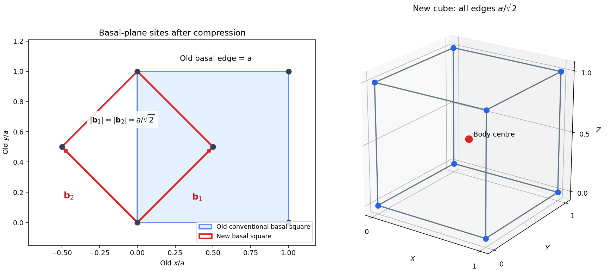

<h1 id="1/c/solution">Solution</h1>

↑ **Parent:** [C](../c.md)

After compression along $z$, let the original conventional edges be $a,a,c$ with $c=a/\sqrt2$. This gives exactly the specified [volume](../../../../volume.md) reduction. The compressed FCC points admit the alternative translation vectors

$$
\mathbf b_1=\frac a2(1,1,0),\qquad
\mathbf b_2=\frac a2(-1,1,0),\qquad
\mathbf b_3=(0,0,a/\sqrt2).
$$

They are mutually perpendicular, have equal length $b=a/\sqrt2$, and form a right-handed cube. Besides its corners, the lattice has the point

$$
\frac{\mathbf b_1+\mathbf b_2+\mathbf b_3}{2}
=(0,a/2,a/(2\sqrt2)),
$$

which is the compressed image of an original FCC face centre. All compressed FCC sites are generated by the cube's integer translations and this body-centre coset. Therefore

$$
\boxed{\text{compressed FCC}\equiv\text{BCC with conventional edge }b=a/\sqrt2.}
$$

The old compressed tetragonal conventional cell has [volume](../../../../volume.md) $a^3/\sqrt2$ and four sites; the new BCC cube has half that [volume](../../../../volume.md) and two sites. This verifies the same physical site density rather than silently losing atoms during the change of cell. The continuous uniaxial deformation is the [Bain path](../../../../bain-path.md), named for [Edgar Bain](../../../../edgar-bain.md).

**[Figure 1](#1/c/image-the-bain-path-a-rotated-conventional-cell-exposes-bcc-geometry). The Bain path: a rotated conventional cell exposes BCC geometry**. Original geometric construction. The basal panel shows the old square and a new square generated by the two diagonal half-translations. The spatial panel uses new-cell coordinates, with corner sites and a body centre. The compressed vertical edge and both new basal edges all have length $a/\sqrt2$. Dots are lattice sites rather than hard-sphere atomic surfaces.

## ↑ Ancestors (12)

1. [C](../c.md)
2. [1](../../1.md)
3. [2014](../../../2014-split.md)
4. [Past exam of the condensed matter physics course of the University of Oxford](../../../split.md)
5. [Condensed matter physics course of the University of Oxford](../../../../condensed-matter-physics-course-of-the-university-of-oxford.md)
6. [Year 3 of the physics course of the University of Oxford](../../../../year-3-of-the-physics-course-of-the-university-of-oxford.md)
7. [Physics course of the University of Oxford](../../../../physics-course-of-the-university-of-oxford.md)
8. [Undergraduate course of the University of Oxford](../../../../undergraduate-course-of-the-university-of-oxford.md)
9. [Course of the University of Oxford](../../../../course-of-the-university-of-oxford.md)
10. [University of Oxford](../../../../university-of-oxford-split.md)
11. [List of universities](../../../../list-of-universities.md)
12. [Codex Wiki](../../../../split.md)
