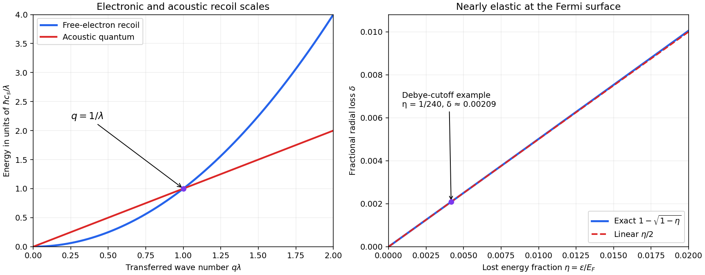

<h1 id="2/d/solution">Solution</h1>

↑ **Parent:** [D](../d.md)

The [electron-acoustic recoil length](../../../../electron-acoustic-recoil-length.md) compares electronic recoil with the acoustic quantum [energy](../../../../energy-split.md) associated with the same [momentum](../../../../momentum-split.md). For transferred wave number $q$,

$$
E_{\rm recoil}(q)=\frac{\hbar^2q^2}{2m_e},\qquad
E_{\rm phonon}(q)=\hbar cq,\qquad
\boxed{\frac{E_{\rm recoil}}{E_{\rm phonon}}=q\lambda.}
$$

The dispersions cross at $q=1/\lambda$; there the reduced [electron](../../../../electron.md) de Broglie wavelength is $\lambda$ and its free-particle group [velocity](../../../../velocity.md) is $2c$. Thus $\lambda$ is the length scale at which an [electron](../../../../electron.md)'s localization/recoil [energy](../../../../energy-split.md) and a corresponding acoustic excitation [energy](../../../../energy-split.md) become comparable. At $q\lambda\gg1$ the [electron](../../../../electron.md) recoil [energy](../../../../energy-split.md) is large compared with the [phonon](../../../../phonon.md) [energy](../../../../energy-split.md); this explains the separation of electronic and acoustic [energy](../../../../energy-split.md) scales when lattice wave numbers exceed $1/\lambda$.

Formally it is half the [Reduced Compton wavelength](../../../../reduced-compton-wavelength.md) with the speed of light replaced by the speed of sound. That is an analogy of scales, not a relativistic [electron](../../../../electron.md) [mass](../../../../mass.md) or a pair-production threshold: sound does not replace the limiting speed in [electron](../../../../electron.md) dynamics. Also it is a reduced-wavelength convention; an ordinary de Broglie wavelength $2\pi/q$ at the crossing is $2\pi\lambda$. No scattering lifetime appears, so $\lambda$ is not an [electron](../../../../electron.md) [mean free path](../../../../mean-free-path.md).

**[Figure 2](#2/d/image-electron-acoustic-recoil-crossover-and-nearly-conserved-fermi-wavevector-magnitude). Electron–acoustic recoil crossover and nearly conserved Fermi-wavevector magnitude**. Original dimensionless dispersion comparison with $q\lambda$ on the horizontal axis. The separate right panel compares the exact radial loss $1-\sqrt{1-\epsilon/E_F}$ to its small-transfer approximation $\epsilon/(2E_F)$; the cutoff-phonon example is marked at $\epsilon/E_F=1/240$. Neither panel is a measured copper dispersion curve.

## ↑ Ancestors (12)

1. [D](../d.md)
2. [2](../../2.md)
3. [2014](../../../2014-split.md)
4. [Past exam of the condensed matter physics course of the University of Oxford](../../../split.md)
5. [Condensed matter physics course of the University of Oxford](../../../../condensed-matter-physics-course-of-the-university-of-oxford.md)
6. [Year 3 of the physics course of the University of Oxford](../../../../year-3-of-the-physics-course-of-the-university-of-oxford.md)
7. [Physics course of the University of Oxford](../../../../physics-course-of-the-university-of-oxford.md)
8. [Undergraduate course of the University of Oxford](../../../../undergraduate-course-of-the-university-of-oxford.md)
9. [Course of the University of Oxford](../../../../course-of-the-university-of-oxford.md)
10. [University of Oxford](../../../../university-of-oxford-split.md)
11. [List of universities](../../../../list-of-universities.md)
12. [Codex Wiki](../../../../split.md)
