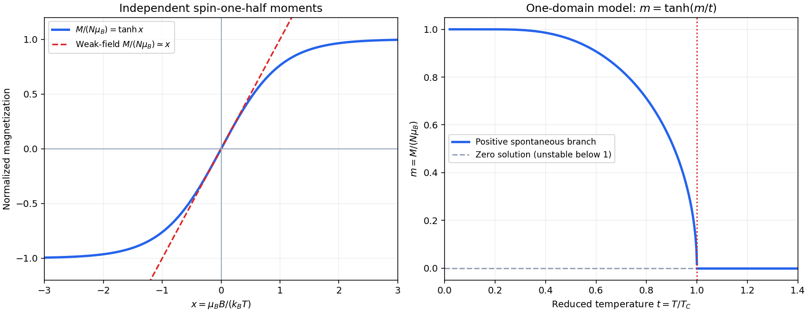

<h1 id="4/c/solution">Solution</h1>

↑ **Parent:** [C](../c.md)

The inverse-susceptibility curve has a Curie–Weiss form above $T_C$ and vanishes on approach to it. The material can have [spontaneous magnetization](../../../../spontaneous-magnetization.md) for $T<T_C$, including the zero-temperature limit, whereas for $T>T_C$ its zero-field equilibrium state is paramagnetic. At a continuous transition the spontaneous moment tends to zero at $T_C$; divergence of differential susceptibility there is not a finite saturated permanent moment.

A simple [Weiss molecular field](../../../../weiss-molecular-field.md) model takes the effective internal field intensity to be $H_{\rm eff}=H+\Lambda M$, with positive coupling $\Lambda$. Let $C$ be the independent-moment Curie constant. Linearizing the single-ion response on the high-temperature side gives

$$
M=\frac CT(H+\Lambda M),\qquad
\boxed{\chi_M=\frac C{T-T_C},\quad T_C=\Lambda C,\quad
\frac1{\chi_M}=\frac{T-T_C}{C}.}
$$

This explains the straight upper branch and its positive [temperature](../../../../temperature-split.md) intercept. At $T_C$ the zero-field linearized response diverges; finite field, finite size and critical fluctuations limit its use. For a spin-only two-state mean-field model the full equation is $m=\tanh[(T_C/T)m+\mu_B\mu_0H/(k_BT)]$, with $m=M/(N\mu_B)$; below $T_C$ it has nonzero zero-field solutions.

An ordering scale near $1000\,\mathrm K$ corresponds to $k_BT_C\simeq0.086\,\mathrm{eV}$, about four orders of magnitude larger than the preceding dipolar pair scale. [Exchange interaction](../../../../exchange-interaction.md) can supply such energies: the Pauli antisymmetry of overlapping [electron](../../../../electron.md) states changes their spatial correlations and hence Coulomb and kinetic energies according to their [spin](../../../../spin.md) configuration. An effective ferromagnetic coupling can favor parallel moments. It is not simply the classical [magnetic field](../../../../magnetic-field-split.md) of a neighbouring dipole. For example, with the convention $\mathcal H=-J\sum_{\langle ij\rangle}\mathbf S_i\cdot\mathbf S_j$ and $J>0$, the localized-spin mean-field scale is $k_BT_C=zJS(S+1)/3$; this illustrates why an atomic electronic interaction, rather than a bare dipolar field, can produce a high transition [temperature](../../../../temperature-split.md).

**[Figure 3](#4/c/image-independent-spin-saturation-and-spontaneous-order-in-a-specified-mean-field-model). Independent-spin saturation and spontaneous order in a specified mean-field model**. Original calculated curves. The left panel compares $\tanh x$ to its weak-field linearization. The right panel solves the zero-field spin-one-half mean-field equation $m=\tanh(m/t)$ on the positive spontaneous branch, with $t=T/T_C$. It depicts one [magnetic domain](../../../../magnetic-domain.md); cancellation between domains is a separate macroscopic effect.

## ↑ Ancestors (12)

1. [C](../c.md)
2. [4](../../4.md)
3. [2014](../../../2014-split.md)
4. [Past exam of the condensed matter physics course of the University of Oxford](../../../split.md)
5. [Condensed matter physics course of the University of Oxford](../../../../condensed-matter-physics-course-of-the-university-of-oxford.md)
6. [Year 3 of the physics course of the University of Oxford](../../../../year-3-of-the-physics-course-of-the-university-of-oxford.md)
7. [Physics course of the University of Oxford](../../../../physics-course-of-the-university-of-oxford.md)
8. [Undergraduate course of the University of Oxford](../../../../undergraduate-course-of-the-university-of-oxford.md)
9. [Course of the University of Oxford](../../../../course-of-the-university-of-oxford.md)
10. [University of Oxford](../../../../university-of-oxford-split.md)
11. [List of universities](../../../../list-of-universities.md)
12. [Codex Wiki](../../../../split.md)
