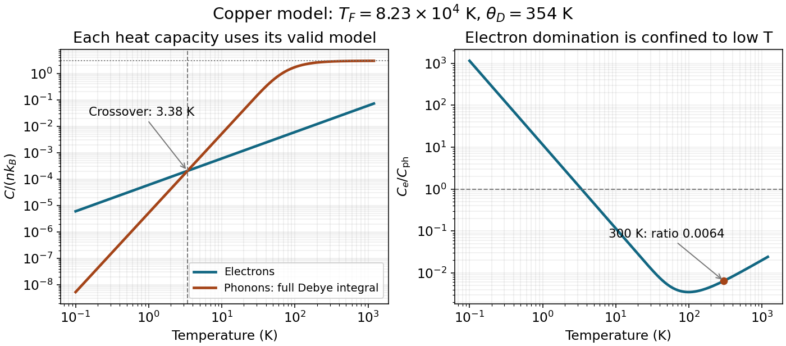
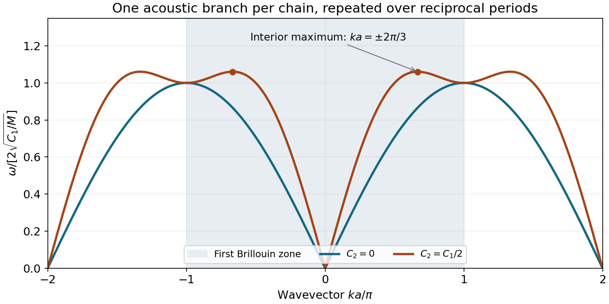
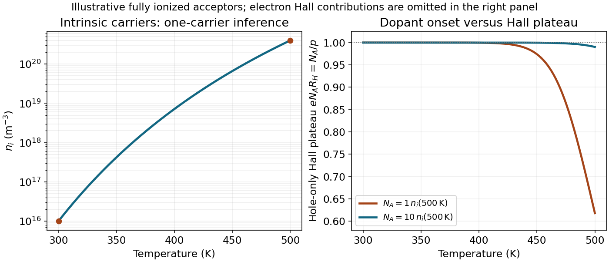

# 2015

↑ **Parent:** [Past exam of the condensed matter physics course of the University of Oxford](../past-exam-of-the-condensed-matter-physics-course-of-the-university-of-oxford.md)

Source paper: [https://www.whatdotheyknow.com/request/oxford_physics_past_papers_2/response/2340696/attach/3/Physics%20Papers%202014.pdf?cookie_passthrough=1.](https://www.whatdotheyknow.com/request/oxford_physics_past_papers_2/response/2340696/attach/3/Physics%20Papers%202014.pdf?cookie_passthrough=1.) The cover identifies the Part B sitting of 15 June 2015, despite the annual bundle's 2014 filename. All four options are solved; lettered subdivisions organize the unlettered marked blocks.

**Table of contents**

- [1](#1)
  - [a](#1/a)
    - [Solution](#1/a/solution)
  - [b](#1/b)
    - [Solution](#1/b/solution)
  - [c](#1/c)
    - [Solution](#1/c/solution)
  - [d](#1/d)
    - [Solution](#1/d/solution)
- [2](#2)
  - [a](#2/a)
    - [Solution](#2/a/solution)
  - [b](#2/b)
    - [Solution](#2/b/solution)
  - [c](#2/c)
    - [Solution](#2/c/solution)
- [3](#3)
  - [a](#3/a)
    - [Solution](#3/a/solution)
  - [b](#3/b)
    - [Solution](#3/b/solution)
  - [c](#3/c)
    - [Solution](#3/c/solution)
- [4](#4)
  - [a](#4/a)
    - [Solution](#4/a/solution)
  - [b](#4/b)
    - [Solution](#4/b/solution)
  - [c](#4/c)
    - [Solution](#4/c/solution)
  - [d](#4/d)
    - [Solution](#4/d/solution)

## 1

↑ **Parent:** [2015](2015.md)

<h3 id="1/a">a</h3>

↑ **Parent:** [1](#1)

<h4 id="1/a/solution">Solution</h4>

↑ **Parent:** [A](#1/a)

Take one conduction [electron](../physics.md#electron) per atom and a three-dimensional [free electron gas](../physics.md#free-electron-model), with [spin degeneracy](../statistical-physics.md#spin-degeneracy) two and [electron](../physics.md#electron) [mass](../classical-mechanics.md#mass) $m_e$. State counting inside the occupied [Fermi sphere](../fermi-liquid.md#fermi-sphere) gives

$$
n=\frac2{(2\pi)^3}\frac{4\pi k_F^3}{3}=\frac{k_F^3}{3\pi^2}.
$$

The highest occupied [energy](../energy.md) at zero [temperature](../temperature.md) is $E_F=\hbar^2k_F^2/(2m_e)$, so

$$
\boxed{T_F=\frac{\hbar^2}{2m_ek_B}(3\pi^2n)^{2/3}}.
$$

This relates the atomic [number density](../statistical-physics.md#number-density) to the [Fermi temperature](../quantum-ideal-gas-statistics.md#fermi-temperature) only because monovalency and the free-electron dispersion have been assumed. A real [energy band](../bloch-s-theorem.md#energy-band) can require a different [density of states](../quantum-ideal-gas-statistics.md#density-of-states) and [band effective mass](../bloch-s-theorem.md#band-effective-mass).

For the isotropic [Debye model](../quantum-ideal-gas-statistics.md#debye-model), count three acoustic [polarizations](../wave.md#polarization-waves) up to one spherical [wavevector](../elasticity-physics.md#wavevector) cutoff $q_D$. The number of vibrational modes per [volume](../geometry-and-topology.md#volume) is

$$
3\frac1{(2\pi)^3}\frac{4\pi q_D^3}{3}=3n,
\qquad q_D=(6\pi^2n)^{1/3}.
$$

With $\omega=cq$ and $\hbar\omega_D=k_B\theta_D$,

$$
\boxed{\theta_D=\frac{\hbar c}{k_B}(6\pi^2n)^{1/3}}.
$$

The effective $c$ is the [Debye sound speed](../quantum-ideal-gas-statistics.md#debye-sound-speed): matching the low-frequency mode density of one longitudinal and two transverse branches requires $3/c^3=1/c_L^3+2/c_T^3$. It is not generally the arithmetic average of their speeds. The cutoff preserves the mode count; it need not coincide with the actual nonspherical [Brillouin zone](../bloch-s-theorem.md#brillouin-zone) boundary.

<h3 id="1/b">b</h3>

↑ **Parent:** [1](#1)

<h4 id="1/b/solution">Solution</h4>

↑ **Parent:** [B](#1/b)

[Pauli exclusion principle](../tensor-product-of-quantum-systems.md#pauli-exclusion-principle) prevents most filled electronic states from changing occupation at $T\ll T_F$. Only a shell of width of order $k_BT$ around the [Fermi energy](../quantum-ideal-gas-statistics.md#fermi-energy) participates. Since the [density of states](../quantum-ideal-gas-statistics.md#density-of-states) near that [energy](../energy.md) is of order $n/E_F$ per [volume](../geometry-and-topology.md#volume) and [energy](../energy.md), the fraction of active [electrons](../physics.md#electron) is of order $k_BT/E_F=T/T_F$. Their typical change of [energy](../energy.md) is of order $k_BT$, so the [thermal energy](../thermodynamics.md#thermal-energy) increment per [volume](../geometry-and-topology.md#volume) scales as

$$
\Delta u_e\sim n\frac{T}{T_F}k_BT.
$$

Differentiating with respect to [temperature](../temperature.md) gives the [electronic heat capacity](../heat.md#electronic-heat-capacity)

$$
\boxed{C_e=A\,nk_B\frac{T}{T_F}}.
$$

The simple shell argument fixes the linear law, not its coefficient. A [Sommerfeld expansion](../quantum-ideal-gas-statistics.md#sommerfeld-expansion) using the spin-summed free-electron [density of states](../quantum-ideal-gas-statistics.md#density-of-states) $g(E_F)=3n/(2E_F)$ gives $C_e=(\pi^2/3)g(E_F)k_B^2T$, hence $A=\pi^2/2$, consistent with the supplied value. The result excludes strong band-structure or interaction corrections and requires a degenerate [electron](../physics.md#electron) population.

<h3 id="1/c">c</h3>

↑ **Parent:** [1](#1)

<h4 id="1/c/solution">Solution</h4>

↑ **Parent:** [C](#1/c)

The [Debye model](../quantum-ideal-gas-statistics.md#debye-model) treats the crystal as an isotropic elastic continuum with independent harmonic vibrational modes. There are three acoustic [polarizations](../wave.md#polarization-waves), approximated by linear dispersions and a common effective speed. A cutoff is chosen to retain $3N$ modes for $N$ atoms. The model neglects anharmonic interactions and the detailed high-wavevector dispersion. In a multi-atom primitive cell, optical branches require additional treatment; copper has one atom per primitive cell even though its conventional cubic cell contains four atoms.

A [frequency](../wave.md#frequency) interval contains, per [volume](../geometry-and-topology.md#volume),

$$
g_{\rm ph}(\omega)\,d\omega=3\frac{4\pi q^2dq}{(2\pi)^3}
=\frac{3\omega^2}{2\pi^2c^3}\,d\omega
=\frac{9n\omega^2}{\omega_D^3}\,d\omega.
$$

Each [phonon](../quantum-ideal-gas-statistics.md#phonon) mode has [Bose-Einstein distribution](../quantum-ideal-gas-statistics.md#bose-einstein-distribution) occupation $(e^{\hbar\omega/(k_BT)}-1)^{-1}$. The fixed [zero-point energy](../quantum-harmonic-oscillator.md#zero-point-energy) contributes no [heat capacity](../heat.md#heat-capacity). Its [thermal energy](../thermodynamics.md#thermal-energy) density is

$$
u_{\rm ph}=\frac{9n\hbar}{\omega_D^3}\int_0^{\omega_D}\frac{\omega^3\,d\omega}{e^{\hbar\omega/(k_BT)}-1}
=9nk_BT\left(\frac{T}{\theta_D}\right)^3\int_0^{\theta_D/T}\frac{x^3\,dx}{e^x-1}.
$$

For $T\ll\theta_D$, extending the upper limit to infinity gives $u_{\rm ph}=(3\pi^4/5)nk_BT^4/\theta_D^3$. Therefore

$$
\boxed{C_{\rm ph}=\frac{12\pi^4}{5}nk_B\left(\frac{T}{\theta_D}\right)^3
=\frac{2\pi^2k_B^4}{5\hbar^3c^3}T^3}.
$$

The cubic law reflects the three-dimensional acoustic mode density proportional to $\omega^2$. It is a low-temperature limit, not a valid extrapolation through the classical high-temperature regime.

<h3 id="1/d">d</h3>

↑ **Parent:** [1](#1)

<h4 id="1/d/solution">Solution</h4>

↑ **Parent:** [D](#1/d)

The conventional [face-centered cubic lattice](../quantum-scattering.md#face-centered-cubic-lattice) cell contains four atoms, so

$$
n=\frac4{(0.36\times10^{-9})^3}=8.57\times10^{28}\ \mathrm{m^{-3}}.
$$

The preceding free-electron and Debye expressions give

$$
\boxed{T_F=8.23\times10^4\ \mathrm K,\qquad \theta_D=354\ \mathrm K},\qquad E_F\simeq7.09\ \mathrm{eV}.
$$

At low [temperature](../temperature.md) the [electronic and lattice heat-capacity crossover in a monovalent metal](../quantum-ideal-gas-statistics.md#electronic-and-lattice-heat-capacity-crossover-in-a-monovalent-metal) is found from

$$
\frac{C_e}{C_{\rm ph}}=\frac{5\theta_D^3}{24\pi^2T_FT^2}=\left(\frac{T_*}{T}\right)^2,
\qquad
\boxed{T_* =\left(\frac{5\theta_D^3}{24\pi^2T_F}\right)^{1/2}=3.38\ \mathrm K}.
$$

Thus the electronic term dominates for $0<T\lesssim3.4$ K within the normal-metal model. Both low-temperature approximations are well controlled at that crossover. At exactly zero [temperature](../temperature.md) both [heat capacities](../heat.md#heat-capacity) vanish; below sufficiently small finite-size [energy](../energy.md) scales a continuum model also needs revision.

Room [temperature](../temperature.md) is not $T\ll\theta_D$: using the cubic formula at 300 K would incorrectly predict $C_{\rm ph}\simeq142nk_B$, far above the harmonic high-temperature limit $3nk_B$. Instead use the [Dulong-Petit law](../heat.md#dulong-petit-law) as an estimate:

$$
\boxed{\frac{C_e}{C_{\rm ph}}\simeq\frac{(\pi^2/2)nk_B(300/T_F)}{3nk_B}
=6.0\times10^{-3}}.
$$

Keeping the finite cutoff in the [Debye heat capacity](../quantum-ideal-gas-statistics.md#debye-heat-capacity) gives

$$
C_{\rm ph}=9nk_B\left(\frac{T}{\theta_D}\right)^3
\int_0^{\theta_D/T}\frac{x^4e^x}{(e^x-1)^2}\,dx.
$$

At 300 K this is $2.8006nk_B$, whereas $C_e=0.017994nk_B$, giving $\boxed{C_e/C_{\rm ph}=6.42\times10^{-3}}$. Either appropriate room-temperature estimate shows that the lattice contribution dominates. The electronic approximation remains excellent because $300\ll T_F$.

**[Figure 1](#1/d/image-electronic-and-full-debye-lattice-heat-capacities-of-the-stated-copper-model-with-the-low-temperature-crossover-and-room-temperature-marked). Electronic and full Debye lattice heat capacities of the stated copper model, with the low-temperature crossover and room temperature marked**.

## 2

↑ **Parent:** [2015](2015.md)

<h3 id="2/a">a</h3>

↑ **Parent:** [2](#2)

<h4 id="2/a/solution">Solution</h4>

↑ **Parent:** [A](#2/a)

The [structure factor](../quantum-scattering.md#structure-factor) is the coherent [scattering amplitude](../quantum-scattering.md#scattering-amplitude) of the contents of a [unit cell](../quantum-scattering.md#unit-cell) at a specified momentum transfer. Contributions from its atoms add with phases fixed by their positions. At a [reciprocal lattice vector](../quantum-scattering.md#reciprocal-lattice-vector) indexed by [Miller indices](../physical-chemistry.md#miller-index), the [crystal basis structure factor](../quantum-scattering.md#crystal-basis-structure-factor) is

$$
\boxed{S_{hkl}=\sum_{j=1}^N f_j(\mathbf Q)\exp[2\pi i(hx_j+ky_j+lz_j)]}.
$$

Changing every phase sign conjugates the amplitude for real scattering factors and leaves the intensity unchanged. The positions here are fractions of the chosen cell edges. An [atomic basis of a crystal](../physical-chemistry.md#atomic-basis-of-a-crystal) should not be confused with a set of primitive translation vectors.

In kinematic elastic scattering the [diffraction intensity](../quantum-scattering.md#diffraction-intensity) of a [Bragg reflection](../quantum-scattering.md#bragg-reflection) is proportional to $|S_{hkl}|^2$, after including geometrical, [polarization](../wave.md#polarization-waves), thermal-displacement and experimental factors. Powder integrated intensities also include multiplicity. The many-cell interference factor selects reciprocal-lattice vectors satisfying the diffraction geometry; the unit-cell factor determines their relative amplitudes and additional extinctions. Ring positions determine spacings through [Bragg's law](../quantum-scattering.md#bragg-s-law), while intensity patterns and systematic absences constrain lattice centering and atomic arrangements. Intensity loses the overall complex phase, so structure determination is not a direct measurement of every individual atomic phase.

X-rays scatter from [electron density](../chemistry.md#electron-density), giving an atomic factor that changes with momentum transfer and chemical charge distribution. Neutrons scatter coherently from nuclei with bound coherent scattering lengths, which need not track [atomic number](../chemical-substance.md#atomic-number); magnetic neutron scattering is an additional channel in magnetic materials. Their different elemental/isotopic contrasts make the two probes complementary.

<h3 id="2/b">b</h3>

↑ **Parent:** [2](#2)

<h4 id="2/b/solution">Solution</h4>

↑ **Parent:** [B](#2/b)

For the four conventional [face-centered cubic lattice](../quantum-scattering.md#face-centered-cubic-lattice) sites $000$, $0\frac12\frac12$, $\frac120\frac12$ and $\frac12\frac120$, their centering factor is

$$
F_{\rm fcc}=1+(-1)^{k+l}+(-1)^{h+l}+(-1)^{h+k}
=\begin{cases}4,&h,k,l\text{ all even or all odd},\\0,&\text{mixed parity}.\end{cases}
$$

This is the [face-centred cubic selection rule](../quantum-scattering.md#face-centred-cubic-selection-rule). Enumerating the nonzero representatives with $h^2+k^2+l^2\le16$ gives

$$
\begin{array}{c|rrrrrr}
(hkl)&111&200&220&311&222&400\\\hline
h^2+k^2+l^2&3&4&8&11&12&16
\end{array}
$$

Symmetry-related permutations and signs belong to the same powder ring, not additional rings. For Al, the basis contains one atom, $S=F_{\rm fcc}f_{\rm Al}$. Thus

$$
\boxed{\mathrm{Al}:\quad111,\ 200,\ 220,\ 311,\ 222,\ 400}.
$$

For the stated KCl basis,

$$
S_{\rm KCl}=F_{\rm fcc}[f_K+(-1)^hf_{\rm Cl}].
$$

The all-even reflections add the two atomic factors; all-odd reflections subtract them. Ionic $K^+$ and $Cl^-$ each have 18 [electrons](../physics.md#electron), giving similar X-ray amplitudes. Their difference is much smaller than their sum, so the 111 and 311 rings are weak. Consequently the four strong rings are

$$
\boxed{\mathrm{KCl}:\quad200,\ 220,\ 222,\ 400}.
$$

This is an [accidental diffraction extinction from equal atomic scattering factors](../quantum-scattering.md#accidental-diffraction-extinction-from-equal-atomic-scattering-factors) in the equal-factor limit, not an extra exact fcc selection rule. Isoelectronic ions can have different radial [electron](../physics.md#electron) distributions, so real odd reflections need not vanish exactly. Even the cruder neutral-atom estimate $f_K\simeq19$, $f_{\rm Cl}\simeq17$ makes the odd/even basis-intensity ratio only $(2/36)^2\simeq0.0031$, before other ring-intensity factors.

For Si's displaced identical basis atoms,

$$
S_{\rm Si}=F_{\rm fcc}f_{\rm Si}\left[1+e^{i\pi(h+k+l)/2}\right].
$$

For all-odd indices, the bracket is $1\pm i$, with squared magnitude 2. For all-even indices it vanishes when $h+k+l=2\pmod4$, and has squared magnitude 4 when the sum is a multiple of four. Thus 200 and 222 vanish, whereas 111, 220, 311 and 400 survive:

$$
\boxed{\mathrm{Si}:\quad111,\ 220,\ 311,\ 400}.
$$

These are the basis extinctions of the ideal [diamond cubic structure](../physical-chemistry.md#diamond-cubic-structure). Intensity strengths within each surviving set can still differ because of atomic factors, multiplicity and geometry.

<h3 id="2/c">c</h3>

↑ **Parent:** [2](#2)

<h4 id="2/c/solution">Solution</h4>

↑ **Parent:** [C](#2/c)

Replacing X-rays by neutrons of the same [wavelength](../wave-equation.md#wavelength) keeps the geometric Bragg positions, but replaces electron-density amplitudes by nuclear coherent scattering lengths. For Al all sites still carry the same nonzero amplitude, so its six reflections remain. For Si the identical two-site basis still has the same destructive-interference conditions, so its four reflections remain. Isotopic randomness can add diffuse/incoherent scattering but does not create a new periodic basis with different systematic Bragg absences.

K and Cl, however, have different nuclear amplitudes despite their isoelectronic ionic [electron](../physics.md#electron) clouds. For natural isotopic composition, $b_K=3.67$ fm and $b_{\rm Cl}=9.577$ fm. The all-odd/all-even basis-intensity ratio becomes

$$
\frac{|b_K-b_{\rm Cl}|^2}{|b_K+b_{\rm Cl}|^2}=0.199,
$$

which is no longer the strong X-ray cancellation. The two odd rings should therefore be observable with suitable sensitivity, giving

$$
\boxed{N_{\rm Al}=6,\qquad N_{\rm KCl}=6,\qquad N_{\rm Si}=4}.
$$

The numerical contrast uses the NIST bound coherent lengths.[Complete table, natural-element K and Cl rows: coherent b in femtometres; also Al and Si rows](../physics-bibliography.md#neutron-scattering-lengths-and-cross-sections-by-nist) Counts here mean allowed and reasonably observable rings in the specified range, assuming sufficient angular coverage and resolution; no theory alone fixes an instrument's intensity threshold. These nonmagnetic examples use nuclear elastic scattering, not magnetic scattering.

## 3

↑ **Parent:** [2015](2015.md)

<h3 id="3/a">a</h3>

↑ **Parent:** [3](#3)

<h4 id="3/a/solution">Solution</h4>

↑ **Parent:** [A](#3/a)

A [phonon](../quantum-ideal-gas-statistics.md#phonon) is one quantum of a collective harmonic [normal mode](../wave-equation.md#normal-mode) of a crystal. A mode labelled by [wavevector](../elasticity-physics.md#wavevector) and branch has energies $E_m=\hbar\omega(m+1/2)$, with bosonic occupation statistics. The [crystal momentum](../bloch-s-theorem.md#crystal-momentum) $\hbar\mathbf k$ is defined modulo a [reciprocal lattice vector](../quantum-scattering.md#reciprocal-lattice-vector); it is not generally the mechanical momentum of one atom. The [phonon dispersion relation](../quantum-ideal-gas-statistics.md#phonon-dispersion-relation) assigns its [frequency](../wave.md#frequency) and [polarization](../wave.md#polarization-waves) to the [wavevector](../elasticity-physics.md#wavevector) and branch.

[Inelastic neutron scattering](../neutron.md#inelastic-neutron-scattering) can measure this relation in a single crystal. Determine the incident neutron [energy](../energy.md) and [wavevector](../elasticity-physics.md#wavevector), scatter at a chosen angle, and analyze the outgoing [energy](../energy.md) by time of flight or a spectrometer analyzer. [Energy](../energy.md) and crystal-momentum conservation give

$$
E_i-E_f=\pm\hbar\omega_s(\mathbf k),\qquad
\mathbf k_i-\mathbf k_f=\mathbf G\pm\mathbf k.
$$

The signs distinguish [phonon](../quantum-ideal-gas-statistics.md#phonon) creation and annihilation with consistent momentum convention. Repeating measurements at different momentum transfers maps peaks in the dynamic scattering response into [phonon](../quantum-ideal-gas-statistics.md#phonon) branches. The measured intensity depends on occupation, scattering factors and the projection of the mode [polarization](../wave.md#polarization-waves) along the momentum transfer; a weak or missing peak need not mean that the corresponding mode does not exist.

<h3 id="3/b">b</h3>

↑ **Parent:** [3](#3)

<h4 id="3/b/solution">Solution</h4>

↑ **Parent:** [B](#3/b)

Let $u_p$ be the longitudinal displacement of atom $p$. Translational invariance and a symmetric harmonic pair force give the [long-range harmonic-chain dispersion](../quantum-ideal-gas-statistics.md#long-range-harmonic-chain-dispersion) equations

$$
M\ddot u_p=\sum_{n\ne0}C_{|n|}(u_{p+n}-u_p)
=\sum_{n>0}C_n(u_{p+n}+u_{p-n}-2u_p).
$$

Use a traveling [normal mode](../wave-equation.md#normal-mode) $u_p=u_0e^{i(kpa-\omega t)}$. Dividing by its nonzero amplitude gives

$$
-M\omega^2=\sum_{n>0}C_n(e^{inka}+e^{-inka}-2)
=-4\sum_{n>0}C_n\sin^2(nka/2).
$$

Hence

$$
\boxed{\omega(k)=\frac2{\sqrt M}\left[\sum_{n>0}C_n\sin^2(nka/2)\right]^{1/2}}.
$$

Positive pair constants give a nonnegative squared [frequency](../wave.md#frequency) and a uniform-translation zero mode. More general signed force constants require checking stability of the entire sum. The [frequency](../wave.md#frequency) is even in $k$ and periodic with $2\pi/a$, reflecting reciprocal-lattice equivalence. The force sum must converge in the model. A finite ordinary acoustic slope additionally requires convergence of $\sum n^2C_n$, in which case $v_s=a\sqrt{\sum n^2C_n/M}$. Both finite-range examples below satisfy this condition.

<h3 id="3/c">c</h3>

↑ **Parent:** [3](#3)

<h4 id="3/c/solution">Solution</h4>

↑ **Parent:** [C](#3/c)

Write $q=ka$ and use $2\sqrt{C_1/M}$ as the [frequency](../wave.md#frequency) unit. The nearest-neighbour chain and its next-nearest-neighbour extension have

$$
\boxed{\omega_1=2\sqrt{\frac{C_1}{M}}\,|\sin(q/2)|},\qquad
\boxed{\omega_2=2\sqrt{\frac{C_1}{M}}\left[\sin^2(q/2)+\frac12\sin^2q\right]^{1/2}}.
$$

These are each a single acoustic branch, repeated over reciprocal-lattice periods. There is no added optical branch merely because a longer-range spring is introduced. The cutoff $C_n=0$ for $|n|>1$ specifies the first chain as nearest-neighbour despite the source's repeated word in its description.

For small $|q|$, $\omega_1\simeq a\sqrt{C_1/M}|k|$ and $\omega_2\simeq a\sqrt{(C_1+4C_2)/M}|k|$. Thus

$$
\boxed{\frac{v_{s,2}}{v_{s,1}}=\sqrt3}.
$$

The maximum is not necessarily at the zone edge. Put $x=\sin^2(q/2)$, so $0\le x\le1$. The second squared dimensionless [frequency](../wave.md#frequency) is

$$
x+2x(1-x)=3x-2x^2=\frac98-2\left(x-\frac34\right)^2.
$$

It reaches its maximum at $x=3/4$, or $q=\pm2\pi/3$ in the first zone. The first chain peaks at $q=\pm\pi$. Therefore

$$
\omega_{1,\max}=2\sqrt{C_1/M},\qquad
\omega_{2,\max}=\frac3{\sqrt2}\sqrt{C_1/M},\qquad
\boxed{\frac{\omega_{2,\max}}{\omega_{1,\max}}=\frac3{2\sqrt2}=1.061}.
$$

At $q=\pm\pi$ both chains have the same [frequency](../wave.md#frequency), but the second chain has already passed its interior maximum. The [next-nearest-neighbour monatomic-chain frequency maximum](../quantum-ideal-gas-statistics.md#next-nearest-neighbour-monatomic-chain-frequency-maximum) is therefore crucial to a correct sketch. Periodic repetition gives the requested curves for all [wavevectors](../elasticity-physics.md#wavevector).

**[Figure 2](#3/c/image-nearest-and-next-nearest-neighbour-monatomic-chain-dispersions-in-repeated-zones-the-second-chain-peaks-inside-the-first-zone). Nearest- and next-nearest-neighbour monatomic-chain dispersions in repeated zones; the second chain peaks inside the first zone**.

## 4

↑ **Parent:** [2015](2015.md)

<h3 id="4/a">a</h3>

↑ **Parent:** [4](#4)

<h4 id="4/a/solution">Solution</h4>

↑ **Parent:** [A](#4/a)

An [intrinsic semiconductor](../semiconductor.md#intrinsic-semiconductor) has thermally generated conduction [electrons](../physics.md#electron) and valence holes, with $n=p=n_i$ at equilibrium in the ideal undoped neutral material. Their abundance is controlled by its [band gap](../bloch-s-theorem.md#band-gap), [temperature](../temperature.md) and band [density of states](../quantum-ideal-gas-statistics.md#density-of-states).

An [extrinsic semiconductor](../semiconductor.md#extrinsic-semiconductor) has its mobile carrier populations substantially modified by electrically active impurities. A [donor impurity](../semiconductor.md#donor-impurity) can supply [electrons](../physics.md#electron), producing n-type material; an [acceptor impurity](../semiconductor.md#acceptor-impurity) can capture a valence [electron](../physics.md#electron) and leave a mobile [electron hole](../quantum-mechanics.md#electron-hole), producing p-type material. Compensation and incomplete ionization can modify these simple counts. At low [temperature](../temperature.md) [dopant freeze-out](../semiconductor.md#dopant-freeze-out) can occur; at sufficiently high [temperature](../temperature.md) intrinsic pair production can overwhelm a fixed dopant density. Doping and the dominant transport regime are related but are not interchangeable descriptions at every [temperature](../temperature.md).

<h3 id="4/b">b</h3>

↑ **Parent:** [4](#4)

<h4 id="4/b/solution">Solution</h4>

↑ **Parent:** [B](#4/b)

Assume nondegenerate three-dimensional parabolic band edges, a fixed gap and approximately temperature-independent density-of-states effective masses. Let $\mu$ be the [chemical potential](../chemical-potential.md), $E_c$ and $E_v$ the band edges, and $N_c,N_v$ their [effective density of states](../semiconductor.md#effective-density-of-states). Boltzmann occupation gives

$$
n=N_c e^{-(E_c-\mu)/(k_BT)},\qquad
p=N_v e^{-(\mu-E_v)/(k_BT)},\qquad E_g=E_c-E_v.
$$

For one spin-degenerate spherical conduction extremum, direct integration of $g_c(E)\propto\sqrt{E-E_c}$ gives

$$
N_c=2\left(\frac{m_c^*k_BT}{2\pi\hbar^2}\right)^{3/2},
$$

and similarly for the [valence band](../quantum-mechanics.md#valence-band) with its appropriate density-of-states [mass](../classical-mechanics.md#mass). Valley and additional band degeneracies can be included in these prefactors. The $T^{3/2}$ factor follows from the integral $\int_0^\infty\sqrt\epsilon\,e^{-\epsilon/(k_BT)}d\epsilon\propto T^{3/2}$.

Multiplication removes the [chemical potential](../chemical-potential.md):

$$
np=N_cN_v e^{-E_g/(k_BT)}.
$$

The [semiconductor mass-action law](../semiconductor.md#semiconductor-mass-action-law) combined with intrinsic [charge neutrality](../electric-charge.md#charge-neutrality), $n=p$, therefore gives

$$
\boxed{n_i=\sqrt{N_cN_v}\,e^{-E_g/(2k_BT)}=AT^{3/2}e^{-E_g/(2k_BT)}}.
$$

The intrinsic [chemical potential](../chemical-potential.md) is not necessarily exactly midgap: $\mu_i=(E_c+E_v)/2+(k_BT/2)\ln(N_v/N_c)$. Equal effective masses are unnecessary for the displayed carrier-density law. A changing gap, effective [mass](../classical-mechanics.md#mass) or degeneracy would make the prefactor or activation law [temperature](../temperature.md) dependent.

<h3 id="4/c">c</h3>

↑ **Parent:** [4](#4)

<h4 id="4/c/solution">Solution</h4>

↑ **Parent:** [C](#4/c)

Choose longitudinal current along $x$, [magnetic field](../magnetic-field.md) along $z$, and define the oriented [Hall coefficient](../relativistic-electromagnetism.md#hall-coefficient) by $R_H=E_y/(j_xB_z)$. For one carrier type with signed charge $q$, a stationary transverse force balance is $q(\mathbf E+\mathbf v\times\mathbf B)_y=0$. Since $(\mathbf v\times\mathbf B)_y=-v_xB_z$, this gives $E_y=v_xB_z$. Using $j_x=nqv_x$,

$$
\boxed{R_H=\frac1{nq}},\qquad R_H=-\frac1{ne}\ \text{for electrons},\quad R_H=+\frac1{pe}\ \text{for holes}.
$$

This is the weak-field isotropic one-carrier approximation with [Hall scattering factor](../relativistic-electromagnetism.md#hall-scattering-factor) one, not a general multiband identity.

Under the stipulated electron-dominated approximation, the given Hall magnitudes imply

$$
n_i(300)=\frac1{e(625)}=9.99\times10^{15}\ \mathrm{m^{-3}},\qquad
n_i(500)=4\times10^4n_i(300)=3.99\times10^{20}\ \mathrm{m^{-3}}.
$$

Take the ratio of the intrinsic activation law:

$$
4\times10^4=\left(\frac{500}{300}\right)^{3/2}
\exp\left[\frac{E_g}{2k_B}\left(\frac1{300}-\frac1{500}\right)\right].
$$

Solving gives the model's activation-gap estimate

$$
\boxed{E_g=\frac{2k_B\ln[4\times10^4(300/500)^{3/2}]}{1/300-1/500}
=2.04\times10^{-19}\ \mathrm J=1.27\ \mathrm{eV}}.
$$

This result uses the supplied Hall-temperature ratio and the fixed-gap, fixed-prefactor assumptions. A temperature-dependent gap or changing Hall factors would modify its interpretation.

The source's description of [electrons](../physics.md#electron) as intrinsic silicon's majority carriers needs qualification. **Intrinsic neutrality gives equal [electron](../physics.md#electron) and hole concentrations**, not an [electron density](../chemistry.md#electron-density) majority. [Electrons](../physics.md#electron) can nevertheless dominate conductivity and the Hall response because their mobility is larger. For two weak-field carriers,

$$
R_H=\frac{p\mu_h^2-n\mu_e^2}{e(p\mu_h+n\mu_e)^2}.
$$

At $n=p=n_i$ this becomes $R_H=-(\mu_e-\mu_h)/[en_i(\mu_e+\mu_h)]$. Thus $\mu_e>\mu_h$ explains the negative sign, while the one-electron formula is quantitatively accurate only if the hole contribution can be neglected. Equality $n=p$ itself is a concrete counterexample to a literal electron-number-majority claim. The numerical deductions above retain the approximation explicitly requested by the source.

<h3 id="4/d">d</h3>

↑ **Parent:** [4](#4)

<h4 id="4/d/solution">Solution</h4>

↑ **Parent:** [D](#4/d)

The sign must become positive, so use p-type [acceptor impurities](../semiconductor.md#acceptor-impurity), such as boron substituting for tetravalent silicon. Assume uncompensated, fully ionized acceptors of density $N_A$, nondegenerate carriers and equilibrium throughout the interval. [Charge neutrality](../electric-charge.md#charge-neutrality) and [mass](../classical-mechanics.md#mass) action give

$$
p-n=N_A,\qquad np=n_i^2,\qquad
\boxed{p=\frac{N_A+\sqrt{N_A^2+4n_i^2}}2,\quad n=\frac{n_i^2}{p}}.
$$

For a nearly constant hole-dominated [Hall coefficient](../relativistic-electromagnetism.md#hall-coefficient), the dopant plateau must persist up to the highest [temperature](../temperature.md). Its necessary concentration scale is therefore

$$
\boxed{N_A\gg n_i(500)\simeq4.0\times10^{20}\ \mathrm{m^{-3}}
=4.0\times10^{14}\ \mathrm{cm^{-3}}}.
$$

The order-of-magnitude onset is $N_A\sim4\times10^{20}\ \mathrm{m^{-3}}$, but equality is not a flat plateau: at $N_A=n_i(500)$, $p/N_A=(1+\sqrt5)/2=1.618$, changing the hole-only [Hall coefficient](../relativistic-electromagnetism.md#hall-coefficient) by about 38 percent. The word approximately does not define a unique sharp minimum without a tolerance.

For $N_A\gg n_i$, $p\simeq N_A[1+(n_i/N_A)^2]$, so the hole-only $R_H\simeq1/(eN_A)$ varies by a fraction of order $(n_i/N_A)^2$. An illustrative one-percent tolerance in that approximation is obtained with $N_A\simeq10n_i(500)=4.0\times10^{21}\ \mathrm{m^{-3}}$. This gives $R_H\simeq+1.56\times10^{-3}\ \mathrm{m^3\,C^{-1}}$ and less than one percent hole-density-induced variation. It is an explicit plateau criterion, not an exact minimum deduced from the unspecified word approximately.

At 300 K the minority [electron](../physics.md#electron) concentration is

$$
\boxed{n(300)\simeq\frac{[9.99\times10^{15}]^2}{N_A}
=2.50\times10^{11}\left(\frac{4.0\times10^{20}\ \mathrm{m^{-3}}}{N_A}\right)\ \mathrm{m^{-3}}}.
$$

Thus the onset-scale estimate gives about $2.5\times10^{11}\ \mathrm{m^{-3}}$, whereas the explicit ten-times-larger plateau choice gives $2.5\times10^{10}\ \mathrm{m^{-3}}$.

The [acceptor density for a stable Hall sign](../relativistic-electromagnetism.md#acceptor-density-for-a-stable-hall-sign) can be more restrictive if both carriers matter. With mobility ratio $r_\mu=\mu_e/\mu_h>1$, positive Hall sign requires $p>r_\mu n_i$, or $N_A>n_i(r_\mu-r_\mu^{-1})$. In the strongly extrinsic limit the full two-carrier Hall correction scales as $(1+r_\mu)^2(n_i/N_A)^2$, not just $(n_i/N_A)^2$. Hence a true measured-Hall tolerance can require a larger dopant density than the hole-only illustration. Mobilities and their [temperature](../temperature.md) dependence are not supplied, so they cannot be used to manufacture a unique sharper minimum.

**[Figure 3](#4/d/image-intrinsic-carrier-activation-and-the-hole-only-hall-plateau-for-two-explicitly-chosen-acceptor-densities-concentrations-are-model-estimates-not-extra-measurements). Intrinsic carrier activation and the hole-only Hall plateau for two explicitly chosen acceptor densities; concentrations are model estimates, not extra measurements**.

## ↑ Ancestors (9)

1. [Past exam of the condensed matter physics course of the University of Oxford](../past-exam-of-the-condensed-matter-physics-course-of-the-university-of-oxford.md)
2. [Condensed matter physics course of the University of Oxford](../university-of-oxford.md#condensed-matter-physics-course-of-the-university-of-oxford)
3. [Year 3 of the physics course of the University of Oxford](../university-of-oxford.md#year-3-of-the-physics-course-of-the-university-of-oxford)
4. [Physics course of the University of Oxford](../university-of-oxford.md#physics-course-of-the-university-of-oxford)
5. [Undergraduate course of the University of Oxford](../university-of-oxford.md#undergraduate-course-of-the-university-of-oxford)
6. [Course of the University of Oxford](../university-of-oxford.md#course-of-the-university-of-oxford)
7. [University of Oxford](../university-of-oxford.md)
8. [List of universities](../README.md#list-of-universities)
9. [Codex Wiki](../README.md)
