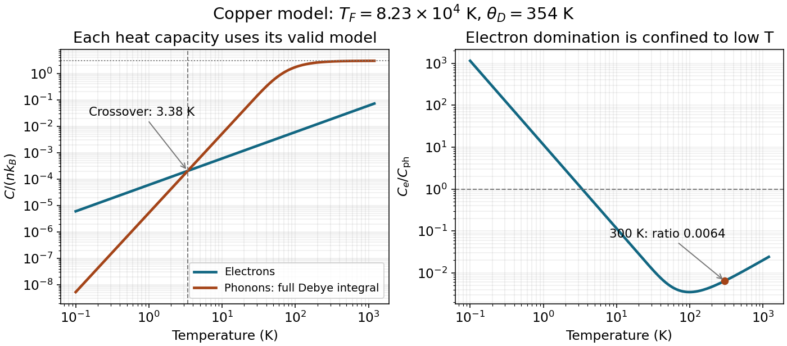

<h1 id="1/d/solution">Solution</h1>

↑ **Parent:** [D](../d.md)

The conventional [face-centered cubic lattice](../../../../face-centered-cubic-lattice.md) cell contains four atoms, so

$$
n=\frac4{(0.36\times10^{-9})^3}=8.57\times10^{28}\ \mathrm{m^{-3}}.
$$

The preceding free-electron and Debye expressions give

$$
\boxed{T_F=8.23\times10^4\ \mathrm K,\qquad \theta_D=354\ \mathrm K},\qquad E_F\simeq7.09\ \mathrm{eV}.
$$

At low [temperature](../../../../temperature-split.md) the [electronic and lattice heat-capacity crossover in a monovalent metal](../../../../electronic-and-lattice-heat-capacity-crossover-in-a-monovalent-metal.md) is found from

$$
\frac{C_e}{C_{\rm ph}}=\frac{5\theta_D^3}{24\pi^2T_FT^2}=\left(\frac{T_*}{T}\right)^2,
\qquad
\boxed{T_* =\left(\frac{5\theta_D^3}{24\pi^2T_F}\right)^{1/2}=3.38\ \mathrm K}.
$$

Thus the electronic term dominates for $0<T\lesssim3.4$ K within the normal-metal model. Both low-temperature approximations are well controlled at that crossover. At exactly zero [temperature](../../../../temperature-split.md) both [heat capacities](../../../../heat-capacity.md) vanish; below sufficiently small finite-size [energy](../../../../energy-split.md) scales a continuum model also needs revision.

Room [temperature](../../../../temperature-split.md) is not $T\ll\theta_D$: using the cubic formula at 300 K would incorrectly predict $C_{\rm ph}\simeq142nk_B$, far above the harmonic high-temperature limit $3nk_B$. Instead use the [Dulong-Petit law](../../../../dulong-petit-law.md) as an estimate:

$$
\boxed{\frac{C_e}{C_{\rm ph}}\simeq\frac{(\pi^2/2)nk_B(300/T_F)}{3nk_B}
=6.0\times10^{-3}}.
$$

Keeping the finite cutoff in the [Debye heat capacity](../../../../debye-heat-capacity.md) gives

$$
C_{\rm ph}=9nk_B\left(\frac{T}{\theta_D}\right)^3
\int_0^{\theta_D/T}\frac{x^4e^x}{(e^x-1)^2}\,dx.
$$

At 300 K this is $2.8006nk_B$, whereas $C_e=0.017994nk_B$, giving $\boxed{C_e/C_{\rm ph}=6.42\times10^{-3}}$. Either appropriate room-temperature estimate shows that the lattice contribution dominates. The electronic approximation remains excellent because $300\ll T_F$.

**[Figure 1](#1/d/image-electronic-and-full-debye-lattice-heat-capacities-of-the-stated-copper-model-with-the-low-temperature-crossover-and-room-temperature-marked). Electronic and full Debye lattice heat capacities of the stated copper model, with the low-temperature crossover and room temperature marked**.

## ↑ Ancestors (12)

1. [D](../d.md)
2. [1](../../1.md)
3. [2015](../../../2015-split.md)
4. [Past exam of the condensed matter physics course of the University of Oxford](../../../split.md)
5. [Condensed matter physics course of the University of Oxford](../../../../condensed-matter-physics-course-of-the-university-of-oxford.md)
6. [Year 3 of the physics course of the University of Oxford](../../../../year-3-of-the-physics-course-of-the-university-of-oxford.md)
7. [Physics course of the University of Oxford](../../../../physics-course-of-the-university-of-oxford.md)
8. [Undergraduate course of the University of Oxford](../../../../undergraduate-course-of-the-university-of-oxford.md)
9. [Course of the University of Oxford](../../../../course-of-the-university-of-oxford.md)
10. [University of Oxford](../../../../university-of-oxford-split.md)
11. [List of universities](../../../../list-of-universities.md)
12. [Codex Wiki](../../../../split.md)
