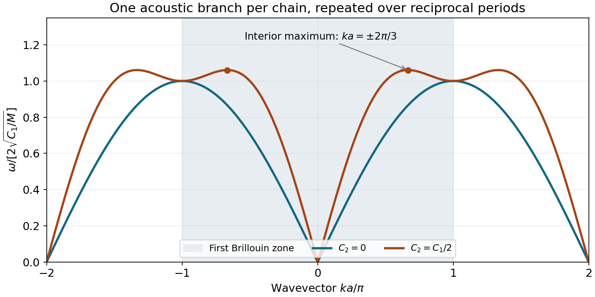

<h1 id="3/c/solution">Solution</h1>

↑ **Parent:** [C](../c.md)

Write $q=ka$ and use $2\sqrt{C_1/M}$ as the [frequency](../../../../frequency.md) unit. The nearest-neighbour chain and its next-nearest-neighbour extension have

$$
\boxed{\omega_1=2\sqrt{\frac{C_1}{M}}\,|\sin(q/2)|},\qquad
\boxed{\omega_2=2\sqrt{\frac{C_1}{M}}\left[\sin^2(q/2)+\frac12\sin^2q\right]^{1/2}}.
$$

These are each a single acoustic branch, repeated over reciprocal-lattice periods. There is no added optical branch merely because a longer-range spring is introduced. The cutoff $C_n=0$ for $|n|>1$ specifies the first chain as nearest-neighbour despite the source's repeated word in its description.

For small $|q|$, $\omega_1\simeq a\sqrt{C_1/M}|k|$ and $\omega_2\simeq a\sqrt{(C_1+4C_2)/M}|k|$. Thus

$$
\boxed{\frac{v_{s,2}}{v_{s,1}}=\sqrt3}.
$$

The maximum is not necessarily at the zone edge. Put $x=\sin^2(q/2)$, so $0\le x\le1$. The second squared dimensionless [frequency](../../../../frequency.md) is

$$
x+2x(1-x)=3x-2x^2=\frac98-2\left(x-\frac34\right)^2.
$$

It reaches its maximum at $x=3/4$, or $q=\pm2\pi/3$ in the first zone. The first chain peaks at $q=\pm\pi$. Therefore

$$
\omega_{1,\max}=2\sqrt{C_1/M},\qquad
\omega_{2,\max}=\frac3{\sqrt2}\sqrt{C_1/M},\qquad
\boxed{\frac{\omega_{2,\max}}{\omega_{1,\max}}=\frac3{2\sqrt2}=1.061}.
$$

At $q=\pm\pi$ both chains have the same [frequency](../../../../frequency.md), but the second chain has already passed its interior maximum. The [next-nearest-neighbour monatomic-chain frequency maximum](../../../../next-nearest-neighbour-monatomic-chain-frequency-maximum.md) is therefore crucial to a correct sketch. Periodic repetition gives the requested curves for all [wavevectors](../../../../wavevector.md).

**[Figure 2](#3/c/image-nearest-and-next-nearest-neighbour-monatomic-chain-dispersions-in-repeated-zones-the-second-chain-peaks-inside-the-first-zone). Nearest- and next-nearest-neighbour monatomic-chain dispersions in repeated zones; the second chain peaks inside the first zone**.

## ↑ Ancestors (12)

1. [C](../c.md)
2. [3](../../3.md)
3. [2015](../../../2015-split.md)
4. [Past exam of the condensed matter physics course of the University of Oxford](../../../split.md)
5. [Condensed matter physics course of the University of Oxford](../../../../condensed-matter-physics-course-of-the-university-of-oxford.md)
6. [Year 3 of the physics course of the University of Oxford](../../../../year-3-of-the-physics-course-of-the-university-of-oxford.md)
7. [Physics course of the University of Oxford](../../../../physics-course-of-the-university-of-oxford.md)
8. [Undergraduate course of the University of Oxford](../../../../undergraduate-course-of-the-university-of-oxford.md)
9. [Course of the University of Oxford](../../../../course-of-the-university-of-oxford.md)
10. [University of Oxford](../../../../university-of-oxford-split.md)
11. [List of universities](../../../../list-of-universities.md)
12. [Codex Wiki](../../../../split.md)
