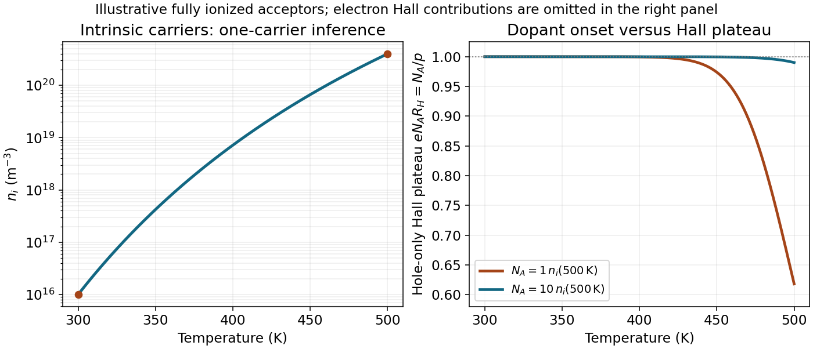

<h1 id="4/d/solution">Solution</h1>

↑ **Parent:** [D](../d.md)

The sign must become positive, so use p-type [acceptor impurities](../../../../acceptor-impurity.md), such as boron substituting for tetravalent silicon. Assume uncompensated, fully ionized acceptors of density $N_A$, nondegenerate carriers and equilibrium throughout the interval. [Charge neutrality](../../../../charge-neutrality.md) and [mass](../../../../mass.md) action give

$$
p-n=N_A,\qquad np=n_i^2,\qquad
\boxed{p=\frac{N_A+\sqrt{N_A^2+4n_i^2}}2,\quad n=\frac{n_i^2}{p}}.
$$

For a nearly constant hole-dominated [Hall coefficient](../../../../hall-coefficient.md), the dopant plateau must persist up to the highest [temperature](../../../../temperature-split.md). Its necessary concentration scale is therefore

$$
\boxed{N_A\gg n_i(500)\simeq4.0\times10^{20}\ \mathrm{m^{-3}}
=4.0\times10^{14}\ \mathrm{cm^{-3}}}.
$$

The order-of-magnitude onset is $N_A\sim4\times10^{20}\ \mathrm{m^{-3}}$, but equality is not a flat plateau: at $N_A=n_i(500)$, $p/N_A=(1+\sqrt5)/2=1.618$, changing the hole-only [Hall coefficient](../../../../hall-coefficient.md) by about 38 percent. The word approximately does not define a unique sharp minimum without a tolerance.

For $N_A\gg n_i$, $p\simeq N_A[1+(n_i/N_A)^2]$, so the hole-only $R_H\simeq1/(eN_A)$ varies by a fraction of order $(n_i/N_A)^2$. An illustrative one-percent tolerance in that approximation is obtained with $N_A\simeq10n_i(500)=4.0\times10^{21}\ \mathrm{m^{-3}}$. This gives $R_H\simeq+1.56\times10^{-3}\ \mathrm{m^3\,C^{-1}}$ and less than one percent hole-density-induced variation. It is an explicit plateau criterion, not an exact minimum deduced from the unspecified word approximately.

At 300 K the minority [electron](../../../../electron.md) concentration is

$$
\boxed{n(300)\simeq\frac{[9.99\times10^{15}]^2}{N_A}
=2.50\times10^{11}\left(\frac{4.0\times10^{20}\ \mathrm{m^{-3}}}{N_A}\right)\ \mathrm{m^{-3}}}.
$$

Thus the onset-scale estimate gives about $2.5\times10^{11}\ \mathrm{m^{-3}}$, whereas the explicit ten-times-larger plateau choice gives $2.5\times10^{10}\ \mathrm{m^{-3}}$.

The [acceptor density for a stable Hall sign](../../../../acceptor-density-for-a-stable-hall-sign.md) can be more restrictive if both carriers matter. With mobility ratio $r_\mu=\mu_e/\mu_h>1$, positive Hall sign requires $p>r_\mu n_i$, or $N_A>n_i(r_\mu-r_\mu^{-1})$. In the strongly extrinsic limit the full two-carrier Hall correction scales as $(1+r_\mu)^2(n_i/N_A)^2$, not just $(n_i/N_A)^2$. Hence a true measured-Hall tolerance can require a larger dopant density than the hole-only illustration. Mobilities and their [temperature](../../../../temperature-split.md) dependence are not supplied, so they cannot be used to manufacture a unique sharper minimum.

**[Figure 3](#4/d/image-intrinsic-carrier-activation-and-the-hole-only-hall-plateau-for-two-explicitly-chosen-acceptor-densities-concentrations-are-model-estimates-not-extra-measurements). Intrinsic carrier activation and the hole-only Hall plateau for two explicitly chosen acceptor densities; concentrations are model estimates, not extra measurements**.

## ↑ Ancestors (12)

1. [D](../d.md)
2. [4](../../4.md)
3. [2015](../../../2015-split.md)
4. [Past exam of the condensed matter physics course of the University of Oxford](../../../split.md)
5. [Condensed matter physics course of the University of Oxford](../../../../condensed-matter-physics-course-of-the-university-of-oxford.md)
6. [Year 3 of the physics course of the University of Oxford](../../../../year-3-of-the-physics-course-of-the-university-of-oxford.md)
7. [Physics course of the University of Oxford](../../../../physics-course-of-the-university-of-oxford.md)
8. [Undergraduate course of the University of Oxford](../../../../undergraduate-course-of-the-university-of-oxford.md)
9. [Course of the University of Oxford](../../../../course-of-the-university-of-oxford.md)
10. [University of Oxford](../../../../university-of-oxford-split.md)
11. [List of universities](../../../../list-of-universities.md)
12. [Codex Wiki](../../../../split.md)
