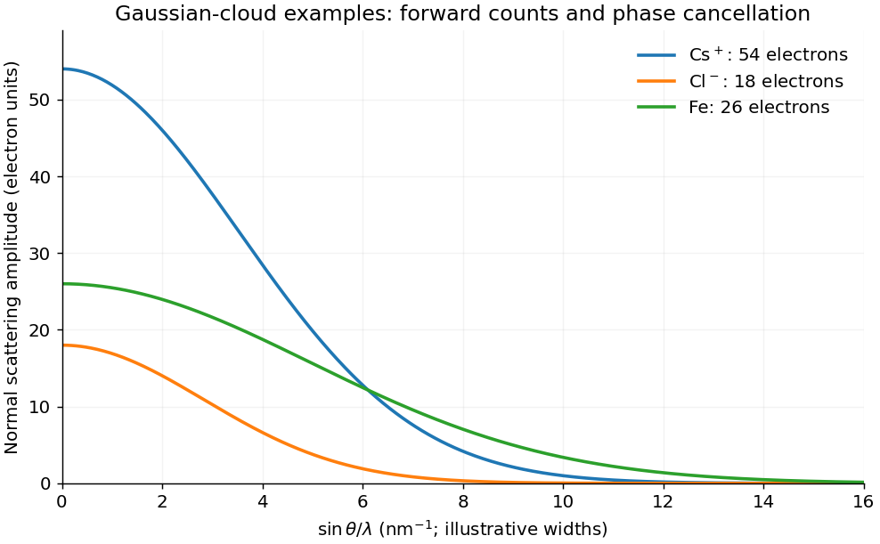
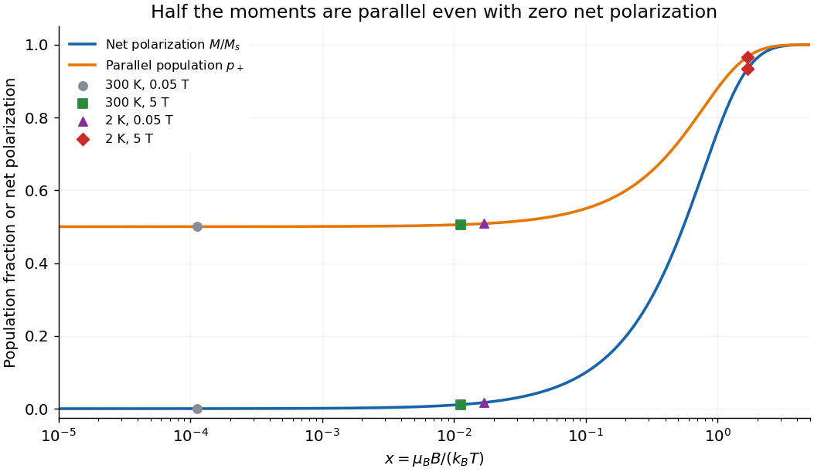
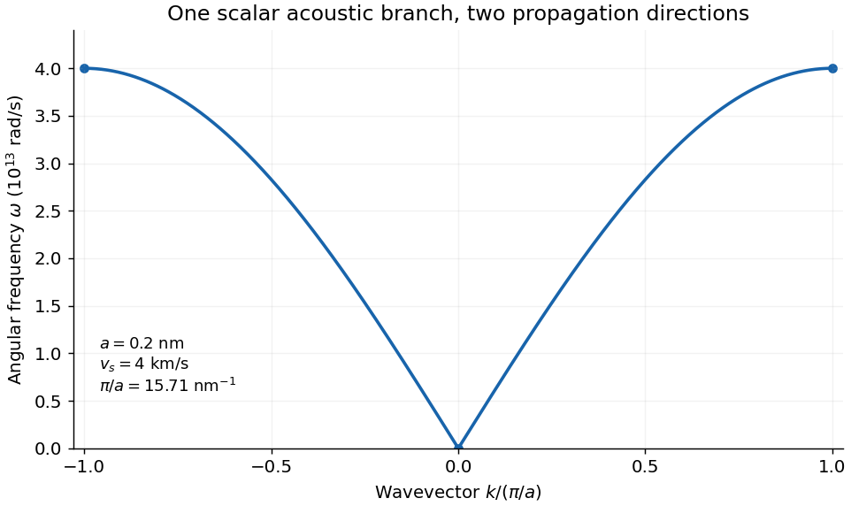
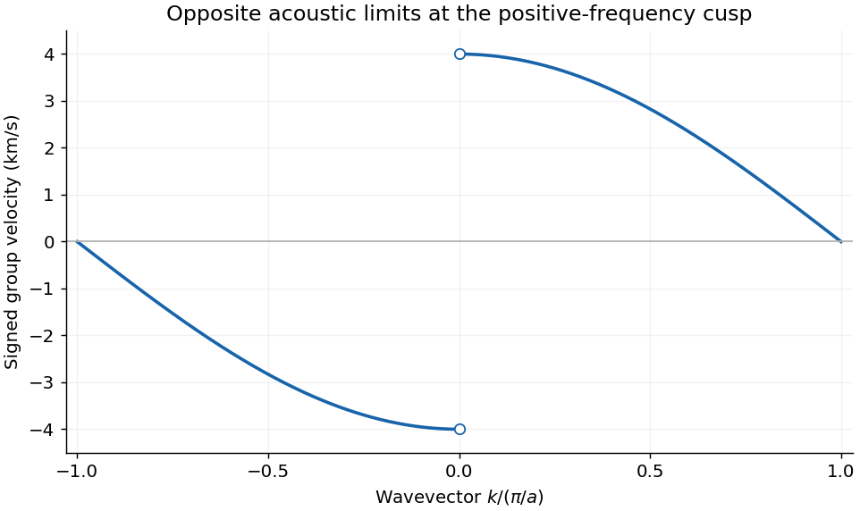
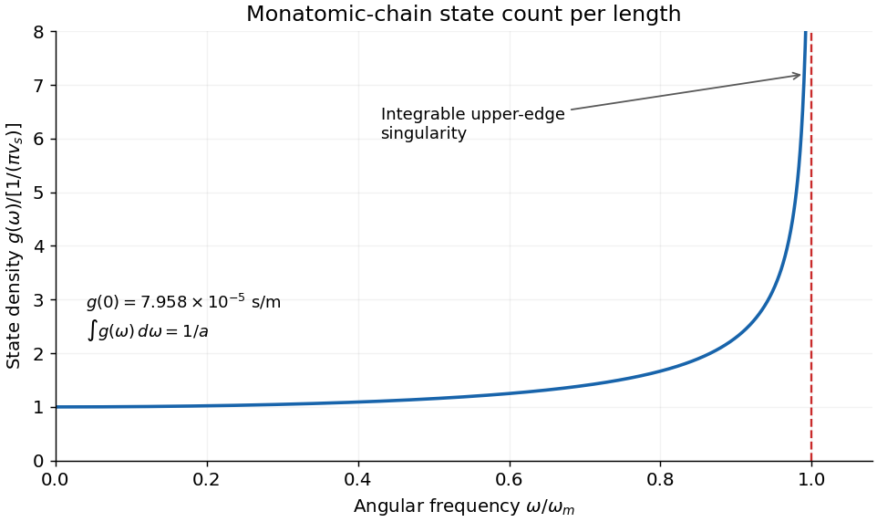
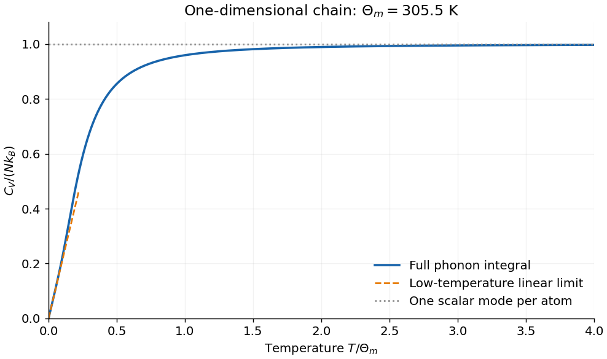

# 2016

↑ **Parent:** [Past exam of the condensed matter physics course of the University of Oxford](../past-exam-of-the-condensed-matter-physics-course-of-the-university-of-oxford.md)

Source paper: [https://www.whatdotheyknow.com/request/physics_past_exam_papers_2015_16/response/973997/attach/3/Cowell%20Attachment.zip?cookie_passthrough=1](https://www.whatdotheyknow.com/request/physics_past_exam_papers_2015_16/response/973997/attach/3/Cowell%20Attachment.zip?cookie_passthrough=1)

**Table of contents**

- [1](#1)
  - [a](#1/a)
    - [Solution](#1/a/solution)
  - [b](#1/b)
    - [Solution](#1/b/solution)
  - [c](#1/c)
    - [Solution](#1/c/solution)
    - [i](#1/c/i)
      - [Solution](#1/c/i/solution)
    - [ii](#1/c/ii)
      - [Solution](#1/c/ii/solution)
- [2](#2)
  - [a](#2/a)
    - [Solution](#2/a/solution)
  - [b](#2/b)
    - [Solution](#2/b/solution)
  - [c](#2/c)
    - [i](#2/c/i)
      - [Solution](#2/c/i/solution)
    - [ii](#2/c/ii)
      - [Solution](#2/c/ii/solution)
- [3](#3)
  - [a](#3/a)
    - [Solution](#3/a/solution)
  - [b](#3/b)
    - [Solution](#3/b/solution)
    - [i](#3/b/i)
      - [Solution](#3/b/i/solution)
    - [ii](#3/b/ii)
      - [Solution](#3/b/ii/solution)
- [4](#4)
  - [a](#4/a)
    - [Solution](#4/a/solution)
  - [b](#4/b)
    - [Solution](#4/b/solution)
  - [c](#4/c)
    - [i](#4/c/i)
      - [Solution](#4/c/i/solution)
    - [ii](#4/c/ii)
      - [Solution](#4/c/ii/solution)
    - [iii](#4/c/iii)
      - [Solution](#4/c/iii/solution)
    - [iv](#4/c/iv)
      - [Solution](#4/c/iv/solution)

## 1

↑ **Parent:** [2016](2016.md)

<h3 id="1/a">a</h3>

↑ **Parent:** [1](#1)

<h4 id="1/a/solution">Solution</h4>

↑ **Parent:** [A](#1/a)

Take $(x_j,y_j,z_j)$ as fractional coordinates in the chosen [unit cell](../quantum-scattering.md#unit-cell). In the kinematic approximation the [crystal basis structure factor](../quantum-scattering.md#crystal-basis-structure-factor) is

$$
\boxed{F(hkl)=\sum_j f_j(Q)\exp[2\pi i(hx_j+ky_j+lz_j)]},\qquad Q=\frac{4\pi\sin\theta}{\lambda}.
$$

Equivalently, in Cartesian coordinates the phase is $\mathbf G_{hkl}\cdot\mathbf r_j$. Reversing every phase sign complex-conjugates the nonabsorbing amplitude and leaves its [intensity](../wave.md#intensity-physics) unchanged. The [atomic scattering factor](../quantum-scattering.md#atomic-scattering-factor) is the [Fourier transform](../fourier-transform.md) of the [atom](../physics.md#atom-physics)'s [electron density](../statistical-physics.md#electron-number-density), in [electron](../physics.md#electron) scattering units:

$$
f_j(\mathbf Q)=\int\rho_{e,j}(\mathbf r)e^{i\mathbf Q\cdot\mathbf r}\,d^3r.
$$

At zero [scattering angle](../quantum-scattering.md#bragg-angle) the normal form factor counts [electrons](../physics.md#electron): $f_j(0)=Z_j$ for a neutral [atom](../physics.md#atom-physics), modified by the ionic charge for an [ion](../chemistry.md#ion). At increasing $Q$, different parts of the [electron](../physics.md#electron) cloud scatter with different phases, reducing the coherent amplitude. Typical nonresonant [atomic curves](../quantum-scattering.md#atomic-scattering-factor) fall from their forward value toward small values at large angle. A localized cloud falls more slowly in reciprocal space. Anomalous scattering near an absorption edge adds energy-dependent complex terms and is excluded from this simple sketch.

For a fixed reflection and fixed instrumental and geometric corrections,

$$
\boxed{I_{hkl}\propto|F(hkl)|^2.}
$$

The full amplitude also contains the lattice sum. At its [reciprocal-lattice](../quantum-scattering.md#reciprocal-lattice) peak, $N_c$ coherently illuminated identical cells give a peak amplitude $N_cF$; peak height and integrated peak [intensity](../wave.md#intensity-physics) have different size dependences because the peak narrows with [crystal](../thermodynamics.md#crystal) size. Powder multiplicity, polarization, absorption, [thermal motion](../statistical-physics.md#thermal-fluctuation) and measurement geometry also affect observed [intensities](../wave.md#intensity-physics). The basis factor determines relative [interference](../physical-optics.md#interference-wave-propagation), not every experimental prefactor.

**[Figure 1](#1/a/image-forward-electron-counts-and-decreasing-atomic-scattering-amplitudes). Forward electron counts and decreasing atomic scattering amplitudes**. Original Gaussian-cloud illustrations for Cs+, Cl- and Fe, with their correct electron counts at zero transfer. Cloud widths are illustrative rather than tabulated atomic form-factor fits; the horizontal variable increases with scattering angle at fixed wavelength.

<h3 id="1/b">b</h3>

↑ **Parent:** [1](#1)

<h4 id="1/b/solution">Solution</h4>

↑ **Parent:** [B](#1/b)

The two sites give phases one and $\exp[i\pi(h+k+l)]=(-1)^{h+k+l}$. Thus

$$
F_{\rm CsCl}=f_{\rm Cs^+}+(-1)^{h+k+l}f_{\rm Cl^-},\qquad
\boxed{I_{hkl}=K_{hkl}\left|f_{\rm Cs^+}+(-1)^{h+k+l}f_{\rm Cl^-}\right|^2.}
$$

For real nonresonant [form factors](../quantum-scattering.md#atomic-scattering-factor), even $h+k+l$ gives the square of the sum and odd $h+k+l$ the square of the difference. The factor $K_{hkl}$ represents the remaining experimental corrections, not another basis-interference term. Since the two [ions](../chemistry.md#ion) differ, a half-body-diagonal translation does not preserve the decorated [crystal](../thermodynamics.md#crystal). Its [Bravais lattice](../quantum-scattering.md#bravais-lattice) is therefore [simple cubic](../quantum-scattering.md#primitive-cubic-lattice), with a two-ion basis; [CsCl](../physical-chemistry.md#caesium-chloride-structure) is not a monatomic [body-centered cubic](../quantum-scattering.md#body-centered-cubic-lattice) [Bravais lattice](../quantum-scattering.md#bravais-lattice).

Replacing **both** sites by identical Fe [atoms](../physics.md#atom-physics) changes the amplitude to

$$
F_{\rm Fe}=f_{\rm Fe}[1+(-1)^{h+k+l}],\qquad
\boxed{I_{hkl}^{\rm Fe}=\begin{cases}4K_{hkl}|f_{\rm Fe}|^2,&h+k+l\text{ even},\\0,&h+k+l\text{ odd}.\end{cases}}
$$

Now the body-centering translation does preserve the structure. It is a [body-centered cubic lattice](../quantum-scattering.md#body-centered-cubic-lattice) with one Fe [atom](../physics.md#atom-physics) per [primitive cell](../quantum-scattering.md#primitive-unit-cell), or two per conventional cubic cell.

For 111 the parity is odd: [CsCl](../physical-chemistry.md#caesium-chloride-structure) generally has a nonzero amplitude $f_{\rm Cs^+}-f_{\rm Cl^-}$, whereas the identical-Fe 111 reflection is systematically absent. A numerical absolute [CsCl](../physical-chemistry.md#caesium-chloride-structure) [intensity](../wave.md#intensity-physics) requires the angle-dependent [form factors](../quantum-scattering.md#atomic-scattering-factor) and experimental normalization; no such values are supplied. Forward [electron](../physics.md#electron) counts, 54 for Cs+ and 18 for Cl-, explain why their amplitudes are substantially unequal, but are not substituted for the actual finite-angle factors without an additional approximation.

<h3 id="1/c">c</h3>

↑ **Parent:** [1](#1)

<h4 id="1/c/solution">Solution</h4>

↑ **Parent:** [C](#1/c)

The isothermal volume [compressibility](../thermodynamics.md#isothermal-compressibility) is $\kappa=-(1/V)(\partial V/\partial p)_T$. For isotropic cubic compression $V\propto a^3$ and $d_{hkl}=a/\sqrt{h^2+k^2+l^2}$, so

$$
\frac1{d_{hkl}}\left(\frac{\partial d_{hkl}}{\partial p}\right)_T
=\frac1a\left(\frac{\partial a}{\partial p}\right)_T=-\frac\kappa3.
$$

[Differentiate](../calculus.md#derivative) [Bragg's law](../quantum-scattering.md#bragg-s-law) $2d_{hkl}\sin\theta=\lambda$ at fixed incident [wavelength](../wave-equation.md#wavelength) and fixed reflection:

$$
0=\sin\theta\frac{\partial d}{\partial p}+d\cos\theta\frac{\partial\theta}{\partial p},
\qquad\boxed{\left(\frac{\partial\theta}{\partial p}\right)_T=\frac\kappa3\tan\theta,\quad\alpha=\frac13.}
$$

This [derivative](../calculus.md#derivative) uses radians. It remains locally valid with a pressure-dependent [compressibility](../thermodynamics.md#isothermal-compressibility), provided the cubic isotropic phase is retained. For a constant stipulated $\kappa$, integration gives

$$
\boxed{a(p)=a_0e^{-\kappa p/3},\qquad
\sin\theta(p)=\sin\theta_0e^{\kappa p/3}.}
$$

Thus $a_0(1-\kappa p/3)$ is only the first-order approximation, not the exact consequence of a constant logarithmic [compressibility](../thermodynamics.md#isothermal-compressibility). The finite-pressure calculation also assumes that the reflection still exists, the [crystal](../thermodynamics.md#crystal) remains in the same structure and $\sin\theta_0e^{\kappa p/3}\leq1$. These limitations matter for a large extrapolation.

<h4 id="1/c/i">i</h4>

↑ **Parent:** [C](#1/c)

<h5 id="1/c/i/solution">Solution</h5>

↑ **Parent:** [I](#1/c/i)

The 110 plane spacing of the conventional cubic cell is

$$
d_{110}(0)=\frac{0.287}{\sqrt2}\ \mathrm{nm}=0.202940\ \mathrm{nm}.
$$

For the first-order Bragg condition,

$$
\sin\theta_0=\frac{\lambda}{2d_{110}}
=\frac{0.154\sqrt2}{2(0.287)}=0.37942\ldots,
\qquad\boxed{2\theta_0=44.596^\circ.}
$$

The quoted experimental deflection is twice the angle between the beam and the reflecting planes; reporting only $22.298^\circ$ would report the [Bragg angle](../quantum-scattering.md#bragg-angle) instead of the requested [scattering angle](../quantum-scattering.md#bragg-angle). The 110 reflection is allowed for the identical-Fe body-centered lattice because $1+1+0$ is even. [Wavelength](../wave-equation.md#wavelength) and spacing have been expressed in the same units, so their ratio is dimensionless. Higher Bragg orders are conventionally represented by the corresponding higher-index reflection, rather than inserted as an unannounced extra order here.

<h4 id="1/c/ii">ii</h4>

↑ **Parent:** [C](#1/c)

<h5 id="1/c/ii/solution">Solution</h5>

↑ **Parent:** [Ii](#1/c/ii)

Use the integrated constant-compressibility model from [c](#1/c), with $\kappa p=0.0059\times100=0.59$:

$$
a(100)=0.287e^{-0.59/3}\ \mathrm{nm}=0.235760\ \mathrm{nm},\qquad
\sin\theta(100)=0.37942\ldots e^{0.59/3}.
$$

Therefore

$$
\boxed{2\theta(100\ \mathrm{GPa})=55.018^\circ.}
$$

Compression reduces the spacing and moves the same allowed reflection to larger deflection, as the positive [pressure](../pressure.md) [derivative](../calculus.md#derivative) predicts. The input [compressibility](../thermodynamics.md#isothermal-compressibility) corresponds to a constant [bulk modulus](../elasticity-physics.md#bulk-modulus) $1/\kappa\simeq169.5$ GPa in this ideal model.

This is the stipulated **unchanged cubic-phase, constant-compressibility extrapolation**, rather than a reliable prediction for real Fe at 100 GPa. Real Fe exhibits a pressure-induced [body-centered-cubic](../quantum-scattering.md#body-centered-cubic-lattice) to [hexagonal-close-packed](../physical-chemistry.md#hexagonal-close-packed-structure) transformation, and [compressibility](../thermodynamics.md#isothermal-compressibility) can change with [pressure](../pressure.md).[2008 primary diffraction study, abstract: pressure-driven structural transformation in Fe](https://journals.aps.org/prb/abstract/10.1103/PhysRevB.78.220101) A real high-pressure [diffraction](../quantum-scattering.md#x-ray-diffraction) interpretation would require its actual phase and [equation of state](../pressure.md#equation-of-state). The source gives neither, so its numerical exercise is answered within its explicitly stated idealization.

## 2

↑ **Parent:** [2016](2016.md)

<h3 id="2/a">a</h3>

↑ **Parent:** [2](#2)

<h4 id="2/a/solution">Solution</h4>

↑ **Parent:** [A](#2/a)

In the [free electron model](../physics.md#free-electron-model), [conduction electrons](../quantum-mechanics.md#conduction-electron) occupy independent [plane-wave](../wave-function.md#plane-wave) states with [energy](../energy.md) $\varepsilon_{\mathbf k}=\hbar^2k^2/(2m)$ in a uniform mean background. [Crystal-periodic](../bloch-s-theorem.md#periodic-potential) band structure and explicit [electron](../physics.md#electron)–[electron](../physics.md#electron) correlations are omitted. [Electrons](../physics.md#electron) still obey the [Pauli exclusion principle](../tensor-product-of-quantum-systems.md#pauli-exclusion-principle) and [Fermi–Dirac statistics](../tensor-product-of-quantum-systems.md#fermi-dirac-statistics); free does not mean distinguishable classical particles. A scattering time can be added phenomenologically to describe transport.

The [Fermi energy](../quantum-ideal-gas-statistics.md#fermi-energy) is the highest occupied single-particle [energy](../energy.md) at zero [temperature](../temperature.md), measured here from the bottom of the [parabolic band](../bloch-s-theorem.md#parabolic-band-dispersion). The [Fermi temperature](../quantum-ideal-gas-statistics.md#fermi-temperature) is the corresponding scale $T_F=E_F/k_B$, not the actual [thermal temperature](../temperature.md) of the sample. Metallic [electron](../physics.md#electron) densities are large, so filling all distinct states up to the required [momentum](../momentum.md) gives [Fermi energies](../quantum-ideal-gas-statistics.md#fermi-energy) of several electronvolts, equivalent to tens of thousands of kelvin or more. At ordinary [temperatures](../temperature.md), only a narrow region around the [Fermi surface](../fermi-liquid.md#fermi-surface) has appreciably changing occupations.

A room-temperature metal and its lattice are nevertheless at room [temperature](../temperature.md), not at $T_F$. High occupied [kinetic energies](../energy.md#kinetic-energy) are present even in the zero-temperature ground state and cannot all be liberated as [heat](../heat.md) without violating the allowed occupancy structure. A metal below skin [temperature](../temperature.md) often feels cold because it transfers [heat](../heat.md) rapidly out of the skin; its [thermal conductivity](../heat.md#thermal-conductivity) and [thermal effusivity](../heat.md#thermal-effusivity) matter, not the value of its [Fermi temperature](../quantum-ideal-gas-statistics.md#fermi-temperature). At the same actual [temperature](../temperature.md), a poorly conducting material can therefore feel warmer while neither material is thermodynamically hotter.

<h3 id="2/b">b</h3>

↑ **Parent:** [2](#2)

<h4 id="2/b/solution">Solution</h4>

↑ **Parent:** [B](#2/b)

Use periodic boundaries in a box of side $L$ and include two [spin states](../statistical-physics.md#spin-degeneracy) for each [wavevector](../elasticity-physics.md#wavevector). One orbital state occupies $(2\pi/L)^d$ in [wavevector](../elasticity-physics.md#wavevector) space. Let $v_d$ be the volume of the unit ball in dimension $d$, namely $2,\pi,4\pi/3$. Filling the ball of radius $k_F$ gives

$$
N=2\left(\frac{L}{2\pi}\right)^d v_dk_F^d,
\qquad k_F^d=\frac{(2\pi)^d}{2v_d}n.
$$

Since $E_F=\hbar^2k_F^2/(2m)$,

$$
\boxed{a_d=\frac{(2\pi)^d}{2v_d},\qquad
 a_1=\frac\pi2,\quad a_2=2\pi,\quad a_3=3\pi^2.}
$$

The density $n$ means number per length, area or volume as appropriate; it is not assigned three-dimensional units in every case.

For the same spin-summed states, the cumulative number per $d$-dimensional volume below [energy](../energy.md) $E$ is $n(E)=2v_d(2mE/\hbar^2)^{d/2}/(2\pi)^d$. [Differentiating](../calculus.md#derivative) yields $g(E)=(d/2)n(E)/E$. Evaluating at the filling [energy](../energy.md),

$$
\boxed{g(E_F)=b_d\frac n{E_F},\qquad
b_1=\frac12,\quad b_2=1,\quad b_3=\frac32.}
$$

In one, two and three dimensions the [density of states](../quantum-ideal-gas-statistics.md#density-of-states) varies respectively as $E^{-1/2}$, a constant and $E^{1/2}$. The normalization counts both signs of [momentum](../momentum.md) and both [spin states](../statistical-physics.md#spin-degeneracy) exactly once. A single-spin [density of states](../quantum-ideal-gas-statistics.md#density-of-states) or extra valley degeneracy would require a different counting convention, not an extra unexplained factor in these constants.

<h3 id="2/c">c</h3>

↑ **Parent:** [2](#2)

<h4 id="2/c/i">i</h4>

↑ **Parent:** [C](#2/c)

<h5 id="2/c/i/solution">Solution</h5>

↑ **Parent:** [I](#2/c/i)

A conventional [face-centered cubic](../quantum-scattering.md#face-centered-cubic-lattice) cell contains four [atoms](../physics.md#atom-physics). With three [conduction electrons](../quantum-mechanics.md#conduction-electron) per [atom](../physics.md#atom-physics),

$$
n=\frac{12}{(0.405\times10^{-9}\ \mathrm m)^3}=1.8064\times10^{29}\ \mathrm{m^{-3}},
\quad k_F=(3\pi^2n)^{1/3}=1.7488\times10^{10}\ \mathrm{m^{-1}}.
$$

Using the [bare electron mass](../physics.md#electron-mass),

$$
\boxed{E_F=\frac{\hbar^2k_F^2}{2m_e}=11.65\ \mathrm{eV},\qquad
T_F=1.352\times10^5\ \mathrm K.}
$$

The [Drude](../electric-charge.md#drude-model) transport relation is $\rho=m_e/(ne^2\tau)$, giving

$$
\boxed{\tau=\frac{m_e}{ne^2\rho}=7.02\times10^{-15}\ \mathrm s.}
$$

For a [degenerate electron gas](../quantum-ideal-gas-statistics.md#degenerate-electron-gas), transport samples [electrons](../physics.md#electron) near the [Fermi surface](../fermi-liquid.md#fermi-surface), so use $v_F=\hbar k_F/m_e=2.025\times10^6$ m/s:

$$
\boxed{\ell_F=v_F\tau=1.42\times10^{-8}\ \mathrm m=14.2\ \mathrm{nm}.}
$$

This is a [transport relaxation time](../electric-charge.md#momentum-relaxation-time) and associated [transport mean free path](../ideal-gas.md#mean-free-path) inferred from the specified [resistivity](../electric-charge.md#electrical-resistivity). It need not equal a single-particle quantum lifetime when scattering is strongly angle dependent. The free-electron valence count also neglects the detailed band structure of [aluminium](../chemical-substance.md#aluminium), as the stipulated model requires. A classical [thermal speed](../kinetic-theory.md#thermal-speed) is not the appropriate velocity scale for this strongly degenerate metal.

<h4 id="2/c/ii">ii</h4>

↑ **Parent:** [C](#2/c)

<h5 id="2/c/ii/solution">Solution</h5>

↑ **Parent:** [Ii](#2/c/ii)

For one spin-degenerate parabolic two-dimensional band, $k_F=\sqrt{2\pi n}=1.3729\times10^8$ m$^{-1}$. The [free-electron model](../physics.md#free-electron-model) with $m=m_e$ gives

$$
\boxed{E_F=\frac{\pi\hbar^2n}{m_e}=7.182\times10^{-4}\ \mathrm{eV}
=0.7182\ \mathrm{meV},\qquad T_F=8.334\ \mathrm K.}
$$

The given $10^3\ \Omega$ is a [sheet resistivity](../electric-charge.md#sheet-resistivity), not a bulk [resistivity in ohm-metres](../electric-charge.md#electrical-resistivity). The two-dimensional [Drude](../electric-charge.md#drude-model) [sheet conductance](../electric-charge.md#electrical-conductance) is $ne^2\tau/m_e$, so

$$
\boxed{\tau=\frac{m_e}{ne^2\rho_{\square}}=1.183\times10^{-11}\ \mathrm s.}
$$

Thus $v_F=\hbar k_F/m_e=1.589\times10^4$ m/s and

$$
\boxed{\ell_F=v_F\tau=1.880\times10^{-7}\ \mathrm m=188\ \mathrm{nm}.}
$$

The sample [temperature](../temperature.md) is not given. This is specifically the **Fermi-surface** [mean free path](../ideal-gas.md#mean-free-path), appropriate in the degenerate regime $T\ll8.3$ K for the bare-mass model. At higher [temperatures](../temperature.md) the characteristic [thermal speed](../kinetic-theory.md#thermal-speed) should replace $v_F$ for a thermal transport distance. If a real two-dimensional band has mass $m^*$, the stated results scale as $E_F,T_F\propto1/m^*$, $\tau\propto m^*$ and $v_F\propto1/m^*$; the inferred $\ell_F=\hbar k_F/(ne^2\rho_{\square})$ is mass independent under these same [Drude](../electric-charge.md#drude-model) assumptions. No semiconductor [effective mass](../bloch-s-theorem.md#band-effective-mass) or valley degeneracy is silently introduced.

## 3

↑ **Parent:** [2016](2016.md)

<h3 id="3/a">a</h3>

↑ **Parent:** [3](#3)

<h4 id="3/a/solution">Solution</h4>

↑ **Parent:** [A](#3/a)

Write the two allowed [moment projections](../electromagnetism.md#spin-state-population-and-net-polarization) as $\pm\mu$, where $\mu=g\mu_B/2$ for [spin one-half](../angular-momentum-operator.md#spin-one-half). Their [Zeeman energies](../atomic-physics.md#zeeman-splitting) in the prescribed [flux density](../magnetic-field.md) are $\mp\mu B$. The single-particle [partition function](../canonical-ensemble.md#canonical-partition-function) and the mean moment along the field are

$$
z=e^{\beta\mu B}+e^{-\beta\mu B}=2\cosh x,\qquad
\langle\mu_z\rangle=\mu\frac{e^x-e^{-x}}{e^x+e^{-x}}=\mu\tanh x,
\quad x=\frac{\mu B}{k_BT}.
$$

For noninteracting moments, [magnetization](../electromagnetism.md#magnetization) is moment per volume:

$$
\boxed{M=M_s\tanh(\eta B/T),\qquad M_s=\frac{N\mu}{V},\quad
\eta=\frac\mu{k_B}.}
$$

For electron-like [spin-only](../electromagnetism.md#spin-only-magnetic-moment) moments $g\simeq2$, these become $M_s=N\mu_B/V$ and $\eta=\mu_B/k_B$.

[Differentiate](../calculus.md#derivative) with respect to the specified $B$ to obtain

$$
\boxed{\chi_B=\left(\frac{\partial M}{\partial B}\right)_T
=\frac{N\mu^2}{Vk_BT}\operatorname{sech}^2x.}
$$

This $B$ [derivative](../calculus.md#derivative) is not a dimensionless SI [volume susceptibility](../statistical-physics.md#volume-magnetic-susceptibility). In the weak-feedback approximation $B\simeq\mu_0H$, the usual dimensionless [differential susceptibility](../statistical-physics.md#differential-magnetic-susceptibility) is $\chi_{\rm diff}\simeq\mu_0\chi_B$. The [small-field limit](../statistical-physics.md#linear-response-theory) gives Curie's law $\chi_0=\mu_0N\mu^2/(Vk_BT)$. At finite bias a secant response $M/H\simeq\mu_0M/B=\chi_0\tanh(x)/x$ differs from the differential slope $\chi_0\operatorname{sech}^2x$. For an internal $B=\mu_0(H+M)$ retained self-consistently, the exact local conversion is $\chi_H=\mu_0\chi_B/(1-\mu_0\chi_B)$; [demagnetizing](../statistical-physics.md#demagnetizing-field) geometry can further affect an applied-field measurement. Stating the field convention avoids a hidden factor of $\mu_0$ or confusion between a slope and a ratio.

<h3 id="3/b">b</h3>

↑ **Parent:** [3](#3)

<h4 id="3/b/solution">Solution</h4>

↑ **Parent:** [B](#3/b)

A $3d^9$ shell has one hole in the otherwise filled $d$ shell. [Hund's rules](../chemistry.md#hund-s-rules) give $S=1/2$, $L=2$, and, for a more-than-half-filled shell, $J=L+S=5/2$: the free-ion term is ${}^2D_{5/2}$. Its [Landé factor](../atomic-physics.md#lande-g-factor) is

$$
g_J=1+\frac{J(J+1)+S(S+1)-L(L+1)}{2J(J+1)}=\frac65.
$$

Distinguish the [Curie effective moment](../electromagnetism.md#effective-paramagnetic-moment) from a saturated projection:

$$
\boxed{\mu_{\rm eff}^{\rm free}=g_J\mu_B\sqrt{J(J+1)}=3.55\mu_B,
\qquad\mu_{\rm sat}^{\rm free}=g_JJ\mu_B=3\mu_B.}
$$

The question then explicitly asks us to use [orbital quenching](../chemistry.md#orbital-quenching) in the [crystal](../thermodynamics.md#crystal). [Ligand fields](../chemistry.md#crystal-field-theory) split and mix orbital states, suppressing their freely orientable [angular momentum](../momentum.md#angular-momentum). The [spin-only](../electromagnetism.md#spin-only-magnetic-moment) approximation has $g\simeq2$, $S=1/2$, so $\mu_{\rm eff}=\sqrt3\mu_B$ but the two [field-axis](../angular-momentum-operator.md#spin-one-half-along-an-axis) projections are $\pm\mu_B$. The latter, not $\sqrt3\mu_B$, belong in the tanh argument and [saturation magnetization](../electromagnetism.md#spin-one-half-paramagnetic-magnetization).

The sulfate and water environment supplies mainly closed-shell, weakly magnetic surroundings, stabilizes localized Cu2+ sites and separates their moments so that [exchange](../electromagnetism.md#exchange-interaction) can be weak on the [temperature](../temperature.md) scale considered. [Paramagnetism](../electromagnetism.md#paramagnetism) here is an approximation of weakly interacting local spins, not a claim that dilution guarantees no magnetic ordering at any [temperature](../temperature.md). Elemental [copper](../chemical-substance.md#copper) has a filled $3d$ band and itinerant [conduction electrons](../quantum-mechanics.md#conduction-electron) rather than one localized Cu2+ spin per [atom](../physics.md#atom-physics). [Pauli spin response](../quantum-ideal-gas-statistics.md#pauli-paramagnetism) and orbital/core contributions then replace a local-spin [Curie law](../statistical-physics.md#curie-s-law); ordinary pure [copper](../chemical-substance.md#copper) has a weak net [diamagnetic](../electromagnetism.md#diamagnetism) response.[2015 primary measurement, abstract: negative volume susceptibility of high-purity copper wire](https://www.sciencedirect.com/science/article/pii/S1090780715000774)

There is one Cu2+ per formula unit, hence $n_s=N_A/V_m=5.5148\times10^{27}$ m$^{-3}$. The [spin-only](../electromagnetism.md#spin-only-magnetic-moment) weak-field SI [volume susceptibility](../statistical-physics.md#volume-magnetic-susceptibility) is

$$
\chi_0(T)=\frac{\mu_0n_s\mu_B^2}{k_BT}=\frac{0.0431708\ \mathrm K}{T},
\qquad\boxed{\chi_0(300\ \mathrm K)=1.4390\times10^{-4},\quad
\chi_0(2\ \mathrm K)=2.1585\times10^{-2}.}
$$

These neglect [exchange](../electromagnetism.md#exchange-interaction), [anisotropic](../continuum-mechanics.md#anisotropy) $g$ factors and background [diamagnetism](../electromagnetism.md#diamagnetism). At high field and low [temperature](../temperature.md), saturation requires the nonlinear response in [a](#3/a); a field-independent [Curie value](../statistical-physics.md#curie-s-law) then describes only the zero-field slope.

<h4 id="3/b/i">i</h4>

↑ **Parent:** [B](#3/b)

<h5 id="3/b/i/solution">Solution</h5>

↑ **Parent:** [I](#3/b/i)

For $B=0.05$ T, use the two [spin-only](../electromagnetism.md#spin-only-magnetic-moment) moment states. Their probabilities and normalized [magnetization](../electromagnetism.md#magnetization) are

$$
p_+=\frac{e^x}{2\cosh x}=\frac{1+\tanh x}{2},\quad
p_-=1-p_+,\quad \frac{M}{M_s}=p_+-p_-=\tanh x,
\quad x=\frac{\mu_B B}{k_BT}.
$$

At 300 K, $x=1.11952\times10^{-4}$; at 2 K, $x=0.0167928$. Therefore

$$
\boxed{\begin{array}{c|cc}
T&\text{aligned population }p_+&\text{net polarization }M/M_s\\\hline
300\ \mathrm K&0.50005598&1.11952\times10^{-4}\\
2\ \mathrm K&0.50839563&0.0167913
\end{array}}
$$

The phrase “fraction aligned” is ambiguous if it is used to mean net alignment. Half the moments are already in the parallel state at zero field, but the net [magnetization](../electromagnetism.md#magnetization) is then zero because the antiparallel half cancels them. The table reports both the literal parallel-state population and the imbalance that produces [magnetization](../electromagnetism.md#magnetization). At this weak field even the 2 K sample is far from saturation, so the [Curie approximation](../statistical-physics.md#curie-s-law) is accurate within this independent-spin model.

<h4 id="3/b/ii">ii</h4>

↑ **Parent:** [B](#3/b)

<h5 id="3/b/ii/solution">Solution</h5>

↑ **Parent:** [Ii](#3/b/ii)

For $B=5$ T, the same [spin-only](../electromagnetism.md#spin-only-magnetic-moment) two-state probabilities apply, but the low-temperature argument is no longer small. At 300 K, $x=0.0111952$; at 2 K, $x=1.67928$. Hence

$$
\boxed{\begin{array}{c|cc}
T&\text{aligned population }p_+&\text{net polarization }M/M_s\\\hline
300\ \mathrm K&0.50559738&0.0111948\\
2\ \mathrm K&0.96638432&0.932769
\end{array}}
$$

The 2 K sample is about $93.3\%$ of its [saturation magnetization](../electromagnetism.md#spin-one-half-paramagnetic-magnetization), with about $96.6\%$ of the moments in the aligned state. The two percentages describe different observables. A linear extrapolation would predict $M/M_s\simeq x=1.679$, exceeding saturation and therefore contradicting the bounded two-state population.

For completeness, at this 2 K, 5 T bias the dimensionless secant [susceptibility](../statistical-physics.md#magnetic-susceptibility) is approximately $\chi_0\tanh x/x=0.01199$, while the [differential susceptibility](../statistical-physics.md#differential-magnetic-susceptibility) is $\chi_0\operatorname{sech}^2x=0.002805$ under the same prescribed-field approximation. Neither equals the zero-field [Curie slope](../statistical-physics.md#curie-s-law) $0.02159$. Thus saturation reduces the incremental response even while the [magnetization](../electromagnetism.md#magnetization) itself is large.

**[Figure 2](#3/b/ii/image-parallel-state-population-and-net-spin-polarization). Parallel-state population and net spin polarization**. Original independent-spin calculation. At zero field the parallel-state population is one half and net polarization is zero; the four specified field and temperature combinations are marked.

## 4

↑ **Parent:** [2016](2016.md)

<h3 id="4/a">a</h3>

↑ **Parent:** [4](#4)

<h4 id="4/a/solution">Solution</h4>

↑ **Parent:** [A](#4/a)

[Inelastic neutron scattering](../neutron.md#inelastic-neutron-scattering) measures both [momentum](../momentum.md) and [energy](../energy.md) exchanged with the [crystal](../thermodynamics.md#crystal). Comparing incident and outgoing neutron [wavevectors](../elasticity-physics.md#wavevector) gives $\mathbf Q=\mathbf k_i-\mathbf k_f$, while their [energy](../energy.md) difference gives a created or annihilated [phonon energy](../quantum-ideal-gas-statistics.md#phonon) $\hbar\omega$. [Crystal momentum](../bloch-s-theorem.md#crystal-momentum) conservation identifies the reduced [phonon wavevector](../elasticity-physics.md#wavevector) modulo a [reciprocal-lattice vector](../quantum-scattering.md#reciprocal-lattice-vector). Varying scattering geometry maps [dispersion curves](../dispersion-relation.md) and [polarization-dependent](../quantum-ideal-gas-statistics.md#phonon-polarization) [intensities](../wave.md#intensity-physics) across a substantial part of the [Brillouin zone](../bloch-s-theorem.md#brillouin-zone).

[Inelastic X-ray scattering](../quantum-scattering.md#inelastic-x-ray-scattering) provides a complementary energy- and momentum-resolved probe, particularly when small samples or high-pressure environments favor photon beams. [Raman](../optics.md#raman-spectroscopy) and [infrared spectroscopy](../chemistry.md#infrared-spectroscopy) measure optical-frequency resonances subject to different symmetry selection rules. Photon [momentum](../momentum.md) at these frequencies is usually small on the Brillouin-zone scale, so these methods mostly sample near the [zone center](../bloch-s-theorem.md#brillouin-zone) rather than an arbitrary [phonon wavevector](../elasticity-physics.md#wavevector). [Brillouin scattering](../optics.md#brillouin-scattering) and [ultrasonic](../fluid-mechanics.md#ultrasound) measurements probe low-frequency acoustic motion and infer [sound velocities](../compressible-flow.md#speed-of-sound) or [elastic constants](../elasticity-physics.md#elastic-modulus).

[Heat-capacity](../heat.md#heat-capacity) measurements constrain the thermally weighted [vibrational density of states](../quantum-ideal-gas-statistics.md#phonon-density-of-states) and its low-frequency behavior, but do not by themselves reconstruct a unique wavevector-resolved dispersion. Elastic [diffraction](../quantum-scattering.md#x-ray-diffraction) and temperature-dependent [displacement](../classical-mechanics.md#displacement) factors also constrain mean-square motion, while energy-resolved inelastic measurements distinguish individual excitations directly. A monatomic scalar chain has only the [acoustic branch](../quantum-ideal-gas-statistics.md#acoustic-phonon-branch) derived below; it should not be assigned an [optical branch](../quantum-ideal-gas-statistics.md#optical-phonon-branch) merely because [Raman](../optics.md#raman-spectroscopy) spectroscopy exists for more complicated [crystals](../thermodynamics.md#crystal).

<h3 id="4/b">b</h3>

↑ **Parent:** [4](#4)

<h4 id="4/b/solution">Solution</h4>

↑ **Parent:** [B](#4/b)

The right [spring](../elasticity-physics.md#spring) changes length by $u_{n+1}-u_n$ and pulls [atom](../physics.md#atom-physics) $n$ to the right with [force](../force.md) $C(u_{n+1}-u_n)$. The left [spring](../elasticity-physics.md#spring) contributes $-C(u_n-u_{n-1})$. Adding these [restoring forces](../force.md#restoring-force) and applying [Newton's second law](../force.md#newton-s-second-law) gives

$$
m\ddot u_n=C(u_{n+1}-2u_n+u_{n-1}).
$$

Uniform [displacement](../classical-mechanics.md#displacement) makes both [spring](../elasticity-physics.md#spring) extensions vanish, as [translational invariance](../physics.md#translational-symmetry) requires. Search for a [normal mode](../wave-equation.md#normal-mode) $u_n=u_0e^{i(kna-\omega t)}$. Substitution yields

$$
-m\omega^2=C(e^{ika}+e^{-ika}-2)=-4C\sin^2(ka/2),
\qquad\boxed{\omega(k)=2\sqrt{C/m}\,|\sin(ka/2)|.}
$$

One representative [first Brillouin zone](../bloch-s-theorem.md#first-brillouin-zone) is $-\pi/a\leq k\leq\pi/a$. This is one positive-frequency [acoustic branch](../quantum-ideal-gas-statistics.md#acoustic-phonon-branch): near zero [wavevector](../elasticity-physics.md#wavevector), $\omega\simeq a\sqrt{C/m}|k|$, so the [sound speed](../compressible-flow.md#speed-of-sound) is $v_s=a\sqrt{C/m}$. Opposite signs of $k$ label opposite propagation directions, not a second polarization branch.

The model assumes small [displacements](../classical-mechanics.md#displacement), [harmonic](../classical-mechanics.md#simple-harmonic-motion) nearest-neighbor [forces](../force.md), one scalar [displacement](../classical-mechanics.md#displacement) per [atom](../physics.md#atom-physics) and uniform equilibrium spacing. It excludes [damping](../wave-equation.md#damping), [anharmonic](../wave.md#anharmonicity) expansion and transverse polarizations. In a three-dimensional monatomic [crystal](../thermodynamics.md#crystal) there would normally be three acoustic polarizations; that counting cannot be imported into this explicitly one-dimensional scalar model.

<h3 id="4/c">c</h3>

↑ **Parent:** [4](#4)

<h4 id="4/c/i">i</h4>

↑ **Parent:** [C](#4/c)

<h5 id="4/c/i/solution">Solution</h5>

↑ **Parent:** [I](#4/c/i)

The supplied [sound speed](../compressible-flow.md#speed-of-sound) determines the spring-to-mass ratio without needing either parameter separately:

$$
\sqrt{C/m}=\frac{v_s}{a}=\frac{4.0\times10^3}{2.0\times10^{-10}}=2.0\times10^{13}\ \mathrm{s^{-1}}.
$$

Consequently

$$
\boxed{\omega(k)=4.0\times10^{13}|\sin(ka/2)|\ \mathrm{rad\,s^{-1}},\quad
k_{\rm edge}=\frac\pi a=1.571\times10^{10}\ \mathrm{m^{-1}}.}
$$

The curve is even in $k$, rises linearly from the origin with one-sided slopes $\pm4.0$ km/s, and flattens at both [zone edges](../bloch-s-theorem.md#brillouin-zone). Its maximum is $\omega_m=4.0\times10^{13}$ rad/s, or ordinary frequency $\nu_m=\omega_m/(2\pi)=6.366$ THz. Keeping [angular frequency](../lagrangian-mechanics.md#angular-frequency) distinct from cycles per second avoids a factor-of-$2\pi$ error. Repeating the curve outside the first zone is a representation of equivalent [crystal](../thermodynamics.md#crystal) momenta, not the discovery of additional modes.

**[Figure 3](#4/c/i/image-positive-frequency-acoustic-dispersion-of-the-specified-monatomic-chain). Positive-frequency acoustic dispersion of the specified monatomic chain**. Original nearest-neighbor harmonic-chain calculation, with both propagation directions in one first Brillouin zone. The plotted vertical frequency is angular frequency.

<h4 id="4/c/ii">ii</h4>

↑ **Parent:** [C](#4/c)

<h5 id="4/c/ii/solution">Solution</h5>

↑ **Parent:** [Ii](#4/c/ii)

[Differentiate](../calculus.md#derivative) the positive-frequency branch on either side of the origin:

$$
\boxed{v_g(k)=\frac{d\omega}{dk}=v_s\,\operatorname{sgn}(k)\cos(ka/2),\qquad
0<|k|<\pi/a.}
$$

It tends to $+4.0$ km/s as $k\to0^+$ and to $-4.0$ km/s as $k\to0^-$, and vanishes at either [zone boundary](../bloch-s-theorem.md#brillouin-zone). A positive-$k$ [wavepacket](../dispersion-relation.md#wave-packet) therefore transports [energy](../energy.md) to the right, while a negative-$k$ one transports it to the left. At the zone edge, neighboring [atoms](../physics.md#atom-physics) oscillate out of phase and the dispersion is flat, giving zero [group velocity](../dispersion-relation.md#group-velocity) even though the frequency is nonzero.

The graph has separate one-sided limits at zero because $\omega(k)$ has a cusp there. Assigning one differentiable slope at exactly $k=0$ would erase the distinction between the two propagation directions; a precisely uniform translation has no preferred propagation direction. Plotting only $0\leq k\leq\pi/a$ is also legitimate if the missing negative branch is stated. [Group velocity](../dispersion-relation.md#group-velocity) and [phase velocity](../dispersion-relation.md#phase-velocity) $\omega/k$ are different except in the long-wavelength linear limit.

**[Figure 4](#4/c/ii/image-signed-group-velocity-across-the-first-brillouin-zone). Signed group velocity across the first Brillouin zone**. Original derivative of the positive-frequency acoustic branch. Open markers show the distinct limits at zero wavevector; the derivative is not defined at the cusp itself.

<h4 id="4/c/iii">iii</h4>

↑ **Parent:** [C](#4/c)

<h5 id="4/c/iii/solution">Solution</h5>

↑ **Parent:** [Iii](#4/c/iii)

For a long periodic chain of length $\mathcal L=Na$, neighboring allowed signed [wavevectors](../elasticity-physics.md#wavevector) differ by $2\pi/\mathcal L$. Counting both signs once gives a [state density](../quantum-ideal-gas-statistics.md#density-of-states) per length $dk/\pi$ on the positive half-zone. Therefore the [density per angular-frequency interval](../quantum-ideal-gas-statistics.md#phonon-density-of-states) and per length is

$$
g(\omega)=\frac1\pi\left|\frac{dk}{d\omega}\right|
=\boxed{\frac1{\pi v_s\sqrt{1-(\omega/\omega_m)^2}}},\qquad0<\omega<\omega_m.
$$

It is zero outside this band, starts at $g(0)=1/(\pi v_s)=7.958\times10^{-5}$ s/m and has an integrable inverse-square-root [Van Hove singularity](../quantum-ideal-gas-statistics.md#van-hove-singularity) as $\omega\to\omega_m^-$. The state-count normalization is

$$
\int_0^{\omega_m}g(\omega)\,d\omega=\frac{\omega_m}{2v_s}=\frac1a.
$$

Thus the scalar chain has one vibrational mode per [atom](../physics.md#atom-physics), with no extra factor of two for the already counted propagation directions. If the horizontal variable were ordinary frequency $\nu$, the density would be $g_\nu(\nu)=2\pi g_\omega(2\pi\nu)$. A finite chain has discrete lines instead of an actual infinite peak; the smooth divergent curve is the large-chain continuum description.

**[Figure 5](#4/c/iii/image-vibrational-state-density-per-length-and-angular-frequency-interval). Vibrational state density per length and angular-frequency interval**. Original continuum state count including both wavevector signs. The upper-edge singularity is integrable and its normalization gives one scalar mode per atom.

<h4 id="4/c/iv">iv</h4>

↑ **Parent:** [C](#4/c)

<h5 id="4/c/iv/solution">Solution</h5>

↑ **Parent:** [Iv](#4/c/iv)

At fixed chain length, each [harmonic mode](../wave-equation.md#normal-mode) contributes a [Bose–Einstein thermal occupation](../quantum-ideal-gas-statistics.md#bose-einstein-distribution) and a temperature-independent [zero-point energy](../quantum-harmonic-oscillator.md#zero-point-energy). The latter contributes no [heat capacity](../heat.md#heat-capacity). With $x=\hbar\omega/(k_BT)$,

$$
\frac{C_V}{\mathcal L}=k_B\int_0^{\omega_m}g(\omega)
\frac{x^2e^x}{(e^x-1)^2}\,d\omega.
$$

At low [temperature](../temperature.md) only the approximately linear part of the [acoustic dispersion](../quantum-ideal-gas-statistics.md#monatomic-chain-dispersion-relation) is excited, so $g(\omega)\simeq1/(\pi v_s)$. Using $\int_0^\infty x^2e^x/(e^x-1)^2dx=\pi^2/3$ gives

$$
\boxed{\frac{C_V}{\mathcal L}\simeq\frac{\pi k_B^2}{3\hbar v_s}T
=(4.732\times10^{-16}\ \mathrm{J\,K^{-2}\,m^{-1}}) T.}
$$

It is **linear in [temperature](../temperature.md)**, rather than the three-dimensional [Debye](../quantum-ideal-gas-statistics.md#debye-model) $T^3$ law. At high [temperature](../temperature.md) every scalar oscillator tends to $k_B$, hence

$$
\boxed{\frac{C_V}{\mathcal L}\longrightarrow\frac{k_B}{a}
=6.903\times10^{-14}\ \mathrm{J\,K^{-1}\,m^{-1}},\qquad C_V/(Nk_B)\to1.}
$$

The cutoff [temperature](../temperature.md) is $\Theta_m=\hbar\omega_m/k_B=305.5$ K. The curve rises smoothly from zero toward this plateau; $\Theta_m$ sets a crossover scale, not a sharp transition. In normalized variables its initial slope is $C_V/(Nk_B)\simeq(2\pi/3)T/\Theta_m$. The low-temperature continuum limit also requires [temperature](../temperature.md) above the finite-size level spacing; uniform center-of-mass translation is treated separately. Below the lowest nonzero mode [energy](../energy.md) a finite chain does not retain a continuum linear law down to arbitrary [temperature](../temperature.md).

**[Figure 6](#4/c/iv/image-single-branch-chain-heat-capacity-and-its-low-and-high-temperature-limits). Single-branch chain heat capacity and its low- and high-temperature limits**. Original numerical Bose–Einstein mode integral. The dashed line is the low-temperature linear asymptote; the plateau is one Boltzmann constant per atom for this scalar model.

## ↑ Ancestors (9)

1. [Past exam of the condensed matter physics course of the University of Oxford](../past-exam-of-the-condensed-matter-physics-course-of-the-university-of-oxford.md)
2. [Condensed matter physics course of the University of Oxford](../university-of-oxford.md#condensed-matter-physics-course-of-the-university-of-oxford)
3. [Year 3 of the physics course of the University of Oxford](../university-of-oxford.md#year-3-of-the-physics-course-of-the-university-of-oxford)
4. [Physics course of the University of Oxford](../university-of-oxford.md#physics-course-of-the-university-of-oxford)
5. [Undergraduate course of the University of Oxford](../university-of-oxford.md#undergraduate-course-of-the-university-of-oxford)
6. [Course of the University of Oxford](../university-of-oxford.md#course-of-the-university-of-oxford)
7. [University of Oxford](../university-of-oxford.md)
8. [List of universities](../README.md#list-of-universities)
9. [Codex Wiki](../README.md)
