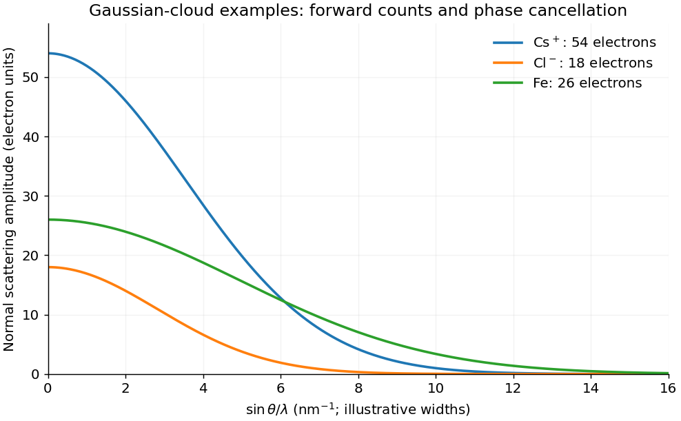

<h1 id="1/a/solution">Solution</h1>

↑ **Parent:** [A](../a.md)

Take $(x_j,y_j,z_j)$ as fractional coordinates in the chosen [unit cell](../../../../unit-cell.md). In the kinematic approximation the [crystal basis structure factor](../../../../crystal-basis-structure-factor.md) is

$$
\boxed{F(hkl)=\sum_j f_j(Q)\exp[2\pi i(hx_j+ky_j+lz_j)]},\qquad Q=\frac{4\pi\sin\theta}{\lambda}.
$$

Equivalently, in Cartesian coordinates the phase is $\mathbf G_{hkl}\cdot\mathbf r_j$. Reversing every phase sign complex-conjugates the nonabsorbing amplitude and leaves its [intensity](../../../../intensity-physics.md) unchanged. The [atomic scattering factor](../../../../atomic-scattering-factor.md) is the [Fourier transform](../../../../fourier-transform-split.md) of the [atom](../../../../atom-physics.md)'s [electron density](../../../../electron-number-density.md), in [electron](../../../../electron.md) scattering units:

$$
f_j(\mathbf Q)=\int\rho_{e,j}(\mathbf r)e^{i\mathbf Q\cdot\mathbf r}\,d^3r.
$$

At zero [scattering angle](../../../../bragg-angle.md) the normal form factor counts [electrons](../../../../electron.md): $f_j(0)=Z_j$ for a neutral [atom](../../../../atom-physics.md), modified by the ionic charge for an [ion](../../../../ion.md). At increasing $Q$, different parts of the [electron](../../../../electron.md) cloud scatter with different phases, reducing the coherent amplitude. Typical nonresonant [atomic curves](../../../../atomic-scattering-factor.md) fall from their forward value toward small values at large angle. A localized cloud falls more slowly in reciprocal space. Anomalous scattering near an absorption edge adds energy-dependent complex terms and is excluded from this simple sketch.

For a fixed reflection and fixed instrumental and geometric corrections,

$$
\boxed{I_{hkl}\propto|F(hkl)|^2.}
$$

The full amplitude also contains the lattice sum. At its [reciprocal-lattice](../../../../reciprocal-lattice.md) peak, $N_c$ coherently illuminated identical cells give a peak amplitude $N_cF$; peak height and integrated peak [intensity](../../../../intensity-physics.md) have different size dependences because the peak narrows with [crystal](../../../../crystal.md) size. Powder multiplicity, polarization, absorption, [thermal motion](../../../../thermal-fluctuation.md) and measurement geometry also affect observed [intensities](../../../../intensity-physics.md). The basis factor determines relative [interference](../../../../interference-wave-propagation.md), not every experimental prefactor.

**[Figure 1](#1/a/image-forward-electron-counts-and-decreasing-atomic-scattering-amplitudes). Forward electron counts and decreasing atomic scattering amplitudes**. Original Gaussian-cloud illustrations for Cs+, Cl- and Fe, with their correct electron counts at zero transfer. Cloud widths are illustrative rather than tabulated atomic form-factor fits; the horizontal variable increases with scattering angle at fixed wavelength.

## ↑ Ancestors (12)

1. [A](../a.md)
2. [1](../../1.md)
3. [2016](../../../2016-split.md)
4. [Past exam of the condensed matter physics course of the University of Oxford](../../../split.md)
5. [Condensed matter physics course of the University of Oxford](../../../../condensed-matter-physics-course-of-the-university-of-oxford.md)
6. [Year 3 of the physics course of the University of Oxford](../../../../year-3-of-the-physics-course-of-the-university-of-oxford.md)
7. [Physics course of the University of Oxford](../../../../physics-course-of-the-university-of-oxford.md)
8. [Undergraduate course of the University of Oxford](../../../../undergraduate-course-of-the-university-of-oxford.md)
9. [Course of the University of Oxford](../../../../course-of-the-university-of-oxford.md)
10. [University of Oxford](../../../../university-of-oxford-split.md)
11. [List of universities](../../../../list-of-universities.md)
12. [Codex Wiki](../../../../split.md)
