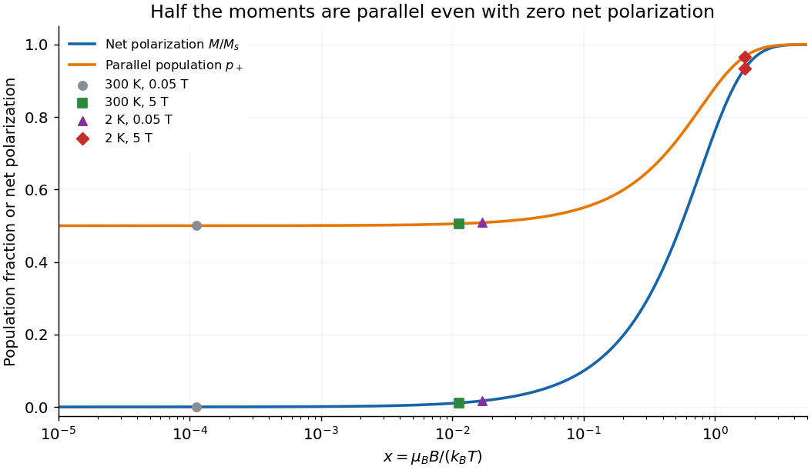

<h1 id="3/b/ii/solution">Solution</h1>

↑ **Parent:** [Ii](../ii.md)

For $B=5$ T, the same [spin-only](../../../../../spin-only-magnetic-moment.md) two-state probabilities apply, but the low-temperature argument is no longer small. At 300 K, $x=0.0111952$; at 2 K, $x=1.67928$. Hence

$$
\boxed{\begin{array}{c|cc}
T&\text{aligned population }p_+&\text{net polarization }M/M_s\\\hline
300\ \mathrm K&0.50559738&0.0111948\\
2\ \mathrm K&0.96638432&0.932769
\end{array}}
$$

The 2 K sample is about $93.3\%$ of its [saturation magnetization](../../../../../spin-one-half-paramagnetic-magnetization.md), with about $96.6\%$ of the moments in the aligned state. The two percentages describe different observables. A linear extrapolation would predict $M/M_s\simeq x=1.679$, exceeding saturation and therefore contradicting the bounded two-state population.

For completeness, at this 2 K, 5 T bias the dimensionless secant [susceptibility](../../../../../magnetic-susceptibility.md) is approximately $\chi_0\tanh x/x=0.01199$, while the [differential susceptibility](../../../../../differential-magnetic-susceptibility.md) is $\chi_0\operatorname{sech}^2x=0.002805$ under the same prescribed-field approximation. Neither equals the zero-field [Curie slope](../../../../../curie-s-law.md) $0.02159$. Thus saturation reduces the incremental response even while the [magnetization](../../../../../magnetization.md) itself is large.

**[Figure 2](#3/b/ii/image-parallel-state-population-and-net-spin-polarization). Parallel-state population and net spin polarization**. Original independent-spin calculation. At zero field the parallel-state population is one half and net polarization is zero; the four specified field and temperature combinations are marked.

## ↑ Ancestors (13)

1. [Ii](../ii.md)
2. [B](../../b.md)
3. [3](../../../3.md)
4. [2016](../../../../2016-split.md)
5. [Past exam of the condensed matter physics course of the University of Oxford](../../../../split.md)
6. [Condensed matter physics course of the University of Oxford](../../../../../condensed-matter-physics-course-of-the-university-of-oxford.md)
7. [Year 3 of the physics course of the University of Oxford](../../../../../year-3-of-the-physics-course-of-the-university-of-oxford.md)
8. [Physics course of the University of Oxford](../../../../../physics-course-of-the-university-of-oxford.md)
9. [Undergraduate course of the University of Oxford](../../../../../undergraduate-course-of-the-university-of-oxford.md)
10. [Course of the University of Oxford](../../../../../course-of-the-university-of-oxford.md)
11. [University of Oxford](../../../../../university-of-oxford-split.md)
12. [List of universities](../../../../../list-of-universities.md)
13. [Codex Wiki](../../../../../split.md)
