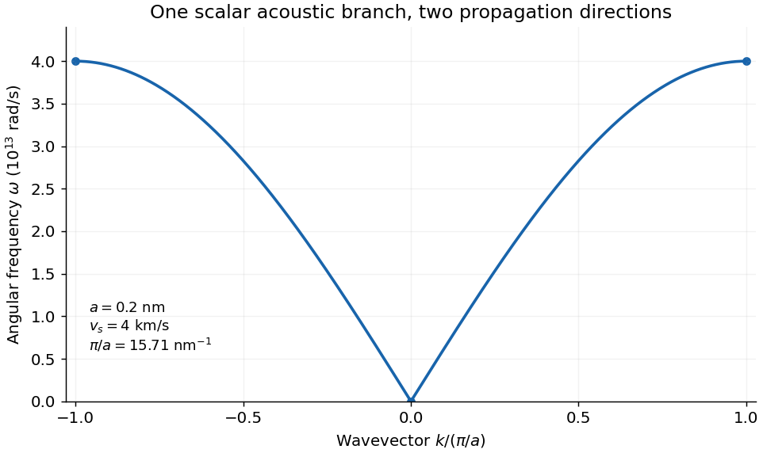

<h1 id="4/c/i/solution">Solution</h1>

↑ **Parent:** [I](../i.md)

The supplied [sound speed](../../../../../speed-of-sound.md) determines the spring-to-mass ratio without needing either parameter separately:

$$
\sqrt{C/m}=\frac{v_s}{a}=\frac{4.0\times10^3}{2.0\times10^{-10}}=2.0\times10^{13}\ \mathrm{s^{-1}}.
$$

Consequently

$$
\boxed{\omega(k)=4.0\times10^{13}|\sin(ka/2)|\ \mathrm{rad\,s^{-1}},\quad
k_{\rm edge}=\frac\pi a=1.571\times10^{10}\ \mathrm{m^{-1}}.}
$$

The curve is even in $k$, rises linearly from the origin with one-sided slopes $\pm4.0$ km/s, and flattens at both [zone edges](../../../../../brillouin-zone.md). Its maximum is $\omega_m=4.0\times10^{13}$ rad/s, or ordinary frequency $\nu_m=\omega_m/(2\pi)=6.366$ THz. Keeping [angular frequency](../../../../../angular-frequency.md) distinct from cycles per second avoids a factor-of-$2\pi$ error. Repeating the curve outside the first zone is a representation of equivalent [crystal](../../../../../crystal.md) momenta, not the discovery of additional modes.

**[Figure 3](#4/c/i/image-positive-frequency-acoustic-dispersion-of-the-specified-monatomic-chain). Positive-frequency acoustic dispersion of the specified monatomic chain**. Original nearest-neighbor harmonic-chain calculation, with both propagation directions in one first Brillouin zone. The plotted vertical frequency is angular frequency.

## ↑ Ancestors (13)

1. [I](../i.md)
2. [C](../../c.md)
3. [4](../../../4.md)
4. [2016](../../../../2016-split.md)
5. [Past exam of the condensed matter physics course of the University of Oxford](../../../../split.md)
6. [Condensed matter physics course of the University of Oxford](../../../../../condensed-matter-physics-course-of-the-university-of-oxford.md)
7. [Year 3 of the physics course of the University of Oxford](../../../../../year-3-of-the-physics-course-of-the-university-of-oxford.md)
8. [Physics course of the University of Oxford](../../../../../physics-course-of-the-university-of-oxford.md)
9. [Undergraduate course of the University of Oxford](../../../../../undergraduate-course-of-the-university-of-oxford.md)
10. [Course of the University of Oxford](../../../../../course-of-the-university-of-oxford.md)
11. [University of Oxford](../../../../../university-of-oxford-split.md)
12. [List of universities](../../../../../list-of-universities.md)
13. [Codex Wiki](../../../../../split.md)
