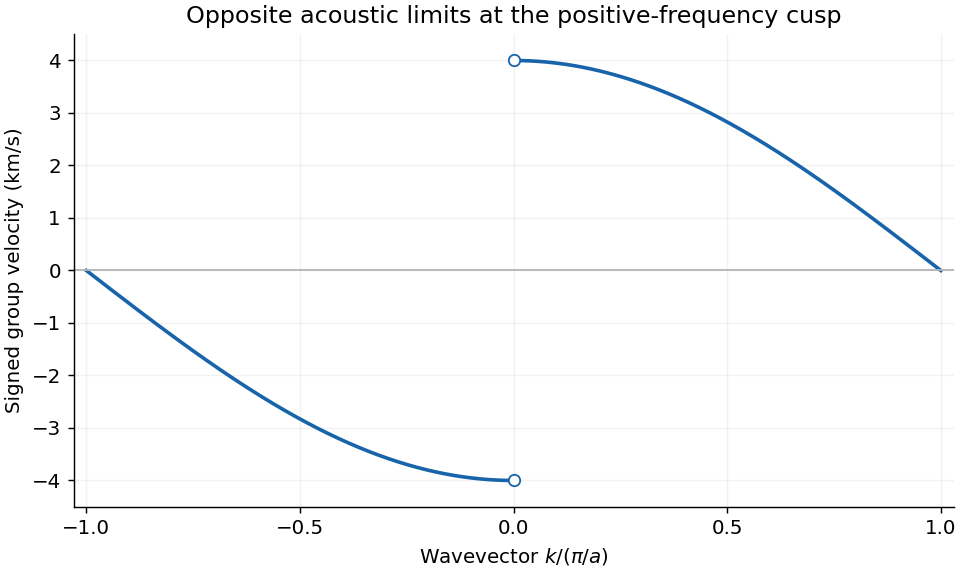

<h1 id="4/c/ii/solution">Solution</h1>

↑ **Parent:** [Ii](../ii.md)

[Differentiate](../../../../../derivative.md) the positive-frequency branch on either side of the origin:

$$
\boxed{v_g(k)=\frac{d\omega}{dk}=v_s\,\operatorname{sgn}(k)\cos(ka/2),\qquad
0<|k|<\pi/a.}
$$

It tends to $+4.0$ km/s as $k\to0^+$ and to $-4.0$ km/s as $k\to0^-$, and vanishes at either [zone boundary](../../../../../brillouin-zone.md). A positive-$k$ [wavepacket](../../../../../wave-packet.md) therefore transports [energy](../../../../../energy-split.md) to the right, while a negative-$k$ one transports it to the left. At the zone edge, neighboring [atoms](../../../../../atom-physics.md) oscillate out of phase and the dispersion is flat, giving zero [group velocity](../../../../../group-velocity.md) even though the frequency is nonzero.

The graph has separate one-sided limits at zero because $\omega(k)$ has a cusp there. Assigning one differentiable slope at exactly $k=0$ would erase the distinction between the two propagation directions; a precisely uniform translation has no preferred propagation direction. Plotting only $0\leq k\leq\pi/a$ is also legitimate if the missing negative branch is stated. [Group velocity](../../../../../group-velocity.md) and [phase velocity](../../../../../phase-velocity.md) $\omega/k$ are different except in the long-wavelength linear limit.

**[Figure 4](#4/c/ii/image-signed-group-velocity-across-the-first-brillouin-zone). Signed group velocity across the first Brillouin zone**. Original derivative of the positive-frequency acoustic branch. Open markers show the distinct limits at zero wavevector; the derivative is not defined at the cusp itself.

## ↑ Ancestors (13)

1. [Ii](../ii.md)
2. [C](../../c.md)
3. [4](../../../4.md)
4. [2016](../../../../2016-split.md)
5. [Past exam of the condensed matter physics course of the University of Oxford](../../../../split.md)
6. [Condensed matter physics course of the University of Oxford](../../../../../condensed-matter-physics-course-of-the-university-of-oxford.md)
7. [Year 3 of the physics course of the University of Oxford](../../../../../year-3-of-the-physics-course-of-the-university-of-oxford.md)
8. [Physics course of the University of Oxford](../../../../../physics-course-of-the-university-of-oxford.md)
9. [Undergraduate course of the University of Oxford](../../../../../undergraduate-course-of-the-university-of-oxford.md)
10. [Course of the University of Oxford](../../../../../course-of-the-university-of-oxford.md)
11. [University of Oxford](../../../../../university-of-oxford-split.md)
12. [List of universities](../../../../../list-of-universities.md)
13. [Codex Wiki](../../../../../split.md)
