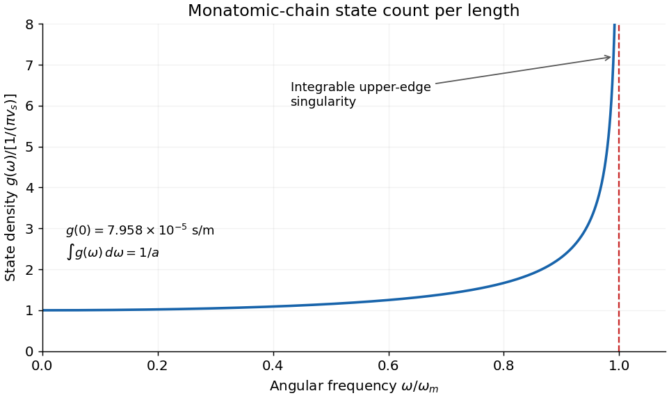

<h1 id="4/c/iii/solution">Solution</h1>

↑ **Parent:** [Iii](../iii.md)

For a long periodic chain of length $\mathcal L=Na$, neighboring allowed signed [wavevectors](../../../../../wavevector.md) differ by $2\pi/\mathcal L$. Counting both signs once gives a [state density](../../../../../density-of-states.md) per length $dk/\pi$ on the positive half-zone. Therefore the [density per angular-frequency interval](../../../../../phonon-density-of-states.md) and per length is

$$
g(\omega)=\frac1\pi\left|\frac{dk}{d\omega}\right|
=\boxed{\frac1{\pi v_s\sqrt{1-(\omega/\omega_m)^2}}},\qquad0<\omega<\omega_m.
$$

It is zero outside this band, starts at $g(0)=1/(\pi v_s)=7.958\times10^{-5}$ s/m and has an integrable inverse-square-root [Van Hove singularity](../../../../../van-hove-singularity.md) as $\omega\to\omega_m^-$. The state-count normalization is

$$
\int_0^{\omega_m}g(\omega)\,d\omega=\frac{\omega_m}{2v_s}=\frac1a.
$$

Thus the scalar chain has one vibrational mode per [atom](../../../../../atom-physics.md), with no extra factor of two for the already counted propagation directions. If the horizontal variable were ordinary frequency $\nu$, the density would be $g_\nu(\nu)=2\pi g_\omega(2\pi\nu)$. A finite chain has discrete lines instead of an actual infinite peak; the smooth divergent curve is the large-chain continuum description.

**[Figure 5](#4/c/iii/image-vibrational-state-density-per-length-and-angular-frequency-interval). Vibrational state density per length and angular-frequency interval**. Original continuum state count including both wavevector signs. The upper-edge singularity is integrable and its normalization gives one scalar mode per atom.

## ↑ Ancestors (13)

1. [Iii](../iii.md)
2. [C](../../c.md)
3. [4](../../../4.md)
4. [2016](../../../../2016-split.md)
5. [Past exam of the condensed matter physics course of the University of Oxford](../../../../split.md)
6. [Condensed matter physics course of the University of Oxford](../../../../../condensed-matter-physics-course-of-the-university-of-oxford.md)
7. [Year 3 of the physics course of the University of Oxford](../../../../../year-3-of-the-physics-course-of-the-university-of-oxford.md)
8. [Physics course of the University of Oxford](../../../../../physics-course-of-the-university-of-oxford.md)
9. [Undergraduate course of the University of Oxford](../../../../../undergraduate-course-of-the-university-of-oxford.md)
10. [Course of the University of Oxford](../../../../../course-of-the-university-of-oxford.md)
11. [University of Oxford](../../../../../university-of-oxford-split.md)
12. [List of universities](../../../../../list-of-universities.md)
13. [Codex Wiki](../../../../../split.md)
