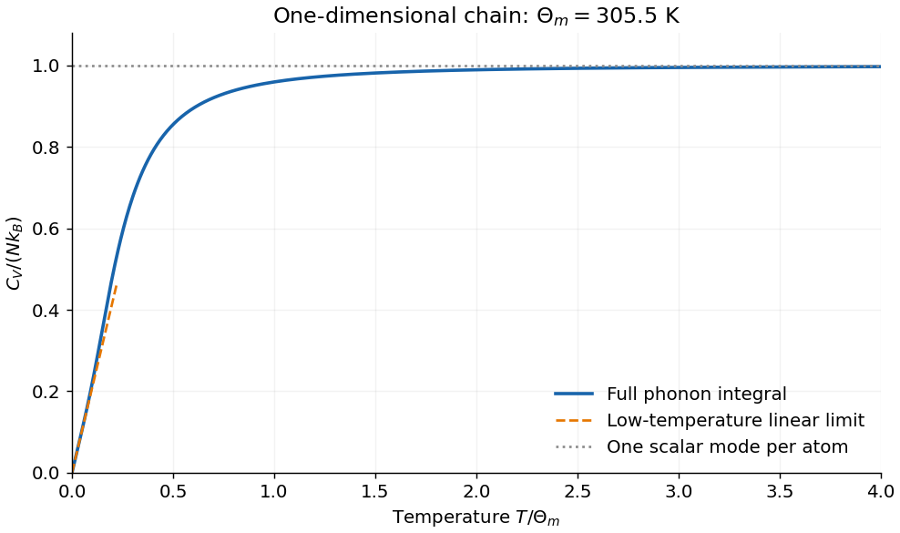

<h1 id="4/c/iv/solution">Solution</h1>

↑ **Parent:** [Iv](../iv.md)

At fixed chain length, each [harmonic mode](../../../../../normal-mode.md) contributes a [Bose–Einstein thermal occupation](../../../../../bose-einstein-distribution.md) and a temperature-independent [zero-point energy](../../../../../zero-point-energy.md). The latter contributes no [heat capacity](../../../../../heat-capacity.md). With $x=\hbar\omega/(k_BT)$,

$$
\frac{C_V}{\mathcal L}=k_B\int_0^{\omega_m}g(\omega)
\frac{x^2e^x}{(e^x-1)^2}\,d\omega.
$$

At low [temperature](../../../../../temperature-split.md) only the approximately linear part of the [acoustic dispersion](../../../../../monatomic-chain-dispersion-relation.md) is excited, so $g(\omega)\simeq1/(\pi v_s)$. Using $\int_0^\infty x^2e^x/(e^x-1)^2dx=\pi^2/3$ gives

$$
\boxed{\frac{C_V}{\mathcal L}\simeq\frac{\pi k_B^2}{3\hbar v_s}T
=(4.732\times10^{-16}\ \mathrm{J\,K^{-2}\,m^{-1}}) T.}
$$

It is **linear in [temperature](../../../../../temperature-split.md)**, rather than the three-dimensional [Debye](../../../../../debye-model.md) $T^3$ law. At high [temperature](../../../../../temperature-split.md) every scalar oscillator tends to $k_B$, hence

$$
\boxed{\frac{C_V}{\mathcal L}\longrightarrow\frac{k_B}{a}
=6.903\times10^{-14}\ \mathrm{J\,K^{-1}\,m^{-1}},\qquad C_V/(Nk_B)\to1.}
$$

The cutoff [temperature](../../../../../temperature-split.md) is $\Theta_m=\hbar\omega_m/k_B=305.5$ K. The curve rises smoothly from zero toward this plateau; $\Theta_m$ sets a crossover scale, not a sharp transition. In normalized variables its initial slope is $C_V/(Nk_B)\simeq(2\pi/3)T/\Theta_m$. The low-temperature continuum limit also requires [temperature](../../../../../temperature-split.md) above the finite-size level spacing; uniform center-of-mass translation is treated separately. Below the lowest nonzero mode [energy](../../../../../energy-split.md) a finite chain does not retain a continuum linear law down to arbitrary [temperature](../../../../../temperature-split.md).

**[Figure 6](#4/c/iv/image-single-branch-chain-heat-capacity-and-its-low-and-high-temperature-limits). Single-branch chain heat capacity and its low- and high-temperature limits**. Original numerical Bose–Einstein mode integral. The dashed line is the low-temperature linear asymptote; the plateau is one Boltzmann constant per atom for this scalar model.

## ↑ Ancestors (13)

1. [Iv](../iv.md)
2. [C](../../c.md)
3. [4](../../../4.md)
4. [2016](../../../../2016-split.md)
5. [Past exam of the condensed matter physics course of the University of Oxford](../../../../split.md)
6. [Condensed matter physics course of the University of Oxford](../../../../../condensed-matter-physics-course-of-the-university-of-oxford.md)
7. [Year 3 of the physics course of the University of Oxford](../../../../../year-3-of-the-physics-course-of-the-university-of-oxford.md)
8. [Physics course of the University of Oxford](../../../../../physics-course-of-the-university-of-oxford.md)
9. [Undergraduate course of the University of Oxford](../../../../../undergraduate-course-of-the-university-of-oxford.md)
10. [Course of the University of Oxford](../../../../../course-of-the-university-of-oxford.md)
11. [University of Oxford](../../../../../university-of-oxford-split.md)
12. [List of universities](../../../../../list-of-universities.md)
13. [Codex Wiki](../../../../../split.md)
