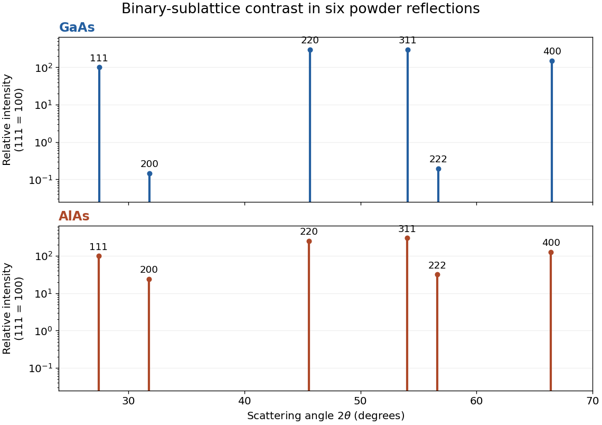
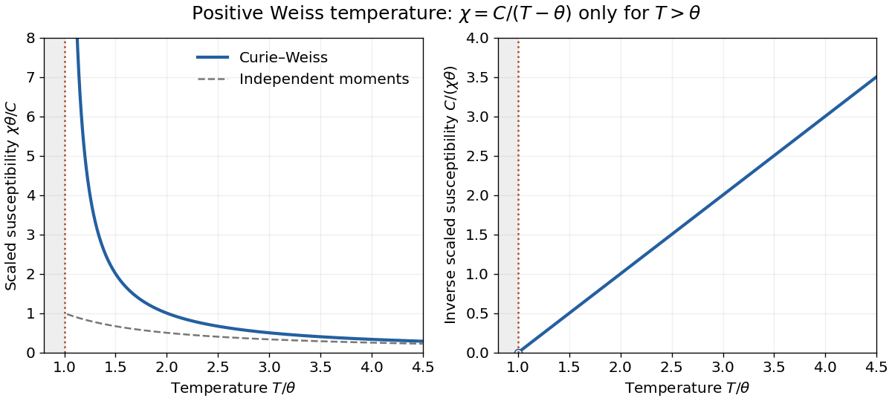

# 2017

↑ **Parent:** [Past exam of the condensed matter physics course of the University of Oxford](../past-exam-of-the-condensed-matter-physics-course-of-the-university-of-oxford.md)

Source paper: [Oxford public bundle, pages 72–74](https://www.whatdotheyknow.com/request/oxford_physics_past_papers_2/response/2340696/attach/5/Physics%20Papers%202016.pdf?cookie_passthrough=1). The bundle filename says 2016, but the held B6 cover is dated 10 June 2017. All four options are solved. Letters below identify successive unlettered source paragraphs; the inline Roman labels are retained.

**Table of contents**

- [1](#1)
  - [a](#1/a)
    - [Solution](#1/a/solution)
  - [b](#1/b)
    - [Solution](#1/b/solution)
  - [c](#1/c)
    - [i](#1/c/i)
      - [Solution](#1/c/i/solution)
    - [ii](#1/c/ii)
      - [Solution](#1/c/ii/solution)
  - [d](#1/d)
    - [Solution](#1/d/solution)
  - [e](#1/e)
    - [Solution](#1/e/solution)
- [2](#2)
  - [a](#2/a)
    - [Solution](#2/a/solution)
  - [b](#2/b)
    - [Solution](#2/b/solution)
  - [c](#2/c)
    - [Solution](#2/c/solution)
  - [d](#2/d)
    - [Solution](#2/d/solution)
- [3](#3)
  - [a](#3/a)
    - [Solution](#3/a/solution)
  - [b](#3/b)
    - [Solution](#3/b/solution)
  - [c](#3/c)
    - [Solution](#3/c/solution)
  - [d](#3/d)
    - [Solution](#3/d/solution)
- [4](#4)
  - [a](#4/a)
    - [Solution](#4/a/solution)
  - [b](#4/b)
    - [Solution](#4/b/solution)
  - [c](#4/c)
    - [Solution](#4/c/solution)
  - [d](#4/d)
    - [i](#4/d/i)
      - [Solution](#4/d/i/solution)
    - [ii](#4/d/ii)
      - [Solution](#4/d/ii/solution)

## 1

↑ **Parent:** [2017](2017.md)

<h3 id="1/a">a</h3>

↑ **Parent:** [1](#1)

<h4 id="1/a/solution">Solution</h4>

↑ **Parent:** [A](#1/a)

With the convention $\mathbf a_i\cdot\mathbf b_j=2\pi\delta_{ij}$, the [reciprocal lattice](../quantum-scattering.md#reciprocal-lattice) of a [face-centered cubic lattice](../quantum-scattering.md#face-centered-cubic-lattice) is a [body-centered cubic lattice](../quantum-scattering.md#body-centered-cubic-lattice). The reciprocal conventional cube is parallel to the direct conventional cube and has side $4\pi/a$. In direct-cubic coordinates its points are

$$
\boxed{\mathbf G=\frac{2\pi}{a}(h,k,l),\qquad h,k,l\text{ all even or all odd}.}
$$

The even triples supply the corners of that reciprocal cube and the odd triples its body centres. The [atomic basis](../physical-chemistry.md#atomic-basis-of-a-crystal) can change [diffraction intensities](../quantum-scattering.md#diffraction-intensity) through its [structure factor](../quantum-scattering.md#structure-factor); it does not change the [reciprocal lattice](../quantum-scattering.md#reciprocal-lattice) determined by the translation lattice.

<h3 id="1/b">b</h3>

↑ **Parent:** [1](#1)

<h4 id="1/b/solution">Solution</h4>

↑ **Parent:** [B](#1/b)

The cubic [Miller indices](../physical-chemistry.md#miller-index) give an [interplanar spacing](../physical-chemistry.md#interplanar-spacing) $d_{hkl}=a/\sqrt{h^2+k^2+l^2}$. Equivalently, the [reciprocal lattice vector](../quantum-scattering.md#reciprocal-lattice-vector) normal to these [lattice planes](../physical-chemistry.md#lattice-plane) has length $2\pi/d_{hkl}$. Hence

$$
\boxed{d_{111}=\frac{a}{\sqrt3},\qquad
\mathbf G_{111}=\frac{2\pi}{a}(1,1,1).}
$$

The eight $\{111\}$ [reciprocal lattice vectors](../quantum-scattering.md#reciprocal-lattice-vector) are the nearest nonzero reciprocal points. Their perpendicular bisectors form the eight hexagonal faces of the first [Brillouin zone](../bloch-s-theorem.md#brillouin-zone), a truncated octahedron. For the positive $(111)$ direction, that [Bragg plane](../quantum-scattering.md#bragg-plane) is $\mathbf k\cdot\mathbf G_{111}=|\mathbf G_{111}|^2/2$, or $k_x+k_y+k_z=3\pi/a$. It is parallel to the direct $(111)$ [lattice planes](../physical-chemistry.md#lattice-plane). The six remaining square zone faces correspond to the $\{200\}$ reciprocal points. The zone boundary is halfway to a reciprocal point, not the point itself.

<h3 id="1/c">c</h3>

↑ **Parent:** [1](#1)

<h4 id="1/c/i">i</h4>

↑ **Parent:** [C](#1/c)

<h5 id="1/c/i/solution">Solution</h5>

↑ **Parent:** [I](#1/c/i)

Use the [angle between two planes](../geometry-and-topology.md#angle-between-two-planes) defined as the acute angle between their [normal vectors](../differential-geometry.md#normal-vector). The normals $(1,1,1)$ and $(-1,1,1)$ have dot product one and lengths $\sqrt3$. Thus

$$
\boxed{\phi=\cos^{-1}\!\left(\frac13\right)=70.5288^\circ.}
$$

Choosing an oriented rather than an acute interplanar angle could give the supplementary $109.4712^\circ$; it describes the same unoriented pair of [lattice planes](../physical-chemistry.md#lattice-plane).

<h4 id="1/c/ii">ii</h4>

↑ **Parent:** [C](#1/c)

<h5 id="1/c/ii/solution">Solution</h5>

↑ **Parent:** [Ii](#1/c/ii)

The $(100)$ [normal vector](../differential-geometry.md#normal-vector) is $(1,0,0)$. Its normalized dot product with $(1,1,1)$ is $1/\sqrt3$, so

$$
\boxed{\phi=\cos^{-1}\!\left(\frac1{\sqrt3}\right)=54.7356^\circ.}
$$

This is the acute angle between the [lattice planes](../physical-chemistry.md#lattice-plane), rather than the complementary angle between a plane and the other plane's normal.

<h3 id="1/d">d</h3>

↑ **Parent:** [1](#1)

<h4 id="1/d/solution">Solution</h4>

↑ **Parent:** [D](#1/d)

The [X-ray](../electromagnetic-radiation.md#x-ray) [wavelength](../wave-equation.md#wavelength) is $\lambda=hc/E=1.54980\times10^{-10}\,\mathrm m$. Write the amplitude of one conventional [unit cell](../quantum-scattering.md#unit-cell) as the [face-centred cubic selection rule](../quantum-scattering.md#face-centred-cubic-selection-rule) times the two-atom [atomic basis](../physical-chemistry.md#atomic-basis-of-a-crystal) amplitude:

$$
F_{hkl}=\left[1+e^{i\pi(k+l)}+e^{i\pi(h+l)}+e^{i\pi(h+k)}\right]
\left[f_{\mathrm{Ga}}+f_{\mathrm{As}}e^{i\pi(h+k+l)/2}\right].
$$

The first bracket is four when the indices have equal parity and zero otherwise. Among the allowed [Bragg reflections](../quantum-scattering.md#bragg-reflection), the [zinc blende structure factor](../physical-chemistry.md#zinc-blende-structure-factor) therefore gives

$$
|F_{hkl}|^2=16\begin{cases}
f_{\mathrm{Ga}}^2+f_{\mathrm{As}}^2,&h,k,l\text{ odd},\\
(f_{\mathrm{Ga}}+f_{\mathrm{As}})^2,&h+k+l\equiv0\pmod4,\\
(f_{\mathrm{Ga}}-f_{\mathrm{As}})^2,&h+k+l\equiv2\pmod4.
\end{cases}
$$

Here the [atomic scattering factors](../quantum-scattering.md#atomic-scattering-factor) are taken as real. For the requested rough estimate set $f_{\mathrm{Ga}}\simeq31$ and $f_{\mathrm{As}}\simeq33$. The weak difference reflections remain allowed: unequal species do not have the extra exact extinction of the equal-species diamond limit.

The first six allowed values of $h^2+k^2+l^2$ are $3,4,8,11,12,16$. [Bragg's law](../quantum-scattering.md#bragg-s-law) gives the measured scattering angle $2\theta=2\sin^{-1}(\lambda\sqrt{h^2+k^2+l^2}/2a)$. For [powder diffraction](../physical-chemistry.md#powder-diffraction), multiply the squared amplitude by the [powder diffraction multiplicity](../physical-chemistry.md#powder-diffraction-multiplicity) $m_{hkl}$. The last two columns use $I_{111}=100$:

$$
\begin{array}{c|r|r|r|r|r}
hkl&2\theta\ ({}^\circ)&m_{hkl}&|F|^2&I\propto m|F|^2&I\propto m|F|^2LP\\\hline
111&27.4693&8&32800&100&100\\
200&31.8234&6&64&0.1463&0.1068\\
220&45.6248&12&65536&299.707&98.684\\
311&54.0830&24&32800&300&67.110\\
222&56.6994&8&64&0.1951&0.03921\\
400&66.5025&6&65536&149.854&21.165
\end{array}
$$

The first intensity column is the geometry-independent multiplicity-and-structure estimate. The second additionally assumes an unpolarized beam and a common symmetric powder-diffractometer geometry, with [Lorentz-polarization factor](../physical-chemistry.md#lorentz-polarization-factor)

$$
LP(\theta)\propto\frac{1+\cos^2(2\theta)}{\sin^2\theta\cos\theta}.
$$

An overall constant cancels in either normalization. A particular measured intensity set is not fixed by the atomic numbers alone: actual [atomic scattering factors](../quantum-scattering.md#atomic-scattering-factor) decrease with momentum transfer, anomalous scattering and absorption can matter, and the instrument geometry and [polarization](../wave.md#polarization-waves) determine angular corrections. The two columns state the approximation rather than asserting identical peak heights for all instruments.[Section 4, equation 5 and sections 4.1–4.2: multiplicity, structure amplitude and geometry-dependent polarization and Lorentz corrections](../physics-bibliography.md#quantitative-powder-diffraction-using-a-2-plus-3-surface-diffractometer-and-an-area-detector-by-giuseppe-abbondanza-and-others)

<h3 id="1/e">e</h3>

↑ **Parent:** [1](#1)

<h4 id="1/e/solution">Solution</h4>

↑ **Parent:** [E](#1/e)

The sixth allowed family is $400$. For the two [lattice constants](../physical-chemistry.md#lattice-constant), use $2\theta_{400}=2\sin^{-1}(2\lambda/a)$:

$$
2\theta_{400}(\mathrm{GaAs})=66.50250^\circ,\qquad
2\theta_{400}(\mathrm{AlAs})=66.40961^\circ.
$$

Consequently

$$
\boxed{\Delta(2\theta)\equiv2\theta(\mathrm{AlAs})-2\theta(\mathrm{GaAs})=-0.09290^\circ.}
$$

The larger [lattice constant](../physical-chemistry.md#lattice-constant) shifts the AlAs reflection to lower scattering angle. As a differential check, $\Delta(2\theta)\simeq-2\tan\theta\,\Delta a/a$ in radians.

If the angular displacement is unresolved, use the intensity contrast. With the same $f\simeq Z$ model, a difference reflection has basis amplitude $13-33=-20$ for AlAs, versus $31-33=-2$ for GaAs. Its squared amplitude is therefore one hundred times greater before overall sample normalization. More robustly, compare a weak and a strong reflection within each specimen. Neglecting their almost identical angular corrections,

$$
\frac{I_{200}}{I_{220}}=\frac6{12}\left(\frac{f_A-f_{\mathrm{As}}}{f_A+f_{\mathrm{As}}}\right)^2
=\begin{cases}0.0004883,&\mathrm{GaAs},\\0.09452,&\mathrm{AlAs}.
\end{cases}
$$

The contrast in this internal ratio is about a factor $194$. Element-specific [X-ray fluorescence](../electromagnetic-radiation.md#x-ray-fluorescence), for example testing for a Ga characteristic line with a suitably energetic incident beam, or an [X-ray absorption spectroscopy](../physics.md#x-ray-absorption-spectroscopy) scan through an element-specific [absorption edge](../electromagnetic-radiation.md#absorption-edge), also distinguishes composition. Such scans can change incident energy; one must not assume every core shell can be excited by the original $8\,\mathrm{keV}$ beam.

**[Figure 1](#1/e/image-approximate-powder-reflection-contrast-for-gaas-and-alas). Approximate powder-reflection contrast for GaAs and AlAs**. Original stick patterns use the six derived angles, $f\simeq Z$, and multiplicity times squared structure amplitude. Each compound is normalized to its own $111$ reflection. A logarithmic intensity scale reveals the nearly cancelled $200$ and $222$ GaAs reflections. Geometry and form-factor corrections are omitted deliberately.

## 2

↑ **Parent:** [2017](2017.md)

<h3 id="2/a">a</h3>

↑ **Parent:** [2](#2)

<h4 id="2/a/solution">Solution</h4>

↑ **Parent:** [A](#2/a)

The [density of states](../quantum-ideal-gas-statistics.md#density-of-states) $g(E)$ counts one-electron states per energy interval, including both [electron spin](../angular-momentum-operator.md#electron-spin) orientations. It may be a total or a per-volume quantity; $U$ must have the matching normalization. The [Fermi-Dirac distribution](../quantum-ideal-gas-statistics.md#fermi-dirac-distribution)

$$
f(E,T)=\frac1{e^{(E-\mu(T))/(k_BT)}+1}
$$

is the occupation probability of such a state. In the fixed-volume [free electron model](../physics.md#free-electron-model), the integration variable $E$ and the [density of states](../quantum-ideal-gas-statistics.md#density-of-states) do not depend on $T$. The occupation depends explicitly on $T$ and implicitly through the [chemical potential](../chemical-potential.md) $\mu(T)$ needed to preserve electron number. Thermal expansion or a changing [electronic band structure](../bloch-s-theorem.md#electronic-band-structure) would require additional effects outside this model.

At $T\ll T_F$, only states within order $k_BT$ of the [Fermi energy](../quantum-ideal-gas-statistics.md#fermi-energy) change their occupation. There are order $g(E_F)k_BT$ such states, each carrying an excitation energy of order $k_BT$. Thus $U(T)-U(0)\propto g(E_F)(k_BT)^2$ and the [electronic heat capacity](../heat.md#electronic-heat-capacity) is proportional to $g(E_F)k_B^2T$. Using the supplied coefficient,

$$
\boxed{C_V=\gamma T,\qquad\gamma=\frac{\pi^2}{3}k_B^2g(E_F),\qquad
U(T)-U(0)=\frac12\gamma T^2.}
$$

The shell argument fixes the scaling, not the numerical coefficient; the controlled [Sommerfeld expansion](../quantum-ideal-gas-statistics.md#sommerfeld-expansion) fixes that coefficient at fixed electron number. Filled states far below $E_F$ cannot accept arbitrary thermal excitations because of the [Pauli exclusion principle](../tensor-product-of-quantum-systems.md#pauli-exclusion-principle).

<h3 id="2/b">b</h3>

↑ **Parent:** [2](#2)

<h4 id="2/b/solution">Solution</h4>

↑ **Parent:** [B](#2/b)

At fixed volume and particle number, reversible heating obeys $dS=C_V\,dT/T$. Integrating the [electronic heat capacity](../heat.md#electronic-heat-capacity) from zero [temperature](../temperature.md) gives

$$
S(T)-S(0)=\int_0^T\frac{\gamma T'}{T'}\,dT'=\gamma T.
$$

With no extensive residual ground-state degeneracy, the [third law of thermodynamics](../thermodynamics.md#third-law-of-thermodynamics) sets the electronic $S(0)=0$. Therefore

$$
\boxed{S_{\mathrm{el}}=\gamma T.}
$$

The [entropy](../entropy.md) normalization follows that of $\gamma$: total, per volume or per mole. Lattice contributions are additional and are not part of this electronic result.

<h3 id="2/c">c</h3>

↑ **Parent:** [2](#2)

<h4 id="2/c/solution">Solution</h4>

↑ **Parent:** [C](#2/c)

Let $g_v(E)$ denote the spin-summed [density of states](../quantum-ideal-gas-statistics.md#density-of-states) per volume. An electron moment with magnitude the [Bohr magneton](../electromagnetism.md#bohr-magneton) $\mu_B$ has [Zeeman energies](../electromagnetism.md#zeeman-energy) $\mp\mu_B B$. At low [temperature](../temperature.md), the two spin populations are

$$
n_\pm=\frac12\int_0^{\mu\pm\mu_B B}g_v(E)\,dE,
\qquad
n_+-n_-=g_v(E_F)\mu_B B+O(B^3).
$$

The common [chemical potential](../chemical-potential.md) changes only at order $B^2$, so it does not affect this linear imbalance. The [magnetization](../electromagnetism.md#magnetization) is $M=\mu_B(n_+-n_-)=\mu_B^2g_v(E_F)B$. Define SI volume [magnetic susceptibility](../statistical-physics.md#magnetic-susceptibility) by $M=\chi_p H$ and take the weak applied field as $B\simeq\mu_0H$. Then [Pauli paramagnetism](../quantum-ideal-gas-statistics.md#pauli-paramagnetism) gives

$$
\boxed{\chi_p=\mu_0\mu_B^2g_v(E_F)=\frac{3\mu_0n\mu_B^2}{2E_F}.}
$$

The last equality uses the three-dimensional parabolic [free electron model](../physics.md#free-electron-model), $g_v(E_F)=3n/(2E_F)$. This susceptibility is nearly independent of [temperature](../temperature.md) for $T\ll T_F$, unlike the [Curie law](../statistical-physics.md#curie-s-law) for localized independent moments. The displayed result excludes orbital [diamagnetism](../electromagnetism.md#diamagnetism) and interaction enhancements. If susceptibility instead denotes $\partial M/\partial B$, omit $\mu_0$; confusing that convention with $\partial M/\partial H$ changes the units.

<h3 id="2/d">d</h3>

↑ **Parent:** [2](#2)

<h4 id="2/d/solution">Solution</h4>

↑ **Parent:** [D](#2/d)

In the one-band electron [Hall effect](../relativistic-electromagnetism.md#hall-effect) model, $R_H=-1/(ne)$, with $e>0$. The measured [Hall coefficient](../relativistic-electromagnetism.md#hall-coefficient) therefore gives

$$
n=\frac1{e|R_H|}=2.4966\times10^{28}\,\mathrm{m^{-3}}.
$$

A monovalent [body-centered cubic lattice](../quantum-scattering.md#body-centered-cubic-lattice) has two conduction electrons per conventional [unit cell](../quantum-scattering.md#unit-cell). Thus $na^3=2$, and

$$
\boxed{a=\left(\frac2n\right)^{1/3}=4.3108\times10^{-10}\,\mathrm m.}
$$

Counting two spin states within the [Fermi sphere](../fermi-liquid.md#fermi-sphere) gives $k_F=(3\pi^2n)^{1/3}=9.0418\times10^9\,\mathrm{m^{-1}}$. Using the specified [effective mass](../bloch-s-theorem.md#band-effective-mass) in the dispersion,

$$
\boxed{E_F=\frac{\hbar^2k_F^2}{2m^*}=2.3960\,\mathrm{eV},\qquad
T_F=E_F/k_B=2.7805\times10^4\,\mathrm K.}
$$

There is one mole of conduction electrons per mole of sodium. Its molar [density of states](../quantum-ideal-gas-statistics.md#density-of-states) at $E_F$ is $3N_A/(2E_F)$, giving

$$
\boxed{\gamma_{\mathrm{mol}}=\frac{\pi^2N_Ak_B^2}{2E_F}
=1.4757\,\mathrm{mJ\,mol^{-1}\,K^{-2}}.}
$$

Using the volume [density of states](../quantum-ideal-gas-statistics.md#density-of-states) in [c](#2/c) gives

$$
\boxed{\chi_p=1.0543\times10^{-5}\quad\text{(dimensionless SI volume susceptibility)}.}
$$

The [effective mass](../bloch-s-theorem.md#band-effective-mass) changes the dispersion and [density of states](../quantum-ideal-gas-statistics.md#density-of-states); the electron [Bohr magneton](../electromagnetism.md#bohr-magneton) used for the spin coupling retains the bare electron mass. Replacing it by $e\hbar/(2m^*)$ would be an additional, unjustified magnetic-moment assumption. A Hall factor or a multiband metal would also invalidate the simple density inference; the stated calculation uses the requested one-band approximation.

## 3

↑ **Parent:** [2017](2017.md)

<h3 id="3/a">a</h3>

↑ **Parent:** [3](#3)

<h4 id="3/a/solution">Solution</h4>

↑ **Parent:** [A](#3/a)

Take two localized [spin](../angular-momentum-operator.md#spin) orientations with moments $\pm\mu_B$ along the applied [magnetic field](../magnetic-field.md). This assumes an electron-like spin $g$ factor of two. Their [energies](../energy.md) are $\mp\mu_BB$, so the one-moment [partition function](../canonical-ensemble.md#canonical-partition-function) is $Z_1=2\cosh x$, with $x=\mu_BB/(k_BT)$. The thermal mean moment is $k_BT\,\partial_B\ln Z_1=\mu_B\tanh x$, and the [spin-one-half paramagnetic magnetization](../electromagnetism.md#spin-one-half-paramagnetic-magnetization) is

$$
\boxed{M=n\mu_B\tanh\!\left(\frac{\mu_BB}{k_BT}\right).}
$$

For $|x|\ll1$, $M\simeq n\mu_B^2B/(k_BT)$. With the same SI convention $\chi=\partial M/\partial H$ and $B\simeq\mu_0H$,

$$
\boxed{\chi=\frac CT,\qquad C=\frac{n\mu_0\mu_B^2}{k_B}.}
$$

This [Curie law](../statistical-physics.md#curie-s-law) is a zero-field or weak-field susceptibility. At arbitrary field the differential response is $(C/T)\operatorname{sech}^2x$, and $M$ saturates at $n\mu_B$; extending the linear law to unlimited field would contradict that finite [saturation magnetization](../statistical-physics.md#saturation-magnetization).

<h3 id="3/b">b</h3>

↑ **Parent:** [3](#3)

<h4 id="3/b/solution">Solution</h4>

↑ **Parent:** [B](#3/b)

In the [Weiss molecular field](../statistical-physics.md#weiss-molecular-field) approximation, the local response obeys

$$
M=n\mu_B\tanh\!\left[\frac{\mu_B(B+\lambda\mu_0M)}{k_BT}\right].
$$

Linearize around $M=B=0$ in the stable phase of [paramagnetism](../electromagnetism.md#paramagnetism). Substitution of [a](#3/a) gives

$$
M=\frac{C}{\mu_0T}(B+\lambda\mu_0M),\qquad
(T-\lambda C)M=\frac C{\mu_0}B.
$$

Hence the [Curie–Weiss law](../electromagnetism.md#curie-weiss-law) and [Weiss temperature](../electromagnetism.md#weiss-temperature) are

$$
\boxed{\chi=\frac{C}{T-\theta},\qquad
\theta=\lambda C=\frac{\lambda n\mu_0\mu_B^2}{k_B}.}
$$

For positive $\lambda$, $\theta$ is the [mean-field theory](../statistical-physics.md#mean-field-theory) [Curie temperature](../electromagnetism.md#curie-temperature): the zero-magnetization solution becomes unstable there, and below it a spontaneous solution appears. For negative coupling, a negative fitted [Weiss temperature](../electromagnetism.md#weiss-temperature) indicates predominantly opposing interactions, but this one-uniform-magnetization treatment does not determine an antiferromagnetic ordering pattern or its transition temperature. More generally the fitted [Weiss temperature](../electromagnetism.md#weiss-temperature) need not equal the observed ordering temperature.

For $\theta>0$, the paramagnetic curve is positive for $T>\theta$, diverges as $T\downarrow\theta$, and tends to $C/T$ at high [temperature](../temperature.md); its inverse is the straight line $(T-\theta)/C$. The expression is not the stable susceptibility below $\theta$. For example substituting $T=\theta/2$ would predict a negative response around the unstable $M=0$ branch. The nonlinear self-consistency equation must instead be expanded about the appropriate spontaneous [magnetization](../electromagnetism.md#magnetization).

**[Figure 2](#3/b/image-paramagnetic-curie-weiss-susceptibility-and-its-inverse). Paramagnetic Curie-Weiss susceptibility and its inverse**. The positive-Weiss-temperature mean-field law is shown only in its stable paramagnetic range $T>\theta$. Its inverse extrapolates to zero at $T=\theta$. The curve below the transition is not obtained by continuing the displayed rational expression.

<h3 id="3/c">c</h3>

↑ **Parent:** [3](#3)

<h4 id="3/c/solution">Solution</h4>

↑ **Parent:** [C](#3/c)

Within the stipulated localized, one-moment-per-atom [spin](../angular-momentum-operator.md#spin) model, the number density follows directly from mass density and molar mass:

$$
n=\frac{\rho N_A}{M_{\mathrm{mol}}}
=\frac{8908}{0.058693}N_A
=9.1400\times10^{28}\,\mathrm{m^{-3}}.
$$

The [face-centered cubic lattice](../quantum-scattering.md#face-centered-cubic-lattice) is consistent with four atoms per conventional [unit cell](../quantum-scattering.md#unit-cell); no additional factor four is needed once $n$ has been obtained from the density. The [Curie constant](../statistical-physics.md#curie-constant) is $C=0.71549\,\mathrm K$. Identifying the model's $\theta=\lambda C$ with the specified [Curie temperature](../electromagnetism.md#curie-temperature) gives

$$
\boxed{\lambda=\frac{627\,\mathrm K}{0.71549\,\mathrm K}=8.7632\times10^2.}
$$

At very low [temperature](../temperature.md), a fully ordered single domain has $M_s=n\mu_B=8.4764\times10^5\,\mathrm{A\,m^{-1}}$. Its [Weiss molecular field](../statistical-physics.md#weiss-molecular-field) is

$$
\boxed{B_{\mathrm{eff}}=\lambda\mu_0M_s
=\frac{k_BT_C}{\mu_B}=9.3343\times10^2\,\mathrm T.}
$$

The cancellation of $n$ in the middle expression provides a useful check. The ordinary magnetostatic scale is only $\mu_0M_s\simeq1.065\,\mathrm T$, smaller by the factor $\lambda$. Thus $B_{\mathrm{eff}}$ is not a plausible ordinary self-generated dipolar [magnetic field](../magnetic-field.md) of the nickel moments. It represents the [exchange interaction](../electromagnetism.md#exchange-interaction) energy in field units, not an additional Maxwell field of that magnitude. This does not assert that such large externally generated fields are forbidden. Nickel is an itinerant [ferromagnet](../electromagnetism.md#ferromagnet); the imposed one-$\mu_B$-per-atom model is an estimate rather than its measured microscopic moment.

<h3 id="3/d">d</h3>

↑ **Parent:** [3](#3)

<h4 id="3/d/solution">Solution</h4>

↑ **Parent:** [D](#3/d)

A macroscopic nickel specimen can split into [magnetic domains](../electromagnetism.md#magnetic-domain), each with nonzero local [spontaneous magnetization](../spin-model.md#spontaneous-magnetization) but with different orientations. Their vector contributions can cancel, giving an almost zero measured net [magnetization](../electromagnetism.md#magnetization) below the [Curie temperature](../electromagnetism.md#curie-temperature). This reduces the external stray-field energy, at the expense of [magnetic domain wall](../electromagnetism.md#magnetic-domain-wall) energy; the balance favours a multidomain state in many ordinary specimens.

An applied [magnetic field](../magnetic-field.md) can move [magnetic domain walls](../electromagnetism.md#magnetic-domain-wall) and rotate the domain moments, revealing a large response and eventually [saturation magnetization](../statistical-physics.md#saturation-magnetization). Thus a zero average does not mean that each local moment has become thermally disordered or that the material is above its [Curie temperature](../electromagnetism.md#curie-temperature). Preparation, shape and domain-wall pinning influence remanence.

## 4

↑ **Parent:** [2017](2017.md)

<h3 id="4/a">a</h3>

↑ **Parent:** [4](#4)

<h4 id="4/a/solution">Solution</h4>

↑ **Parent:** [A](#4/a)

Assume thermal equilibrium, a three-dimensional [nondegenerate semiconductor](../semiconductor.md#nondegenerate-semiconductor), one parabolic conduction extremum and one parabolic valence extremum, with two spin states in each. Use the supplied [effective masses](../bloch-s-theorem.md#band-effective-mass) as scalar density-of-states parameters. With conduction energy $E=E_c+\varepsilon$, state counting gives the per-volume [density of states](../quantum-ideal-gas-statistics.md#density-of-states)

$$
D_c(\varepsilon)=\frac1{2\pi^2}\left(\frac{2m_e^*}{\hbar^2}\right)^{3/2}\sqrt\varepsilon.
$$

Since $E_c-\mu\gg k_BT$, replace the [Fermi-Dirac distribution](../quantum-ideal-gas-statistics.md#fermi-dirac-distribution) by its [Boltzmann factor](../canonical-ensemble.md#boltzmann-factor). Using $x=\varepsilon/(k_BT)$ and the supplied integral,

$$
n=e^{-(E_c-\mu)/(k_BT)}\int_0^\infty D_c(\varepsilon)e^{-\varepsilon/(k_BT)}d\varepsilon
=N_c e^{-(E_c-\mu)/(k_BT)},
$$

$$
N_c=2\left(\frac{m_e^*k_BT}{2\pi\hbar^2}\right)^{3/2}
=2\left(\frac{2\pi m_e^*k_BT}{h^2}\right)^{3/2}.
$$

The [electron hole](../quantum-mechanics.md#electron-hole) occupation is $1-f(E)$ in the [valence band](../quantum-mechanics.md#valence-band). Applying the same integration below $E_v$ gives

$$
p=N_v e^{-(\mu-E_v)/(k_BT)},\qquad
N_v=2\left(\frac{2\pi m_h^*k_BT}{h^2}\right)^{3/2}.
$$

Their product cancels the [chemical potential](../chemical-potential.md), giving the [semiconductor mass-action law](../semiconductor.md#semiconductor-mass-action-law)

$$
\boxed{np=4\left(\frac{2\pi k_B}{h^2}\right)^3
(m_e^*m_h^*)^{3/2}T^3e^{-E_g/(k_BT)}.}
$$

Thus, for masses expressed in ordinary mass units,

$$
\boxed{A=4\left(\frac{2\pi k_B}{h^2}\right)^3
=\frac{k_B^3}{2\pi^3\hbar^6},\qquad B=\frac32,\qquad C=3.}
$$

The labels $B,C$ in this last box are exponents, unrelated to the magnetic field or [Curie constant](../statistical-physics.md#curie-constant) above. [Valley degeneracy](../bloch-s-theorem.md#valley-degeneracy) or multiple valence bands must be included in the [effective density of states](../semiconductor.md#effective-density-of-states), or absorbed into suitable [density-of-states effective masses](../semiconductor.md#density-of-states-effective-mass), not counted twice. Real silicon has anisotropic multiple valleys, so its conductivity mass is not automatically its density-of-states mass; the numerical answers below implement the paper's supplied scalar-mass model.[Slide 26, A Few Cautions: carrier counting uses the density-of-states effective mass, while silicon conductivity and cyclotron masses differ](../physics-bibliography.md#ece-340-lecture-6-by-john-dallesasse)

The formula is not an identity for arbitrarily degenerate carriers. For a concrete counterexample, take $\mu-E_c=10k_BT$ while holes remain dilute. Fermi occupation gives $n/N_c\simeq24.1$, whereas the Boltzmann replacement would give $e^{10}\simeq22026$; the predicted product then differs by about three orders of magnitude. Separate electron and hole quasi-Fermi levels out of equilibrium would also prevent the cancellation used above.

<h3 id="4/b">b</h3>

↑ **Parent:** [4](#4)

<h4 id="4/b/solution">Solution</h4>

↑ **Parent:** [B](#4/b)

For an undoped neutral [intrinsic semiconductor](../semiconductor.md#intrinsic-semiconductor), $n=p$. Equating the two expressions from [a](#4/a) and taking logarithms gives

$$
\ln N_c-\frac{E_c-\mu}{k_BT}
=\ln N_v-\frac{\mu-E_v}{k_BT},
$$

and hence the [intrinsic-semiconductor chemical potential](../semiconductor.md#intrinsic-semiconductor-chemical-potential)

$$
\boxed{\mu_i(T)=\frac{E_c+E_v}{2}
+\frac{k_BT}{2}\ln\frac{N_v}{N_c}
=\frac{E_c+E_v}{2}+\frac34k_BT\ln\frac{m_h^*}{m_e^*}.}
$$

Therefore $\boxed{\alpha=\tfrac34\ln(m_h^*/m_e^*)}$. The logarithm is [temperature](../temperature.md)-independent for fixed parabolic [effective masses](../bloch-s-theorem.md#band-effective-mass). The [chemical potential](../chemical-potential.md) is exactly at midgap only if the two [effective density of states](../semiconductor.md#effective-density-of-states) values coincide; for $m_h^*>m_e^*$ it moves above midgap. Additional valley multiplicities would add their logarithmic contribution.

<h3 id="4/c">c</h3>

↑ **Parent:** [4](#4)

<h4 id="4/c/solution">Solution</h4>

↑ **Parent:** [C](#4/c)

A substitutional phosphorus atom supplies one more valence electron than the silicon atom it replaces. In the shallow [hydrogenic donor state](../semiconductor.md#hydrogenic-donor-state) model, the remaining positive impurity attracts that extra electron through the screened [Coulomb potential](../electrostatics.md#coulomb-potential-energy)

$$
V(r)=-\frac{e^2}{4\pi\epsilon_0\epsilon_r r}.
$$

Rescaling the [hydrogen atom](../mathematical-physics.md#hydrogen-atom) binding energy by the [effective mass](../bloch-s-theorem.md#band-effective-mass) and dielectric screening gives the ionization energy

$$
\boxed{E_D^{\mathrm{bind}}=13.6057\,\mathrm{eV}\,
\frac{m_e^*/m_e}{\epsilon_r^2}
=13.6057\frac{0.26}{11.7^2}\,\mathrm{eV}
=0.02584\,\mathrm{eV}.}
$$

The donor level lies at $E_c-E_D^{\mathrm{bind}}$; its binding magnitude is positive. The associated [effective Bohr radius of a hydrogenic donor](../semiconductor.md#effective-bohr-radius-of-a-hydrogenic-donor) is $a_B^*=\epsilon_r(m_e/m_e^*)a_0\simeq2.38\,\mathrm{nm}$, consistent with a shallow state extended over several lattice spacings.

At $1000\,\mathrm K$, $k_BT=0.08617\,\mathrm{eV}$, approximately $3.3$ times this binding energy. Dilute donors are consequently expected to be largely ionized, rather than frozen out. The actual ionized fraction also depends on the [chemical potential](../chemical-potential.md), available conduction states and [donor charge-state degeneracy](../semiconductor.md#donor-charge-state-degeneracy); comparing $k_BT$ to the binding energy alone is not a normalized ionization probability. At sufficiently high [temperature](../temperature.md), intrinsic electron-hole production can dominate the total carriers even though donors are ionized. Band anisotropy and short-range impurity corrections limit the numerical hydrogenic estimate.

<h3 id="4/d">d</h3>

↑ **Parent:** [4](#4)

<h4 id="4/d/i">i</h4>

↑ **Parent:** [D](#4/d)

<h5 id="4/d/i/solution">Solution</h5>

↑ **Parent:** [I](#4/d/i)

At $300\,\mathrm K$, $k_BT=0.0258520\,\mathrm{eV}$. With the scalar [effective masses](../bloch-s-theorem.md#band-effective-mass) and two-spin convention of [a](#4/a), the [effective density of states](../semiconductor.md#effective-density-of-states) values are

$$
N_c=3.32684\times10^{24}\,\mathrm{m^{-3}},\qquad
N_v=6.11180\times10^{24}\,\mathrm{m^{-3}}.
$$

The [intrinsic carrier concentration](../semiconductor.md#intrinsic-carrier-concentration) follows from $n=p=n_i$:

$$
\boxed{p=n_i=\sqrt{N_cN_v}\,e^{-E_g/(2k_BT)}
=2.1405\times10^{15}\,\mathrm{m^{-3}}.}
$$

From [b](#4/b), $\alpha=(3/4)\ln(0.39/0.26)=0.304099$. Taking $E_v=0$ as a reference,

$$
\boxed{\mu_i-E_v=0.562862\,\mathrm{eV},\qquad
E_c-\mu_i=0.547138\,\mathrm{eV}.}
$$

It lies $7.862\,\mathrm{meV}$ above the middle of the [band gap](../bloch-s-theorem.md#band-gap), because the hole [effective density of states](../semiconductor.md#effective-density-of-states) is larger. Both band edges are more than twenty $k_BT$ away, validating the [nondegenerate semiconductor](../semiconductor.md#nondegenerate-semiconductor) approximation.

<h4 id="4/d/ii">ii</h4>

↑ **Parent:** [D](#4/d)

<h5 id="4/d/ii/solution">Solution</h5>

↑ **Parent:** [Ii](#4/d/ii)

Take uncompensated [donor impurities](../semiconductor.md#donor-impurity) and initially approximate them as ionized. [Charge neutrality](../electric-charge.md#charge-neutrality) then gives $n-p=N_d$, while the [semiconductor mass-action law](../semiconductor.md#semiconductor-mass-action-law) gives $np=n_i^2$. Solving the quadratic without prematurely discarding minority carriers,

$$
n=\frac{N_d+\sqrt{N_d^2+4n_i^2}}2,\qquad
p=\frac{2n_i^2}{N_d+\sqrt{N_d^2+4n_i^2}}.
$$

Since $N_d\gg n_i$, the hole density is

$$
\boxed{p\simeq\frac{n_i^2}{N_d}
=4.5816\times10^{10}\,\mathrm{m^{-3}},\qquad
n\simeq1.0000\times10^{20}\,\mathrm{m^{-3}}.}
$$

Use the conduction population to locate the [chemical potential](../chemical-potential.md):

$$
\boxed{E_c-\mu=k_BT\ln\frac{N_c}{n}=0.269180\,\mathrm{eV},\qquad
\mu-E_v=0.840820\,\mathrm{eV}.}
$$

It moves toward the [conduction band](../quantum-mechanics.md#conduction-band) but remains about $10.4k_BT$ below it, so the mobile electrons are nondegenerate. Despite the donor binding energy being comparable with $k_BT$, the large number of available conduction states makes ionization almost complete at this dilute doping. For a singly occupied two-spin donor, $N_d^+/N_d=[1+2e^{(\mu-E_D)/(k_BT)}]^{-1}$, with $E_D=E_c-0.02584\,\mathrm{eV}$. The inferred value is $0.99984$, confirming the approximation to much better than one percent. Including this small correction raises the hole density only to about $4.5824\times10^{10}\,\mathrm{m^{-3}}$.

## ↑ Ancestors (9)

1. [Past exam of the condensed matter physics course of the University of Oxford](../past-exam-of-the-condensed-matter-physics-course-of-the-university-of-oxford.md)
2. [Condensed matter physics course of the University of Oxford](../university-of-oxford.md#condensed-matter-physics-course-of-the-university-of-oxford)
3. [Year 3 of the physics course of the University of Oxford](../university-of-oxford.md#year-3-of-the-physics-course-of-the-university-of-oxford)
4. [Physics course of the University of Oxford](../university-of-oxford.md#physics-course-of-the-university-of-oxford)
5. [Undergraduate course of the University of Oxford](../university-of-oxford.md#undergraduate-course-of-the-university-of-oxford)
6. [Course of the University of Oxford](../university-of-oxford.md#course-of-the-university-of-oxford)
7. [University of Oxford](../university-of-oxford.md)
8. [List of universities](../README.md#list-of-universities)
9. [Codex Wiki](../README.md)
