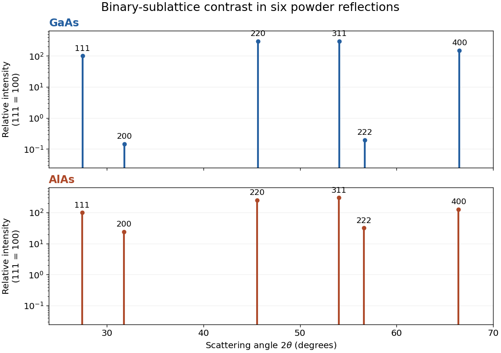

<h1 id="1/e/solution">Solution</h1>

↑ **Parent:** [E](../e.md)

The sixth allowed family is $400$. For the two [lattice constants](../../../../lattice-constant.md), use $2\theta_{400}=2\sin^{-1}(2\lambda/a)$:

$$
2\theta_{400}(\mathrm{GaAs})=66.50250^\circ,\qquad
2\theta_{400}(\mathrm{AlAs})=66.40961^\circ.
$$

Consequently

$$
\boxed{\Delta(2\theta)\equiv2\theta(\mathrm{AlAs})-2\theta(\mathrm{GaAs})=-0.09290^\circ.}
$$

The larger [lattice constant](../../../../lattice-constant.md) shifts the AlAs reflection to lower scattering angle. As a differential check, $\Delta(2\theta)\simeq-2\tan\theta\,\Delta a/a$ in radians.

If the angular displacement is unresolved, use the intensity contrast. With the same $f\simeq Z$ model, a difference reflection has basis amplitude $13-33=-20$ for AlAs, versus $31-33=-2$ for GaAs. Its squared amplitude is therefore one hundred times greater before overall sample normalization. More robustly, compare a weak and a strong reflection within each specimen. Neglecting their almost identical angular corrections,

$$
\frac{I_{200}}{I_{220}}=\frac6{12}\left(\frac{f_A-f_{\mathrm{As}}}{f_A+f_{\mathrm{As}}}\right)^2
=\begin{cases}0.0004883,&\mathrm{GaAs},\\0.09452,&\mathrm{AlAs}.
\end{cases}
$$

The contrast in this internal ratio is about a factor $194$. Element-specific [X-ray fluorescence](../../../../x-ray-fluorescence.md), for example testing for a Ga characteristic line with a suitably energetic incident beam, or an [X-ray absorption spectroscopy](../../../../x-ray-absorption-spectroscopy.md) scan through an element-specific [absorption edge](../../../../absorption-edge.md), also distinguishes composition. Such scans can change incident energy; one must not assume every core shell can be excited by the original $8\,\mathrm{keV}$ beam.

**[Figure 1](#1/e/image-approximate-powder-reflection-contrast-for-gaas-and-alas). Approximate powder-reflection contrast for GaAs and AlAs**. Original stick patterns use the six derived angles, $f\simeq Z$, and multiplicity times squared structure amplitude. Each compound is normalized to its own $111$ reflection. A logarithmic intensity scale reveals the nearly cancelled $200$ and $222$ GaAs reflections. Geometry and form-factor corrections are omitted deliberately.

## ↑ Ancestors (12)

1. [E](../e.md)
2. [1](../../1.md)
3. [2017](../../../2017-split.md)
4. [Past exam of the condensed matter physics course of the University of Oxford](../../../split.md)
5. [Condensed matter physics course of the University of Oxford](../../../../condensed-matter-physics-course-of-the-university-of-oxford.md)
6. [Year 3 of the physics course of the University of Oxford](../../../../year-3-of-the-physics-course-of-the-university-of-oxford.md)
7. [Physics course of the University of Oxford](../../../../physics-course-of-the-university-of-oxford.md)
8. [Undergraduate course of the University of Oxford](../../../../undergraduate-course-of-the-university-of-oxford.md)
9. [Course of the University of Oxford](../../../../course-of-the-university-of-oxford.md)
10. [University of Oxford](../../../../university-of-oxford-split.md)
11. [List of universities](../../../../list-of-universities.md)
12. [Codex Wiki](../../../../split.md)
