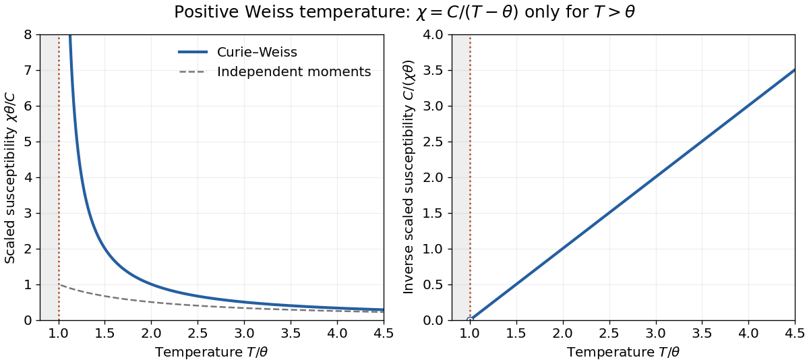

<h1 id="3/b/solution">Solution</h1>

↑ **Parent:** [B](../b.md)

In the [Weiss molecular field](../../../../weiss-molecular-field.md) approximation, the local response obeys

$$
M=n\mu_B\tanh\!\left[\frac{\mu_B(B+\lambda\mu_0M)}{k_BT}\right].
$$

Linearize around $M=B=0$ in the stable phase of [paramagnetism](../../../../paramagnetism.md). Substitution of [a](../a.md) gives

$$
M=\frac{C}{\mu_0T}(B+\lambda\mu_0M),\qquad
(T-\lambda C)M=\frac C{\mu_0}B.
$$

Hence the [Curie–Weiss law](../../../../curie-weiss-law.md) and [Weiss temperature](../../../../weiss-temperature.md) are

$$
\boxed{\chi=\frac{C}{T-\theta},\qquad
\theta=\lambda C=\frac{\lambda n\mu_0\mu_B^2}{k_B}.}
$$

For positive $\lambda$, $\theta$ is the [mean-field theory](../../../../mean-field-theory.md) [Curie temperature](../../../../curie-temperature.md): the zero-magnetization solution becomes unstable there, and below it a spontaneous solution appears. For negative coupling, a negative fitted [Weiss temperature](../../../../weiss-temperature.md) indicates predominantly opposing interactions, but this one-uniform-magnetization treatment does not determine an antiferromagnetic ordering pattern or its transition temperature. More generally the fitted [Weiss temperature](../../../../weiss-temperature.md) need not equal the observed ordering temperature.

For $\theta>0$, the paramagnetic curve is positive for $T>\theta$, diverges as $T\downarrow\theta$, and tends to $C/T$ at high [temperature](../../../../temperature-split.md); its inverse is the straight line $(T-\theta)/C$. The expression is not the stable susceptibility below $\theta$. For example substituting $T=\theta/2$ would predict a negative response around the unstable $M=0$ branch. The nonlinear self-consistency equation must instead be expanded about the appropriate spontaneous [magnetization](../../../../magnetization.md).

**[Figure 2](#3/b/image-paramagnetic-curie-weiss-susceptibility-and-its-inverse). Paramagnetic Curie-Weiss susceptibility and its inverse**. The positive-Weiss-temperature mean-field law is shown only in its stable paramagnetic range $T>\theta$. Its inverse extrapolates to zero at $T=\theta$. The curve below the transition is not obtained by continuing the displayed rational expression.

## ↑ Ancestors (12)

1. [B](../b.md)
2. [3](../../3.md)
3. [2017](../../../2017-split.md)
4. [Past exam of the condensed matter physics course of the University of Oxford](../../../split.md)
5. [Condensed matter physics course of the University of Oxford](../../../../condensed-matter-physics-course-of-the-university-of-oxford.md)
6. [Year 3 of the physics course of the University of Oxford](../../../../year-3-of-the-physics-course-of-the-university-of-oxford.md)
7. [Physics course of the University of Oxford](../../../../physics-course-of-the-university-of-oxford.md)
8. [Undergraduate course of the University of Oxford](../../../../undergraduate-course-of-the-university-of-oxford.md)
9. [Course of the University of Oxford](../../../../course-of-the-university-of-oxford.md)
10. [University of Oxford](../../../../university-of-oxford-split.md)
11. [List of universities](../../../../list-of-universities.md)
12. [Codex Wiki](../../../../split.md)
