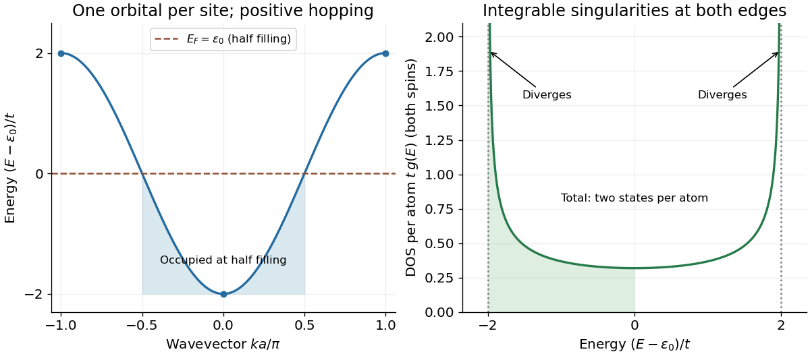
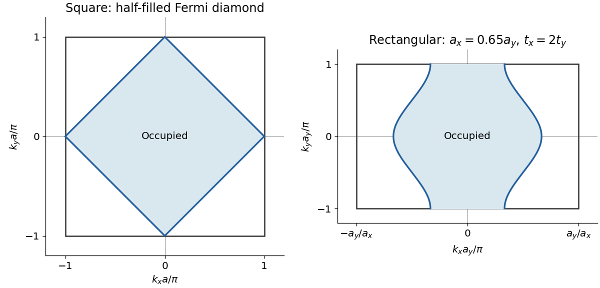
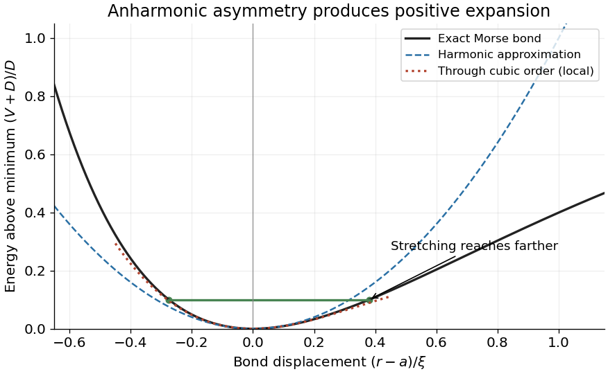
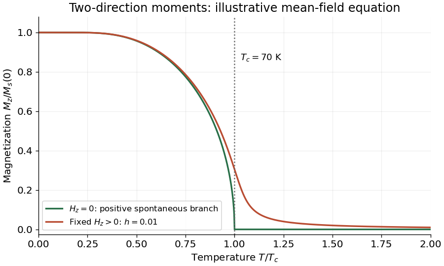

# 2018

↑ **Parent:** [Past exam of the condensed matter physics course of the University of Oxford](../past-exam-of-the-condensed-matter-physics-course-of-the-university-of-oxford.md)

Source paper: [https://www.whatdotheyknow.com/request/oxford_physics_past_papers_2/response/2340696/attach/6/Physics%20Papers%202017.pdf?cookie_passthrough=1.](https://www.whatdotheyknow.com/request/oxford_physics_past_papers_2/response/2340696/attach/6/Physics%20Papers%202017.pdf?cookie_passthrough=1.) The cover identifies B6 on 8 June 2018; the annual bundle's 2017 filename does not determine the examination year.

**Table of contents**

- [1](#1)
  - [a](#1/a)
    - [Solution](#1/a/solution)
  - [b](#1/b)
    - [Solution](#1/b/solution)
  - [c](#1/c)
    - [Solution](#1/c/solution)
  - [d](#1/d)
    - [Solution](#1/d/solution)
  - [e](#1/e)
    - [Solution](#1/e/solution)
- [2](#2)
  - [a](#2/a)
    - [Solution](#2/a/solution)
  - [b](#2/b)
    - [Solution](#2/b/solution)
  - [c](#2/c)
    - [Solution](#2/c/solution)
  - [d](#2/d)
    - [Solution](#2/d/solution)
  - [e](#2/e)
    - [Solution](#2/e/solution)
- [3](#3)
  - [a](#3/a)
    - [Solution](#3/a/solution)
  - [b](#3/b)
    - [Solution](#3/b/solution)
  - [c](#3/c)
    - [Solution](#3/c/solution)
  - [d](#3/d)
    - [Solution](#3/d/solution)
  - [e](#3/e)
    - [i](#3/e/i)
      - [Solution](#3/e/i/solution)
    - [ii](#3/e/ii)
      - [Solution](#3/e/ii/solution)
- [4](#4)
  - [a](#4/a)
    - [Solution](#4/a/solution)
  - [b](#4/b)
    - [Solution](#4/b/solution)
  - [c](#4/c)
    - [Solution](#4/c/solution)
  - [d](#4/d)
    - [Solution](#4/d/solution)
  - [e](#4/e)
    - [Solution](#4/e/solution)

## 1

↑ **Parent:** [2018](2018.md)

<h3 id="1/a">a</h3>

↑ **Parent:** [1](#1)

<h4 id="1/a/solution">Solution</h4>

↑ **Parent:** [A](#1/a)

A [Bravais lattice](../quantum-scattering.md#bravais-lattice) is a set of points generated by integer translations along three independent [primitive lattice translation vectors](../quantum-scattering.md#primitive-lattice-translation-vector):

$$
\mathbf R=n_1\mathbf a_1+n_2\mathbf a_2+n_3\mathbf a_3,\qquad n_i\in\mathbb Z.
$$

Every [lattice point](../quantum-scattering.md#lattice-point) has the same environment under [lattice translations](../quantum-scattering.md#lattice-translation). A [crystal structure](../physical-chemistry.md#crystal-structure) consists of this [Bravais lattice](../quantum-scattering.md#bravais-lattice) with an [atomic basis of a crystal](../physical-chemistry.md#atomic-basis-of-a-crystal) repeated at every [lattice point](../quantum-scattering.md#lattice-point); the set of atomic positions need not itself be a [Bravais lattice](../quantum-scattering.md#bravais-lattice).

The two positions in the conventional cubic cell of alpha-[tungsten](../chemical-substance.md#tungsten) give a [body-centred cubic lattice](../quantum-scattering.md#body-centered-cubic-lattice), with one [tungsten](../chemical-substance.md#tungsten) atom per primitive cell and two per conventional cell. One possible set of [primitive lattice translation vectors](../quantum-scattering.md#primitive-lattice-translation-vector) is

$$
\boxed{\mathbf a_1=\frac a2(-1,1,1),\quad\mathbf a_2=\frac a2(1,-1,1),\quad\mathbf a_3=\frac a2(1,1,-1).}
$$

Their primitive-cell [volume](../geometry-and-topology.md#volume) is $a^3/2$.

<h3 id="1/b">b</h3>

↑ **Parent:** [1](#1)

<h4 id="1/b/solution">Solution</h4>

↑ **Parent:** [B](#1/b)

For the conventional [body-centred cubic lattice](../quantum-scattering.md#body-centered-cubic-lattice), the [crystal basis structure factor](../quantum-scattering.md#crystal-basis-structure-factor) of identical atoms is

$$
F_{hkl}=f_{\mathrm W}\bigl[1+e^{i\pi(h+k+l)}\bigr].
$$

It vanishes for odd $h+k+l$ and equals $2f_{\mathrm W}$ for even $h+k+l$. Thus the first [powder diffraction](../physical-chemistry.md#powder-diffraction) ring is the $\{110\}$ family, with [interplanar spacing](../physical-chemistry.md#interplanar-spacing) $d_{110}=a/\sqrt2$.

The measured deflection is the angle between incident and scattered rays, $2\theta=40.26^\circ$, so the [Bragg angle](../quantum-scattering.md#bragg-angle) is $\theta=20.13^\circ$. Using first-order [Bragg diffraction](../quantum-scattering.md#bragg-diffraction), $2d\sin\theta=\lambda$, gives

$$
\boxed{a=\frac{\lambda}{\sqrt2\sin\theta}=0.31683\,\mathrm{nm}.}
$$

The [mass density](../fluid-mechanics.md#density) follows from two atoms per conventional [unit cell](../quantum-scattering.md#unit-cell), with molar mass $M=0.1838\,\mathrm{kg\,mol^{-1}}$ and [Avogadro constant](../physics.md#avogadro-constant) $N_A$:

$$
\boxed{\rho=\frac{2M}{N_Aa^3}=1.9194\times10^4\,\mathrm{kg\,m^{-3}}\simeq19.19\,\mathrm{g\,cm^{-3}}.}
$$

Using $40.26^\circ$ as the [Bragg angle](../quantum-scattering.md#bragg-angle) would confuse $\theta$ with $2\theta$ and give an incorrect [lattice constant](../physical-chemistry.md#lattice-constant) and [mass density](../fluid-mechanics.md#density).

<h3 id="1/c">c</h3>

↑ **Parent:** [1](#1)

<h4 id="1/c/solution">Solution</h4>

↑ **Parent:** [C](#1/c)

The beta phase has a [primitive cubic lattice](../quantum-scattering.md#primitive-cubic-lattice) with an eight-atom [atomic basis of a crystal](../physical-chemistry.md#atomic-basis-of-a-crystal), rather than a [body-centred cubic lattice](../quantum-scattering.md#body-centered-cubic-lattice). A [lattice translation](../quantum-scattering.md#lattice-translation) must map the entire atomic arrangement onto itself. For example, the putative body-centering vector $(1/2,1/2,1/2)$ maps $(1/4,1/2,0)$ to $(3/4,0,1/2)$ modulo integer coordinates, where the given [atomic basis of a crystal](../physical-chemistry.md#atomic-basis-of-a-crystal) has no atom. None of the seven nonzero basis positions generates a translation that preserves all eight sites. Therefore

$$
\boxed{\text{Bravais lattice: primitive cubic; basis: eight atoms.}}
$$

The presence of atoms at both the origin and the body centre alone is insufficient to establish body-centering of the full [crystal structure](../physical-chemistry.md#crystal-structure).

<h3 id="1/d">d</h3>

↑ **Parent:** [1](#1)

<h4 id="1/d/solution">Solution</h4>

↑ **Parent:** [D](#1/d)

Initially approximate every [tungsten](../chemical-substance.md#tungsten) atom by the same [atomic scattering factor](../quantum-scattering.md#atomic-scattering-factor) $f$. Pairing the quarter-coordinate sites in the [crystal basis structure factor](../quantum-scattering.md#crystal-basis-structure-factor) gives

$$
\frac{F_{hkl}}f=1+(-1)^{h+k+l}+2\left[(-1)^k\cos\frac{\pi h}{2}+(-1)^h\cos\frac{\pi l}{2}+(-1)^l\cos\frac{\pi k}{2}\right].
$$

For cubic [powder diffraction](../physical-chemistry.md#powder-diffraction), increasing deflection corresponds to increasing $h^2+k^2+l^2$, since $d_{hkl}=a/\sqrt{h^2+k^2+l^2}$. The first possibilities are

| Family | $h^2+k^2+l^2$ | $F/f$ \\ | $\{100\}$ | $1$ | $0$ \\ | $\{110\}$ | $2$ | $0$ \\ | $\{111\}$ | $3$ | $0$ \\ | $\{200\}$ | $4$ | $4$ \\ | $\{210\}$ | $5$ | $4$ |
| --- | --- | --- | --- | --- | --- |

Hence the first two strong rings have [Miller indices](../physical-chemistry.md#miller-index)

$$
\boxed{\{200\},\qquad\{210\}.}
$$

The [powder diffraction multiplicity](../physical-chemistry.md#powder-diffraction-multiplicity) is six for $\{200\}$, from three choices of nonzero axis and two signs. For $\{210\}$ it is $3!\,2^2=24$, from six permutations and four sign choices. If the [atomic scattering factors](../quantum-scattering.md#atomic-scattering-factor) and angular corrections are taken as approximately equal for these nearby rings, their integrated [diffraction intensity](../quantum-scattering.md#diffraction-intensity) obey

$$
\boxed{I_{200}:I_{210}\simeq6|4f|^2:24|4f|^2=1:4.}
$$

This is a multiplicity-based estimate. An exact measured ratio also depends on the momentum-transfer dependence of the [atomic scattering factor](../quantum-scattering.md#atomic-scattering-factor), the [Lorentz-polarization factor](../physical-chemistry.md#lorentz-polarization-factor), the [Debye–Waller factor](../quantum-ideal-gas-statistics.md#debye-waller-factor), absorption and instrument geometry. In particular, the source does not provide the beta-phase [lattice constant](../physical-chemistry.md#lattice-constant) or instrument corrections needed to calculate those angular factors. Peak heights additionally depend on peak widths; the estimate refers to integrated ring [intensities](../wave.md#intensity-physics).

<h3 id="1/e">e</h3>

↑ **Parent:** [1](#1)

<h4 id="1/e/solution">Solution</h4>

↑ **Parent:** [E](#1/e)

The two body-centre/origin sites and the other six sites have different local environments. Their effective [atomic scattering factors](../quantum-scattering.md#atomic-scattering-factor) therefore need not be identical even in an elemental, chemically pure [crystal](../thermodynamics.md#crystal). Write them as $f_A$ and $f_B$, respectively. The [crystal basis structure factor](../quantum-scattering.md#crystal-basis-structure-factor) becomes

$$
F_{hkl}=f_A[1+(-1)^{h+k+l}]+2f_B\left[(-1)^k\cos\frac{\pi h}{2}+(-1)^h\cos\frac{\pi l}{2}+(-1)^l\cos\frac{\pi k}{2}\right].
$$

For the low-angle families this gives

$$
F_{100}=0,\qquad \boxed{F_{110}=2(f_A-f_B),}\qquad F_{111}=0.
$$

Thus $\{110\}$ can produce a weak extra [powder diffraction](../physical-chemistry.md#powder-diffraction) ring below $\{200\}$. This is an [accidental diffraction extinction from equal atomic scattering factors](../quantum-scattering.md#accidental-diffraction-extinction-from-equal-atomic-scattering-factors): its cancellation in part d is exact only in the identical-atom-scattering approximation. Small differences in the bonding [electron density](../chemistry.md#electron-density), or site-dependent [Debye–Waller factors](../quantum-ideal-gas-statistics.md#debye-waller-factor), can leave a small nonzero amplitude. For instance, taking $f_A=f+\delta f$ and $f_B=f$ gives $F_{110}=2\delta f$ while $F_{200}=4f+2\delta f$; the corresponding intensity suppression is quadratic in $|\delta f/f|$. No impurity is required. The $\{100\}$ and $\{111\}$ cancellations remain for arbitrary scalar $f_A,f_B$ in this two-site-class model.

## 2

↑ **Parent:** [2018](2018.md)

<h3 id="2/a">a</h3>

↑ **Parent:** [2](#2)

<h4 id="2/a/solution">Solution</h4>

↑ **Parent:** [A](#2/a)

The [chemical potential](../chemical-potential.md) is the change in [Helmholtz free energy](../thermodynamic-potential.md#helmholtz-free-energy) when particles are added at fixed [temperature](../temperature.md) and [volume](../geometry-and-topology.md#volume):

$$
\boxed{\mu=\left(\frac{\partial F}{\partial N}\right)_{T,V}.}
$$

Equivalently, $dU=T\,dS-P\,dV+\mu\,dN$ identifies it as the derivative of [internal energy](../internal-energy.md) at fixed [entropy](../entropy.md) and [volume](../geometry-and-topology.md#volume). In equilibrium, systems that exchange particles have equal [chemical potentials](../chemical-potential.md).

The [Fermi energy](../quantum-ideal-gas-statistics.md#fermi-energy) is the zero-temperature [chemical potential](../chemical-potential.md), or, for independent [electrons](../physics.md#electron), the highest occupied single-particle [energy](../energy.md) in the zero-temperature limit. Its numerical value depends on the chosen [energy](../energy.md) reference; the [Fermi energy](../quantum-ideal-gas-statistics.md#fermi-energy) need not be measured from the bottom of a band unless that convention is specified.

<h3 id="2/b">b</h3>

↑ **Parent:** [2](#2)

<h4 id="2/b/solution">Solution</h4>

↑ **Parent:** [B](#2/b)

Expand a single-electron [wavefunction](../wave-function.md) as $|\psi\rangle=\sum_n\psi_n|n\rangle$. Project the [Schrödinger equation](../mathematical-physics.md#schrodinger-equation) onto $\langle n|$ to obtain

$$
E\psi_n=\epsilon_0\psi_n-t\psi_{n-1}-t\psi_{n+1}.
$$

Translation [symmetry](../physics.md#symmetry-physics) suggests the [Bloch state](../bloch-s-theorem.md#bloch-state) $\psi_n=N^{-1/2}e^{ikna}$ on a periodic chain of $N$ sites. Substitution gives

$$
\boxed{E(k)=\epsilon_0-t(e^{ika}+e^{-ika})=\epsilon_0-2t\cos(ka).}
$$

Take the conventional positive hopping $t>0$. The first [Brillouin zone](../bloch-s-theorem.md#brillouin-zone) is $-\pi/a\leq k<\pi/a$; the band has minimum $\epsilon_0-2t$ at $k=0$ and maximum $\epsilon_0+2t$ at the zone edges. Its width is $4t$. A negative hopping interchanges the extrema but does not change the [density of states](../quantum-ideal-gas-statistics.md#density-of-states) after replacing $t$ by $|t|$.

There are $N$ allowed [wavevectors](../elasticity-physics.md#wavevector) and two [spin](../angular-momentum-operator.md#spin) states per [wavevector](../elasticity-physics.md#wavevector). For the total spin-summed [density of states](../quantum-ideal-gas-statistics.md#density-of-states) $D(E)$, each interior band [energy](../energy.md) has two roots, $\pm k$. Using the spacing $2\pi/(Na)$ gives

$$
D(E)=\frac{2Na}{2\pi}\sum_{k:E(k)=E}\frac1{|dE/dk|}
=\frac{2N}{\pi\sqrt{4t^2-(E-\epsilon_0)^2}}.
$$

Thus the [density of states](../quantum-ideal-gas-statistics.md#density-of-states) per atom is

$$
\boxed{g(E)=\begin{cases}\dfrac{2}{\pi\sqrt{4t^2-(E-\epsilon_0)^2}},&|E-\epsilon_0|<2t,\\0,&|E-\epsilon_0|>2t.\end{cases}}
$$

It is symmetric about $\epsilon_0$ and has integrable inverse-square-root [Van Hove singularities](../quantum-ideal-gas-statistics.md#van-hove-singularity) at both band edges. Its [integral](../integral.md) over the band is two states per atom. The plot labels the dispersion extrema and both singular edges.

**[Figure 1](#2/b/image-one-dimensional-tight-binding-dispersion-and-spin-summed-density-of-states). One-dimensional tight binding dispersion and spin-summed density of states**.

<h3 id="2/c">c</h3>

↑ **Parent:** [2](#2)

<h4 id="2/c/solution">Solution</h4>

↑ **Parent:** [C](#2/c)

Monovalency gives one [electron](../physics.md#electron) per atom, so the two-spin-state band is half filled. At zero [temperature](../temperature.md), occupying $-k_F<k<k_F$ gives $2(Na/2\pi)(2k_F)=N$. Hence

$$
\boxed{k_F=\frac{\pi}{2a},\qquad E_F=E(k_F)=\epsilon_0.}
$$

Relative to the band minimum, the [Fermi energy](../quantum-ideal-gas-statistics.md#fermi-energy) is $2t$.

The [density of states](../quantum-ideal-gas-statistics.md#density-of-states) obeys $g(\epsilon_0+x)=g(\epsilon_0-x)$. At $\mu=\epsilon_0$, the [Fermi-Dirac distribution](../quantum-ideal-gas-statistics.md#fermi-dirac-distribution) satisfies

$$
f(\epsilon_0+x)+f(\epsilon_0-x)=1.
$$

Pairing the energies above and below the band centre therefore leaves exactly half of the two available states per atom occupied, at every positive [temperature](../temperature.md). Increasing $\mu$ strictly increases the mean particle number, so this solution at fixed half filling is unique. Consequently

$$
\boxed{\mu(T)=\epsilon_0\quad\text{for every }T\text{ in this isolated symmetric-band model}.}
$$

This [particle-hole symmetry of a half-filled bipartite band](../bloch-s-theorem.md#particle-hole-symmetry-of-a-half-filled-bipartite-band) argument uses the symmetric [tight binding](../bloch-s-theorem.md#tight-binding) band and fixed half filling; it is not a general temperature-independence property of [chemical potential](../chemical-potential.md) in metals with additional bands or an asymmetric [density of states](../quantum-ideal-gas-statistics.md#density-of-states).

<h3 id="2/d">d</h3>

↑ **Parent:** [2](#2)

<h4 id="2/d/solution">Solution</h4>

↑ **Parent:** [D](#2/d)

The first [Brillouin zone](../bloch-s-theorem.md#brillouin-zone) is the square

$$
-\frac\pi a\leq k_x<\frac\pi a,\qquad -\frac\pi a\leq k_y<\frac\pi a.
$$

At half filling, translation of the [wavevector](../elasticity-physics.md#wavevector) by $\mathbf Q=(\pi/a,\pi/a)$ exchanges the two band [energies](../energy.md):

$$
E(\mathbf k+\mathbf Q)-\epsilon_0=-[E(\mathbf k)-\epsilon_0].
$$

Thus the same energy-pair argument as in part c gives

$$
\boxed{\mu(T)=\epsilon_0.}
$$

At zero [temperature](../temperature.md), the [Fermi surface](../fermi-liquid.md#fermi-surface) satisfies $\cos(k_xa)+\cos(k_ya)=0$. Within the square [Brillouin zone](../bloch-s-theorem.md#brillouin-zone) this is the diamond

$$
\boxed{|k_x|+|k_y|=\frac\pi a,}
$$

whose vertices are $(\pm\pi/a,0)$ and $(0,\pm\pi/a)$. The occupied region is the diamond's interior, containing the band minimum at the zone centre. It has half the [Brillouin zone](../bloch-s-theorem.md#brillouin-zone) area, consistent with one [electron](../physics.md#electron) per atom and two [spin](../angular-momentum-operator.md#spin) states per [wavevector](../elasticity-physics.md#wavevector).

**[Figure 2](#2/d/image-brillouin-zones-and-half-filled-fermi-surfaces-for-square-and-rectangular-models). Brillouin zones and half-filled Fermi surfaces for square and rectangular models**.

<h3 id="2/e">e</h3>

↑ **Parent:** [2](#2)

<h4 id="2/e/solution">Solution</h4>

↑ **Parent:** [E](#2/e)

The reciprocal primitive vectors are $(2\pi/a_x,0)$ and $(0,2\pi/a_y)$, so the first [Brillouin zone](../bloch-s-theorem.md#brillouin-zone) is

$$
\boxed{|k_x|\leq\pi/a_x,\qquad |k_y|\leq\pi/a_y.}
$$

It is wider in the $k_x$ direction because $a_x<a_y$.

The geometry alone does not fix the hopping amplitudes or a unique [Fermi surface](../fermi-liquid.md#fermi-surface). One consistent [tight-binding model](../bloch-s-theorem.md#tight-binding) is

$$
E(\mathbf k)=\epsilon_0-2t_x\cos(k_xa_x)-2t_y\cos(k_ya_y),\qquad t_x>t_y>0,
$$

representing larger hopping between the closer atoms. It remains a nearest-neighbour bipartite band at half filling, so its [chemical potential](../chemical-potential.md) is $\epsilon_0$. Its [Fermi surface](../fermi-liquid.md#fermi-surface) consists of the two sheets

$$
\boxed{k_x=\pm\frac1{a_x}\arccos\!\left[-\frac{t_y}{t_x}\cos(k_ya_y)\right].}
$$

These meet the top and bottom zone edges and continue periodically into the neighbouring zones. The right panel of the figure gives an explicit example with $t_x=2t_y$ and $a_x=0.65a_y$. The central region between the sheets is occupied and has half the zone area. If the hopping amplitudes instead remained equal, a geometrically stretched diamond would also satisfy the stated information. The metric inequality $a_x<a_y$ alone does not determine which of these shapes occurs.

## 3

↑ **Parent:** [2018](2018.md)

<h3 id="3/a">a</h3>

↑ **Parent:** [3](#3)

<h4 id="3/a/solution">Solution</h4>

↑ **Parent:** [A](#3/a)

A [phonon](../quantum-ideal-gas-statistics.md#phonon) is a quantum of a [normal mode](../wave-equation.md#normal-mode) of [Bravais lattice](../quantum-scattering.md#bravais-lattice) vibration. A harmonic mode of [angular frequency](../lagrangian-mechanics.md#angular-frequency) $\omega$ has [energy](../energy.md) $\hbar\omega(n+1/2)$, and adding one [phonon](../quantum-ideal-gas-statistics.md#phonon) increases its [energy](../energy.md) by $\hbar\omega$. The [phonon](../quantum-ideal-gas-statistics.md#phonon) carries [crystal momentum](../bloch-s-theorem.md#crystal-momentum) $\hbar\mathbf q$, defined modulo a [reciprocal lattice](../quantum-scattering.md#reciprocal-lattice) vector.

The first [Brillouin zone](../bloch-s-theorem.md#brillouin-zone) is the [Wigner-Seitz cell](../quantum-scattering.md#wigner-seitz-cell) of the [reciprocal lattice](../quantum-scattering.md#reciprocal-lattice) about the origin: the set of [wavevectors](../elasticity-physics.md#wavevector) at least as close to the origin as to any other [reciprocal lattice](../quantum-scattering.md#reciprocal-lattice) point. Its boundaries are reciprocal-space perpendicular bisectors. It gives one representative of each [wavevector](../elasticity-physics.md#wavevector) modulo [reciprocal lattice](../quantum-scattering.md#reciprocal-lattice) translations.

<h3 id="3/b">b</h3>

↑ **Parent:** [3](#3)

<h4 id="3/b/solution">Solution</h4>

↑ **Parent:** [B](#3/b)

Put $y=e^{-r/\xi}$. Differentiating the [Morse potential](../quantum-system.md#morse-potential) gives

$$
V'(r)=\frac1\xi(-2Ay^2+By).
$$

The finite-separation minimum has $y=B/(2A)$. Thus

$$
\boxed{a=\xi\ln\frac{2A}{B}=0.36809\,\mathrm{nm},\qquad V(a)=-\frac{B^2}{4A}=-0.250\,\mathrm{eV}.}
$$

The positive [bond-dissociation energy](../chemical-bond.md#bond-dissociation-energy) is $D=B^2/(4A)=0.250\,\mathrm{eV}$, measured relative to the separated-atom value $V(\infty)=0$. This distinguishes the well's negative [potential energy](../energy.md#potential-energy) from the positive [energy](../energy.md) required to break the bond.

For the displacement $x=r-a$, the [Taylor expansion](../calculus.md#taylor-expansion) is

$$
V(a+x)=V(a)+\frac12\kappa x^2+O(x^3),\qquad
\kappa=V''(a)=\frac{B^2}{2A\xi^2}=\frac{2D}{\xi^2}.
$$

Consequently

$$
\boxed{\kappa=70.862\,\mathrm{eV\,nm^{-2}}=11.353\,\mathrm{N\,m^{-1}}.}
$$

The restoring [force](../force.md) is $-\kappa x$ to leading order, identifying the bond's [Hooke's law](../elasticity-physics.md#hooke-s-law) [spring constant](../elasticity-physics.md#spring-constant).

<h3 id="3/c">c</h3>

↑ **Parent:** [3](#3)

<h4 id="3/c/solution">Solution</h4>

↑ **Parent:** [C](#3/c)

The [mass](../classical-mechanics.md#mass) per [lead](../chemical-substance.md#lead) atom is

$$
m=\frac{0.2070\,\mathrm{kg\,mol^{-1}}}{N_A}=3.4373\times10^{-25}\,\mathrm{kg}.
$$

Let $u_n$ be its longitudinal displacement. [Newton's second law](../force.md#newton-s-second-law) gives the [harmonic chain](../classical-mechanics.md#harmonic-chain) equation

$$
m\ddot u_n=\kappa(u_{n+1}+u_{n-1}-2u_n).
$$

Insert the [normal mode](../wave-equation.md#normal-mode) $u_n=u\,e^{i(kna-\omega t)}$ to obtain

$$
\omega^2=\frac{4\kappa}{m}\sin^2\frac{ka}{2}.
$$

At long [wavelength](../wave-equation.md#wavelength), $\omega\simeq a\sqrt{\kappa/m}\,|k|$. The [sound speed](../compressible-flow.md#speed-of-sound) is the corresponding low-[frequency](../wave.md#frequency) [group velocity](../dispersion-relation.md#group-velocity):

$$
\boxed{v_s=a\sqrt{\frac\kappa m}=2.1155\times10^3\,\mathrm{m\,s^{-1}}.}
$$

The relevant inertia in this chain equation is one atomic [mass](../classical-mechanics.md#mass). The reduced [mass](../classical-mechanics.md#mass) $m/2$ belongs to the relative vibration of an isolated pair and should not be substituted for $m$ in the chain's [dispersion relation](../dispersion-relation.md).

<h3 id="3/d">d</h3>

↑ **Parent:** [3](#3)

<h4 id="3/d/solution">Solution</h4>

↑ **Parent:** [D](#3/d)

Write the [Morse potential](../quantum-system.md#morse-potential) relative to its minimum as $V(a+x)=D[e^{-2x/\xi}-2e^{-x/\xi}]$. Expanding one order beyond the harmonic term gives

$$
\boxed{V(a+x)=-D+\frac{D}{\xi^2}x^2-\frac{D}{\xi^3}x^3+O(x^4)
=-D+\frac\kappa2x^2-\frac{\kappa}{2\xi}x^3+O(x^4).}
$$

The negative cubic coefficient means that stretching is softer than compression. Thermal motion therefore has positive mean displacement even though the most probable minimum is at $x=0$.

For [thermal expansion of a weakly anharmonic bond](../thermodynamics.md#thermal-expansion-of-a-weakly-anharmonic-bond), classical [equipartition](../canonical-ensemble.md#equipartition-theorem) gives $\langle x^2\rangle_0=k_BT/\kappa$. Vanishing mean restoring [force](../force.md), to first anharmonic order, requires

$$
0=\langle V'(a+x)\rangle=\kappa\langle x\rangle-\frac{3\kappa}{2\xi}\langle x^2\rangle+\cdots,
\qquad \langle x\rangle\simeq\frac{3k_BT}{2\kappa\xi}.
$$

For a bond free to expand under negligible applied tension, $L=\langle r\rangle\simeq a+\langle x\rangle$. Its [linear thermal expansion coefficient](../thermodynamics.md#linear-thermal-expansion-coefficient) is therefore

$$
\boxed{\alpha\sim\frac{k_B}{a\kappa\xi}\simeq3.9\times10^{-5}\,\mathrm{K^{-1}}.}
$$

Keeping the leading perturbative numerical factor gives $\alpha\simeq3k_B/(2a\kappa\xi)=5.9\times10^{-5}\,\mathrm{K^{-1}}$. The question only requires the scale, not that factor. The [thermal expansion](../thermodynamics.md#thermal-expansion) is positive; a purely harmonic approximation would give zero mean displacement and zero [thermal expansion](../thermodynamics.md#thermal-expansion). The local [Taylor expansion](../calculus.md#taylor-expansion) describes a bound bond and is not a globally stable cubic potential.

**[Figure 3](#3/d/image-morse-potential-asymmetry-and-its-local-harmonic-and-cubic-approximations). Morse potential asymmetry and its local harmonic and cubic approximations**.

<h3 id="3/e">e</h3>

↑ **Parent:** [3](#3)

<h4 id="3/e/i">i</h4>

↑ **Parent:** [E](#3/e)

<h5 id="3/e/i/solution">Solution</h5>

↑ **Parent:** [I](#3/e/i)

The small parameter controlling the local [Taylor expansion](../calculus.md#taylor-expansion) is the typical bond displacement divided by $\xi$. In the classical regime, the root-mean-square displacement is $x_{\mathrm{rms}}\simeq\sqrt{k_BT/\kappa}$. Thus

$$
\boxed{\frac{x_{\mathrm{rms}}}{\xi}\ll1\quad\Longleftrightarrow\quad
T\ll\frac{\kappa\xi^2}{k_B}=5.80\times10^3\,\mathrm K.}
$$

For example, the magnitude of the cubic term divided by the quadratic term is $|x|/\xi$, and subsequent terms carry further powers of this ratio. A physically safe bound-bond regime also has $k_BT\ll D$, or $T\ll2.90\times10^3\,\mathrm K$. These are the same parametric scale, differing only by a factor two. The inequalities are strong: they do not imply that a truncated local expansion is accurate close to several thousand kelvin.

At very low [temperature](../temperature.md), replace the classical fluctuation estimate by the [zero-point motion](../quantum-harmonic-oscillator.md#zero-point-motion) as discussed in part ii. Its bond displacement is small compared with $\xi$ for the supplied parameters, so low [temperature](../temperature.md) does not itself invalidate the local expansion. Actual melting, other neighbours and bond breaking are outside this one-dimensional bond model.

<h4 id="3/e/ii">ii</h4>

↑ **Parent:** [E](#3/e)

<h5 id="3/e/ii/solution">Solution</h5>

↑ **Parent:** [Ii](#3/e/ii)

Quantum statistics matter when thermal [energy](../energy.md) is comparable with a characteristic vibrational level spacing. The chain's natural [angular frequency](../lagrangian-mechanics.md#angular-frequency) is $\omega_0=\sqrt{\kappa/m}=5.7471\times10^{12}\,\mathrm{s^{-1}}$, giving

$$
\boxed{T_Q\sim\frac{\hbar\omega_0}{k_B}=43.9\,\mathrm K.}
$$

Factors of order unity depend on which vibrational scale is used. The largest chain [phonon](../quantum-ideal-gas-statistics.md#phonon) [angular frequency](../lagrangian-mechanics.md#angular-frequency) is $2\omega_0$, corresponding to $87.8\,\mathrm K$. An isolated two-atom bond has reduced [mass](../classical-mechanics.md#mass) $m/2$ and [angular frequency](../lagrangian-mechanics.md#angular-frequency) $\sqrt2\omega_0$, corresponding to $62.1\,\mathrm K$. Thus quantum corrections become appreciable on the scale of several tens of kelvin, and all modes are classical only when $T$ is comfortably above the largest relevant vibrational scale. Below it, high-[frequency](../wave.md#frequency) [phonons](../quantum-ideal-gas-statistics.md#phonon) are progressively frozen out and [equipartition](../canonical-ensemble.md#equipartition-theorem) fails.

For the isolated bond, the zero-temperature root-mean-square relative displacement is

$$
x_{\mathrm{zp}}=\sqrt{\frac{\hbar}{2(m/2)(\sqrt2\omega_0)}}\simeq0.0061\,\mathrm{nm}\simeq0.073\xi.
$$

It is small enough for a local bond expansion. The classical weakly anharmonic estimate in part d therefore has a useful parametric window

$$
\boxed{10^2\,\mathrm K\ll T\ll\text{a few }10^3\,\mathrm K,}
$$

where the lower condition means comfortably above the vibrational scale, rather than a sharp threshold. The model's upper bound concerns local anharmonicity and binding, not a prediction of the melting temperature.

## 4

↑ **Parent:** [2018](2018.md)

<h3 id="4/a">a</h3>

↑ **Parent:** [4](#4)

<h4 id="4/a/solution">Solution</h4>

↑ **Parent:** [A](#4/a)

A material with [paramagnetism](../electromagnetism.md#paramagnetism) develops a [magnetization](../electromagnetism.md#magnetization) parallel to a weak applied [magnetic field intensity](../electromagnetism.md#magnetic-field-intensity), with positive [magnetic susceptibility](../statistical-physics.md#magnetic-susceptibility) and no spontaneous [magnetization](../electromagnetism.md#magnetization) in its paramagnetic phase. [Molecular oxygen](../chemical-substance.md#molecular-oxygen) is an example; it has unpaired [electron spins](../angular-momentum-operator.md#electron-spin).

A material with [diamagnetism](../electromagnetism.md#diamagnetism) develops an induced [magnetization](../electromagnetism.md#magnetization) opposing the applied [magnetic field](../magnetic-field.md), with negative [magnetic susceptibility](../statistical-physics.md#magnetic-susceptibility). A closed-shell atom such as [helium](../chemical-substance.md#helium) is an example; its orbital response is diamagnetic.

A [ferromagnet](../electromagnetism.md#ferromagnet) has a spontaneously ordered [magnetization](../electromagnetism.md#magnetization) below its [Curie temperature](../electromagnetism.md#curie-temperature), even in the limit of vanishing applied [magnetic field](../magnetic-field.md). [Iron](../chemical-substance.md#iron) below its [Curie temperature](../electromagnetism.md#curie-temperature) is an example. Different [magnetic domains](../electromagnetism.md#magnetic-domain) can cancel the net moment of an unmagnetized bulk sample, despite nonzero local spontaneous [magnetization](../electromagnetism.md#magnetization).

<h3 id="4/b">b</h3>

↑ **Parent:** [4](#4)

<h4 id="4/b/solution">Solution</h4>

↑ **Parent:** [B](#4/b)

An $f$ shell has orbital quantum number $l=3$ and seven orbital states with $m_l=-3,-2,\ldots,3$. The first of [Hund's rules](../chemistry.md#hund-s-rules) maximizes total [spin](../angular-momentum-operator.md#spin) subject to the [Pauli exclusion principle](../tensor-product-of-quantum-systems.md#pauli-exclusion-principle). Seven [electrons](../physics.md#electron) occupy the seven orbitals singly with parallel spins, giving

$$
\boxed{S=7\times\frac12=\frac72.}
$$

Their orbital projections sum to zero, so the half-filled shell also has total orbital [angular momentum](../momentum.md#angular-momentum) $L=0$, total $J=7/2$, and [Landé g-factor](../atomic-physics.md#lande-g-factor) $g_J=2$. These further values identify the magnetic moment used below.

<h3 id="4/c">c</h3>

↑ **Parent:** [4](#4)

<h4 id="4/c/solution">Solution</h4>

↑ **Parent:** [C](#4/c)

The specified two-direction constraint permits magnetic moments $\mu_z=\pm\mu$, with

$$
\mu=g_JS\mu_B=7\mu_B,
$$

where $\mu_B$ is the [Bohr magneton](../electromagnetism.md#bohr-magneton). There are four magnetic [gadolinium](../chemical-substance.md#gadolinium) ions per conventional [face-centered cubic lattice](../quantum-scattering.md#face-centered-cubic-lattice) cell; the closed-shell nitrogen ions add no local spin moment. Hence the magnetic-ion [number density](../statistical-physics.md#number-density) is

$$
n=\frac4{a^3}=3.20\times10^{28}\,\mathrm{m^{-3}}.
$$

At high [temperature](../temperature.md), neglect interactions and use $B_z\simeq\mu_0H_z$. The one-ion [partition function](../canonical-ensemble.md#canonical-partition-function) and mean [magnetic dipole moment](../electromagnetism.md#magnetic-dipole-moment) are

$$
Z_1=2\cosh\!\left(\frac{\mu\mu_0H_z}{k_BT}\right),\qquad
\langle\mu_z\rangle=\mu\tanh\!\left(\frac{\mu\mu_0H_z}{k_BT}\right).
$$

In the weak-[magnetic field](../magnetic-field.md) limit, $\tanh x\simeq x$, so $M_z=n\langle\mu_z\rangle=\mu_0n\mu^2H_z/(k_BT)$. Thus the dimensionless SI [magnetic susceptibility](../statistical-physics.md#magnetic-susceptibility) is $\chi=C/T$, with

$$
\boxed{C=\frac{\mu_0n(7\mu_B)^2}{k_B}=12.27\,\mathrm K.}
$$

The coefficient has units of kelvin. The unrestricted-spin expression proportional to $S(S+1)/3$ is inappropriate here: the source explicitly retains only the two orientations with $S_z=\pm S$. In this [two-state Curie law](../electromagnetism.md#two-state-curie-law), the squared axial moment is $(g_JS\mu_B)^2$.

<h3 id="4/d">d</h3>

↑ **Parent:** [4](#4)

<h4 id="4/d/solution">Solution</h4>

↑ **Parent:** [D](#4/d)

Ferromagnetic interactions enhance the response above the ordering transition. The [Curie–Weiss law](../electromagnetism.md#curie-weiss-law) improves the independent-spin approximation:

$$
\boxed{\chi(T)\simeq\frac{C}{T-\Theta},\qquad T>T_c,}
$$

with positive [Weiss temperature](../electromagnetism.md#weiss-temperature) $\Theta$ and the same high-[temperature](../temperature.md) coefficient $C$. In a simple [mean-field theory](../statistical-physics.md#mean-field-theory), take $\Theta=T_c=70\,\mathrm K$. More generally $\Theta$ is fitted and need not equal $T_c$, and the simple pole does not give exact critical behaviour arbitrarily close to the transition.

At zero [temperature](../temperature.md), a selected ferromagnetic orientation has all magnetic moments aligned. Its [saturation magnetization](../statistical-physics.md#saturation-magnetization) is

$$
\boxed{M_s(0)=n\mu=\frac4{a^3}(7\mu_B)=2.077\times10^6\,\mathrm{A\,m^{-1}}.}
$$

Equivalently, there are $28\mu_B$ per conventional cell. The moment points along either allowed easy-axis direction at zero [magnetic field](../magnetic-field.md). This is the local or single-domain spontaneous [magnetization](../electromagnetism.md#magnetization); a macroscopic multidomain sample can have smaller, even zero, net [magnetization](../electromagnetism.md#magnetization) in the absence of a selecting field.

<h3 id="4/e">e</h3>

↑ **Parent:** [4](#4)

<h4 id="4/e/solution">Solution</h4>

↑ **Parent:** [E](#4/e)

Choose the positive spontaneous branch for $H_z=0$. Its [magnetization](../electromagnetism.md#magnetization) starts at $M_s(0)$, decreases with [temperature](../temperature.md), and reaches zero continuously at $T_c$. It remains zero for $T_c\leq T<2T_c$. There is an equally valid negative branch below $T_c$; domain averaging can instead give zero net moment.

A fixed small positive [magnetic field intensity](../electromagnetism.md#magnetic-field-intensity) selects the positive branch. At zero [temperature](../temperature.md) it still saturates at $M_s(0)$; at intermediate [temperature](../temperature.md) it increases the [magnetization](../electromagnetism.md#magnetization) relative to the zero-field branch. It rounds the zero-field transition and leaves a positive [magnetization](../electromagnetism.md#magnetization) above $T_c$, tending in the linear-response region to $C H_z/(T-\Theta)$. The [magnetization](../electromagnetism.md#magnetization) therefore does not vanish at $T_c$ in the nonzero-field curve.

For a concrete labelled sketch, the figure uses the illustrative [mean-field theory](../statistical-physics.md#mean-field-theory) equation

$$
m=\tanh\!\left(\frac{m+h}{t}\right),\qquad
m=\frac{M_z}{M_s(0)},\quad t=\frac{T}{T_c},\quad h=\frac{\mu\mu_0H_z}{k_BT_c}.
$$

It shows $h=0$ and a fixed small $h=0.01$. The curve is an illustrative equilibrium equation of state, not a determination of the precise critical exponents of GdN. At $h>0$ no symmetry-breaking transition remains along this temperature sweep.

**[Figure 4](#4/e/image-spontaneous-and-field-selected-magnetization-in-the-two-direction-model). Spontaneous and field-selected magnetization in the two-direction model**.

## ↑ Ancestors (9)

1. [Past exam of the condensed matter physics course of the University of Oxford](../past-exam-of-the-condensed-matter-physics-course-of-the-university-of-oxford.md)
2. [Condensed matter physics course of the University of Oxford](../university-of-oxford.md#condensed-matter-physics-course-of-the-university-of-oxford)
3. [Year 3 of the physics course of the University of Oxford](../university-of-oxford.md#year-3-of-the-physics-course-of-the-university-of-oxford)
4. [Physics course of the University of Oxford](../university-of-oxford.md#physics-course-of-the-university-of-oxford)
5. [Undergraduate course of the University of Oxford](../university-of-oxford.md#undergraduate-course-of-the-university-of-oxford)
6. [Course of the University of Oxford](../university-of-oxford.md#course-of-the-university-of-oxford)
7. [University of Oxford](../university-of-oxford.md)
8. [List of universities](../README.md#list-of-universities)
9. [Codex Wiki](../README.md)
