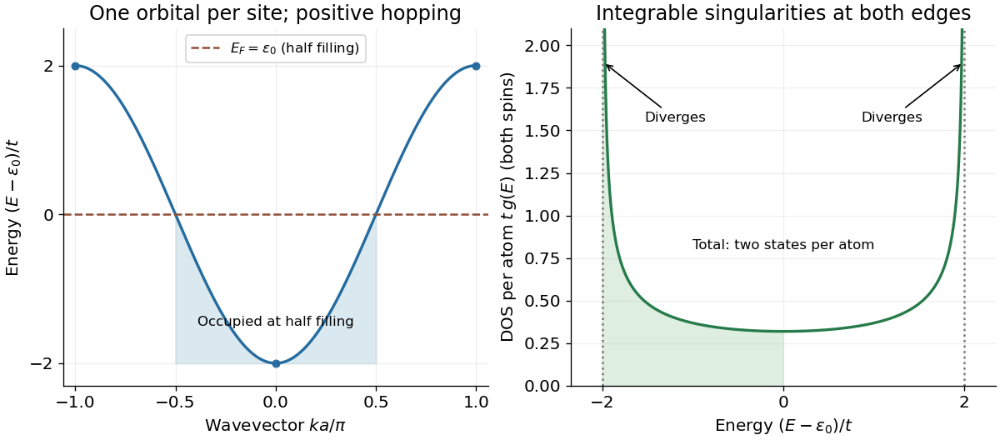

<h1 id="2/b/solution">Solution</h1>

↑ **Parent:** [B](../b.md)

Expand a single-electron [wavefunction](../../../../wave-function-split.md) as $|\psi\rangle=\sum_n\psi_n|n\rangle$. Project the [Schrödinger equation](../../../../schrodinger-equation.md) onto $\langle n|$ to obtain

$$
E\psi_n=\epsilon_0\psi_n-t\psi_{n-1}-t\psi_{n+1}.
$$

Translation [symmetry](../../../../symmetry-physics.md) suggests the [Bloch state](../../../../bloch-state.md) $\psi_n=N^{-1/2}e^{ikna}$ on a periodic chain of $N$ sites. Substitution gives

$$
\boxed{E(k)=\epsilon_0-t(e^{ika}+e^{-ika})=\epsilon_0-2t\cos(ka).}
$$

Take the conventional positive hopping $t>0$. The first [Brillouin zone](../../../../brillouin-zone.md) is $-\pi/a\leq k<\pi/a$; the band has minimum $\epsilon_0-2t$ at $k=0$ and maximum $\epsilon_0+2t$ at the zone edges. Its width is $4t$. A negative hopping interchanges the extrema but does not change the [density of states](../../../../density-of-states.md) after replacing $t$ by $|t|$.

There are $N$ allowed [wavevectors](../../../../wavevector.md) and two [spin](../../../../spin.md) states per [wavevector](../../../../wavevector.md). For the total spin-summed [density of states](../../../../density-of-states.md) $D(E)$, each interior band [energy](../../../../energy-split.md) has two roots, $\pm k$. Using the spacing $2\pi/(Na)$ gives

$$
D(E)=\frac{2Na}{2\pi}\sum_{k:E(k)=E}\frac1{|dE/dk|}
=\frac{2N}{\pi\sqrt{4t^2-(E-\epsilon_0)^2}}.
$$

Thus the [density of states](../../../../density-of-states.md) per atom is

$$
\boxed{g(E)=\begin{cases}\dfrac{2}{\pi\sqrt{4t^2-(E-\epsilon_0)^2}},&|E-\epsilon_0|<2t,\\0,&|E-\epsilon_0|>2t.\end{cases}}
$$

It is symmetric about $\epsilon_0$ and has integrable inverse-square-root [Van Hove singularities](../../../../van-hove-singularity.md) at both band edges. Its [integral](../../../../integral-split.md) over the band is two states per atom. The plot labels the dispersion extrema and both singular edges.

**[Figure 1](#2/b/image-one-dimensional-tight-binding-dispersion-and-spin-summed-density-of-states). One-dimensional tight binding dispersion and spin-summed density of states**.

## ↑ Ancestors (12)

1. [B](../b.md)
2. [2](../../2.md)
3. [2018](../../../2018-split.md)
4. [Past exam of the condensed matter physics course of the University of Oxford](../../../split.md)
5. [Condensed matter physics course of the University of Oxford](../../../../condensed-matter-physics-course-of-the-university-of-oxford.md)
6. [Year 3 of the physics course of the University of Oxford](../../../../year-3-of-the-physics-course-of-the-university-of-oxford.md)
7. [Physics course of the University of Oxford](../../../../physics-course-of-the-university-of-oxford.md)
8. [Undergraduate course of the University of Oxford](../../../../undergraduate-course-of-the-university-of-oxford.md)
9. [Course of the University of Oxford](../../../../course-of-the-university-of-oxford.md)
10. [University of Oxford](../../../../university-of-oxford-split.md)
11. [List of universities](../../../../list-of-universities.md)
12. [Codex Wiki](../../../../split.md)
