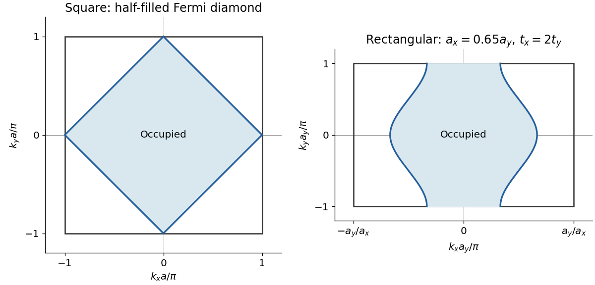

<h1 id="2/d/solution">Solution</h1>

↑ **Parent:** [D](../d.md)

The first [Brillouin zone](../../../../brillouin-zone.md) is the square

$$
-\frac\pi a\leq k_x<\frac\pi a,\qquad -\frac\pi a\leq k_y<\frac\pi a.
$$

At half filling, translation of the [wavevector](../../../../wavevector.md) by $\mathbf Q=(\pi/a,\pi/a)$ exchanges the two band [energies](../../../../energy-split.md):

$$
E(\mathbf k+\mathbf Q)-\epsilon_0=-[E(\mathbf k)-\epsilon_0].
$$

Thus the same energy-pair argument as in part c gives

$$
\boxed{\mu(T)=\epsilon_0.}
$$

At zero [temperature](../../../../temperature-split.md), the [Fermi surface](../../../../fermi-surface.md) satisfies $\cos(k_xa)+\cos(k_ya)=0$. Within the square [Brillouin zone](../../../../brillouin-zone.md) this is the diamond

$$
\boxed{|k_x|+|k_y|=\frac\pi a,}
$$

whose vertices are $(\pm\pi/a,0)$ and $(0,\pm\pi/a)$. The occupied region is the diamond's interior, containing the band minimum at the zone centre. It has half the [Brillouin zone](../../../../brillouin-zone.md) area, consistent with one [electron](../../../../electron.md) per atom and two [spin](../../../../spin.md) states per [wavevector](../../../../wavevector.md).

**[Figure 2](#2/d/image-brillouin-zones-and-half-filled-fermi-surfaces-for-square-and-rectangular-models). Brillouin zones and half-filled Fermi surfaces for square and rectangular models**.

## ↑ Ancestors (12)

1. [D](../d.md)
2. [2](../../2.md)
3. [2018](../../../2018-split.md)
4. [Past exam of the condensed matter physics course of the University of Oxford](../../../split.md)
5. [Condensed matter physics course of the University of Oxford](../../../../condensed-matter-physics-course-of-the-university-of-oxford.md)
6. [Year 3 of the physics course of the University of Oxford](../../../../year-3-of-the-physics-course-of-the-university-of-oxford.md)
7. [Physics course of the University of Oxford](../../../../physics-course-of-the-university-of-oxford.md)
8. [Undergraduate course of the University of Oxford](../../../../undergraduate-course-of-the-university-of-oxford.md)
9. [Course of the University of Oxford](../../../../course-of-the-university-of-oxford.md)
10. [University of Oxford](../../../../university-of-oxford-split.md)
11. [List of universities](../../../../list-of-universities.md)
12. [Codex Wiki](../../../../split.md)
