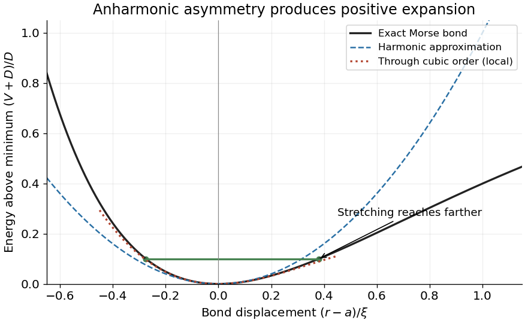

<h1 id="3/d/solution">Solution</h1>

↑ **Parent:** [D](../d.md)

Write the [Morse potential](../../../../morse-potential.md) relative to its minimum as $V(a+x)=D[e^{-2x/\xi}-2e^{-x/\xi}]$. Expanding one order beyond the harmonic term gives

$$
\boxed{V(a+x)=-D+\frac{D}{\xi^2}x^2-\frac{D}{\xi^3}x^3+O(x^4)
=-D+\frac\kappa2x^2-\frac{\kappa}{2\xi}x^3+O(x^4).}
$$

The negative cubic coefficient means that stretching is softer than compression. Thermal motion therefore has positive mean displacement even though the most probable minimum is at $x=0$.

For [thermal expansion of a weakly anharmonic bond](../../../../thermal-expansion-of-a-weakly-anharmonic-bond.md), classical [equipartition](../../../../equipartition-theorem.md) gives $\langle x^2\rangle_0=k_BT/\kappa$. Vanishing mean restoring [force](../../../../force-split.md), to first anharmonic order, requires

$$
0=\langle V'(a+x)\rangle=\kappa\langle x\rangle-\frac{3\kappa}{2\xi}\langle x^2\rangle+\cdots,
\qquad \langle x\rangle\simeq\frac{3k_BT}{2\kappa\xi}.
$$

For a bond free to expand under negligible applied tension, $L=\langle r\rangle\simeq a+\langle x\rangle$. Its [linear thermal expansion coefficient](../../../../linear-thermal-expansion-coefficient.md) is therefore

$$
\boxed{\alpha\sim\frac{k_B}{a\kappa\xi}\simeq3.9\times10^{-5}\,\mathrm{K^{-1}}.}
$$

Keeping the leading perturbative numerical factor gives $\alpha\simeq3k_B/(2a\kappa\xi)=5.9\times10^{-5}\,\mathrm{K^{-1}}$. The question only requires the scale, not that factor. The [thermal expansion](../../../../thermal-expansion.md) is positive; a purely harmonic approximation would give zero mean displacement and zero [thermal expansion](../../../../thermal-expansion.md). The local [Taylor expansion](../../../../taylor-expansion.md) describes a bound bond and is not a globally stable cubic potential.

**[Figure 3](#3/d/image-morse-potential-asymmetry-and-its-local-harmonic-and-cubic-approximations). Morse potential asymmetry and its local harmonic and cubic approximations**.

## ↑ Ancestors (12)

1. [D](../d.md)
2. [3](../../3.md)
3. [2018](../../../2018-split.md)
4. [Past exam of the condensed matter physics course of the University of Oxford](../../../split.md)
5. [Condensed matter physics course of the University of Oxford](../../../../condensed-matter-physics-course-of-the-university-of-oxford.md)
6. [Year 3 of the physics course of the University of Oxford](../../../../year-3-of-the-physics-course-of-the-university-of-oxford.md)
7. [Physics course of the University of Oxford](../../../../physics-course-of-the-university-of-oxford.md)
8. [Undergraduate course of the University of Oxford](../../../../undergraduate-course-of-the-university-of-oxford.md)
9. [Course of the University of Oxford](../../../../course-of-the-university-of-oxford.md)
10. [University of Oxford](../../../../university-of-oxford-split.md)
11. [List of universities](../../../../list-of-universities.md)
12. [Codex Wiki](../../../../split.md)
