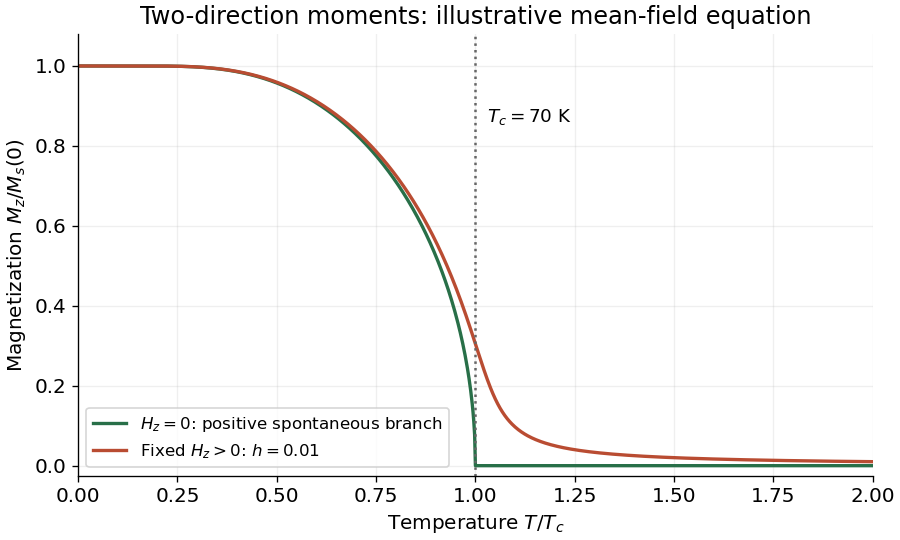

<h1 id="4/e/solution">Solution</h1>

↑ **Parent:** [E](../e.md)

Choose the positive spontaneous branch for $H_z=0$. Its [magnetization](../../../../magnetization.md) starts at $M_s(0)$, decreases with [temperature](../../../../temperature-split.md), and reaches zero continuously at $T_c$. It remains zero for $T_c\leq T<2T_c$. There is an equally valid negative branch below $T_c$; domain averaging can instead give zero net moment.

A fixed small positive [magnetic field intensity](../../../../magnetic-field-intensity.md) selects the positive branch. At zero [temperature](../../../../temperature-split.md) it still saturates at $M_s(0)$; at intermediate [temperature](../../../../temperature-split.md) it increases the [magnetization](../../../../magnetization.md) relative to the zero-field branch. It rounds the zero-field transition and leaves a positive [magnetization](../../../../magnetization.md) above $T_c$, tending in the linear-response region to $C H_z/(T-\Theta)$. The [magnetization](../../../../magnetization.md) therefore does not vanish at $T_c$ in the nonzero-field curve.

For a concrete labelled sketch, the figure uses the illustrative [mean-field theory](../../../../mean-field-theory.md) equation

$$
m=\tanh\!\left(\frac{m+h}{t}\right),\qquad
m=\frac{M_z}{M_s(0)},\quad t=\frac{T}{T_c},\quad h=\frac{\mu\mu_0H_z}{k_BT_c}.
$$

It shows $h=0$ and a fixed small $h=0.01$. The curve is an illustrative equilibrium equation of state, not a determination of the precise critical exponents of GdN. At $h>0$ no symmetry-breaking transition remains along this temperature sweep.

**[Figure 4](#4/e/image-spontaneous-and-field-selected-magnetization-in-the-two-direction-model). Spontaneous and field-selected magnetization in the two-direction model**.

## ↑ Ancestors (12)

1. [E](../e.md)
2. [4](../../4.md)
3. [2018](../../../2018-split.md)
4. [Past exam of the condensed matter physics course of the University of Oxford](../../../split.md)
5. [Condensed matter physics course of the University of Oxford](../../../../condensed-matter-physics-course-of-the-university-of-oxford.md)
6. [Year 3 of the physics course of the University of Oxford](../../../../year-3-of-the-physics-course-of-the-university-of-oxford.md)
7. [Physics course of the University of Oxford](../../../../physics-course-of-the-university-of-oxford.md)
8. [Undergraduate course of the University of Oxford](../../../../undergraduate-course-of-the-university-of-oxford.md)
9. [Course of the University of Oxford](../../../../course-of-the-university-of-oxford.md)
10. [University of Oxford](../../../../university-of-oxford-split.md)
11. [List of universities](../../../../list-of-universities.md)
12. [Codex Wiki](../../../../split.md)
