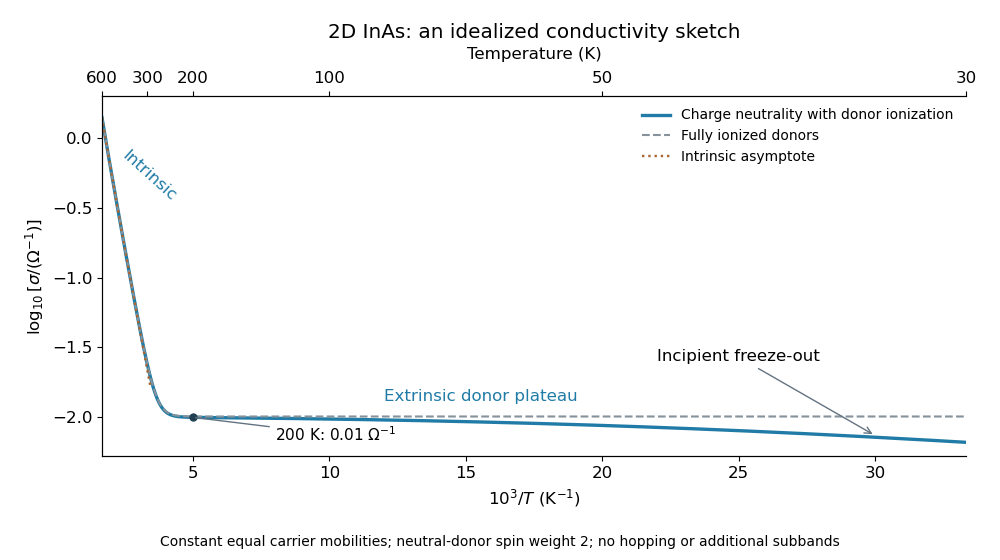

<h1 id="3/e/solution">Solution</h1>

↑ **Parent:** [E](../e.md)

With equal constant [electron mobility](../../../../electron-mobility.md) and [hole mobility](../../../../hole-mobility.md) $\mathcal M$, the sheet [electrical conductivity](../../../../electrical-conductivity.md) is $\sigma=e\mathcal M(n+p)$. In the intrinsic regime, $n+p\simeq2n_i\propto T e^{-E_g/(2k_BT)}$, so

$$
\log\sigma=\mathrm{constant}+\log T-\frac{E_g}{2k_BT}.
$$

It decreases steeply with increasing $1/T$ on the high-temperature side. There is a small logarithmic curvature rather than a perfectly straight activation line.

In the fully ionized extrinsic regime, [charge neutrality](../../../../charge-neutrality.md) and the [semiconductor mass-action law](../../../../semiconductor-mass-action-law.md) give $n-p=n_d$, $np=n_i^2$, hence

$$
n+p=\sqrt{n_d^2+4n_i^2},\qquad\sigma\simeq e\mathcal M n_d\quad(n_i\ll n_d).
$$

This gives a nearly horizontal region passing through $\sigma(200\,\mathrm K)=0.01\,\Omega^{-1}$. At lower temperatures [semiconductor carrier freeze-out](../../../../semiconductor-carrier-freeze-out.md) decreases the ionized donor density and bends the curve downward again.

To locate that bend realistically, include [donor charge-state degeneracy](../../../../donor-charge-state-degeneracy.md). For a neutral donor with two spin states and an empty donor with one state, the ionized density is

$$
n_d^+=\frac{n_d}{1+2(n/N_c)e^{E_B/(k_BT)}}.
$$

Solve $n-n_i^2/n=n_d^+$ for the mobile density. In the asymptotic freeze-out regime, where $p$ is negligible and $n\ll n_d$,

$$
n\simeq\sqrt{\frac{n_dN_c}{2}}e^{-E_B/(2k_BT)},\qquad\log\sigma\simeq\mathrm{constant}+\frac12\log T-\frac{E_B}{2k_BT}.
$$

Its activation scale $E_B/2\simeq3.14\,\mathrm{meV}$ is much smaller than the intrinsic scale $E_g/2=180\,\mathrm{meV}$.

Within the specified interval the low-temperature downturn is modest: $N_c(30\,\mathrm K)\simeq2.81\times10^{10}\,\mathrm{cm}^{-2}$, and the partial-ionization equation gives $n(30\,\mathrm K)\simeq0.65n_d$. The sample is not yet deep in the asymptotic freeze-out limit at 30 K. Calibrating the mobility to the stated 200 K value gives representative values

$$
\boxed{\sigma(30\,\mathrm K)\simeq0.0066,\quad\sigma(200\,\mathrm K)=0.010,\quad\sigma(300\,\mathrm K)\simeq0.024,\quad\sigma(600\,\mathrm K)\simeq1.39\quad\text{in }\Omega^{-1}.}
$$

The donor statistical weights were not explicitly supplied, so they are a stated assumption for these illustrative curve details; a one-state donor approximation changes the low-temperature rounding but not the three physical regimes or their activation scales.

**[Figure 1](#3/e/image-two-dimensional-inas-conductivity-from-intrinsic-carriers-to-incipient-donor-freeze-out). Two-dimensional InAs conductivity from intrinsic carriers to incipient donor freeze-out**. Original ideal-model calculation using the supplied gap, masses and donor density, the derived 2D donor binding energy, twofold neutral-donor spin weight and equal temperature-independent carrier mobilities. The vertical scale is normalized to the stated 200 K conductivity. The plotted range is 30 to 600 K; donor freeze-out is only beginning at its cold end. The dashed line is the fully ionized extrinsic approximation.

## ↑ Ancestors (12)

1. [E](../e.md)
2. [3](../../3.md)
3. [2019](../../../2019-split.md)
4. [Past exam of the condensed matter physics course of the University of Oxford](../../../split.md)
5. [Condensed matter physics course of the University of Oxford](../../../../condensed-matter-physics-course-of-the-university-of-oxford.md)
6. [Year 3 of the physics course of the University of Oxford](../../../../year-3-of-the-physics-course-of-the-university-of-oxford.md)
7. [Physics course of the University of Oxford](../../../../physics-course-of-the-university-of-oxford.md)
8. [Undergraduate course of the University of Oxford](../../../../undergraduate-course-of-the-university-of-oxford.md)
9. [Course of the University of Oxford](../../../../course-of-the-university-of-oxford.md)
10. [University of Oxford](../../../../university-of-oxford-split.md)
11. [List of universities](../../../../list-of-universities.md)
12. [Codex Wiki](../../../../split.md)
