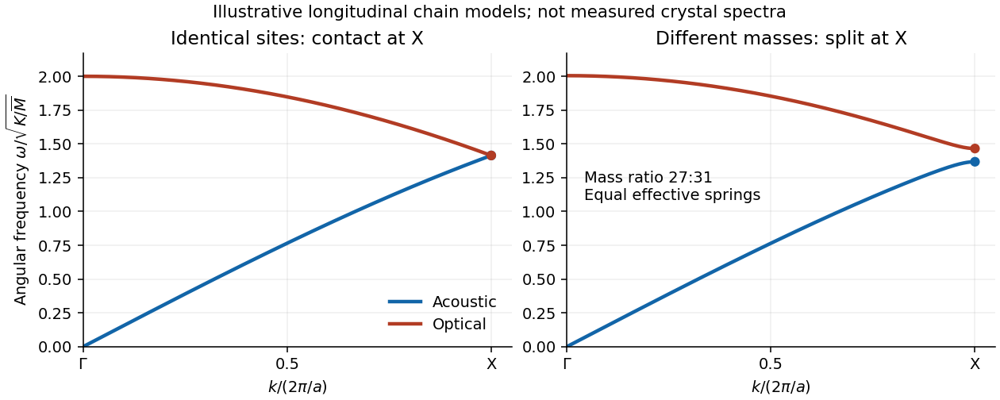

# 2021

↑ **Parent:** [Past exam of the condensed matter physics course of the University of Oxford](../past-exam-of-the-condensed-matter-physics-course-of-the-university-of-oxford.md)

Source paper: [https://www.whatdotheyknow.com/request/oxford_physics_past_papers_2/response/2340696/attach/9/Physics%20Papers%202020.pdf?cookie_passthrough=1](https://www.whatdotheyknow.com/request/oxford_physics_past_papers_2/response/2340696/attach/9/Physics%20Papers%202020.pdf?cookie_passthrough=1)

The 2021 paper occupies bundle pages 74–78; its cover establishes the year despite the attachment's 2020 filename.

**Table of contents**

- [1](#1)
  - [a](#1/a)
    - [Solution](#1/a/solution)
  - [b](#1/b)
    - [Solution](#1/b/solution)
  - [c](#1/c)
    - [Solution](#1/c/solution)
  - [d](#1/d)
    - [Solution](#1/d/solution)
  - [e](#1/e)
    - [Solution](#1/e/solution)
- [2](#2)
  - [a](#2/a)
    - [Solution](#2/a/solution)
  - [b](#2/b)
    - [Solution](#2/b/solution)
  - [c](#2/c)
    - [i](#2/c/i)
      - [Solution](#2/c/i/solution)
    - [ii](#2/c/ii)
      - [Solution](#2/c/ii/solution)
  - [d](#2/d)
    - [Solution](#2/d/solution)
  - [e](#2/e)
    - [Solution](#2/e/solution)
- [3](#3)
  - [a](#3/a)
    - [Solution](#3/a/solution)
  - [b](#3/b)
    - [Solution](#3/b/solution)
  - [c](#3/c)
    - [Solution](#3/c/solution)
  - [d](#3/d)
    - [Solution](#3/d/solution)
  - [e](#3/e)
    - [Solution](#3/e/solution)
- [4](#4)
  - [a](#4/a)
    - [Solution](#4/a/solution)
  - [b](#4/b)
    - [Solution](#4/b/solution)
  - [c](#4/c)
    - [Solution](#4/c/solution)
  - [d](#4/d)
    - [Solution](#4/d/solution)
  - [e](#4/e)
    - [Solution](#4/e/solution)

## 1

↑ **Parent:** [2021](2021.md)

<h3 id="1/a">a</h3>

↑ **Parent:** [1](#1)

<h4 id="1/a/solution">Solution</h4>

↑ **Parent:** [A](#1/a)

Determining [antiferromagnetic](../electromagnetism.md#antiferromagnetism) [magnetic order](../electromagnetism.md#magnetic-order) is a good reason to use [neutron scattering](../neutron.md#neutron-scattering). The [neutron](../neutron.md) has a [magnetic dipole moment](../electromagnetism.md#magnetic-dipole-moment), so its [scattering amplitude](../quantum-scattering.md#scattering-amplitude) includes the spatial arrangement of electronic [magnetic moments](../electromagnetism.md#magnetic-dipole-moment). Alternating [magnetic moments](../electromagnetism.md#magnetic-dipole-moment) can produce [magnetic neutron diffraction](../electromagnetism.md#magnetic-neutron-diffraction) peaks even when there is no change of the nuclear [crystal structure](../physical-chemistry.md#crystal-structure). Ordinary nonresonant [X-ray diffraction](../quantum-scattering.md#x-ray-diffraction) primarily measures the [electron density](../chemistry.md#electron-density), and is much less sensitive to this [magnetic order](../electromagnetism.md#magnetic-order).

<h3 id="1/b">b</h3>

↑ **Parent:** [1](#1)

<h4 id="1/b/solution">Solution</h4>

↑ **Parent:** [B](#1/b)

The [neutron](../neutron.md) is nonrelativistic at this [kinetic energy](../energy.md#kinetic-energy). Its [de Broglie wavelength](../wave-function.md#de-broglie-wavelength) is

$$
\lambda=\frac{h}{\sqrt{2m_nE}}
=\frac{6.62607015\times10^{-34}}{\sqrt{2(1.67493\times10^{-27})(25\times10^{-3})(1.602176634\times10^{-19})}}
=0.180891\,\mathrm{nm}.
$$

In [elastic scattering](../quantum-scattering.md#elastic-scattering), [Bragg's law](../quantum-scattering.md#bragg-s-law) gives $2d\sin\theta=\lambda$. The measured total deflection is $2\theta$, so it must be halved before taking the sine. The reflection order is absorbed into the [Miller indices](../physical-chemistry.md#miller-index) of the diffracting [lattice planes](../physical-chemistry.md#lattice-plane). In the order of the four measured rings, the [interplanar spacings](../physical-chemistry.md#interplanar-spacing) are

$$
\boxed{d_1=0.42457\,\mathrm{nm},\quad d_2=0.29995\,\mathrm{nm},\quad d_3=0.24462\,\mathrm{nm},\quad d_4=0.21203\,\mathrm{nm}.}
$$

The last digits give the numerical calculation, rather than accuracy beyond the supplied angular precision.

<h3 id="1/c">c</h3>

↑ **Parent:** [1](#1)

<h4 id="1/c/solution">Solution</h4>

↑ **Parent:** [C](#1/c)

For the [cubic crystal system](../quantum-scattering.md#cubic-crystal-system), the [Miller indices](../physical-chemistry.md#miller-index) satisfy

$$
\frac1{d_{hkl}^2}=\frac{h^2+k^2+l^2}{a^2}.
$$

The inverse squared [interplanar spacings](../physical-chemistry.md#interplanar-spacing) have ratios approximately $1:2.004:3.012:4.010$. With the [lattice constant](../physical-chemistry.md#lattice-constant) close to $0.4\,\mathrm{nm}$, the appropriate squared-index sums are $1,2,3,4$. Thus the four [powder diffraction](../physical-chemistry.md#powder-diffraction) rings are

$$
\boxed{\{100\},\quad\{110\},\quad\{111\},\quad\{200\}.}
$$

The braces collect all symmetry-related [lattice planes](../physical-chemistry.md#lattice-plane) with the same [interplanar spacing](../physical-chemistry.md#interplanar-spacing). In particular, $(100)$ is forbidden for both a [body-centered cubic lattice](../quantum-scattering.md#body-centered-cubic-lattice) and a [face-centered cubic lattice](../quantum-scattering.md#face-centered-cubic-lattice), but occurs for a [primitive cubic lattice](../quantum-scattering.md#primitive-cubic-lattice). These observations identify the [Bravais lattice](../quantum-scattering.md#bravais-lattice) as [primitive cubic lattice](../quantum-scattering.md#primitive-cubic-lattice), with a multi-atom [atomic basis](../physical-chemistry.md#atomic-basis-of-a-crystal), consistent with a [perovskite structure](../physical-chemistry.md#perovskite-structure).

Each ring independently gives $a_j=d_j\sqrt{j}$:

$$
a_1=0.42457,\qquad a_2=0.42419,\qquad a_3=0.42369,\qquad a_4=0.42406\qquad (\mathrm{nm}).
$$

Their average is $0.42413\,\mathrm{nm}$. Allowing for the rounded measured angles, a suitable final value is

$$
\boxed{a\simeq0.424\,\mathrm{nm}.}
$$

A larger centred [unit cell](../quantum-scattering.md#unit-cell) could relabel reflections, but would conflict with the stated approximate [lattice constant](../physical-chemistry.md#lattice-constant).

<h3 id="1/d">d</h3>

↑ **Parent:** [1](#1)

<h4 id="1/d/solution">Solution</h4>

↑ **Parent:** [D](#1/d)

An applied [magnetic field](../magnetic-field.md) changes the alignment of the manganese [magnetic moments](../electromagnetism.md#magnetic-dipole-moment). The component of their [magnetic structure factor](../electromagnetism.md#magnetic-structure-factor) perpendicular to the [scattering vector](../optics.md#scattering-vector) contributes to [magnetic neutron diffraction](../electromagnetism.md#magnetic-neutron-diffraction). A field-induced uniform [magnetization](../electromagnetism.md#magnetization) has the same translational periodicity as the nuclear [crystal structure](../physical-chemistry.md#crystal-structure), so its [scattering amplitude](../quantum-scattering.md#scattering-amplitude) can occur at the existing [reciprocal lattice vectors](../quantum-scattering.md#reciprocal-lattice-vector). The [diffraction](../quantum-scattering.md#diffraction) [wave intensities](../wave.md#intensity-physics) can therefore change without moving the peaks. Their angular positions still measure the same [interplanar spacings](../physical-chemistry.md#interplanar-spacing). This mechanism does not require a measurable change of the [lattice constant](../physical-chemistry.md#lattice-constant).

<h3 id="1/e">e</h3>

↑ **Parent:** [1](#1)

<h4 id="1/e/solution">Solution</h4>

↑ **Parent:** [E](#1/e)

A consistent mechanism is a transition to G-type [antiferromagnetism](../electromagnetism.md#antiferromagnetism) at the [Néel temperature](../electromagnetism.md#neel-temperature). On the manganese [primitive cubic lattice](../quantum-scattering.md#primitive-cubic-lattice), take the [magnetic moments](../electromagnetism.md#magnetic-dipole-moment) to be

$$
\mathbf m_{j_xj_yj_z}=\mathbf m_0(-1)^{j_x+j_y+j_z}.
$$

Every nearest neighbour has the opposite [magnetic moment](../electromagnetism.md#magnetic-dipole-moment). The nuclear [crystal structure](../physical-chemistry.md#crystal-structure) can retain its original [lattice constant](../physical-chemistry.md#lattice-constant), while the [magnetic order](../electromagnetism.md#magnetic-order) introduces the propagation [wavevector](../elasticity-physics.md#wavevector)

$$
\mathbf Q=\frac{2\pi}{a}\left(\frac12,\frac12,\frac12\right).
$$

Summing the [scattering amplitude](../quantum-scattering.md#scattering-amplitude) from the [magnetic moments](../electromagnetism.md#magnetic-dipole-moment) over sites gives peaks at $\mathbf q=\mathbf G+\mathbf Q$, where $\mathbf G$ is a nuclear [reciprocal lattice vector](../quantum-scattering.md#reciprocal-lattice-vector). Thus all three components of the new [Miller indices](../physical-chemistry.md#miller-index), expressed relative to the original [unit cell](../quantum-scattering.md#unit-cell), are half-integers. The two smallest squared magnitudes in units of $(2\pi/a)^2$ are

$$
\frac34\quad\text{for }\left\{\frac12,\frac12,\frac12\right\},\qquad
\frac{11}{4}\quad\text{for }\left\{\frac32,\frac12,\frac12\right\}.
$$

The first predicts $2\theta\simeq21.29^\circ$, agreeing with the new ring. The next squared magnitude is $19/4$, outside the measured angular range. Taking the observed first magnetic ring as the calibration, [Bragg's law](../quantum-scattering.md#bragg-s-law) predicts

$$
\sin\theta_2=\sqrt{\frac{11}{3}}\sin(10.65^\circ),\qquad
\boxed{2\theta_2\simeq41.45^\circ\simeq41.4^\circ.}
$$

Using the independently fitted [lattice constant](../physical-chemistry.md#lattice-constant) gives $41.42^\circ$, within the input rounding. One ring alone does not uniquely determine a [magnetic order](../electromagnetism.md#magnetic-order); this proposed nearest-neighbour [antiferromagnetic](../electromagnetism.md#antiferromagnetism) pattern explains both the observed ring and the count of two new rings in the specified interval.

## 2

↑ **Parent:** [2021](2021.md)

<h3 id="2/a">a</h3>

↑ **Parent:** [2](#2)

<h4 id="2/a/solution">Solution</h4>

↑ **Parent:** [A](#2/a)

The [Bravais lattice](../quantum-scattering.md#bravais-lattice) is a [face-centered cubic lattice](../quantum-scattering.md#face-centered-cubic-lattice). Four inequivalent representatives of its [lattice points](../quantum-scattering.md#lattice-point) in the conventional cubic [unit cell](../quantum-scattering.md#unit-cell), in [fractional crystal coordinates](../physical-chemistry.md#fractional-crystal-coordinate), are

$$
(0,0,0),\qquad\left(0,\frac12,\frac12\right),\qquad
\left(\frac12,0,\frac12\right),\qquad
\left(\frac12,\frac12,0\right).
$$

Boundary copies in the drawing do not constitute additional independent [lattice points](../quantum-scattering.md#lattice-point). Attach the two-atom [atomic basis](../physical-chemistry.md#atomic-basis-of-a-crystal)

$$
\boxed{\mathrm{Al}:(0,0,0),\qquad
\mathrm{P}:\left(\frac14,\frac14,\frac14\right)}
$$

to each [lattice point](../quantum-scattering.md#lattice-point). The resulting [aluminium phosphide](../semiconductor.md#aluminium-phosphide) [crystal structure](../physical-chemistry.md#crystal-structure) is the [zinc blende structure](../physical-chemistry.md#zinc-blende-structure). For example, the four [phosphorus](../chemical-substance.md#phosphorus) positions reduced into the conventional [unit cell](../quantum-scattering.md#unit-cell) are $(1/4,1/4,1/4)$, $(1/4,3/4,3/4)$, $(3/4,1/4,3/4)$, and $(3/4,3/4,1/4)$, reproducing the heights in the source drawing. There are four [aluminium](../chemical-substance.md#aluminium) and four [phosphorus](../chemical-substance.md#phosphorus) [chemical atoms](../physics.md#atom-physics) per conventional [unit cell](../quantum-scattering.md#unit-cell), but only two [chemical atoms](../physics.md#atom-physics) per [primitive unit cell](../quantum-scattering.md#primitive-unit-cell).

<h3 id="2/b">b</h3>

↑ **Parent:** [2](#2)

<h4 id="2/b/solution">Solution</h4>

↑ **Parent:** [B](#2/b)

Given independent [primitive lattice translation vectors](../quantum-scattering.md#primitive-lattice-translation-vector) $\mathbf a_1,\mathbf a_2,\mathbf a_3$, define

$$
V_p=\mathbf a_1\cdot(\mathbf a_2\times\mathbf a_3),\qquad
\mathbf b_1=2\pi\frac{\mathbf a_2\times\mathbf a_3}{V_p},\quad
\mathbf b_2=2\pi\frac{\mathbf a_3\times\mathbf a_1}{V_p},\quad
\mathbf b_3=2\pi\frac{\mathbf a_1\times\mathbf a_2}{V_p}.
$$

Then $\mathbf a_i\cdot\mathbf b_j=2\pi\delta_{ij}$. The [reciprocal lattice](../quantum-scattering.md#reciprocal-lattice) consists of

$$
\boxed{\mathbf G=h\mathbf b_1+k\mathbf b_2+l\mathbf b_3,\qquad h,k,l\in\mathbb Z,}
$$

equivalently all [wavevectors](../elasticity-physics.md#wavevector) for which $e^{i\mathbf G\cdot\mathbf R}=1$ for every direct [lattice vector](../quantum-scattering.md#lattice-vector) $\mathbf R$.

For the [face-centered cubic lattice](../quantum-scattering.md#face-centered-cubic-lattice), choose

$$
\mathbf a_1=\frac a2(0,1,1),\quad
\mathbf a_2=\frac a2(1,0,1),\quad
\mathbf a_3=\frac a2(1,1,0).
$$

Their [scalar triple product](../multilinear-algebra.md#scalar-triple-product) is $a^3/4$, and direct evaluation of the [cross products](../vector-space.md#cross-product) gives

$$
\mathbf b_1=\frac{2\pi}{a}(-1,1,1),\quad
\mathbf b_2=\frac{2\pi}{a}(1,-1,1),\quad
\mathbf b_3=\frac{2\pi}{a}(1,1,-1).
$$

Every integer combination has coordinates $(2\pi/a)(H,K,L)$ with $H,K,L$ all even or all odd. Conversely, for such coordinates the coefficients $(K+L)/2,(H+L)/2,(H+K)/2$ are integers, so every such point occurs. The even-coordinate points are the corners of cubes of edge $4\pi/a$, and the odd-coordinate points are their body centres. Therefore

$$
\boxed{\text{reciprocal Bravais lattice: body-centred cubic},\qquad a_{\rm reciprocal}=\frac{4\pi}{a}.}
$$

This is a property of the [Bravais lattice](../quantum-scattering.md#bravais-lattice); the two-atom [atomic basis](../physical-chemistry.md#atomic-basis-of-a-crystal) changes [structure factors](../quantum-scattering.md#structure-factor) rather than these [reciprocal lattice](../quantum-scattering.md#reciprocal-lattice) translation vectors.

<h3 id="2/c">c</h3>

↑ **Parent:** [2](#2)

<h4 id="2/c/i">i</h4>

↑ **Parent:** [C](#2/c)

<h5 id="2/c/i/solution">Solution</h5>

↑ **Parent:** [I](#2/c/i)

There are two [chemical atoms](../physics.md#atom-physics) in the [primitive unit cell](../quantum-scattering.md#primitive-unit-cell), hence six displacement coordinates and six [phonon branches](../quantum-ideal-gas-statistics.md#phonon-branch) at each [wavevector](../elasticity-physics.md#wavevector). Three rigid [translations](../geometry-and-topology.md#translation-geometry) cost no restoring [potential energy](../energy.md#potential-energy) in the long-[wavelength](../wave-equation.md#wavelength) limit. Consequently

$$
\boxed{3\text{ acoustic phonon branches}.}
$$

For propagation along $[100]$, one [acoustic phonon](../quantum-ideal-gas-statistics.md#acoustic-phonon) has [longitudinal polarization](../wave-equation.md#longitudinal-polarization) along $x$ and two have [transverse polarization](../wave-equation.md#transverse-polarization) along $y,z$. The cubic [crystal symmetry](../physical-chemistry.md#crystal-symmetry) makes those two transverse directions equivalent. In terms of the [elastic stiffness tensor](../elasticity-physics.md#elastic-stiffness-tensor) and the mass [density](../fluid-mechanics.md#density),

$$
v_L=\sqrt{\frac{C_{11}}{\rho_m}},\qquad
v_{T,y}=v_{T,z}=\sqrt{\frac{C_{44}}{\rho_m}}.
$$

Thus there are **two distinct acoustic velocities** in general, one longitudinal and a doubly degenerate transverse value. This [degeneracy of normal modes](../wave-equation.md#degeneracy-of-normal-modes) concerns the two [transverse polarizations](../wave-equation.md#transverse-polarization); it does not imply equality with the longitudinal [speed of sound](../compressible-flow.md#speed-of-sound).

<h4 id="2/c/ii">ii</h4>

↑ **Parent:** [C](#2/c)

<h5 id="2/c/ii/solution">Solution</h5>

↑ **Parent:** [Ii](#2/c/ii)

Subtracting the three [acoustic phonon branches](../quantum-ideal-gas-statistics.md#acoustic-phonon-branch) from the six displacement [normal modes](../wave-equation.md#normal-mode) leaves

$$
\boxed{3\text{ optical phonon branches}.}
$$

At small [wavevector](../elasticity-physics.md#wavevector), these involve relative motion of the two [atomic basis](../physical-chemistry.md#atomic-basis-of-a-crystal) sites rather than a rigid [translation](../geometry-and-topology.md#translation-geometry) of the [primitive unit cell](../quantum-scattering.md#primitive-unit-cell). Their [angular frequencies](../lagrangian-mechanics.md#angular-frequency) remain nonzero at the zone centre. The count uses the [primitive unit cell](../quantum-scattering.md#primitive-unit-cell); using all eight [chemical atoms](../physics.md#atom-physics) in the conventional [unit cell](../quantum-scattering.md#unit-cell) would spuriously multiply the number of distinct branches in the first [Brillouin zone](../bloch-s-theorem.md#brillouin-zone).

<h3 id="2/d">d</h3>

↑ **Parent:** [2](#2)

<h4 id="2/d/solution">Solution</h4>

↑ **Parent:** [D](#2/d)

Use the long-[wavelength](../wave-equation.md#wavelength) linear [dispersion relation](../dispersion-relation.md) $\omega\simeq v_L|\mathbf k|$ as an estimate. The [phonon](../quantum-ideal-gas-statistics.md#phonon) [energy](../energy.md) is then

$$
E=\hbar\omega\simeq\hbar v_L\frac{2\pi}{a}
=\frac{h(8433\,\mathrm{m\,s^{-1}})}{0.5431\times10^{-9}\,\mathrm m},
\qquad
\boxed{E\simeq0.0642\,\mathrm{eV}.}
$$

This extrapolates the measured low-[wavevector](../elasticity-physics.md#wavevector) [speed of sound](../compressible-flow.md#speed-of-sound) to the $X$ point, the first [Brillouin zone](../bloch-s-theorem.md#brillouin-zone) boundary along $[100]$. It is not an exact [phonon dispersion relation](../quantum-ideal-gas-statistics.md#phonon-dispersion-relation) there: the discrete [crystal structure](../physical-chemistry.md#crystal-structure) generally bends the branch, and the initial slope alone cannot determine its boundary [energy](../energy.md). In particular, $(2\pi/a,0,0)$ is not a [reciprocal lattice vector](../quantum-scattering.md#reciprocal-lattice-vector) of the [face-centered cubic lattice](../quantum-scattering.md#face-centered-cubic-lattice); the smallest such axial vector is $(4\pi/a,0,0)$. There is therefore no reason for this [acoustic phonon](../quantum-ideal-gas-statistics.md#acoustic-phonon) [energy](../energy.md) to vanish.

<h3 id="2/e">e</h3>

↑ **Parent:** [2](#2)

<h4 id="2/e/solution">Solution</h4>

↑ **Parent:** [E](#2/e)

In the [diamond cubic structure](../physical-chemistry.md#diamond-cubic-structure) of [silicon](../chemical-substance.md#silicon), the longitudinal [acoustic phonon branch](../quantum-ideal-gas-statistics.md#acoustic-phonon-branch) and longitudinal [optical phonon branch](../quantum-ideal-gas-statistics.md#optical-phonon-branch) meet at $X=(2\pi/a,0,0)$. The two [atomic basis](../physical-chemistry.md#atomic-basis-of-a-crystal) sites are identical, and the associated [crystal symmetry](../physical-chemistry.md#crystal-symmetry) protects their boundary [degeneracy of normal modes](../wave-equation.md#degeneracy-of-normal-modes). In [aluminium phosphide](../semiconductor.md#aluminium-phosphide), the two sites contain different [chemical atoms](../physics.md#atom-physics). The corresponding [zinc blende structure](../physical-chemistry.md#zinc-blende-structure) lacks the site-exchange symmetry, and these two longitudinal branches generally split at $X$.

A simple way to see the splitting is a [diatomic-chain dispersion relation with equal springs](../quantum-ideal-gas-statistics.md#diatomic-chain-dispersion-relation-with-equal-springs), representing successive $[100]$ atomic planes by alternating [masses](../classical-mechanics.md#mass) $M_1,M_2$ at spacing $d=a/4$. With effective [spring constant](../elasticity-physics.md#spring-constant) $K$, its [angular frequencies](../lagrangian-mechanics.md#angular-frequency) obey

$$
\omega_\pm^2=K\left(\frac1{M_1}+\frac1{M_2}\right)
\pm K\sqrt{\left(\frac1{M_1}+\frac1{M_2}\right)^2-\frac4{M_1M_2}\sin^2(kd)}.
$$

At $X$, $kd=\pi/2$, so the inter-sublattice coupling cancels and the two squared [angular frequencies](../lagrangian-mechanics.md#angular-frequency) are $2K/M_1$ and $2K/M_2$. Equal [masses](../classical-mechanics.md#mass) give a contact; unequal [masses](../classical-mechanics.md#mass) give

$$
\boxed{\omega_{\rm acoustic}(X)\simeq\sqrt{\frac{2K}{M_{\rm heavy}}},\qquad
\omega_{\rm optical}(X)\simeq\sqrt{\frac{2K}{M_{\rm light}}}.}
$$

In [aluminium phosphide](../semiconductor.md#aluminium-phosphide), the heavier [phosphorus](../chemical-substance.md#phosphorus) plane moves in the lower-frequency edge mode, and the lighter [aluminium](../chemical-substance.md#aluminium) plane in the higher-frequency mode in this model. Their similar [atomic masses](../chemical-substance.md#atomic-mass) explain why the splitting is relatively small. Different electronic environments can also change the [force constant matrix](../wave-equation.md#force-constant-matrix). The chain calculation illustrates the mechanism; a quantitative three-dimensional [phonon spectrum](../quantum-ideal-gas-statistics.md#phonon-spectrum) requires its full [dynamical matrix](../wave-equation.md#dynamical-matrix). It does not assert that all transverse acoustic and optical branches meet in [silicon](../chemical-substance.md#silicon).

**[Figure 1](#2/e/image-equal-mass-and-alternating-mass-chain-models-illustrating-longitudinal-branch-contact-and-splitting-at-x). Equal-mass and alternating-mass chain models illustrating longitudinal branch contact and splitting at X**.

## 3

↑ **Parent:** [2021](2021.md)

<h3 id="3/a">a</h3>

↑ **Parent:** [3](#3)

<h4 id="3/a/solution">Solution</h4>

↑ **Parent:** [A](#3/a)

In the [harmonic approximation](../lagrangian-mechanics.md#harmonic-approximation), each in-plane displacement coordinate contributes one quadratic [kinetic energy](../energy.md#kinetic-energy) term and one quadratic restoring [potential energy](../energy.md#potential-energy) term. The [equipartition theorem](../canonical-ensemble.md#equipartition-theorem) assigns $k_BT/2$ to each. There are two such coordinates per [chemical atom](../physics.md#atom-physics), hence

$$
U\simeq2N_ak_BT,\qquad
\boxed{\frac{C_v}{N_a}\longrightarrow2k_B.}
$$

Here the fixed-size [heat capacity](../heat.md#heat-capacity) is at constant area in this two-dimensional model. On cooling, [phonon](../quantum-ideal-gas-statistics.md#phonon) excitation freezes out and the [heat capacity](../heat.md#heat-capacity) decreases. For each nonzero [angular frequency](../lagrangian-mechanics.md#angular-frequency), the [quantum harmonic oscillator](../quantum-harmonic-oscillator.md) contributes

$$
c_\omega=k_B\frac{x^2e^x}{(e^x-1)^2},\qquad x=\frac{\hbar\omega}{k_BT},
$$

which is below $k_B$ at finite $x$ and approaches zero as $T\to0$. Two linearly dispersing in-plane [acoustic phonon branches](../quantum-ideal-gas-statistics.md#acoustic-phonon-branch) give the familiar two-dimensional [Debye model](../quantum-ideal-gas-statistics.md#debye-model) scaling $C_v\propto T^2$ at sufficiently low [temperature](../temperature.md). Out-of-plane modes are excluded by the specified model.

<h3 id="3/b">b</h3>

↑ **Parent:** [3](#3)

<h4 id="3/b/solution">Solution</h4>

↑ **Parent:** [B](#3/b)

For a nondegenerate two-dimensional [electron gas](../physics.md#electron-gas), the two quadratic momentum terms supply $k_BT/2$ each by the [equipartition theorem](../canonical-ensemble.md#equipartition-theorem). There is no lattice restoring [potential energy](../energy.md#potential-energy) for a free [electron](../physics.md#electron). Thus

$$
U=N_ek_BT,\qquad
\boxed{\frac{C_v}{N_e}\longrightarrow k_B.}
$$

On cooling below the [Fermi temperature](../quantum-ideal-gas-statistics.md#fermi-temperature), the [Pauli exclusion principle](../tensor-product-of-quantum-systems.md#pauli-exclusion-principle) restricts the thermally active [electrons](../physics.md#electron) to within approximately $k_BT$ of the [Fermi energy](../quantum-ideal-gas-statistics.md#fermi-energy). The [linear low-temperature heat capacity of a two-dimensional Fermi gas](../quantum-ideal-gas-statistics.md#linear-low-temperature-heat-capacity-of-a-two-dimensional-fermi-gas) is

$$
\boxed{\frac{C_v}{N_e}\simeq\frac{\pi^2}{3}k_B\frac{k_BT}{E_F}\longrightarrow0.}
$$

The [heat capacity](../heat.md#heat-capacity) therefore decreases from its classical value as [quantum degeneracy](../quantum-mechanics.md#degenerate-energy-levels) becomes important. The [particle number](../physics.md#particle-number) of [electrons](../physics.md#electron) and sample area are held fixed when differentiating the [internal energy](../internal-energy.md).

<h3 id="3/c">c</h3>

↑ **Parent:** [3](#3)

<h4 id="3/c/solution">Solution</h4>

↑ **Parent:** [C](#3/c)

Let the sample area be $A$, set the band touching [energy](../energy.md) to zero, and write $m^*=m_e^*=m_h^*$. Assume one [electronic valley](../bloch-s-theorem.md#electronic-valley) in each [energy band](../bloch-s-theorem.md#energy-band) with two [spin](../angular-momentum-operator.md#spin) states. The near-edge [parabolic dispersions](../bloch-s-theorem.md#parabolic-band-dispersion) are

$$
E_c(k)=\frac{\hbar^2k^2}{2m^*},\qquad E_v(k)=-\frac{\hbar^2k^2}{2m^*}.
$$

Under [periodic boundary conditions](../differential-equation.md#periodic-boundary-conditions), each [spin](../angular-momentum-operator.md#spin) occupies reciprocal-space area $(2\pi)^2/A$. Counting the [quantum states](../quantum-system.md#quantum-state) inside a circle gives

$$
\mathcal N_c(E)=2\frac{A}{(2\pi)^2}\pi k^2
=\frac{Am^*}{\pi\hbar^2}E\qquad(E>0).
$$

Its [derivative](../calculus.md#derivative) is the constant [two-dimensional free-electron density of states](../quantum-ideal-gas-statistics.md#two-dimensional-free-electron-density-of-states). Defining $D=Am^*/(\pi\hbar^2)$, the signed-[energy](../energy.md) [density of states](../quantum-ideal-gas-statistics.md#density-of-states) is

$$
\boxed{g_c(E)=D\Theta(E),\qquad g_v(E)=D\Theta(-E).}
$$

The total electronic [density of states](../quantum-ideal-gas-statistics.md#density-of-states) is therefore $D$ on either side of zero, not $2D$ at every signed [energy](../energy.md). If instead one counts positive-[energy](../energy.md) excitations, the [electron](../physics.md#electron) and [hole](../quantum-mechanics.md#electron-hole) species each have [density of states](../quantum-ideal-gas-statistics.md#density-of-states) $D$, giving $2D$ when summed. A common additional [valley degeneracy](../bloch-s-theorem.md#valley-degeneracy) multiplies all these quantities by that factor. The [effective mass](../bloch-s-theorem.md#band-effective-mass) approximation assumes thermally sampled [energies](../energy.md) remain within the near-edge regions of both [energy bands](../bloch-s-theorem.md#energy-band).

<h3 id="3/d">d</h3>

↑ **Parent:** [3](#3)

<h4 id="3/d/solution">Solution</h4>

↑ **Parent:** [D](#3/d)

Equal [effective masses](../bloch-s-theorem.md#band-effective-mass) and equal [spin](../angular-momentum-operator.md#spin) and [valley degeneracies](../bloch-s-theorem.md#valley-degeneracy) give [electron-hole symmetry](../semiconductor.md#electron-hole-symmetry). In the [intrinsic semiconductor](../semiconductor.md#intrinsic-semiconductor), [charge neutrality](../electric-charge.md#charge-neutrality) requires equal numbers of [conduction band](../quantum-mechanics.md#conduction-band) [electrons](../physics.md#electron) and [valence band](../quantum-mechanics.md#valence-band) [holes](../quantum-mechanics.md#electron-hole). It therefore pins the [chemical potential](../chemical-potential.md) to the band touching point, $\mu=0$. The [Fermi-Dirac distribution](../quantum-ideal-gas-statistics.md#fermi-dirac-distribution) gives

$$
N_c=D\int_0^\infty\frac{dE}{e^{E/(k_BT)}+1}
=Dk_BT\ln2,
\qquad
\boxed{N_c(T)=\frac{Am^*k_BT}{\pi\hbar^2}\ln2.}
$$

Measured relative to the filled [valence band](../quantum-mechanics.md#valence-band) at zero [temperature](../temperature.md), the thermal [internal energy](../internal-energy.md) includes both species. Removing a [valence band](../quantum-mechanics.md#valence-band) [electron](../physics.md#electron) at $-E$ costs the positive [hole](../quantum-mechanics.md#electron-hole) [energy](../energy.md) $E$, just as adding a [conduction band](../quantum-mechanics.md#conduction-band) [electron](../physics.md#electron) at $E$ does. Hence

$$
\Delta U=2D\int_0^\infty\frac{E\,dE}{e^{E/(k_BT)}+1}
=\frac{\pi^2}{6}D(k_BT)^2.
$$

Differentiate at fixed area and fixed total electronic [particle number](../physics.md#particle-number), allowing creation of [electron-hole pairs](../quantum-mechanics.md#electron-hole-pair):

$$
C_v^{\rm tot}=\frac{\pi^2}{3}Dk_B^2T,\qquad
\boxed{\frac{C_v^{\rm tot}}{N_c}=\frac{\pi^2}{3\ln2}k_B\simeq4.746\,k_B.}
$$

There is no conflict with the [equipartition theorem](../canonical-ensemble.md#equipartition-theorem). The normalization $N_c$ counts only the excited [conduction band](../quantum-mechanics.md#conduction-band) [electrons](../physics.md#electron), while the [heat capacity](../heat.md#heat-capacity) includes both [electrons](../physics.md#electron) and [holes](../quantum-mechanics.md#electron-hole); moreover, $N_c\propto T$ is not fixed. In fact $\Delta U/N_c=\pi^2k_BT/(6\ln2)$, and differentiating $N_c(T)$ supplies another equal contribution to the [heat capacity](../heat.md#heat-capacity). Finally, $\mu=0$ gives occupation $1/2$ at the touching point, so the excitation gas is not in the classical dilute limit even though $k_BT$ exceeds the vanishing [band gap](../bloch-s-theorem.md#band-gap).

<h3 id="3/e">e</h3>

↑ **Parent:** [3](#3)

<h4 id="3/e/solution">Solution</h4>

↑ **Parent:** [E](#3/e)

For the degenerate [electron gas](../physics.md#electron-gas), let $D_g=Am/(\pi\hbar^2)$ include both [spin](../angular-momentum-operator.md#spin) states. The [Sommerfeld expansion](../quantum-ideal-gas-statistics.md#sommerfeld-expansion) gives

$$
U_g(T)-U_g(0)=\frac{\pi^2}{6}D_g(k_BT)^2,\qquad
C_v=\frac{\pi^2}{3}D_gk_B^2T.
$$

For the gapless symmetric [intrinsic semiconductor](../semiconductor.md#intrinsic-semiconductor), part (d) gave the same coefficient with $D_s=Am^*/(\pi\hbar^2)$. Thus for equal sample areas and equal [spin](../angular-momentum-operator.md#spin) and [valley degeneracies](../bloch-s-theorem.md#valley-degeneracy),

$$
\boxed{\frac{C_v^{\rm tot}}{C_v}=\frac{m^*}{m};\qquad
\frac{C_v^{\rm tot}}{C_v}=1\text{ if }m^*=m.}
$$

The equality often intended in this comparison requires the same [density of states](../quantum-ideal-gas-statistics.md#density-of-states). The source sets $m_e^*=m_h^*$ but does not explicitly equate them to the [electron gas](../physics.md#electron-gas) [mass](../classical-mechanics.md#mass) $m$. Without that additional assumption the ratio is $m^*/m$, or more generally $D_s/D_g$ if sample areas or [degeneracy factors](../statistical-physics.md#degeneracy-factor) differ. For example, $m^*=2m$ with equal areas satisfies the stated equal-[effective mass](../bloch-s-theorem.md#band-effective-mass) condition in the [semiconductor](../semiconductor.md) and gives ratio two. The filled [Fermi sea](../quantum-ideal-gas-statistics.md#fermi-sea) does not add a factor $N_e/N_c$: only the thermal shell near its [Fermi energy](../quantum-ideal-gas-statistics.md#fermi-energy) contributes to its [heat capacity](../heat.md#heat-capacity).

## 4

↑ **Parent:** [2021](2021.md)

<h3 id="4/a">a</h3>

↑ **Parent:** [4](#4)

<h4 id="4/a/solution">Solution</h4>

↑ **Parent:** [A](#4/a)

Undoped [gallium arsenide](../chemical-substance.md#gallium-arsenide) is expected to be **diamagnetic** at zero [temperature](../temperature.md). Its [valence band](../quantum-mechanics.md#valence-band) is filled and its [conduction band](../quantum-mechanics.md#conduction-band) empty, so there are no mobile [conduction band](../quantum-mechanics.md#conduction-band) [electrons](../physics.md#electron) to give [Pauli paramagnetism](../quantum-ideal-gas-statistics.md#pauli-paramagnetism). The specified absence of localized [magnetic moments](../electromagnetism.md#magnetic-dipole-moment) removes a [Curie law](../statistical-physics.md#curie-s-law) response and the usual mechanism for [ferromagnetic ordering](../electromagnetism.md#ferromagnetic-ordering). The remaining induced orbital response is [diamagnetism](../electromagnetism.md#diamagnetism). This classification uses the ordinary weak-field [band insulator](../bloch-s-theorem.md#band-insulator) picture; the [band gap](../bloch-s-theorem.md#band-gap) suppresses thermally generated carriers as $T\to0$.

<h3 id="4/b">b</h3>

↑ **Parent:** [4](#4)

<h4 id="4/b/solution">Solution</h4>

↑ **Parent:** [B](#4/b)

The number of formula units per volume follows from the mass [density](../fluid-mechanics.md#density):

$$
n_f=\frac{5.9\times10^3\,\mathrm{kg\,m^{-3}}}{(69.7+74.9)(1.66053906892\times10^{-27}\,\mathrm{kg})}
=2.4572\times10^{28}\,\mathrm{m^{-3}}.
$$

Each neutral formula unit contains $31+33=64$ [electrons](../physics.md#electron), so $\rho_e=64n_f=1.5726\times10^{30}\,\mathrm{m^{-3}}$. Let $R^2$ be the electron-weighted [mean-square orbital radius](../chemistry.md#mean-square-orbital-radius), averaged over all these [electrons](../physics.md#electron). The supplied [Larmor-Langevin susceptibility](../electromagnetism.md#larmor-langevin-susceptibility) then gives the dimensionless SI [volume magnetic susceptibility](../statistical-physics.md#volume-magnetic-susceptibility)

$$
\chi_0=-\frac{\mu_0\rho_e e^2}{6m_e}R^2,
\qquad
\boxed{\chi_0=-2.5990\times10^{-5}\left(\frac{R}{a_0}\right)^2,}
$$

where $a_0=0.0529177\,\mathrm{nm}$ is the [Bohr radius](../mathematical-physics.md#bohr-radius). An explicit rough atomic-scale assumption $R\simeq a_0$ gives $\chi_0\simeq-2.6\times10^{-5}$.

The quoted bulk data do not determine $R$: a nuclear charge does not specify an orbital radius in a screened many-[electron](../physics.md#electron) [chemical atom](../physics.md#atom-physics). Consequently the numerical estimate just made has atomic-model uncertainty; it is not a deduction with guaranteed 30 percent accuracy. For example, the alternative assumed $R=2a_0$ gives four times the magnitude while leaving every supplied bulk number unchanged. Atomic [wavefunctions](../wave-function.md), an explicit screened-orbital model, or measured atomic [magnetic susceptibilities](../statistical-physics.md#magnetic-susceptibility) of materials exhibiting [diamagnetism](../electromagnetism.md#diamagnetism) would be needed to support that accuracy. Keeping $R$ explicit makes the later comparison independent of an unadvertised radius assumption. The bare [electron mass](../physics.md#electron-mass) belongs in this atomic formula; the [conduction band](../quantum-mechanics.md#conduction-band) [effective mass](../bloch-s-theorem.md#band-effective-mass) is relevant instead to the large donor envelope in part (c).

<h3 id="4/c">c</h3>

↑ **Parent:** [4](#4)

<h4 id="4/c/solution">Solution</h4>

↑ **Parent:** [C](#4/c)

In the [hydrogenic donor state](../semiconductor.md#hydrogenic-donor-state) approximation, the screened [Coulomb potential energy](../electrostatics.md#coulomb-potential-energy) is $-e^2/(4\pi\epsilon_0\epsilon_r r)$ and the kinetic term uses $m^*=0.067m_e$. Rescaling the [hydrogen atom](../mathematical-physics.md#hydrogen-atom) gives the [effective Bohr radius of a hydrogenic donor](../semiconductor.md#effective-bohr-radius-of-a-hydrogenic-donor) and the positive binding [energy](../energy.md)

$$
a_b=\frac{4\pi\epsilon_0\epsilon_r\hbar^2}{m^*e^2}
=\frac{12.9}{0.067}a_0,
\qquad
E_b=\frac{\hbar^2}{2m^*a_b^2}
=13.6057\,\mathrm{eV}\frac{0.067}{12.9^2}.
$$

Therefore

$$
\boxed{a_{\rm binding}=10.19\,\mathrm{nm},\qquad E_{\rm binding}=5.48\,\mathrm{meV}.}
$$

The radius here is the exponential length of the ground-state [wavefunction](../wave-function.md), not its root-mean-square radius. With $\psi(r)=(\pi a_b^3)^{-1/2}e^{-r/a_b}$, radial integration gives $\langle r^2\rangle=3a_b^2$ and $\langle x^2+y^2\rangle=2a_b^2$.

For dilute independent donors of number [density](../fluid-mechanics.md#density) $n$, a bound [spin](../angular-momentum-operator.md#spin) one-half [electron](../physics.md#electron) has [magnetic moment](../electromagnetism.md#magnetic-dipole-moment) magnitude $\mu_s=|g|\mu_B/2$, with the [Bohr magneton](../electromagnetism.md#bohr-magneton) defined using the bare [electron mass](../physics.md#electron-mass). Its weak-field [Curie law](../statistical-physics.md#curie-s-law) response is

$$
\chi_{\rm spin}=\frac{\mu_0n g^2\mu_B^2}{4k_BT}.
$$

For the orbital response, expand the [effective mass](../bloch-s-theorem.md#band-effective-mass) [Hamiltonian](../hamiltonian-mechanics.md#hamiltonian) $(\mathbf p+e\mathbf A)^2/(2m^*)$ in a uniform [magnetic field](../magnetic-field.md), using $\mathbf A=\mathbf B\times\mathbf r/2$. The spherical ground state has zero orbital [angular momentum](../momentum.md#angular-momentum); the quadratic term raises its [energy](../energy.md) by

$$
\Delta E_{\rm orb}=\frac{e^2B^2}{8m^*}\langle x^2+y^2\rangle
=\frac{e^2a_b^2}{4m^*}B^2.
$$

Differentiating this [energy](../energy.md) twice and using $B\simeq\mu_0H$ gives

$$
\chi_{\rm orb}=-\frac{\mu_0ne^2a_b^2}{2m^*}.
$$

The donor-only [magnetic susceptibility](../statistical-physics.md#magnetic-susceptibility) cancels when

$$
\boxed{T_* =\frac{g^2\mu_B^2m^*}{2k_Be^2a_b^2}
=\frac{g^2}{4}\left(\frac{m^*}{m_e}\right)^2\frac{E_b}{k_B}
\simeq1.44\times10^{-2}\,\mathrm K.}
$$

The negative sign of $g=-0.45$ drops out of the linear [magnetic susceptibility](../statistical-physics.md#magnetic-susceptibility). This crossover is far below $E_b/k_B\simeq63.6\,\mathrm K$, consistent with donor binding. It assumes sufficiently weak [magnetic field](../magnetic-field.md), negligible exchange between donors and a thermal scale above any inter-donor splitting; sufficiently dilute donors can satisfy those assumptions. The background [diamagnetism](../electromagnetism.md#diamagnetism) from part (b) is excluded from this cancellation.

<h3 id="4/d">d</h3>

↑ **Parent:** [4](#4)

<h4 id="4/d/solution">Solution</h4>

↑ **Parent:** [D](#4/d)

A [hydrogenic donor state](../semiconductor.md#hydrogenic-donor-state) has an exponentially decaying envelope $\psi(r)\propto e^{-r/a_b}$. Neighbouring donors at typical separation $r_d\sim n^{-1/3}$ therefore have exponentially small orbital overlap. The corresponding [hopping integral](../bloch-s-theorem.md#hopping-integral) is of order $E_b e^{-r_d/a_b}$, apart from algebraic factors and factors from the number of neighbours. Hybridizing many such localized states produces an [impurity band](../semiconductor.md#impurity-band) with a [bandwidth](../electrical-engineering.md#bandwidth-signal-processing) of the same scale:

$$
\boxed{W\sim E_b\exp\left(-\alpha\frac{n^{-1/3}}{a_b}\right).}
$$

The order-one constant $\alpha$ absorbs details of the donor spacing and envelope. The exponential dependence expresses [quantum tunnelling](../quantum-mechanics.md#quantum-tunnelling) between weakly overlapping donor orbitals, rather than thermal excitation over the donor binding [energy](../energy.md).

<h3 id="4/e">e</h3>

↑ **Parent:** [4](#4)

<h4 id="4/e/solution">Solution</h4>

↑ **Parent:** [E](#4/e)

Use the stipulated noninteracting [impurity band](../semiconductor.md#impurity-band) approximation, with one donated [electron](../physics.md#electron) per donor and two available [spin](../angular-momentum-operator.md#spin) states per donor orbital. The [energy band](../bloch-s-theorem.md#energy-band) is half filled. Approximating its spin-summed [density of states](../quantum-ideal-gas-statistics.md#density-of-states) per volume near the [Fermi energy](../quantum-ideal-gas-statistics.md#fermi-energy) by $D_v(E_F)\simeq2n/W$ gives the zero-[temperature](../temperature.md) [Pauli paramagnetism](../quantum-ideal-gas-statistics.md#pauli-paramagnetism)

$$
\chi_{\rm imp}=\mu_0\left(\frac{|g|\mu_B}{2}\right)^2D_v(E_F)
\simeq\frac{\mu_0g^2\mu_B^2n}{2W}.
$$

With $\alpha=1$,

$$
\boxed{\chi_{\rm imp}(n)\sim\frac{\mu_0g^2\mu_B^2}{2E_b}\,n\exp\left(\frac1{a_bn^{1/3}}\right)>0.}
$$

A factor of order one depends on the [density of states](../quantum-ideal-gas-statistics.md#density-of-states) shape; using the [conduction band](../quantum-mechanics.md#conduction-band) $g$-factor rather than silently setting $g=2$ matters here.

To locate the comparison with the magnitude of the undoped [Larmor-Langevin susceptibility](../electromagnetism.md#larmor-langevin-susceptibility), put $x=n^{-1/3}/a_b>1$. Numerically,

$$
\chi_{\rm imp}\simeq P\frac{e^x}{x^3},\qquad
P=\frac{\mu_0g^2\mu_B^2}{2E_ba_b^3}=1.179\times10^{-8}.
$$

For the stated atomic-scale estimate $R=a_0$ in part (b), equality with $|\chi_0|=2.599\times10^{-5}$ requires

$$
x-3\ln x=\ln\frac{|\chi_0|}{P},\qquad x\simeq16.02.
$$

Thus the dilute-branch crossover is

$$
\boxed{n_*\simeq2.3\times10^{20}\,\mathrm{m^{-3}}
=2.3\times10^{14}\,\mathrm{cm^{-3}},}
$$

well below $a_b^{-3}=9.45\times10^{23}\,\mathrm{m^{-3}}$. Within this model the positive [spin](../angular-momentum-operator.md#spin) response exceeds the negative background magnitude for **lower** [dopant densities](../semiconductor.md#dopant-density) on this dilute branch: the exponential narrowing of $W$ wins over the loss of donors. Indeed $d\ln(e^x/x^3)/dx=1-3/x>0$ for $x>3$. This is not a claim of [ferromagnetism](../electromagnetism.md#ferromagnetism).

The degenerate [Pauli paramagnetism](../quantum-ideal-gas-statistics.md#pauli-paramagnetism) calculation requires $k_BT\ll W$, with an unimportant order-one filling factor. At the estimated crossing,

$$
W=E_be^{-16.02}\simeq6.04\times10^{-10}\,\mathrm{eV},\qquad
\boxed{T\ll W/k_B\simeq7.0\times10^{-6}\,\mathrm K.}
$$

The weak-field condition also requires $|g|\mu_BB\ll W$. For a different assumed atomic $R$, use $|\chi_0|=2.599\times10^{-5}(R/a_0)^2$ in the displayed equation for $x$. An order-of-magnitude background $|\chi_0|\sim10^{-5}$ gives the same density order and a crossover scale of order $10^{-5}\,\mathrm K$. At higher [temperature](../temperature.md) than this extremely narrow [bandwidth](../electrical-engineering.md#bandwidth-signal-processing) permits, the $n/W$ enhancement cannot be used; the independent-donor [Curie law](../statistical-physics.md#curie-s-law) is the appropriate thermal scale if interactions remain negligible. At very small [dopant density](../semiconductor.md#dopant-density), disorder, localization and [Coulomb interactions](../electrostatics.md#coulomb-interaction) can also invalidate the assumed noninteracting [impurity band](../semiconductor.md#impurity-band). The formal divergence as $n\to0$ is therefore a limit of the stated zero-[temperature](../temperature.md) band model, not a prediction for isolated donors at a fixed nonzero [temperature](../temperature.md).

## ↑ Ancestors (9)

1. [Past exam of the condensed matter physics course of the University of Oxford](../past-exam-of-the-condensed-matter-physics-course-of-the-university-of-oxford.md)
2. [Condensed matter physics course of the University of Oxford](../university-of-oxford.md#condensed-matter-physics-course-of-the-university-of-oxford)
3. [Year 3 of the physics course of the University of Oxford](../university-of-oxford.md#year-3-of-the-physics-course-of-the-university-of-oxford)
4. [Physics course of the University of Oxford](../university-of-oxford.md#physics-course-of-the-university-of-oxford)
5. [Undergraduate course of the University of Oxford](../university-of-oxford.md#undergraduate-course-of-the-university-of-oxford)
6. [Course of the University of Oxford](../university-of-oxford.md#course-of-the-university-of-oxford)
7. [University of Oxford](../university-of-oxford.md)
8. [List of universities](../README.md#list-of-universities)
9. [Codex Wiki](../README.md)
