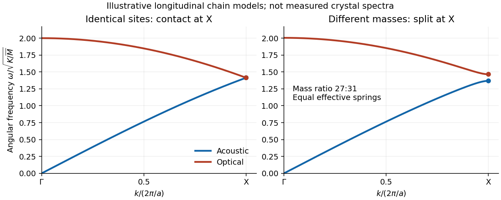

<h1 id="2/e/solution">Solution</h1>

↑ **Parent:** [E](../e.md)

In the [diamond cubic structure](../../../../diamond-cubic-structure.md) of [silicon](../../../../silicon.md), the longitudinal [acoustic phonon branch](../../../../acoustic-phonon-branch.md) and longitudinal [optical phonon branch](../../../../optical-phonon-branch.md) meet at $X=(2\pi/a,0,0)$. The two [atomic basis](../../../../atomic-basis-of-a-crystal.md) sites are identical, and the associated [crystal symmetry](../../../../crystal-symmetry.md) protects their boundary [degeneracy of normal modes](../../../../degeneracy-of-normal-modes.md). In [aluminium phosphide](../../../../aluminium-phosphide.md), the two sites contain different [chemical atoms](../../../../atom-physics.md). The corresponding [zinc blende structure](../../../../zinc-blende-structure.md) lacks the site-exchange symmetry, and these two longitudinal branches generally split at $X$.

A simple way to see the splitting is a [diatomic-chain dispersion relation with equal springs](../../../../diatomic-chain-dispersion-relation-with-equal-springs.md), representing successive $[100]$ atomic planes by alternating [masses](../../../../mass.md) $M_1,M_2$ at spacing $d=a/4$. With effective [spring constant](../../../../spring-constant.md) $K$, its [angular frequencies](../../../../angular-frequency.md) obey

$$
\omega_\pm^2=K\left(\frac1{M_1}+\frac1{M_2}\right)
\pm K\sqrt{\left(\frac1{M_1}+\frac1{M_2}\right)^2-\frac4{M_1M_2}\sin^2(kd)}.
$$

At $X$, $kd=\pi/2$, so the inter-sublattice coupling cancels and the two squared [angular frequencies](../../../../angular-frequency.md) are $2K/M_1$ and $2K/M_2$. Equal [masses](../../../../mass.md) give a contact; unequal [masses](../../../../mass.md) give

$$
\boxed{\omega_{\rm acoustic}(X)\simeq\sqrt{\frac{2K}{M_{\rm heavy}}},\qquad
\omega_{\rm optical}(X)\simeq\sqrt{\frac{2K}{M_{\rm light}}}.}
$$

In [aluminium phosphide](../../../../aluminium-phosphide.md), the heavier [phosphorus](../../../../phosphorus.md) plane moves in the lower-frequency edge mode, and the lighter [aluminium](../../../../aluminium.md) plane in the higher-frequency mode in this model. Their similar [atomic masses](../../../../atomic-mass.md) explain why the splitting is relatively small. Different electronic environments can also change the [force constant matrix](../../../../force-constant-matrix.md). The chain calculation illustrates the mechanism; a quantitative three-dimensional [phonon spectrum](../../../../phonon-spectrum.md) requires its full [dynamical matrix](../../../../dynamical-matrix.md). It does not assert that all transverse acoustic and optical branches meet in [silicon](../../../../silicon.md).

**[Figure 1](#2/e/image-equal-mass-and-alternating-mass-chain-models-illustrating-longitudinal-branch-contact-and-splitting-at-x). Equal-mass and alternating-mass chain models illustrating longitudinal branch contact and splitting at X**.

## ↑ Ancestors (12)

1. [E](../e.md)
2. [2](../../2.md)
3. [2021](../../../2021-split.md)
4. [Past exam of the condensed matter physics course of the University of Oxford](../../../split.md)
5. [Condensed matter physics course of the University of Oxford](../../../../condensed-matter-physics-course-of-the-university-of-oxford.md)
6. [Year 3 of the physics course of the University of Oxford](../../../../year-3-of-the-physics-course-of-the-university-of-oxford.md)
7. [Physics course of the University of Oxford](../../../../physics-course-of-the-university-of-oxford.md)
8. [Undergraduate course of the University of Oxford](../../../../undergraduate-course-of-the-university-of-oxford.md)
9. [Course of the University of Oxford](../../../../course-of-the-university-of-oxford.md)
10. [University of Oxford](../../../../university-of-oxford-split.md)
11. [List of universities](../../../../list-of-universities.md)
12. [Codex Wiki](../../../../split.md)
