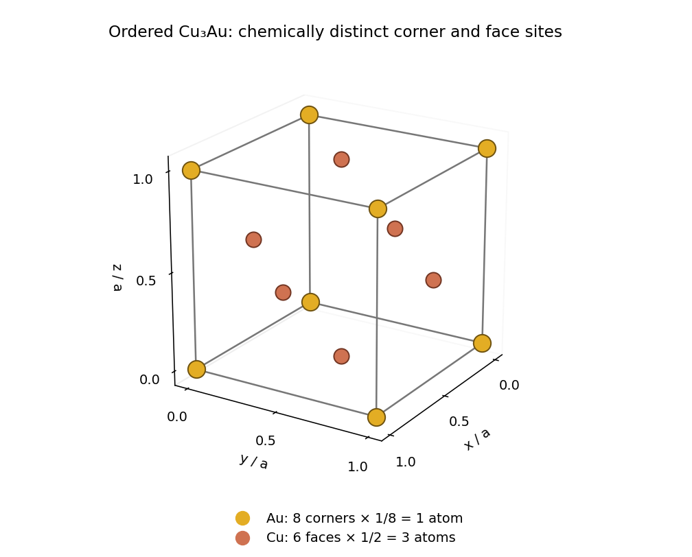
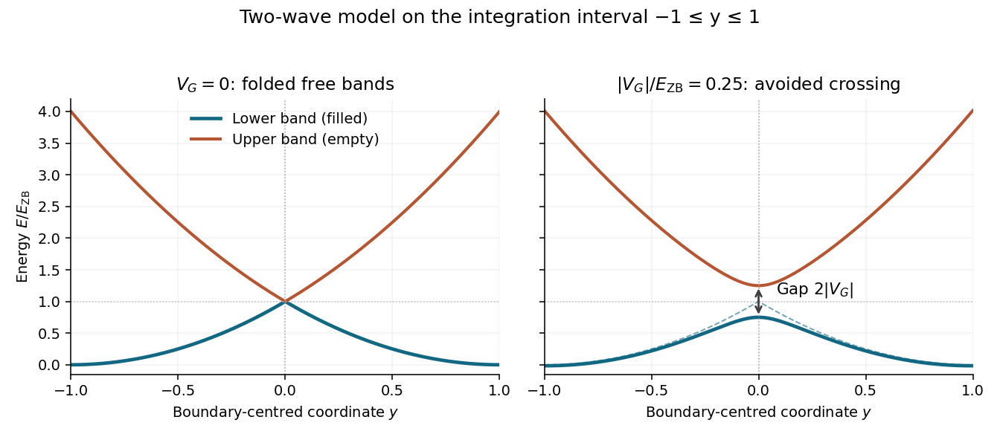

# 2022

↑ **Parent:** [Past exam of the condensed matter physics course of the University of Oxford](../past-exam-of-the-condensed-matter-physics-course-of-the-university-of-oxford.md)

Source: [https://www.whatdotheyknow.com/request/oxford_physics_past_papers_2/response/2340696/attach/10/Physics%20Papers%202021.pdf?cookie_passthrough=1](https://www.whatdotheyknow.com/request/oxford_physics_past_papers_2/response/2340696/attach/10/Physics%20Papers%202021.pdf?cookie_passthrough=1)

Source bundle pages 76–80. The paper cover establishes 2022; the attachment filename uses 2021.

**Table of contents**

- [1](#1)
  - [a](#1/a)
    - [i](#1/a/i)
      - [Solution](#1/a/i/solution)
    - [ii](#1/a/ii)
      - [Solution](#1/a/ii/solution)
    - [iii](#1/a/iii)
      - [Solution](#1/a/iii/solution)
  - [b](#1/b)
    - [i](#1/b/i)
      - [Solution](#1/b/i/solution)
    - [ii](#1/b/ii)
      - [Solution](#1/b/ii/solution)
  - [c](#1/c)
    - [i](#1/c/i)
      - [Solution](#1/c/i/solution)
    - [ii](#1/c/ii)
      - [Solution](#1/c/ii/solution)
  - [d](#1/d)
    - [i](#1/d/i)
      - [Solution](#1/d/i/solution)
    - [ii](#1/d/ii)
      - [Solution](#1/d/ii/solution)
- [2](#2)
  - [a](#2/a)
    - [i](#2/a/i)
      - [Solution](#2/a/i/solution)
    - [ii](#2/a/ii)
      - [Solution](#2/a/ii/solution)
    - [iii](#2/a/iii)
      - [Solution](#2/a/iii/solution)
  - [b](#2/b)
    - [i](#2/b/i)
      - [Solution](#2/b/i/solution)
    - [ii](#2/b/ii)
      - [Solution](#2/b/ii/solution)
    - [iii](#2/b/iii)
      - [Solution](#2/b/iii/solution)
  - [c](#2/c)
    - [i](#2/c/i)
      - [Solution](#2/c/i/solution)
    - [ii](#2/c/ii)
      - [Solution](#2/c/ii/solution)
    - [iii](#2/c/iii)
      - [Solution](#2/c/iii/solution)
  - [d](#2/d)
    - [Solution](#2/d/solution)
- [3](#3)
  - [a](#3/a)
    - [Solution](#3/a/solution)
  - [b](#3/b)
    - [i](#3/b/i)
      - [Solution](#3/b/i/solution)
    - [ii](#3/b/ii)
      - [Solution](#3/b/ii/solution)
  - [c](#3/c)
    - [i](#3/c/i)
      - [Solution](#3/c/i/solution)
    - [ii](#3/c/ii)
      - [Solution](#3/c/ii/solution)
- [4](#4)
  - [a](#4/a)
    - [Solution](#4/a/solution)
  - [b](#4/b)
    - [i](#4/b/i)
      - [Solution](#4/b/i/solution)
    - [ii](#4/b/ii)
      - [Solution](#4/b/ii/solution)
    - [iii](#4/b/iii)
      - [Solution](#4/b/iii/solution)
  - [c](#4/c)
    - [Solution](#4/c/solution)
  - [d](#4/d)
    - [i](#4/d/i)
      - [Solution](#4/d/i/solution)
    - [ii](#4/d/ii)
      - [Solution](#4/d/ii/solution)

## 1

↑ **Parent:** [2022](2022.md)

<h3 id="1/a">a</h3>

↑ **Parent:** [1](#1)

<h4 id="1/a/i">i</h4>

↑ **Parent:** [A](#1/a)

<h5 id="1/a/i/solution">Solution</h5>

↑ **Parent:** [I](#1/a/i)

The ordered [crystal structure](../physical-chemistry.md#crystal-structure) consists of a [primitive cubic lattice](../quantum-scattering.md#primitive-cubic-lattice) with the four-site [atomic basis](../physical-chemistry.md#atomic-basis-of-a-crystal)

$$
\mathrm{Au}:(0,0,0),\qquad
\mathrm{Cu}:\left(0,\frac12,\frac12\right),\left(\frac12,0,\frac12\right),\left(\frac12,\frac12,0\right),
$$

in [fractional crystal coordinates](../physical-chemistry.md#fractional-crystal-coordinate). The drawing shows all boundary representatives of these sites. Eight corner [gold](../chemical-substance.md#gold) [chemical atoms](../physics.md#atom-physics), shared among eight [unit cells](../quantum-scattering.md#unit-cell) each, contribute one [gold](../chemical-substance.md#gold) [chemical atom](../physics.md#atom-physics). Six face-centred [copper](../chemical-substance.md#copper) [chemical atoms](../physics.md#atom-physics), shared between two [unit cells](../quantum-scattering.md#unit-cell) each, contribute three [copper](../chemical-substance.md#copper) [chemical atoms](../physics.md#atom-physics). Thus

$$
\boxed{N_{\rm Au}=8\times\frac18=1,\qquad N_{\rm Cu}=6\times\frac12=3,}
$$

which gives the required [stoichiometry](../chemical-reaction.md#stoichiometry). Although the unlabelled positions form a [face-centered cubic lattice](../quantum-scattering.md#face-centered-cubic-lattice), a face-centering [lattice translation](../quantum-scattering.md#lattice-translation) exchanges [gold](../chemical-substance.md#gold) and [copper](../chemical-substance.md#copper) and therefore fails to preserve the ordered [crystal structure](../physical-chemistry.md#crystal-structure). Its [Bravais lattice](../quantum-scattering.md#bravais-lattice) is [primitive cubic lattice](../quantum-scattering.md#primitive-cubic-lattice).

**[Figure 1](#1/a/i/image-ordered-copper-gold-unit-cell-with-corner-and-face-site-counting). Ordered copper–gold unit cell with corner and face-site counting**.

<h4 id="1/a/ii">ii</h4>

↑ **Parent:** [A](#1/a)

<h5 id="1/a/ii/solution">Solution</h5>

↑ **Parent:** [Ii](#1/a/ii)

For the [reciprocal lattice vector](../quantum-scattering.md#reciprocal-lattice-vector) $\mathbf G_{hkl}=(2\pi/a)(h,k,l)$, sum the [atomic scattering factors](../quantum-scattering.md#atomic-scattering-factor) with the [atomic basis](../physical-chemistry.md#atomic-basis-of-a-crystal) phase factors. Taking the positive phase convention gives the [structure factor](../quantum-scattering.md#structure-factor)

$$
S_{hkl}=f_{\rm Au}(G_{hkl})+f_{\rm Cu}(G_{hkl})
\left[e^{i\pi(k+l)}+e^{i\pi(h+l)}+e^{i\pi(h+k)}\right].
$$

Changing the phase convention complex-conjugates the [structure factor](../quantum-scattering.md#structure-factor) and leaves the [diffraction](../quantum-scattering.md#diffraction) [wave intensity](../wave.md#intensity-physics) unchanged. Since the [Miller indices](../physical-chemistry.md#miller-index) are integers,

$$
\alpha_{hkl}=(-1)^{k+l}+(-1)^{h+l}+(-1)^{h+k}.
$$

If all three [Miller indices](../physical-chemistry.md#miller-index) have the same [integer parity](../integer.md#parity-mathematics), all pairwise sums are even. Otherwise exactly one pairwise sum is even and two are odd. Consequently

$$
\boxed{\alpha_{hkl}=\begin{cases}3,&h,k,l\text{ all even or all odd},\\-1,&\text{mixed parity}.\end{cases}}
$$

The corresponding [structure factors](../quantum-scattering.md#structure-factor) are $f_{\rm Au}+3f_{\rm Cu}$ and $f_{\rm Au}-f_{\rm Cu}$. Reflections with mixed [integer parity](../integer.md#parity-mathematics) are [superlattice reflections](../quantum-scattering.md#superlattice-reflection) that reveal [chemical ordering in alloys](../chemical-substance.md#chemical-ordering-in-alloys).

<h4 id="1/a/iii">iii</h4>

↑ **Parent:** [A](#1/a)

<h5 id="1/a/iii/solution">Solution</h5>

↑ **Parent:** [Iii](#1/a/iii)

In [elastic scattering](../quantum-scattering.md#elastic-scattering), the incoming and outgoing [wave vectors](../elasticity-physics.md#wavevector) have equal magnitude $k_0=2\pi/\lambda$. Their mutual angle is $2\theta_{hkl}$. The [scattering vector](../optics.md#scattering-vector) $\mathbf q=\mathbf k_f-\mathbf k_i$ therefore has magnitude

$$
q^2=2k_0^2\left[1-\cos(2\theta_{hkl})\right]
=4k_0^2\sin^2\theta_{hkl}.
$$

The [elastic Bragg scattering condition](../quantum-scattering.md#elastic-bragg-scattering-condition) is $\mathbf q=\mathbf G_{hkl}$, giving

$$
\boxed{G_{hkl}=\frac{4\pi}{\lambda}\sin\theta_{hkl}.}
$$

Equivalently, $G_{hkl}=2\pi/d_{hkl}$ turns this relation into [Bragg's law](../quantum-scattering.md#bragg-s-law), $2d_{hkl}\sin\theta_{hkl}=\lambda$, with the reflection order incorporated into the [Miller indices](../physical-chemistry.md#miller-index).

<h3 id="1/b">b</h3>

↑ **Parent:** [1](#1)

<h4 id="1/b/i">i</h4>

↑ **Parent:** [B](#1/b)

<h5 id="1/b/i/solution">Solution</h5>

↑ **Parent:** [I](#1/b/i)

The [primitive cubic lattice](../quantum-scattering.md#primitive-cubic-lattice) has $G_{hkl}=(2\pi/a)\sqrt{h^2+k^2+l^2}$. Combining this with [Bragg's law](../quantum-scattering.md#bragg-s-law) gives the [Bragg angle](../quantum-scattering.md#bragg-angle)

$$
\sin\theta_{hkl}=\frac{\lambda}{2a}\sqrt{h^2+k^2+l^2}.
$$

Using $a=0.375\,\mathrm{nm}$ and $\lambda=0.154\,\mathrm{nm}$ yields

$$
\boxed{2\theta_{110}=33.762^\circ\simeq33.8^\circ,\qquad
2\theta_{111}=41.666^\circ\simeq41.7^\circ.}
$$

These are the full scattering angles; the [Bragg angles](../quantum-scattering.md#bragg-angle) themselves are half as large.

<h4 id="1/b/ii">ii</h4>

↑ **Parent:** [B](#1/b)

<h5 id="1/b/ii/solution">Solution</h5>

↑ **Parent:** [Ii](#1/b/ii)

At each reflection, the argument of the [atomic scattering factor](../quantum-scattering.md#atomic-scattering-factor) is

$$
s_{hkl}=\frac{\sin\theta_{hkl}}{\lambda}
=\frac{\sqrt{h^2+k^2+l^2}}{2a},\qquad
s_{110}^2=3.55556\,\mathrm{nm^{-2}},\quad s_{111}^2=5.33333\,\mathrm{nm^{-2}}.
$$

Substitution into the given [atomic scattering factor](../quantum-scattering.md#atomic-scattering-factor) approximation gives

$$
\begin{aligned}
f_{\rm Au}(110)&=59.4421,&f_{\rm Cu}(110)&=23.1801,\\
f_{\rm Au}(111)&=51.5618,&f_{\rm Cu}(111)&=20.7241.
\end{aligned}
$$

Thus the [structure factors](../quantum-scattering.md#structure-factor) are $S_{110}=36.2620$ and $S_{111}=113.7340$. The [powder diffraction multiplicity](../physical-chemistry.md#powder-diffraction-multiplicity) is $m_{110}=12$: choose which [Miller index](../physical-chemistry.md#miller-index) is zero in three ways and the signs of the other two in four ways. For $\{111\}$, the eight sign choices give $m_{111}=8$. With the specified instrumental and angular factors omitted, the integrated [powder diffraction](../physical-chemistry.md#powder-diffraction) [wave intensity](../wave.md#intensity-physics) is proportional to $m_{hkl}|S_{hkl}|^2$, so

$$
\boxed{\frac{I_{111}}{I_{110}}=\frac8{12}
\left(\frac{113.7340}{36.2620}\right)^2\simeq6.56.}
$$

It would be incorrect to use the same [atomic scattering factors](../quantum-scattering.md#atomic-scattering-factor) at the two different [scattering vectors](../optics.md#scattering-vector), or to omit the [powder diffraction multiplicity](../physical-chemistry.md#powder-diffraction-multiplicity).

<h3 id="1/c">c</h3>

↑ **Parent:** [1](#1)

<h4 id="1/c/i">i</h4>

↑ **Parent:** [C](#1/c)

<h5 id="1/c/i/solution">Solution</h5>

↑ **Parent:** [I](#1/c/i)

The [stoichiometry](../chemical-reaction.md#stoichiometry) fixes the site [probabilities](../probability-theory.md#probability) to $1/4$ [gold](../chemical-substance.md#gold) and $3/4$ [copper](../chemical-substance.md#copper). Every site in the average [crystal structure](../physical-chemistry.md#crystal-structure) therefore has the same [atomic scattering factor](../quantum-scattering.md#atomic-scattering-factor)

$$
\bar f=\frac14f_{\rm Au}+\frac34f_{\rm Cu}.
$$

The average [structure factor](../quantum-scattering.md#structure-factor) is

$$
\bar S_{hkl}=\bar f\left[1+(-1)^{k+l}+(-1)^{h+l}+(-1)^{h+k}\right].
$$

At $(110)$ the bracket vanishes, while at $(111)$ it is four. Hence

$$
\boxed{I_{110}^{\rm Bragg}=0,\qquad
\bar S_{111}=4\bar f=f_{\rm Au}+3f_{\rm Cu}=S_{111}^{\rm ordered}.}
$$

The $(111)$ [powder diffraction multiplicity](../physical-chemistry.md#powder-diffraction-multiplicity) is unchanged, so its coherent [Bragg diffraction](../quantum-scattering.md#bragg-diffraction) [wave intensity](../wave.md#intensity-physics) equals the ordered value under the stated equal-[lattice constant](../physical-chemistry.md#lattice-constant) approximation.

The zero refers to the coherent [Bragg diffraction](../quantum-scattering.md#bragg-diffraction) peak of the average [crystal structure](../physical-chemistry.md#crystal-structure). A random [alloy](../chemical-substance.md#alloy) can still give [occupational diffuse scattering](../quantum-scattering.md#occupational-diffuse-scattering) at the same [scattering vector](../optics.md#scattering-vector): the average of the squared amplitude includes fluctuations as well as the square of the average amplitude. Such background is not a surviving $(110)$ [Bragg diffraction](../quantum-scattering.md#bragg-diffraction) peak.

<h4 id="1/c/ii">ii</h4>

↑ **Parent:** [C](#1/c)

<h5 id="1/c/ii/solution">Solution</h5>

↑ **Parent:** [Ii](#1/c/ii)

Replace every coloured site in the drawing by an identical site carrying $\bar f$. The face-centering [lattice translations](../quantum-scattering.md#lattice-translation) now preserve the average [crystal structure](../physical-chemistry.md#crystal-structure), whose [Bravais lattice](../quantum-scattering.md#bravais-lattice) is a [face-centered cubic lattice](../quantum-scattering.md#face-centered-cubic-lattice). One choice of [primitive lattice translation vectors](../quantum-scattering.md#primitive-lattice-translation-vector) is

$$
\mathbf a_1=\frac a2(0,1,1),\qquad
\mathbf a_2=\frac a2(1,0,1),\qquad
\mathbf a_3=\frac a2(1,1,0).
$$

A coherent [Bragg diffraction](../quantum-scattering.md#bragg-diffraction) peak requires $\mathbf G\cdot\mathbf a_j\in2\pi\mathbb Z$ for all three [primitive lattice translation vectors](../quantum-scattering.md#primitive-lattice-translation-vector). Thus $k+l$, $h+l$, and $h+k$ must all be even, equivalent to all three [Miller indices](../physical-chemistry.md#miller-index) having the same [integer parity](../integer.md#parity-mathematics). This is the [face-centred cubic selection rule](../quantum-scattering.md#face-centred-cubic-selection-rule): $(110)$ is forbidden and $(111)$ is allowed. The restoration of these [lattice translations](../quantum-scattering.md#lattice-translation) explains the disappearance of the ordered [superlattice reflections](../quantum-scattering.md#superlattice-reflection).

<h3 id="1/d">d</h3>

↑ **Parent:** [1](#1)

<h4 id="1/d/i">i</h4>

↑ **Parent:** [D](#1/d)

<h5 id="1/d/i/solution">Solution</h5>

↑ **Parent:** [I](#1/d/i)

Specify the normalization of the [alloy sublattice order parameter](../chemical-substance.md#alloy-sublattice-order-parameter) rather than assuming that its endpoint values uniquely define it. Let $p_c$ be the [probability](../probability-theory.md#probability) of [gold](../chemical-substance.md#gold) occupation at a corner site and define

$$
\rho=\frac{p_c-1/4}{1-1/4},\qquad p_c=\frac{1+3\rho}{4}.
$$

The complementary [copper](../chemical-substance.md#copper) [probability](../probability-theory.md#probability) is $3(1-\rho)/4$, so the corner-site [atomic scattering factor](../quantum-scattering.md#atomic-scattering-factor) is

$$
\boxed{\langle f_c\rangle=\frac14\left[(1+3\rho)f_{\rm Au}+3(1-\rho)f_{\rm Cu}\right].}
$$

The [stoichiometry](../chemical-reaction.md#stoichiometry) provides one [gold](../chemical-substance.md#gold) [chemical atom](../physics.md#atom-physics) per four-site [unit cell](../quantum-scattering.md#unit-cell). If all three face sublattices are equivalent, their [gold](../chemical-substance.md#gold) occupation [probability](../probability-theory.md#probability) $p_f$ obeys $p_c+3p_f=1$. Therefore

$$
p_f=\frac{1-\rho}{4},\qquad 1-p_f=\frac{3+\rho}{4},\qquad
\boxed{\langle f_f\rangle=\frac14\left[(1-\rho)f_{\rm Au}+(3+\rho)f_{\rm Cu}\right].}
$$

At $\rho=1$ the corner and face sites carry pure [gold](../chemical-substance.md#gold) and pure [copper](../chemical-substance.md#copper); at $\rho=0$ they have identical statistical compositions. These formulas describe the branch with $0\leq\rho\leq1$ and equivalent face-site averages.

<h4 id="1/d/ii">ii</h4>

↑ **Parent:** [D](#1/d)

<h5 id="1/d/ii/solution">Solution</h5>

↑ **Parent:** [Ii](#1/d/ii)

Use the same [atomic basis](../physical-chemistry.md#atomic-basis-of-a-crystal) phases as in the ordered [structure factor](../quantum-scattering.md#structure-factor), replacing each [atomic scattering factor](../quantum-scattering.md#atomic-scattering-factor) by its site average. For the reflection with equal [integer parity](../integer.md#parity-mathematics),

$$
S_{111}=\langle f_c\rangle+3\langle f_f\rangle=f_{\rm Au}+3f_{\rm Cu}.
$$

Conservation of the total composition removes the [alloy sublattice order parameter](../chemical-substance.md#alloy-sublattice-order-parameter) from this amplitude. For the reflection with mixed [integer parity](../integer.md#parity-mathematics),

$$
S_{110}=\langle f_c\rangle-\langle f_f\rangle=\rho(f_{\rm Au}-f_{\rm Cu}).
$$

The coherent [powder diffraction](../physical-chemistry.md#powder-diffraction) [wave intensities](../wave.md#intensity-physics) consequently satisfy

$$
\boxed{I_{111}(\rho)=I_{111}(1),\qquad I_{110}(\rho)=\rho^2 I_{110}(1).}
$$

Here the [lattice constant](../physical-chemistry.md#lattice-constant), [atomic scattering factors](../quantum-scattering.md#atomic-scattering-factor), [powder diffraction multiplicities](../physical-chemistry.md#powder-diffraction-multiplicity), and omitted experimental factors are held fixed. The ratio of a [superlattice reflection](../quantum-scattering.md#superlattice-reflection) to a fundamental reflection can therefore measure the magnitude of the [alloy sublattice order parameter](../chemical-substance.md#alloy-sublattice-order-parameter).

## 2

↑ **Parent:** [2022](2022.md)

<h3 id="2/a">a</h3>

↑ **Parent:** [2](#2)

<h4 id="2/a/i">i</h4>

↑ **Parent:** [A](#2/a)

<h5 id="2/a/i/solution">Solution</h5>

↑ **Parent:** [I](#2/a/i)

The boundary of the first [Brillouin zone](../bloch-s-theorem.md#brillouin-zone) is $|k|=\pi/a$. The unperturbed [free electron model](../physics.md#free-electron-model) assigns the [kinetic energy](../energy.md#kinetic-energy)

$$
\boxed{E_{\rm ZB}=\frac{\hbar^2\pi^2}{2m_ea^2},}
$$

where $m_e$ is the bare [electron mass](../physics.md#electron-mass) and $\hbar$ is the [reduced Planck constant](../quantum-mechanics.md#reduced-planck-constant). This is the free [kinetic energy](../energy.md#kinetic-energy) at the [Brillouin zone](../bloch-s-theorem.md#brillouin-zone) boundary, not the already split [energy band](../bloch-s-theorem.md#energy-band) edge. A constant mean [potential energy](../energy.md#potential-energy) may be absorbed into the choice of zero of [energy](../energy.md).

<h4 id="2/a/ii">ii</h4>

↑ **Parent:** [A](#2/a)

<h5 id="2/a/ii/solution">Solution</h5>

↑ **Parent:** [Ii](#2/a/ii)

Write $U(x)=-e\phi(x)$ for the [potential energy](../energy.md#potential-energy) of an [electron](../physics.md#electron) in an [electrostatic potential](../electric-field.md#electric-potential) $\phi$, where $e>0$. With $G=2\pi/a$, the coupling in the [nearly-free electron model](../bloch-s-theorem.md#nearly-free-electron-model) is the [Fourier coefficient](../fourier-series.md#fourier-coefficient)

$$
\boxed{V_G=\frac1a\int_0^a U(x)e^{-iGx}\,dx
=-\frac ea\int_0^a\phi(x)e^{-iGx}\,dx.}
$$

If a symbol $V(x)$ already denotes the [electron](../physics.md#electron) [potential energy](../energy.md#potential-energy), as in part (c), it replaces $U(x)$ without another factor $-e$.

At the [Brillouin zone](../bloch-s-theorem.md#brillouin-zone) boundary the two resonant [plane waves](../wave-function.md#plane-wave) have unperturbed [energy](../energy.md) $E_{\rm ZB}$. Their [Hamiltonian operator](../quantum-system.md#hamiltonian-quantum-mechanics) in the two-state basis has diagonal entries $E_{\rm ZB}$ and off-diagonal entries $V_G,V_G^*$; its [eigenvalues](../linear-operator-theory.md#eigenvalue) are $E_{\rm ZB}\pm|V_G|$. Thus

$$
\boxed{\Delta=2|V_G|=2\epsilon E_{\rm ZB}.}
$$

This is the local [band gap](../bloch-s-theorem.md#band-gap) in the two-wave [nearly-free electron model](../bloch-s-theorem.md#nearly-free-electron-model).

<h4 id="2/a/iii">iii</h4>

↑ **Parent:** [A](#2/a)

<h5 id="2/a/iii/solution">Solution</h5>

↑ **Parent:** [Iii](#2/a/iii)

For zero coupling, $\sqrt{4y^2}=2|y|$, and the two folded [energy bands](../bloch-s-theorem.md#energy-band) are

$$
E_-(y)=E_{\rm ZB}(1-|y|)^2,\qquad
E_+(y)=E_{\rm ZB}(1+|y|)^2.
$$

They touch at $y=0$, where the underlying free [plane wave](../wave-function.md#plane-wave) branches cross. A nonzero [Fourier coefficient](../fourier-series.md#fourier-coefficient) replaces this crossing by an [avoided crossing](../bloch-s-theorem.md#avoided-crossing), with $E_\pm(0)=E_{\rm ZB}(1\pm\epsilon)$. The lower [energy band](../bloch-s-theorem.md#energy-band) moves downward and the upper [energy band](../bloch-s-theorem.md#energy-band) upward. Both branches are smooth near $y=0$ for $\epsilon>0$.

**[Figure 2](#2/a/iii/image-folded-free-electron-bands-and-the-gap-opened-by-a-periodic-potential). Folded free-electron bands and the gap opened by a periodic potential**.

The figure uses the boundary-centred interval $-1\leq y\leq1$ required in part (b). With the printed definition $y=1-ka/\pi$, this is the translated [Brillouin zone](../bloch-s-theorem.md#brillouin-zone) $0\leq k\leq2\pi/a$. The printed $0\leq y\leq2$ instead corresponds to $-\pi/a\leq k\leq\pi/a$; the local two-wave formula must be folded appropriately before treating it as a dispersion over that entire zone. It must not be integrated over $0\leq y\leq2$ as though it were the filled first [energy band](../bloch-s-theorem.md#energy-band) there. The subsequent calculation follows the explicit continuation prescribed in part (b).

<h3 id="2/b">b</h3>

↑ **Parent:** [2](#2)

<h4 id="2/b/i">i</h4>

↑ **Parent:** [B](#2/b)

<h5 id="2/b/i/solution">Solution</h5>

↑ **Parent:** [I](#2/b/i)

For a long chain of length $L$ with periodic boundary conditions, each [spin](../angular-momentum-operator.md#spin) has $L\,dk/(2\pi)$ [quantum states](../quantum-system.md#quantum-state) in a [wavenumber](../wave-equation.md#wavenumber) interval $dk$. Including two [spin](../angular-momentum-operator.md#spin) states, a full [energy band](../bloch-s-theorem.md#energy-band) contains $2L/a$ [electrons](../physics.md#electron). The [state counting in a Bloch band](../bloch-s-theorem.md#state-counting-in-a-bloch-band) therefore gives the [energy density](../statistical-physics.md#energy-density)

$$
\mathcal U(\epsilon)=\frac1\pi\int_{\text{one zone}}E_-(k)\,dk
=\frac{E_{\rm ZB}}a\int_{-1}^1
\left[1+y^2-\sqrt{4y^2+\epsilon^2}\right]dy.
$$

The integral of $1+y^2$ is $8/3$. For $\epsilon>0$, the even square-root integral is

$$
\int_{-1}^1\sqrt{4y^2+\epsilon^2}\,dy
=\sqrt{4+\epsilon^2}+\frac{\epsilon^2}{2}
\ln\frac{2+\sqrt{4+\epsilon^2}}{\epsilon}.
$$

For example, this follows by setting $u=2y$, applying the supplied antiderivative, and evaluating both endpoints; the lower-end [logarithm](../calculus.md#logarithm) contributes $\ln\epsilon$. Hence

$$
\boxed{\mathcal U(\epsilon)=\frac{E_{\rm ZB}}a
\left[\frac83-\sqrt{4+\epsilon^2}
-\frac{\epsilon^2}{2}\ln\frac{2+\sqrt{4+\epsilon^2}}{\epsilon}\right].}
$$

The continuous zero-coupling limit is $\mathcal U(0)=2E_{\rm ZB}/(3a)$. This agrees with directly integrating the one-dimensional [free electron model](../physics.md#free-electron-model) up to $k_F=\pi/a$ at two [electrons](../physics.md#electron) per [unit cell](../quantum-scattering.md#unit-cell).

<h4 id="2/b/ii">ii</h4>

↑ **Parent:** [B](#2/b)

<h5 id="2/b/ii/solution">Solution</h5>

↑ **Parent:** [Ii](#2/b/ii)

At every $y$ and every $\epsilon>0$,

$$
\sqrt{4y^2+\epsilon^2}>2|y|,
$$

so the lower [energy band](../bloch-s-theorem.md#energy-band) lies strictly below its zero-coupling counterpart. Its [state counting in a Bloch band](../bloch-s-theorem.md#state-counting-in-a-bloch-band) and complete occupation are unchanged. Subtracting the two [energy densities](../statistical-physics.md#energy-density) directly gives

$$
\mathcal U(\epsilon)-\mathcal U(0)
=-\frac{E_{\rm ZB}}a\int_{-1}^1
\left[\sqrt{4y^2+\epsilon^2}-2|y|\right]dy<0.
$$

Thus

$$
\boxed{\mathcal U(\epsilon)<\mathcal U(0)\quad(\epsilon>0).}
$$

Equality holds at $\epsilon=0$. This is the downward displacement of the filled lower [energy band](../bloch-s-theorem.md#energy-band) in the sketch. The upward displacement of the empty upper [energy band](../bloch-s-theorem.md#energy-band) contributes nothing to the zero-[temperature](../temperature.md) electronic [energy density](../statistical-physics.md#energy-density).

<h4 id="2/b/iii">iii</h4>

↑ **Parent:** [B](#2/b)

<h5 id="2/b/iii/solution">Solution</h5>

↑ **Parent:** [Iii](#2/b/iii)

For $\epsilon\to0^+$, the [Taylor expansions](../calculus.md#taylor-expansion) needed in the exact [energy density](../statistical-physics.md#energy-density) are

$$
\sqrt{4+\epsilon^2}=2+\frac{\epsilon^2}{4}+O(\epsilon^4),\qquad
\ln\frac{2+\sqrt{4+\epsilon^2}}{\epsilon}
=\ln\frac4\epsilon+O(\epsilon^2).
$$

Substitution yields

$$
\begin{aligned}
\mathcal U(\epsilon)
&=\frac{E_{\rm ZB}}a\left[\frac23-\frac{\epsilon^2}{4}
-\frac{\epsilon^2}{2}\ln\frac4\epsilon+O(\epsilon^4)\right]\\
&=\frac{E_{\rm ZB}}a\left[\frac23-\frac{\epsilon^2}{4}
\left(1-2\ln\frac\epsilon4\right)+O(\epsilon^4)\right].
\end{aligned}
$$

Therefore

$$
\boxed{\alpha=1,\qquad\beta=2.}
$$

Here [Big O notation](../real-analysis.md#big-o-notation) describes the neglected small-coupling terms, and the [logarithm](../calculus.md#logarithm) is natural. The nonanalytic $\epsilon^2\ln\epsilon$ term comes from the formerly degenerate [quantum states](../quantum-system.md#quantum-state) near the [Brillouin zone](../bloch-s-theorem.md#brillouin-zone) boundary; a uniform nondegenerate [perturbation theory](../asymptotic-expansion.md#perturbation-theory) expansion of the integrand would fail there. This is the same mechanism as the [Peierls energy gain](../quantum-ideal-gas-statistics.md#logarithmic-energy-gain-from-a-peierls-distortion).

<h3 id="2/c">c</h3>

↑ **Parent:** [2](#2)

<h4 id="2/c/i">i</h4>

↑ **Parent:** [C](#2/c)

<h5 id="2/c/i/solution">Solution</h5>

↑ **Parent:** [I](#2/c/i)

Regard $V(x)$ as an [electron](../physics.md#electron) [potential energy](../energy.md#potential-energy), and take $G=2\pi/a$. Each cosine supplies half its coefficient to each of its two [Fourier coefficients](../fourier-series.md#fourier-coefficient). The nonzero coefficients are

$$
V_{\pm G}=-\pi V_0\delta,\qquad
V_{\pm2G}=\frac{V_0}{2},\qquad
V_{\pm3G}=+\pi V_0\delta.
$$

The [Fourier coefficient](../fourier-series.md#fourier-coefficient) connecting the two [plane waves](../wave-function.md#plane-wave) at $k=\pm\pi/a$ is $V_G$, so the two-wave [band gap](../bloch-s-theorem.md#band-gap) is

$$
\boxed{\Delta=2\pi|V_0|\,|\delta|,\qquad
\epsilon=\frac{\pi|V_0|}{E_{\rm ZB}}|\delta|.}
$$

At $\delta=0$ the actual [periodic potential](../bloch-s-theorem.md#periodic-potential) has period $a/2$ and no Fourier harmonic at $G$. The crossing at the artificially halved [Brillouin zone](../bloch-s-theorem.md#brillouin-zone) boundary then has zero [band gap](../bloch-s-theorem.md#band-gap). Higher-order weak-potential corrections can change the proportionality coefficient at nonzero $\delta$; the displayed coefficient belongs to the given two-wave approximation.

There is also a small-displacement qualification in the source: the claimed positions of the [potential energy](../energy.md#potential-energy) minima are correct to first order in $\delta$, not exactly. Put $t=2\pi x/a$. Then

$$
\frac1{V_0}\frac{dV}{dt}=-2\sin2t+2\pi\delta(\sin t-3\sin3t).
$$

At $\delta=0.01$ and $x/a=1/4-\delta=0.24$, this equals approximately $-2.802\times10^{-3}$, rather than zero. For $V_0>0$, expanding about $x/a=1/4$ and $3/4$ gives minima at $1/4-\delta+O(\delta^3)$ and $3/4+\delta+O(\delta^3)$. This does not alter the leading [Fourier coefficient](../fourier-series.md#fourier-coefficient) or the linear opening of the [band gap](../bloch-s-theorem.md#band-gap).

<h4 id="2/c/ii">ii</h4>

↑ **Parent:** [C](#2/c)

<h5 id="2/c/ii/solution">Solution</h5>

↑ **Parent:** [Ii](#2/c/ii)

Without the [Peierls distortion](../quantum-ideal-gas-statistics.md#peierls-distortion), adjacent [chemical atoms](../physics.md#atom-physics) are separated by $a/2$. The [primitive unit cell](../quantum-scattering.md#primitive-unit-cell) contains one [chemical atom](../physics.md#atom-physics) and contributes one [electron](../physics.md#electron). A [energy band](../bloch-s-theorem.md#energy-band) with two [spin](../angular-momentum-operator.md#spin) states accommodates two [electrons](../physics.md#electron) per [primitive unit cell](../quantum-scattering.md#primitive-unit-cell), so the first [energy band](../bloch-s-theorem.md#energy-band) is half filled. Its true first [Brillouin zone](../bloch-s-theorem.md#brillouin-zone) extends to $\pm2\pi/a$, while the [Fermi points](../fermi-liquid.md#fermi-point) are at $\pm\pi/a$.

Describing the same chain with a doubled [unit cell](../quantum-scattering.md#unit-cell) of length $a$ merely folds the half-filled [energy band](../bloch-s-theorem.md#energy-band) into two branches that touch at those [Fermi points](../fermi-liquid.md#fermi-point). The unbroken [lattice translation](../quantum-scattering.md#lattice-translation) by $a/2$ prevents an artificial [band gap](../bloch-s-theorem.md#band-gap) there. A [Peierls distortion](../quantum-ideal-gas-statistics.md#peierls-distortion) breaks that smaller [lattice translation](../quantum-scattering.md#lattice-translation) and supplies the missing [Fourier coefficient](../fourier-series.md#fourier-coefficient) at $2k_F=G$; the lower folded [energy band](../bloch-s-theorem.md#energy-band) can then be completely filled and separated from the upper [energy band](../bloch-s-theorem.md#energy-band). Thus the zero-[band gap](../bloch-s-theorem.md#band-gap) result at $\delta=0$ agrees with the original one-[electron](../physics.md#electron) [band filling](../bloch-s-theorem.md#band-filling).

<h4 id="2/c/iii">iii</h4>

↑ **Parent:** [C](#2/c)

<h5 id="2/c/iii/solution">Solution</h5>

↑ **Parent:** [Iii](#2/c/iii)

Define the dimensionless coupling $C=\pi|V_0|/E_{\rm ZB}$, so that $\epsilon=C|\delta|$. Substitution into the [energy density](../statistical-physics.md#energy-density) from part (b) gives, within the prescribed continuation of the two-wave [nearly-free electron model](../bloch-s-theorem.md#nearly-free-electron-model),

$$
\boxed{\mathcal U_{\rm el}(\delta)=\frac{E_{\rm ZB}}a
\left[\frac83-\sqrt{4+C^2\delta^2}
-\frac{C^2\delta^2}{2}\ln\frac{2+\sqrt{4+C^2\delta^2}}{C|\delta|}\right].}
$$

Its value at $\delta=0$ is understood by continuity. For $C|\delta|\ll1$,

$$
\boxed{\mathcal U_{\rm el}(\delta)=\frac{2E_{\rm ZB}}{3a}
-\frac{\pi^2V_0^2}{4aE_{\rm ZB}}\delta^2
\left[1-2\ln\frac{\pi|V_0\delta|}{4E_{\rm ZB}}\right]
+O\left(\frac{E_{\rm ZB}}a C^4\delta^4\right).}
$$

Both [electrons](../physics.md#electron) per doubled [unit cell](../quantum-scattering.md#unit-cell) have been included. The fixed $2G$ harmonic affects the underlying [energy bands](../bloch-s-theorem.md#energy-band) beyond the two-wave approximation; the expression here is the [energy density](../statistical-physics.md#energy-density) requested from part (b), rather than an exact solution for all harmonics of the full [periodic potential](../bloch-s-theorem.md#periodic-potential).

<h3 id="2/d">d</h3>

↑ **Parent:** [2](#2)

<h4 id="2/d/solution">Solution</h4>

↑ **Parent:** [D](#2/d)

Use the same normalization for the [elastic energy](../elasticity-physics.md#elastic-energy) and electronic [energy density](../statistical-physics.md#energy-density): if $\kappa\delta^2$ is an [energy](../energy.md) per [unit cell](../quantum-scattering.md#unit-cell), divide it by $a$ first; if it is already per length, use it directly. Write its coefficient per length as $K>0$ and put $A=\pi^2V_0^2/(4aE_{\rm ZB})>0$. The small-distortion change in total [energy density](../statistical-physics.md#energy-density) is

$$
\mathcal U_{\rm tot}(\delta)-\mathcal U_{\rm tot}(0)
=\delta^2\left[K-A+2A\ln\frac{C|\delta|}{4}\right]+O(\delta^4).
$$

No minimization calculation is needed. For arbitrarily small nonzero $|\delta|$, the [logarithm](../calculus.md#logarithm) is negative with arbitrarily large magnitude. Hence the negative electronic [Peierls energy gain](../quantum-ideal-gas-statistics.md#logarithmic-energy-gain-from-a-peierls-distortion), proportional to $\delta^2\ln(1/|\delta|)$, eventually exceeds any fixed positive quadratic [elastic energy](../elasticity-physics.md#elastic-energy). There are distorted configurations with lower [energy](../energy.md) than the undistorted configuration for every finite $K$ and nonzero coupling. The ideal zero-[temperature](../temperature.md) infinite-chain model therefore has

$$
\boxed{|\delta_{\rm eq}|>0.}
$$

The source's $\delta_{\rm eq}>0$ is correct when $\delta$ denotes a nonnegative distortion amplitude. If $\delta$ is signed, the [energy density](../statistical-physics.md#energy-density) is even and the two signs describe equally stable patterns related by a [lattice translation](../quantum-scattering.md#lattice-translation). For example, $V(x+a/2;\delta)=V(x;-\delta)$, so a negative equilibrium distortion has the same [energy](../energy.md) as the positive one. The zero-coupling case $V_0=0$ instead has its minimum at $\delta=0$. The argument assumes a coupled chain, complete lower-[energy band](../bloch-s-theorem.md#energy-band) filling and zero [temperature](../temperature.md); it does not by itself establish finite-[temperature](../temperature.md) [long-range order](../statistical-physics.md#long-range-order) in an isolated one-dimensional system.

## 3

↑ **Parent:** [2022](2022.md)

<h3 id="3/a">a</h3>

↑ **Parent:** [3](#3)

<h4 id="3/a/solution">Solution</h4>

↑ **Parent:** [A](#3/a)

Let $\beta=1/(k_BT)$, with $k_B$ the [Boltzmann constant](../thermodynamics.md#boltzmann-constant), $T$ the absolute [temperature](../temperature.md), and $\mu$ the common equilibrium [chemical potential](../chemical-potential.md). The [conduction band](../quantum-mechanics.md#conduction-band) minimum and [valence band](../quantum-mechanics.md#valence-band) maximum are $\epsilon_c$ and $\epsilon_v$; their separation is the [band gap](../bloch-s-theorem.md#band-gap) $E_g=\epsilon_c-\epsilon_v$. The positive parameters $m_e,m_h$ in the supplied [density of states](../quantum-ideal-gas-statistics.md#density-of-states) functions are the [band effective masses](../bloch-s-theorem.md#band-effective-mass) of [electrons](../physics.md#electron) and [electron holes](../quantum-mechanics.md#electron-hole), not necessarily the bare [electron mass](../physics.md#electron-mass).

The [electron](../physics.md#electron) occupation is the [Fermi-Dirac distribution](../quantum-ideal-gas-statistics.md#fermi-dirac-distribution) $f(\epsilon)=[e^{\beta(\epsilon-\mu)}+1]^{-1}$. The appropriate statistical factors are $f_c=f$ for [electrons](../physics.md#electron) and $f_v=1-f$ for [electron holes](../quantum-mechanics.md#electron-hole). In a [nondegenerate semiconductor](../semiconductor.md#nondegenerate-semiconductor), $\epsilon_c-\mu\gg k_BT$ and $\mu-\epsilon_v\gg k_BT$, so the [Boltzmann approximation](../quantum-ideal-gas-statistics.md#boltzmann-approximation) gives

$$
f_c(\epsilon)\simeq e^{-\beta(\epsilon-\mu)},\qquad
f_v(\epsilon)\simeq e^{\beta(\epsilon-\mu)}.
$$

For the [conduction band](../quantum-mechanics.md#conduction-band), set $u=\epsilon-\epsilon_c$ and then $\xi=\beta u$. The supplied integral yields

$$
\begin{aligned}
n&=\frac{(2m_e)^{3/2}}{2\pi^2\hbar^3}
 e^{-\beta(\epsilon_c-\mu)}\int_0^\infty u^{1/2}e^{-\beta u}\,du\\
&=2\left(\frac{m_e}{2\pi\beta\hbar^2}\right)^{3/2}
 e^{-\beta(\epsilon_c-\mu)}=N_c e^{-\beta(\epsilon_c-\mu)}.
\end{aligned}
$$

For the [valence band](../quantum-mechanics.md#valence-band), set $u=\epsilon_v-\epsilon$ to obtain

$$
p=N_v e^{-\beta(\mu-\epsilon_v)},\qquad
N_v=2\left(\frac{m_h}{2\pi\beta\hbar^2}\right)^{3/2}.
$$

The [effective density of states](../semiconductor.md#effective-density-of-states) factors $N_c,N_v$ include the two [spin](../angular-momentum-operator.md#spin) states already present in the supplied [density of states](../quantum-ideal-gas-statistics.md#density-of-states) functions. Multiplication cancels the [chemical potential](../chemical-potential.md) and gives the [semiconductor mass-action law](../semiconductor.md#semiconductor-mass-action-law)

$$
\boxed{np=N_cN_v e^{-\beta E_g}
=4\left(\frac{\sqrt{m_em_h}\,k_BT}{2\pi\hbar^2}\right)^3
 e^{-E_g/(k_BT)}=n_i^2.}
$$

Here $n_i=\sqrt{N_cN_v}e^{-E_g/(2k_BT)}$ is the [intrinsic carrier concentration](../semiconductor.md#intrinsic-carrier-concentration). Equality $n=p=n_i$ additionally requires an electrically neutral [intrinsic semiconductor](../semiconductor.md#intrinsic-semiconductor). The product law also applies to an equilibrium doped [semiconductor](../semiconductor.md) while both populations remain nondegenerate. The derivation assumes parabolic [energy bands](../bloch-s-theorem.md#energy-band), the stated [spin degeneracy](../statistical-physics.md#spin-degeneracy), and a single common [chemical potential](../chemical-potential.md).

<h3 id="3/b">b</h3>

↑ **Parent:** [3](#3)

<h4 id="3/b/i">i</h4>

↑ **Parent:** [B](#3/b)

<h5 id="3/b/i/solution">Solution</h5>

↑ **Parent:** [I](#3/b/i)

For a single [impurity level in a crystal](../bloch-s-theorem.md#impurity-level-in-a-crystal) with allowed occupations zero and one and equal occupied/empty statistical weights, the [Fermi-Dirac distribution](../quantum-ideal-gas-statistics.md#fermi-dirac-distribution) gives

$$
f_D=\frac1{e^{\beta(\epsilon_D-\mu)}+1}.
$$

Since $n_{\rm full}=N_D f_D$ and $n_{\rm empty}=N_D(1-f_D)$,

$$
\boxed{\frac{n_{\rm full}}{n_{\rm empty}}=\frac{f_D}{1-f_D}
=e^{\beta(\mu-\epsilon_D)}.}
$$

The same result follows from the two [grand canonical ensemble](../statistical-physics.md#grand-canonical-ensemble) weights $1$ and $e^{-\beta(\epsilon_D-\mu)}$.

The equal-statistical-weight convention is necessary for the printed formula when $n_{\rm full}$ and $n_{\rm empty}$ count whole [donor impurities](../semiconductor.md#donor-impurity). More generally, [donor charge-state degeneracy](../semiconductor.md#donor-charge-state-degeneracy) gives $n_{\rm full}/n_{\rm empty}=(g_{\rm full}/g_{\rm empty})e^{\beta(\mu-\epsilon_D)}$. An ordinary singly occupied donor with two [spin](../angular-momentum-operator.md#spin) orientations and a nondegenerate empty state has ratio $2e^{\beta(\mu-\epsilon_D)}$; at $\mu=\epsilon_D$ its occupied-to-empty ratio is two, a concrete counterexample to treating the printed expression as universal. The following part uses the paper's ratio-one convention.

<h4 id="3/b/ii">ii</h4>

↑ **Parent:** [B](#3/b)

<h5 id="3/b/ii/solution">Solution</h5>

↑ **Parent:** [Ii](#3/b/ii)

Assume uncompensated [donor impurities](../semiconductor.md#donor-impurity), negligible intrinsic [electron holes](../quantum-mechanics.md#electron-hole), and a nondegenerate [conduction band](../quantum-mechanics.md#conduction-band). Then [charge neutrality](../electric-charge.md#charge-neutrality) equates the conduction [electron number density](../statistical-physics.md#electron-number-density) to the ionized-donor [number density](../statistical-physics.md#number-density):

$$
n=n_{\rm empty},\qquad n_{\rm full}=N_D-n.
$$

The low-[temperature](../temperature.md) condition relative to the [band gap](../bloch-s-theorem.md#band-gap) supports neglect of intrinsic carriers; one also needs $n_i\ll n$ and the [Boltzmann approximation](../quantum-ideal-gas-statistics.md#boltzmann-approximation) for the conduction [electrons](../physics.md#electron). Combining part (b)(i) with the [effective density of states](../semiconductor.md#effective-density-of-states) result gives

$$
\frac{N_D-n}{n}=e^{\beta(\mu-\epsilon_D)},\qquad
n=N_c e^{\beta(\mu-\epsilon_c)}.
$$

Eliminate the [chemical potential](../chemical-potential.md) by writing $e^{\beta(\mu-\epsilon_D)}=(n/N_c)e^{\beta(\epsilon_c-\epsilon_D)}$. With the donor binding [energy](../energy.md) $E_i=\epsilon_c-\epsilon_D>0$,

$$
\boxed{\frac{n^2}{N_D-n}=N_c e^{-\beta E_i}
=2\left(\frac{m_e}{2\pi\beta\hbar^2}\right)^{3/2}e^{-\beta E_i}.}
$$

Writing $A(T)=N_c e^{-\beta E_i}$, the physical root of the resulting [quadratic equation](../polynomial.md#quadratic-equation) is

$$
n=\frac{\sqrt{A^2+4AN_D}-A}{2}.
$$

This lies between zero and $N_D$. At [semiconductor carrier freeze-out](../semiconductor.md#semiconductor-carrier-freeze-out), $A\ll N_D$, it becomes $n\simeq\sqrt{N_DN_c}\,e^{-E_i/(2k_BT)}$; at essentially complete ionization, $A\gg N_D$, it tends to $N_D$. Including [donor charge-state degeneracy](../semiconductor.md#donor-charge-state-degeneracy) would replace $A$ by $A\,g_{\rm empty}/g_{\rm full}$.

<h3 id="3/c">c</h3>

↑ **Parent:** [3](#3)

<h4 id="3/c/i">i</h4>

↑ **Parent:** [C](#3/c)

<h5 id="3/c/i/solution">Solution</h5>

↑ **Parent:** [I](#3/c/i)

There are three regimes. At the lowest [temperatures](../temperature.md), most [donor impurities](../semiconductor.md#donor-impurity) retain their [electrons](../physics.md#electron); thermal ionization gives [semiconductor carrier freeze-out](../semiconductor.md#semiconductor-carrier-freeze-out). The result from part (b) is

$$
n\simeq\sqrt{N_DN_c}\,e^{-E_i/(2k_BT)}\propto T^{3/4}e^{-E_i/(2k_BT)}.
$$

This produces the approximately straight descending low-[temperature](../temperature.md) tail on the [logarithmic scale](../calculus.md#logarithmic-scale) plot against $1/T$. The activation [energy](../energy.md) in the exponential is $E_i/2$, because the [chemical potential](../chemical-potential.md) adjusts with donor ionization.

At intermediate [temperatures](../temperature.md), the [donor impurities](../semiconductor.md#donor-impurity) are essentially fully ionized while intrinsic excitation remains small. [Charge neutrality](../electric-charge.md#charge-neutrality) gives $n\simeq N_D$, producing the extrinsic plateau, roughly from $20$ to $40\,\mathrm K$ in the figure.

At higher [temperatures](../temperature.md), excitation from the [valence band](../quantum-mechanics.md#valence-band) to the [conduction band](../quantum-mechanics.md#conduction-band) creates [electron-hole pairs](../quantum-mechanics.md#electron-hole-pair). The [intrinsic carrier concentration](../semiconductor.md#intrinsic-carrier-concentration) grows as $n_i\propto T^{3/2}e^{-E_g/(2k_BT)}$ for constant parabolic [band effective masses](../bloch-s-theorem.md#band-effective-mass) and constant [band gap](../bloch-s-theorem.md#band-gap). With ionized [donor impurities](../semiconductor.md#donor-impurity), [charge neutrality](../electric-charge.md#charge-neutrality) and the [semiconductor mass-action law](../semiconductor.md#semiconductor-mass-action-law) give

$$
n-p=N_D,\qquad np=n_i^2,\qquad
n=\frac{N_D+\sqrt{N_D^2+4n_i^2}}2.
$$

Thus $n\simeq n_i+N_D/2$ when $n_i\gg N_D$. This explains the renewed rapid rise and the eventual intrinsic branch; that branch is governed by the [band gap](../bloch-s-theorem.md#band-gap), rather than the donor binding [energy](../energy.md).

<h4 id="3/c/ii">ii</h4>

↑ **Parent:** [C](#3/c)

<h5 id="3/c/ii/solution">Solution</h5>

↑ **Parent:** [Ii](#3/c/ii)

The plateau in both source plots is approximately $10^{18.5}\,\mathrm{m^{-3}}$, so

$$
\boxed{N_D\simeq3\times10^{18}\,\mathrm{m^{-3}}.}
$$

These are graphical estimates, not high-precision fitted material parameters. To extract activation [energies](../energy.md) consistently with part (a), retain the [temperature](../temperature.md) powers in the [effective density of states](../semiconductor.md#effective-density-of-states) factors.

On the [semiconductor carrier freeze-out](../semiconductor.md#semiconductor-carrier-freeze-out) tail, put $x=1/T$. Then

$$
\log_{10}n=\text{constant}-\frac34\log_{10}x
-\frac{E_i}{2k_B\ln10}x.
$$

For example, the right-hand graph gives roughly $\log_{10}[n/(\mathrm{m^{-3}})]\simeq17.7$ at $x=0.10\,\mathrm{K^{-1}}$ and $13.0$ at $x=0.30\,\mathrm{K^{-1}}$. Subtract the known prefactor contribution before interpreting the slope:

$$
E_i\simeq2k_B\ln10\,
\frac{4.7-(3/4)\log_{10}3}{0.20\,\mathrm{K^{-1}}}
\simeq8.6\times10^{-3}\,\mathrm{eV}.
$$

Thus $\boxed{E_i\simeq9\,\mathrm{meV}}$, to the accuracy of the drawing. Ignoring the weak prefactor gives about $9.3\,\mathrm{meV}$, a similar rough estimate.

For the intrinsic branch, use

$$
\ln\frac{n(T_2)}{n(T_1)}=\frac32\ln\frac{T_2}{T_1}
+\frac{E_g}{2k_B}\left(\frac1{T_1}-\frac1{T_2}\right).
$$

The left-hand graph gives $n(100\,\mathrm K)\simeq2.5\times10^{21}\,\mathrm{m^{-3}}$ and $n(500\,\mathrm K)\simeq1.5\times10^{24}\,\mathrm{m^{-3}}$, both far above $N_D$. Therefore

$$
E_g\simeq\frac{2k_B\left[\ln600-(3/2)\ln5\right]}
{(1/100-1/500)\,\mathrm{K^{-1}}}
\simeq0.086\,\mathrm{eV},\qquad
\boxed{E_g\simeq0.09\,\mathrm{eV}.}
$$

Here $k_B=8.6173\times10^{-5}\,\mathrm{eV\,K^{-1}}$. Omitting the $T^{3/2}$ prefactor over this wide [temperature](../temperature.md) interval would instead give approximately $0.14\,\mathrm{eV}$, so it is not a negligible correction for the [band-gap extraction from intrinsic carrier activation](../semiconductor.md#band-gap-extraction-from-intrinsic-carrier-activation). The source graph warrants an approximate narrow [band gap](../bloch-s-theorem.md#band-gap), rather than several significant figures.

## 4

↑ **Parent:** [2022](2022.md)

<h3 id="4/a">a</h3>

↑ **Parent:** [4](#4)

<h4 id="4/a/solution">Solution</h4>

↑ **Parent:** [A](#4/a)

For a fixed open-shell [electron configuration](../chemistry.md#electron-configuration) in the [LS coupling](../angular-momentum-operator.md#ls-coupling) regime, [Hund's rules](../chemistry.md#hund-s-rules) select the free-[ion](../chemistry.md#ion) ground term in the following order:

- Maximize the total [spin](../angular-momentum-operator.md#spin) $S$, subject to the [Pauli exclusion principle](../tensor-product-of-quantum-systems.md#pauli-exclusion-principle).
- Among terms with that $S$, maximize the total [orbital angular momentum](../quantum-mechanics.md#orbital-angular-momentum) $L$.
- For a less-than-half-filled subshell choose the smallest total [angular momentum](../momentum.md#angular-momentum), $J=|L-S|$; for a more-than-half-filled subshell choose the largest, $J=L+S$. A half-filled subshell has $L=0$ and $J=S$.

The first two rules come from the [Coulomb interaction](../electrostatics.md#coulomb-interaction) between [electrons](../physics.md#electron) within the partially filled subshell, including its [exchange interaction](../electromagnetism.md#exchange-interaction). Parallel [spins](../angular-momentum-operator.md#spin) require an antisymmetric spatial [wavefunction](../wave-function.md), reducing close approach and often lowering the repulsive [Coulomb interaction](../electrostatics.md#coulomb-interaction) [energy](../energy.md). Among the allowed high-[spin](../angular-momentum-operator.md#spin) terms, the angular dependence of the [Coulomb interaction](../electrostatics.md#coulomb-interaction) generally favours the largest $L$; a simple magnetic alignment argument alone does not derive this second ordering rule.

The weaker [spin-orbit coupling](../atomic-physics.md#spin-orbit-interaction) then splits a selected $L,S$ term. In [LS coupling](../angular-momentum-operator.md#ls-coupling), its term-level [energy](../energy.md) is proportional to

$$
\langle\mathbf L\cdot\mathbf S\rangle
=\frac{\hbar^2}{2}\left[J(J+1)-L(L+1)-S(S+1)\right].
$$

The effective sign appropriate to less-than-half versus more-than-half filling gives the third rule. These rules assume the electrostatic term separation dominates [spin-orbit coupling](../atomic-physics.md#spin-orbit-interaction); strong [crystal field splitting](../chemistry.md#crystal-field-splitting) or other coupling regimes require further analysis.

<h3 id="4/b">b</h3>

↑ **Parent:** [4](#4)

<h4 id="4/b/i">i</h4>

↑ **Parent:** [B](#4/b)

<h5 id="4/b/i/solution">Solution</h5>

↑ **Parent:** [I](#4/b/i)

In weak [magnetic field](../magnetic-field.md) and the regime of [paramagnetism](../electromagnetism.md#paramagnetism), localized [magnetic moments](../electromagnetism.md#magnetic-dipole-moment) with total [angular momentum](../momentum.md#angular-momentum) $J$ and [Landé g-factor](../atomic-physics.md#lande-g-factor) $\widetilde g$ have SI [volume magnetic susceptibility](../statistical-physics.md#volume-magnetic-susceptibility)

$$
\chi_v=\frac{\mu_0 n_m(\widetilde g\mu_B)^2J(J+1)}{3k_B(T-\Theta)},
$$

within the [Curie–Weiss law](../electromagnetism.md#curie-weiss-law). Here $n_m$ counts magnetic [ions](../chemistry.md#ion) per volume, $\mu_0$ is the [vacuum permeability](../maxwell-equations.md#vacuum-permeability), $\mu_B$ is the [Bohr magneton](../electromagnetism.md#bohr-magneton), and $\Theta$ is the [Weiss temperature](../electromagnetism.md#weiss-temperature). The factor $J(J+1)/3$ is the zero-field average of the squared angular projection over $m_J=-J,\ldots,J$.

For one magnetic [ion](../chemistry.md#ion) per formula unit, a molar volume $V_m$ contains $N_A$ magnetic [ions](../chemistry.md#ion), where $N_A$ is the [Avogadro constant](../physics.md#avogadro-constant). Consequently $n_mV_m=N_A$, and the [molar magnetic susceptibility](../statistical-physics.md#molar-magnetic-susceptibility) is

$$
\chi_{\rm mol}=V_m\chi_v
=\frac{\mu_0N_A\mu_B^2}{3k_B}\,
\frac{\widetilde g^{\,2}J(J+1)}{T-\Theta}.
$$

Defining the dimensionless [effective paramagnetic moment](../electromagnetism.md#effective-paramagnetic-moment) $m_{\rm eff}$ by $\mu_{\rm eff}=m_{\rm eff}\mu_B$, numerical substitution gives

$$
\frac{\mu_0N_A\mu_B^2}{3k_B}=1.5714\times10^{-6}\,
\mathrm{m^3\,K\,mol^{-1}},\qquad
\boxed{\chi_{\rm mol}=(1.57\times10^{-6}\,\mathrm{m^3\,K\,mol^{-1}})
\frac{m_{\rm eff}^2}{T-\Theta}.}
$$

The normalization is per mole of formula units, which here also means per mole of magnetic [ions](../chemistry.md#ion).

<h4 id="4/b/ii">ii</h4>

↑ **Parent:** [B](#4/b)

<h5 id="4/b/ii/solution">Solution</h5>

↑ **Parent:** [Ii](#4/b/ii)

The [Curie constant](../statistical-physics.md#curie-constant) measures the squared [magnetic moment](../electromagnetism.md#magnetic-dipole-moment) averaged over all orientations of the $J$ multiplet, giving

$$
\boxed{m_{\rm eff}=|\widetilde g|\sqrt{J(J+1)},\qquad
\mu_{\rm eff}=|\widetilde g|\mu_B\sqrt{J(J+1)}.}
$$

For the usual positive [Landé g-factor](../atomic-physics.md#lande-g-factor) of the [ion](../chemistry.md#ion) here, the absolute-value sign can be omitted. This [effective paramagnetic moment](../electromagnetism.md#effective-paramagnetic-moment) differs from the maximum projected or [saturation magnetic moment](../electromagnetism.md#saturation-magnetic-moment), $\mu_{\rm sat}=|\widetilde g|J\mu_B$.

<h4 id="4/b/iii">iii</h4>

↑ **Parent:** [B](#4/b)

<h5 id="4/b/iii/solution">Solution</h5>

↑ **Parent:** [Iii](#4/b/iii)

The [Weiss temperature](../electromagnetism.md#weiss-temperature) $\Theta$ is the extrapolated zero of $1/\chi$ in a [Curie–Weiss law](../electromagnetism.md#curie-weiss-law) fit. It summarizes the leading high-[temperature](../temperature.md) effect of interactions between [magnetic moments](../electromagnetism.md#magnetic-dipole-moment). For the sign convention

$$
H_{\rm ex}=-\sum_{i<j}\mathcal J_{ij}\,\mathbf J_i\cdot\mathbf J_j,
$$

where $\mathbf J_i$ are dimensionless [angular momentum operators](../angular-momentum-operator.md), [mean-field theory](../statistical-physics.md#mean-field-theory) gives

$$
\Theta=\frac{J(J+1)}{3k_B}\sum_j\mathcal J_{ij}.
$$

Thus positive net [exchange interaction](../electromagnetism.md#exchange-interaction) in this convention favours parallel [magnetic moments](../electromagnetism.md#magnetic-dipole-moment), giving $\Theta>0$ and tendencies towards [ferromagnetism](../electromagnetism.md#ferromagnetism); negative net [exchange interaction](../electromagnetism.md#exchange-interaction) favours antiparallel [magnetic moments](../electromagnetism.md#magnetic-dipole-moment), giving $\Theta<0$ and [antiferromagnetic](../electromagnetism.md#antiferromagnetism) tendencies. Competing interactions can partially cancel in this sum. The [Weiss temperature](../electromagnetism.md#weiss-temperature) need not equal the actual ordering [temperature](../temperature.md), and its sign alone is not a complete determination of the low-[temperature](../temperature.md) ordered structure.

<h3 id="4/c">c</h3>

↑ **Parent:** [4](#4)

<h4 id="4/c/solution">Solution</h4>

↑ **Parent:** [C](#4/c)

Write the fitted inverse [molar magnetic susceptibility](../statistical-physics.md#molar-magnetic-susceptibility) as

$$
\chi_{\rm mol}^{-1}=sT+b=\frac{T-\Theta}{C_{\rm mol}},\qquad
C_{\rm mol}=\frac1s,\qquad \Theta=-\frac bs.
$$

The vertical scale is in $10^6\,\mathrm{mol\,m^{-3}}$, not unscaled inverse SI [magnetic susceptibility](../statistical-physics.md#magnetic-susceptibility). The source line is approximately $8.8\times10^6\,\mathrm{mol\,m^{-3}}$ at $100\,\mathrm K$ and $19\times10^6\,\mathrm{mol\,m^{-3}}$ at $300\,\mathrm K$. These readings give

$$
s\simeq5.1\times10^4\,\mathrm{mol\,m^{-3}\,K^{-1}},\qquad
b\simeq3.7\times10^6\,\mathrm{mol\,m^{-3}}.
$$

Therefore the [effective paramagnetic moment](../electromagnetism.md#effective-paramagnetic-moment) and [Weiss temperature](../electromagnetism.md#weiss-temperature) are

$$
\boxed{m_{\rm eff}=\sqrt{\frac1{(1.57\times10^{-6})s}}
\simeq3.5\text{–}3.6,\qquad
\Theta\simeq-70\,\mathrm K.}
$$

Equivalently, $\mu_{\rm eff}\simeq(3.5\text{–}3.6)\mu_B$. An uncertainty of order $10\,\mathrm K$ in the graphical [Weiss temperature](../electromagnetism.md#weiss-temperature) is reasonable; the plotted fit does not justify exact integer parameters. Its positive intercept at $T=0$ requires a negative extrapolated [temperature](../temperature.md)-axis intercept. Thus the dominant interactions have the [antiferromagnetic](../electromagnetism.md#antiferromagnetism) sign in the interpretation of part (b).

<h3 id="4/d">d</h3>

↑ **Parent:** [4](#4)

<h4 id="4/d/i">i</h4>

↑ **Parent:** [D](#4/d)

<h5 id="4/d/i/solution">Solution</h5>

↑ **Parent:** [I](#4/d/i)

The given [electron configuration](../chemistry.md#electron-configuration) has an inert closed $[\mathrm{Xe}]$ core and two $4f$ [electrons](../physics.md#electron). The [Aufbau principle](../chemistry.md#aufbau-principle) identifies the occupied subshells; the free-[ion](../chemistry.md#ion) term within the open $4f^2$ configuration is then selected by [Hund's rules](../chemistry.md#hund-s-rules). A closed core contributes $L=S=0$.

Each $f$ [electron](../physics.md#electron) has orbital [angular momentum quantum number](../quantum-system.md#angular-momentum-quantum-number) $l=3$. Place the two [spins](../angular-momentum-operator.md#spin) parallel, so $S=1$. The [Pauli exclusion principle](../tensor-product-of-quantum-systems.md#pauli-exclusion-principle) then requires distinct orbital projections. The largest allowed total projection is $M_L=3+2=5$, obtained from $m_l=3$ and $m_l=2$, giving the maximum allowed $L=5$. A larger $M_L=6$ would place two parallel-[spin](../angular-momentum-operator.md#spin) [electrons](../physics.md#electron) in the same [atomic orbital](../chemistry.md#atomic-orbital) and is forbidden.

The $f$ subshell holds fourteen [electrons](../physics.md#electron); $f^2$ is less than half filled. The third of [Hund's rules](../chemistry.md#hund-s-rules) therefore selects $J=L-S=4$. Hence

$$
\boxed{L=5,\qquad S=1,\qquad J=4,\qquad \text{ground term }{}^3H_4.}
$$

The [term symbol](../atomic-physics.md#term-symbol) uses $2S+1=3$ and the spectroscopic letter $H$ for $L=5$. The [praseodymium](../chemical-substance.md#praseodymium) [ion](../chemistry.md#ion) retains an orbital contribution, so a spin-only estimate would be inappropriate.

<h4 id="4/d/ii">ii</h4>

↑ **Parent:** [D](#4/d)

<h5 id="4/d/ii/solution">Solution</h5>

↑ **Parent:** [Ii](#4/d/ii)

With $J=4$, the measured [effective paramagnetic moment](../electromagnetism.md#effective-paramagnetic-moment) gives the [Landé g-factor](../atomic-physics.md#lande-g-factor)

$$
\widetilde g_{\rm exp}=\frac{m_{\rm eff}}{\sqrt{4(4+1)}}
\simeq\frac{3.5\text{–}3.6}{\sqrt{20}}\simeq0.78\text{–}0.81.
$$

For the free-[ion](../chemistry.md#ion) [Hund's rules](../chemistry.md#hund-s-rules) values $S=1$, $L=5$, $J=4$, the stated formula yields

$$
\widetilde g_{\rm free}=\frac32+\frac{2-30}{2\times20}
=\frac32-\frac7{10}=\frac45.
$$

Thus

$$
\boxed{\widetilde g_{\rm exp}\simeq0.8\simeq\widetilde g_{\rm free},\qquad
m_{\rm eff}^{\rm free}=\frac45\sqrt{20}=3.578.}
$$

The source fit is consistent with the unquenched $4f$ orbital [magnetic moment](../electromagnetism.md#magnetic-dipole-moment) of the free [praseodymium](../chemical-substance.md#praseodymium) [ion](../chemistry.md#ion), within graphical accuracy. Small deviations need not indicate a change of [electron configuration](../chemistry.md#electron-configuration): [crystal field splitting](../chemistry.md#crystal-field-splitting), interactions and the fit range can affect a measured [magnetic susceptibility](../statistical-physics.md#magnetic-susceptibility).

## ↑ Ancestors (9)

1. [Past exam of the condensed matter physics course of the University of Oxford](../past-exam-of-the-condensed-matter-physics-course-of-the-university-of-oxford.md)
2. [Condensed matter physics course of the University of Oxford](../university-of-oxford.md#condensed-matter-physics-course-of-the-university-of-oxford)
3. [Year 3 of the physics course of the University of Oxford](../university-of-oxford.md#year-3-of-the-physics-course-of-the-university-of-oxford)
4. [Physics course of the University of Oxford](../university-of-oxford.md#physics-course-of-the-university-of-oxford)
5. [Undergraduate course of the University of Oxford](../university-of-oxford.md#undergraduate-course-of-the-university-of-oxford)
6. [Course of the University of Oxford](../university-of-oxford.md#course-of-the-university-of-oxford)
7. [University of Oxford](../university-of-oxford.md)
8. [List of universities](../README.md#list-of-universities)
9. [Codex Wiki](../README.md)
