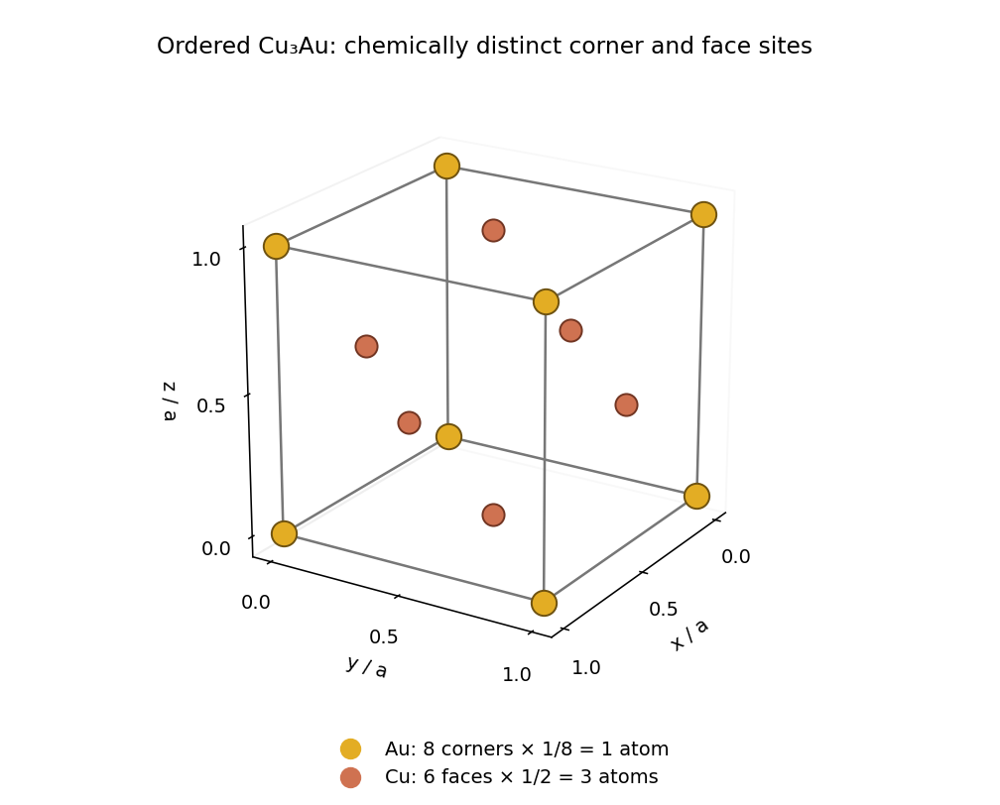

<h1 id="1/a/i/solution">Solution</h1>

↑ **Parent:** [I](../i.md)

The ordered [crystal structure](../../../../../crystal-structure.md) consists of a [primitive cubic lattice](../../../../../primitive-cubic-lattice.md) with the four-site [atomic basis](../../../../../atomic-basis-of-a-crystal.md)

$$
\mathrm{Au}:(0,0,0),\qquad
\mathrm{Cu}:\left(0,\frac12,\frac12\right),\left(\frac12,0,\frac12\right),\left(\frac12,\frac12,0\right),
$$

in [fractional crystal coordinates](../../../../../fractional-crystal-coordinate.md). The drawing shows all boundary representatives of these sites. Eight corner [gold](../../../../../gold.md) [chemical atoms](../../../../../atom-physics.md), shared among eight [unit cells](../../../../../unit-cell.md) each, contribute one [gold](../../../../../gold.md) [chemical atom](../../../../../atom-physics.md). Six face-centred [copper](../../../../../copper.md) [chemical atoms](../../../../../atom-physics.md), shared between two [unit cells](../../../../../unit-cell.md) each, contribute three [copper](../../../../../copper.md) [chemical atoms](../../../../../atom-physics.md). Thus

$$
\boxed{N_{\rm Au}=8\times\frac18=1,\qquad N_{\rm Cu}=6\times\frac12=3,}
$$

which gives the required [stoichiometry](../../../../../stoichiometry.md). Although the unlabelled positions form a [face-centered cubic lattice](../../../../../face-centered-cubic-lattice.md), a face-centering [lattice translation](../../../../../lattice-translation.md) exchanges [gold](../../../../../gold.md) and [copper](../../../../../copper.md) and therefore fails to preserve the ordered [crystal structure](../../../../../crystal-structure.md). Its [Bravais lattice](../../../../../bravais-lattice.md) is [primitive cubic lattice](../../../../../primitive-cubic-lattice.md).

**[Figure 1](#1/a/i/image-ordered-copper-gold-unit-cell-with-corner-and-face-site-counting). Ordered copper–gold unit cell with corner and face-site counting**.

## ↑ Ancestors (13)

1. [I](../i.md)
2. [A](../../a.md)
3. [1](../../../1.md)
4. [2022](../../../../2022-split.md)
5. [Past exam of the condensed matter physics course of the University of Oxford](../../../../split.md)
6. [Condensed matter physics course of the University of Oxford](../../../../../condensed-matter-physics-course-of-the-university-of-oxford.md)
7. [Year 3 of the physics course of the University of Oxford](../../../../../year-3-of-the-physics-course-of-the-university-of-oxford.md)
8. [Physics course of the University of Oxford](../../../../../physics-course-of-the-university-of-oxford.md)
9. [Undergraduate course of the University of Oxford](../../../../../undergraduate-course-of-the-university-of-oxford.md)
10. [Course of the University of Oxford](../../../../../course-of-the-university-of-oxford.md)
11. [University of Oxford](../../../../../university-of-oxford-split.md)
12. [List of universities](../../../../../list-of-universities.md)
13. [Codex Wiki](../../../../../split.md)
