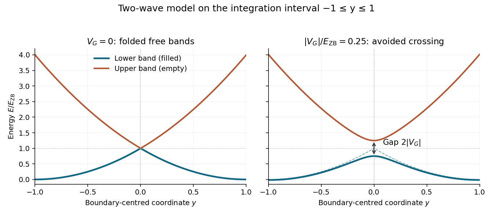

<h1 id="2/a/iii/solution">Solution</h1>

↑ **Parent:** [Iii](../iii.md)

For zero coupling, $\sqrt{4y^2}=2|y|$, and the two folded [energy bands](../../../../../energy-band.md) are

$$
E_-(y)=E_{\rm ZB}(1-|y|)^2,\qquad
E_+(y)=E_{\rm ZB}(1+|y|)^2.
$$

They touch at $y=0$, where the underlying free [plane wave](../../../../../plane-wave.md) branches cross. A nonzero [Fourier coefficient](../../../../../fourier-coefficient.md) replaces this crossing by an [avoided crossing](../../../../../avoided-crossing.md), with $E_\pm(0)=E_{\rm ZB}(1\pm\epsilon)$. The lower [energy band](../../../../../energy-band.md) moves downward and the upper [energy band](../../../../../energy-band.md) upward. Both branches are smooth near $y=0$ for $\epsilon>0$.

**[Figure 2](#2/a/iii/image-folded-free-electron-bands-and-the-gap-opened-by-a-periodic-potential). Folded free-electron bands and the gap opened by a periodic potential**.

The figure uses the boundary-centred interval $-1\leq y\leq1$ required in part (b). With the printed definition $y=1-ka/\pi$, this is the translated [Brillouin zone](../../../../../brillouin-zone.md) $0\leq k\leq2\pi/a$. The printed $0\leq y\leq2$ instead corresponds to $-\pi/a\leq k\leq\pi/a$; the local two-wave formula must be folded appropriately before treating it as a dispersion over that entire zone. It must not be integrated over $0\leq y\leq2$ as though it were the filled first [energy band](../../../../../energy-band.md) there. The subsequent calculation follows the explicit continuation prescribed in part (b).

## ↑ Ancestors (13)

1. [Iii](../iii.md)
2. [A](../../a.md)
3. [2](../../../2.md)
4. [2022](../../../../2022-split.md)
5. [Past exam of the condensed matter physics course of the University of Oxford](../../../../split.md)
6. [Condensed matter physics course of the University of Oxford](../../../../../condensed-matter-physics-course-of-the-university-of-oxford.md)
7. [Year 3 of the physics course of the University of Oxford](../../../../../year-3-of-the-physics-course-of-the-university-of-oxford.md)
8. [Physics course of the University of Oxford](../../../../../physics-course-of-the-university-of-oxford.md)
9. [Undergraduate course of the University of Oxford](../../../../../undergraduate-course-of-the-university-of-oxford.md)
10. [Course of the University of Oxford](../../../../../course-of-the-university-of-oxford.md)
11. [University of Oxford](../../../../../university-of-oxford-split.md)
12. [List of universities](../../../../../list-of-universities.md)
13. [Codex Wiki](../../../../../split.md)
