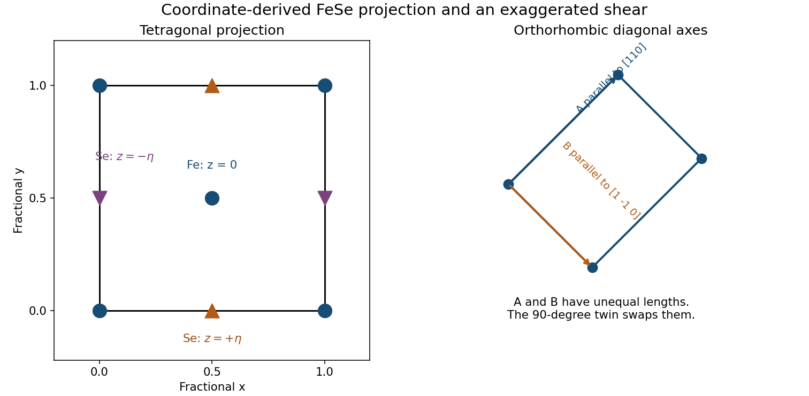
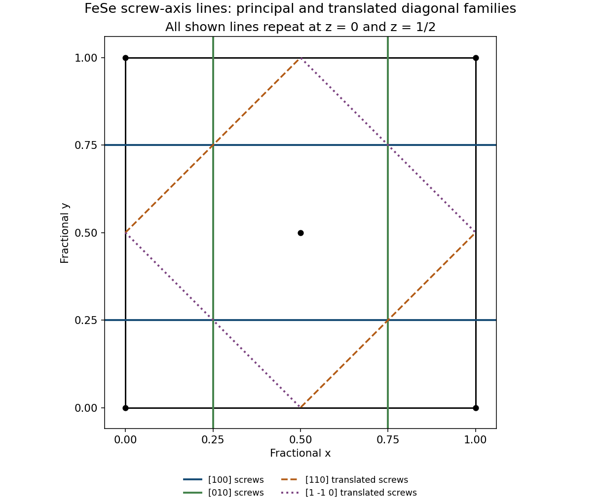
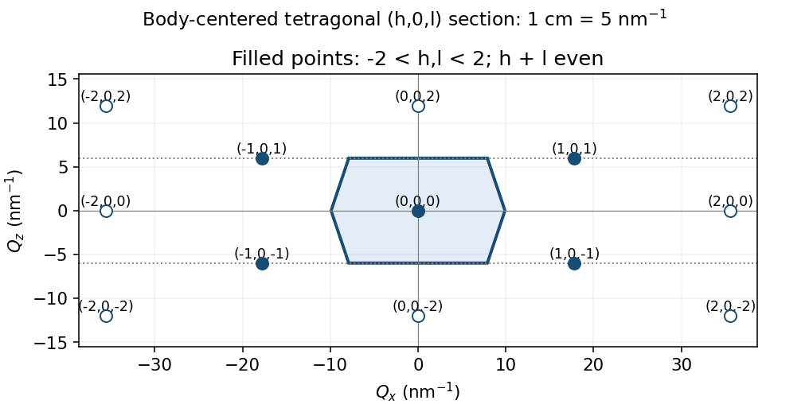
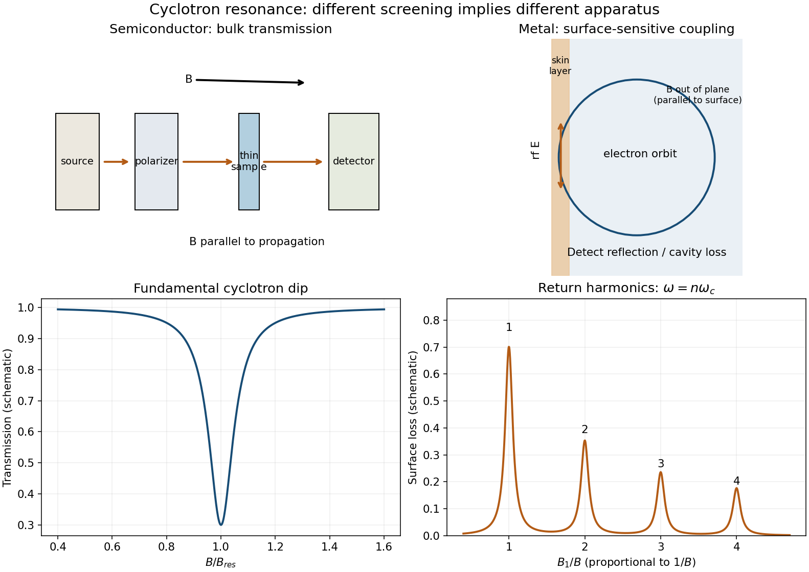
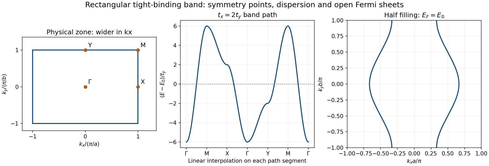
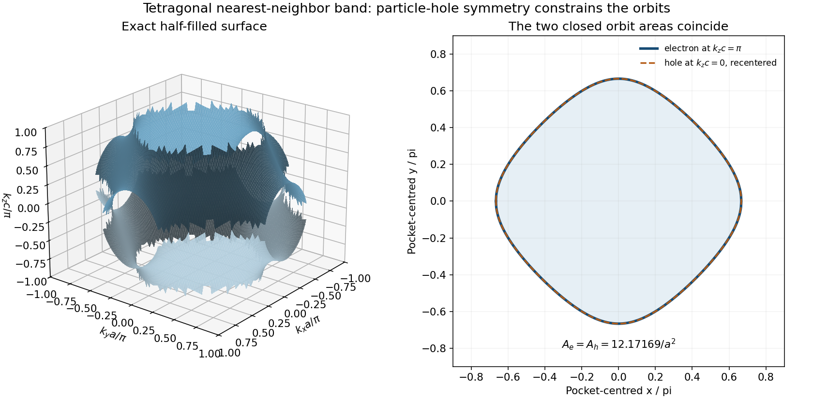
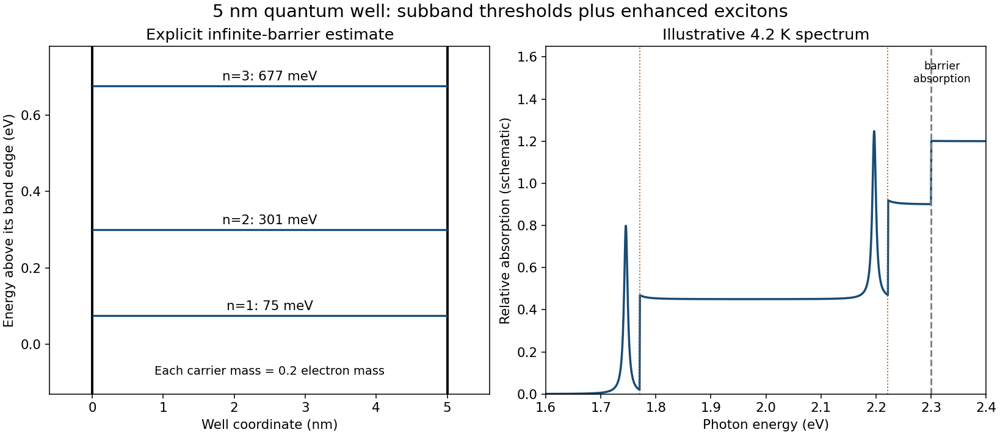
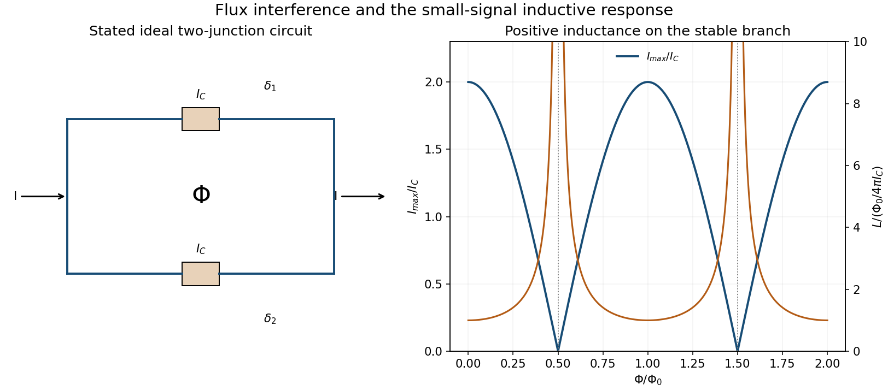

# 2015

↑ **Parent:** [Past exam of the condensed matter physics major option course of the University of Oxford](../past-exam-of-the-condensed-matter-physics-major-option-course-of-the-university-of-oxford.md)

[Public source](https://www.whatdotheyknow.com/request/oxford_physics_past_papers_2/response/2340696/attach/3/Physics%20Papers%202014.pdf?cookie_passthrough=1)

**Table of contents**

- [1](#1)
  - [a](#1/a)
    - [Solution](#1/a/solution)
  - [b](#1/b)
    - [Solution](#1/b/solution)
  - [c](#1/c)
    - [a](#1/c/a)
      - [Solution](#1/c/a/solution)
    - [b](#1/c/b)
      - [Solution](#1/c/b/solution)
    - [c](#1/c/c)
      - [Solution](#1/c/c/solution)
    - [d](#1/c/d)
      - [Solution](#1/c/d/solution)
  - [d](#1/d)
    - [Solution](#1/d/solution)
- [2](#2)
  - [a](#2/a)
    - [Solution](#2/a/solution)
  - [b](#2/b)
    - [a](#2/b/a)
      - [Solution](#2/b/a/solution)
    - [b](#2/b/b)
      - [Solution](#2/b/b/solution)
    - [c](#2/b/c)
      - [Solution](#2/b/c/solution)
    - [d](#2/b/d)
      - [Solution](#2/b/d/solution)
  - [c](#2/c)
    - [Solution](#2/c/solution)
- [3](#3)
  - [a](#3/a)
    - [Solution](#3/a/solution)
  - [b](#3/b)
    - [a](#3/b/a)
      - [Solution](#3/b/a/solution)
    - [b](#3/b/b)
      - [i](#3/b/b/i)
        - [Solution](#3/b/b/i/solution)
      - [ii](#3/b/b/ii)
        - [Solution](#3/b/b/ii/solution)
    - [c](#3/b/c)
      - [Solution](#3/b/c/solution)
  - [c](#3/c)
    - [Solution](#3/c/solution)
- [4](#4)
  - [a](#4/a)
    - [Solution](#4/a/solution)
  - [b](#4/b)
    - [i](#4/b/i)
      - [Solution](#4/b/i/solution)
    - [ii](#4/b/ii)
      - [Solution](#4/b/ii/solution)
  - [c](#4/c)
    - [Solution](#4/c/solution)
  - [d](#4/d)
    - [Solution](#4/d/solution)
- [5](#5)
  - [a](#5/a)
    - [Solution](#5/a/solution)
  - [b](#5/b)
    - [Solution](#5/b/solution)
  - [c](#5/c)
    - [i](#5/c/i)
      - [Solution](#5/c/i/solution)
    - [ii](#5/c/ii)
      - [Solution](#5/c/ii/solution)
    - [iii](#5/c/iii)
      - [Solution](#5/c/iii/solution)
  - [d](#5/d)
    - [Solution](#5/d/solution)
- [6](#6)
  - [a](#6/a)
    - [Solution](#6/a/solution)
  - [b](#6/b)
    - [Solution](#6/b/solution)
  - [c](#6/c)
    - [Solution](#6/c/solution)
- [7](#7)
  - [a](#7/a)
    - [Solution](#7/a/solution)
  - [b](#7/b)
    - [Solution](#7/b/solution)
  - [c](#7/c)
    - [Solution](#7/c/solution)
- [8](#8)
  - [a](#8/a)
    - [Solution](#8/a/solution)
  - [b](#8/b)
    - [Solution](#8/b/solution)
  - [c](#8/c)
    - [Solution](#8/c/solution)
  - [d](#8/d)
    - [Solution](#8/d/solution)

## 1

↑ **Parent:** [2015](2015.md)

<h3 id="1/a">a</h3>

↑ **Parent:** [1](#1)

<h4 id="1/a/solution">Solution</h4>

↑ **Parent:** [A](#1/a)

A [screw axis](../physical-chemistry.md#screw-axis) combines rotation about a line with translation parallel to that line. An $n_p$ screw rotates through $2\pi/n$ and advances by $p/n$ of the lattice repeat along the axis; a $2_1$ screw advances by half a repeat after a half-turn. The combined operation, rather than either component separately, must map every atomic species onto equivalent sites.

A [glide plane](../physical-chemistry.md#glide-plane) combines reflection in a plane with a fractional translation parallel to it. Reflecting alone need not preserve the crystal. A [crystallographic point symmetry](../physical-chemistry.md#crystallographic-point-symmetry) is an isometry with a fixed point, such as a rotation, reflection, inversion, or [rotoinversion](../physical-chemistry.md#rotoinversion). Point operations have no irreducible translational advance: a screw or a glide with nonzero fractional advance cannot be described merely as a rotation or mirror at a different origin. A crystal's [point group](../euclidean-geometry.md#point-group) records the rotational parts of its space-group operations, whereas the full [space group](../physical-chemistry.md#space-group) retains their translations.

<h3 id="1/b">b</h3>

↑ **Parent:** [1](#1)

<h4 id="1/b/solution">Solution</h4>

↑ **Parent:** [B](#1/b)

Take the square projection cell $0\leq x,y\leq1$ and label the heights rather than erasing them in projection. The Fe positions appear at the cell corners and at $(1/2,1/2)$, both with $z=0$. The Se projections are $(1/2,0)$ at height $+\eta$ and $(0,1/2)$ at height $-\eta$, together with their periodic copies on opposite edges. These are distinct height classes even though the observer looks down the $z$ axis.

The corner Fe sites together count as one atom per cell, the central Fe as one, and each edge-shared Se projection contributes half at each of two equivalent edges. The count is therefore two Fe and two Se per [primitive tetragonal lattice](../physical-chemistry.md#primitive-tetragonal-lattice) cell. The Fe sublattice has its shorter nearest-neighbor directions along the projected cell diagonals. The distinction between those directions and the conventional tetragonal axes matters for the distortion in [d](#1/d).

**[Figure 1](#1/b/image-fese-projection-with-selenium-heights-and-the-diagonal-orthorhombic-distortion). FeSe projection with selenium heights and the diagonal orthorhombic distortion**. Original coordinate-based projection and schematic distortion. Opposite selenium heights remain distinguished; the orthorhombic easy axes are rotated by 45 degrees from the conventional tetragonal axes. The distortion amplitude is exaggerated.

<h3 id="1/c">c</h3>

↑ **Parent:** [1](#1)

<h4 id="1/c/a">a</h4>

↑ **Parent:** [C](#1/c)

<h5 id="1/c/a/solution">Solution</h5>

↑ **Parent:** [A](#1/c/a)

A representative half-turn-plus-translation operation about an axis parallel to $x$ is

$$
g_x:(x,y,z)\mapsto(x+\tfrac12,\tfrac12-y,-z).
$$

It rotates about the line $y=1/4,z=0$ and translates by $a/2$ along $x$. It exchanges the two Fe sites, and maps $(1/2,0,\eta)$ onto $(0,1/2,-\eta)$ modulo a [lattice translation](../quantum-scattering.md#lattice-translation). Likewise,

$$
g_y:(x,y,z)\mapsto(\tfrac12-x,y+\tfrac12,-z)
$$

is a $2_1$ screw about $x=1/4,z=0$. Including translated equivalents gives the principal-axis screw lines

$$
\boxed{\begin{aligned}
[100]:&\quad y=\tfrac14+\tfrac m2,\ z=\tfrac n2,\\
[010]:&\quad x=\tfrac14+\tfrac m2,\ z=\tfrac n2,
\end{aligned}\qquad m,n\in\mathbb Z.}
$$

Thus the cell contains lines at the quarter and three-quarter coordinates, in both the $z=0$ and $z=1/2$ levels.

For completeness, translated diagonal twofold operations also produce diagonal $2_1$ screw lines. The operations $(x,y,z)\mapsto(y+1,x,-z)$ and $(x,y,z)\mapsto(1-y,-x,-z)$ preserve the same basis. Their axial translations are $(1/2,1/2,0)$ and $(1/2,-1/2,0)$, half the primitive repeats along the corresponding diagonal directions. Their lines are

$$
\boxed{\begin{aligned}
[110]:&\quad x-y=\tfrac12+m,\ z=\tfrac n2,\\
[1\bar10]:&\quad x+y=\tfrac12+m,\ z=\tfrac n2.
\end{aligned}}
$$

Diagonal lines with integer $x\mp y$ instead support pure twofold rotations. Listing only rotational parts modulo primitive translations would hide these shifted screw lines. There is no fractional screw advance along $z$: every Fe site has integer $z$, so a symmetry taking the Fe layer into itself requires an integer vertical translation. Proper fourfold axes parallel to $z$ are therefore not $4_1$, $4_2$, or $4_3$ screws in this structure. All these statements can be checked directly on the four supplied coordinates without choosing an alternative tabulated origin.[P4/nmm, full Hermann-Mauguin symbol and origin-setting information; coordinate operations here are derived in the supplied origin](../physics-bibliography.md#symmetry-relations-for-space-group-129-by-international-union-of-crystallography)

**[Figure 2](#1/c/a/image-principal-and-translated-diagonal-screw-lines-in-the-fese-basal-cell). Principal and translated diagonal screw lines in the FeSe basal cell**. Original symmetry-element diagram derived from explicit affine operations. Solid horizontal and vertical guides mark principal-axis 21 screws; dashed diagonal guides mark translated diagonal 21 screws. The same line families occur at z equal to zero and one half.

<h4 id="1/c/b">b</h4>

↑ **Parent:** [C](#1/c)

<h5 id="1/c/b/solution">Solution</h5>

↑ **Parent:** [B](#1/c/b)

Reflection through $z=0$ interchanges the two Se height classes but, by itself, leaves their projected positions wrong. The required parallel translation is

$$
\boxed{\mathbf t_g=(\tfrac12,\tfrac12,0),\qquad
(x,y,z)\mapsto(x+\tfrac12,y+\tfrac12,-z).}
$$

For example, $(1/2,0,\eta)$ maps to $(1,1/2,-\eta)$, equivalent to the second Se site. The two Fe sites are also interchanged. This is a diagonal, or $n$, glide; adding an integer lattice vector gives the same fractional translation class. Its translation is expressed in the conventional [primitive tetragonal lattice](../physical-chemistry.md#primitive-tetragonal-lattice) coordinates, not in a smaller Fe-only cell that would discard the selenium height pattern.

<h4 id="1/c/c">c</h4>

↑ **Parent:** [C](#1/c)

<h5 id="1/c/c/solution">Solution</h5>

↑ **Parent:** [C](#1/c/c)

At $l=0$ a point and its glide partner have equal [scattering amplitudes](../quantum-scattering.md#scattering-amplitude) and relative phase $2\pi(h/2+k/2)$. Their joint contribution to the [structure factor](../quantum-scattering.md#structure-factor) is proportional to

$$
1+e^{i\pi(h+k)}.
$$

It vanishes for odd $h+k$. Hence the allowed-condition statement is

$$
\boxed{hk0:\qquad h+k=2n.}
$$

This is a systematic absence: it follows independently of the numerical Fe and Se atomic scattering factors. Explicitly, the supplied basis gives

$$
F_{hk0}=f_{\rm Fe}\{1+(-1)^{h+k}\}+f_{\rm Se}\{(-1)^h+(-1)^k\},
$$

and both braces vanish when $h+k$ is odd. When the sum is even a reflection is symmetry-allowed, but an accidental cancellation for particular scattering factors or experimental conditions can still make its intensity small. The glide alone does not promise that every allowed reflection has a nonzero measured intensity.

<h4 id="1/c/d">d</h4>

↑ **Parent:** [C](#1/c)

<h5 id="1/c/d/solution">Solution</h5>

↑ **Parent:** [D](#1/c/d)

One [crystallographic inversion center](../physical-chemistry.md#crystallographic-inversion-center) is

$$
\boxed{(x_0,y_0,z_0)=(\tfrac14,\tfrac14,0).}
$$

The inversion maps $(x,y,z)$ to $(1/2-x,1/2-y,-z)$; it exchanges both the Fe pair and the Se pair modulo [lattice translations](../quantum-scattering.md#lattice-translation).

A $\bar4$ axis passes along $z$ through the Fe site $(0,0,0)$, and likewise through $(1/2,1/2,0)$. A representative [rotoinversion](../physical-chemistry.md#rotoinversion) is

$$
\boxed{(x,y,z)\mapsto(y,-x,-z).}
$$

It leaves the first Fe site fixed, maps the other Fe onto a translationally equivalent site, and exchanges the Se height classes. The $\bar4$ operation includes a vertical reversal, so it must not be replaced by a pure $90$-degree rotation about an Fe site. Such a pure rotation would put a selenium atom at the wrong height.

<h3 id="1/d">d</h3>

↑ **Parent:** [1](#1)

<h4 id="1/d/solution">Solution</h4>

↑ **Parent:** [D](#1/d)

Choose orthorhombic basal axes along the tetragonal diagonals, $\mathbf A=\mathbf a+\mathbf b$ and $\mathbf B=\mathbf a-\mathbf b$, and allow their lengths to differ slightly. Two orthorhombic twins interchange $A$ and $B$. This corresponds to a small shear of the original tetragonal basal cell, or to unequal nearest-neighbor Fe–Fe distances along its two diagonal directions; it is not simply stretching the original tetragonal $x$ and $y$ axes unequally.

The tetragonal indices map to $H=h+k$, $K=h-k$. Thus tetragonal $110$ becomes orthorhombic $200$ in one twin and $020$ in the rotated twin. Their spacings are $A/2$ and $B/2$, producing the two peaks. Equal populations of the symmetry-related twins explain their equal intensities.

In contrast, tetragonal $200$ becomes orthorhombic $220$. Its inverse spacing squared is $4/A^2+4/B^2$, invariant under exchanging $A$ and $B$. It therefore does not split between those twins, exactly as observed. The diffraction facts determine the distortion's orientation and twin equivalence, but not its numerical strain amplitude without the measured peak separation.

## 2

↑ **Parent:** [2015](2015.md)

<h3 id="2/a">a</h3>

↑ **Parent:** [2](#2)

<h4 id="2/a/solution">Solution</h4>

↑ **Parent:** [A](#2/a)

A neutron can exchange both energy and crystal momentum with a [lattice vibration](../physical-chemistry.md#lattice-vibration). Determine its incoming and outgoing [wave vectors](../elasticity-physics.md#wavevector) $\mathbf k_i,\mathbf k_f$ from neutron wavelengths and directions. Its nonrelativistic [kinetic energy](../energy.md#kinetic-energy) is $E_n=\hbar^2k_n^2/(2m_n)$, so the measured transfers are

$$
\boxed{\mathbf Q=\mathbf k_i-\mathbf k_f,\qquad
\hbar\omega=\frac{\hbar^2}{2m_n}(k_i^2-k_f^2).}
$$

For [phonon](../quantum-ideal-gas-statistics.md#phonon) creation, momentum conservation reads $\mathbf Q=\mathbf G+\mathbf q$ and the neutron loses energy $\hbar\omega_{\nu}(\mathbf q)$. For [phonon](../quantum-ideal-gas-statistics.md#phonon) annihilation the corresponding [phonon](../quantum-ideal-gas-statistics.md#phonon) energy is gained by the neutron. Reduce $\mathbf Q$ by a [reciprocal lattice vector](../quantum-scattering.md#reciprocal-lattice-vector) $\mathbf G$ to obtain the [phonon](../quantum-ideal-gas-statistics.md#phonon) [wave vector](../elasticity-physics.md#wavevector), and trace a branch by repeating this measurement at several reduced [wave vectors](../elasticity-physics.md#wavevector).

A triple-axis spectrometer provides a suitable arrangement: a monochromator selects the incident wavelength, the oriented sample defines the momentum transfer through the scattering angles, and an analyzer crystal selects the final wavelength before detection. A time-of-flight spectrometer instead uses pulse timing and flight paths to obtain the energy change. In either case instrumental energy and angular resolution must be separated from intrinsic line widths. Nuclear scattering from atomic displacements couples neutrons to [phonons](../quantum-ideal-gas-statistics.md#phonon); the one-phonon intensity contains a [polarization](../wave.md#polarization-waves) factor involving $\mathbf Q\cdot\mathbf e_{\nu}$, atomic scattering lengths, and thermal occupation factors. Intensities can therefore differ even at equivalent [phonon](../quantum-ideal-gas-statistics.md#phonon) frequencies.

<h3 id="2/b">b</h3>

↑ **Parent:** [2](#2)

<h4 id="2/b/a">a</h4>

↑ **Parent:** [B](#2/b)

<h5 id="2/b/a/solution">Solution</h5>

↑ **Parent:** [A](#2/b/a)

For the body-centered tetragonal direct lattice, conventional reciprocal labels $(h,k,l)$ are integer triples satisfying $h+k+l$ even. This follows because the extra translation $(1/2,1/2,1/2)$ must have phase one for a [reciprocal lattice vector](../quantum-scattering.md#reciprocal-lattice-vector). In the $k=0$ section the condition is $h+l$ even. The reciprocal steps are

$$
\boxed{a^*=\frac{2\pi}{0.353}=17.799\ \mathrm{nm^{-1}},\qquad
c^*=\frac{2\pi}{1.05}=5.984\ \mathrm{nm^{-1}}.}
$$

Within the strict index window $-2<h,l<2$, the reciprocal points are $(h,l)=(0,0)$ and $(\pm1,\pm1)$. The neighboring $(\pm2,0)$ and $(0,\pm2)$ points lie on the excluded boundary but are useful for constructing the zone bisectors.

At the requested drawing scale, one conventional step in $h$ is $a^*/5=3.560$ cm and one step in $l$ is $c^*/5=1.197$ cm. Thus the four off-origin included points have drawing coordinates $(\pm3.560,\pm1.197)$ cm. Keeping these unequal physical scales avoids drawing a fictitious square reciprocal section.

**[Figure 3](#2/b/a/image-physical-h-zero-l-reciprocal-section-and-its-first-brillouin-zone-boundary). Physical h-zero-l reciprocal section and its first Brillouin-zone boundary**. Original Wigner-Seitz construction using the actual reciprocal lengths. Filled points satisfy h plus l even; open boundary points assist the construction outside the strict requested index window. The hexagon is the section of the three-dimensional first zone.

<h4 id="2/b/b">b</h4>

↑ **Parent:** [B](#2/b)

<h5 id="2/b/b/solution">Solution</h5>

↑ **Parent:** [B](#2/b/b)

Construct the first [Brillouin zone](../bloch-s-theorem.md#brillouin-zone) by the perpendicular bisectors between the origin and [reciprocal lattice](../quantum-scattering.md#reciprocal-lattice) points. For a test point $(h a^*,0,l c^*)$, the nearest relevant reciprocal points are $(0,0,\pm2c^*)$ and $(\pm a^*,0,\pm c^*)$. Their inequalities are

$$
|l|\leq1,\qquad
|h|(a^*)^2+|l|(c^*)^2\leq\frac{(a^*)^2+(c^*)^2}{2}.
$$

Set $\rho=(c^*/a^*)^2=(a/c)^2=0.113024$. The six vertices in conventional $(h,l)$ coordinates are

$$
\boxed{\left(\pm\frac{1+\rho}{2},0\right),\qquad
\left(\pm\frac{1-\rho}{2},\pm1\right).}
$$

Numerically these are $(\pm0.55651,0)$ and $(\pm0.44349,\pm1)$. The $k\ne0$ [reciprocal lattice vectors](../quantum-scattering.md#reciprocal-lattice-vector) must in principle be checked because the requested object is a section of a three-dimensional zone. For example $(\pm1,\pm1,0)$ gives the weaker bound $|h|\leq1$, and $(0,\pm1,\pm1)$ gives a weaker vertical bound; neither clips this hexagon. Direct comparison with surrounding three-dimensional [reciprocal lattice vectors](../quantum-scattering.md#reciprocal-lattice-vector) confirms the displayed section. It is not the rectangular reciprocal conventional cell.

<h4 id="2/b/c">c</h4>

↑ **Parent:** [B](#2/b)

<h5 id="2/b/c/solution">Solution</h5>

↑ **Parent:** [C](#2/b/c)

The difference of the two wave-vector labels is $(1,0,-1)$, an allowed [reciprocal lattice vector](../quantum-scattering.md#reciprocal-lattice-vector) because $1+0-1$ is even. [Bloch's theorem](../bloch-s-theorem.md) of the lattice dynamical matrix therefore gives

$$
\boxed{\omega_\nu(1,0,0)=\omega_\nu(0,0,1)}
$$

for corresponding [phonon](../quantum-ideal-gas-statistics.md#phonon) branches. Neither individual odd-sum point needs to be a [reciprocal lattice](../quantum-scattering.md#reciprocal-lattice) point. It is their **difference** that establishes equivalence. Structure factors and neutron [polarization](../wave.md#polarization-waves) factors can still change the observed intensities at those two scattering vectors, so equal frequencies do not require identical measured spectra peak by peak in intensity.

<h4 id="2/b/d">d</h4>

↑ **Parent:** [B](#2/b)

<h5 id="2/b/d/solution">Solution</h5>

↑ **Parent:** [D](#2/b/d)

There are three acoustic branches, not two. For propagation parallel to the tetragonal $c$ axis, one branch is a [longitudinal wave](../wave.md#longitudinal-wave), polarized parallel to $c$. The other branches are [transverse waves](../wave.md#transverse-wave) whose [polarizations](../wave.md#polarization-waves) lie along the equivalent basal directions. The fourfold symmetry about $c$ makes those transverse modes degenerate along that axis.

Consequently at a generic nonzero [wave vector](../elasticity-physics.md#wavevector) along $c$ there are only two **distinct acoustic frequencies**: one longitudinal frequency and one doubly degenerate transverse frequency. At the zone center all acoustic frequencies go to zero as required by uniform translation invariance. The degeneracy would generally lift if propagation moved away from the symmetry axis or the basal tetragonal symmetry were broken.

<h3 id="2/c">c</h3>

↑ **Parent:** [2](#2)

<h4 id="2/c/solution">Solution</h4>

↑ **Parent:** [C](#2/c)

Subtract the [reciprocal lattice vector](../quantum-scattering.md#reciprocal-lattice-vector) $(0,0,8)$, leaving a reduced [wave vector](../elasticity-physics.md#wavevector) $(0.2,0,0)$ along $a$. A linear-acoustic estimate gives

$$
q=0.2\frac{2\pi}{0.353\ \mathrm{nm}}=3.560\times10^9\ \mathrm{m^{-1}},\qquad
v_g\simeq\frac{E}{\hbar q}=2.99\times10^3\ \mathrm{m\,s^{-1}}.
$$

Interpret the quoted intrinsic width as the full width at half maximum in energy, $\Gamma=0.1$ meV. The corresponding energy-relaxation [mean lifetime](../relativistic-quantum-field.md#mean-lifetime-physics) is $\tau=\hbar/\Gamma=6.58\times10^{-12}$ s, giving [mean free path](../ideal-gas.md#mean-free-path) $v_g\tau\simeq19.7$ nm. If the given width instead denotes a half width, the inferred [mean lifetime](../relativistic-quantum-field.md#mean-lifetime-physics) differs by a factor of two; the convention must be specified.

Approximating the thermal average by this velocity and [mean lifetime](../relativistic-quantum-field.md#mean-lifetime-physics), and using the isotropic angular factor $\langle v_a^2\rangle=v_g^2/3$, kinetic theory gives

$$
\boxed{\kappa_{{\rm ph},a}\simeq\tfrac13 C_Vv_g^2\tau
=0.72\ \mathrm{W\,m^{-1}\,K^{-1}}.}
$$

Using a single purely $a$-directed effective channel without angular averaging gives $2.17$ W m$^{-1}$ K$^{-1}$, still far below the observed total $39$ W m$^{-1}$ K$^{-1}$. The isotropic estimate is roughly $54$ times smaller than the measured total.

The calculation is not a complete thermal-transport average. Electrons in this metallic compound can carry substantial heat, the supplied total [heat capacity](../heat.md#heat-capacity) need not be entirely phononic, and one $7$ meV [phonon](../quantum-ideal-gas-statistics.md#phonon) need not represent all thermally active branches and [mean lifetimes](../relativistic-quantum-field.md#mean-lifetime-physics). At $20$ K, $k_BT\simeq1.72$ meV, so that measured mode is relatively high in the thermal distribution; lower-energy modes can have much longer [mean lifetimes](../relativistic-quantum-field.md#mean-lifetime-physics). A measured [phase velocity](../dispersion-relation.md#phase-velocity) is also only an estimate of the [group velocity](../dispersion-relation.md#group-velocity) if the branch is nonlinear.

[electron-phonon interaction](../quantum-ideal-gas-statistics.md#electron-phonon-interaction) is a plausible damping mechanism in a phonon-mediated [superconductor](../superconductivity.md#superconductor), but the measurement is **above** its $15$ K transition and probes the normal state. It cannot be attributed directly to decay into an already established superconducting condensate. Below the transition an energy gap can modify electron-hole damping. The weak-coupling scale $2\Delta\simeq3.52k_BT_c\simeq4.55$ meV is below the $7$ meV [phonon](../quantum-ideal-gas-statistics.md#phonon) energy, so even superconductivity need not prohibit all pair-breaking damping of this mode. Temperature-dependent spectra would distinguish that mechanism from defects or anharmonic [phonon](../quantum-ideal-gas-statistics.md#phonon) decay.

## 3

↑ **Parent:** [2015](2015.md)

<h3 id="3/a">a</h3>

↑ **Parent:** [3](#3)

<h4 id="3/a/solution">Solution</h4>

↑ **Parent:** [A](#3/a)

[Hund's rules](../chemistry.md#hund-s-rules) maximizes total [spin](../angular-momentum-operator.md#spin) within the partially filled shell: parallel [spins](../angular-momentum-operator.md#spin) require an antisymmetric spatial wavefunction, reducing Coulomb overlap through exchange. Among terms with that [spin](../angular-momentum-operator.md#spin), the second rule selects the largest total [orbital angular momentum](../quantum-mechanics.md#orbital-angular-momentum). The third rule, from [spin-orbit coupling](../atomic-physics.md#spin-orbit-interaction) within the selected term, gives $J=|L-S|$ below half filling and $J=L+S$ above half filling, with the half-filled case treated directly.

For seven $4f$ electrons, put one parallel-spin electron in each $m_l=-3,-2,-1,0,1,2,3$ orbital. Their orbital projections sum to zero and form the half-filled $L=0$ shell; all seven [spins](../angular-momentum-operator.md#spin) add. Thus

$$
\boxed{S=\frac72,\qquad L=0,\qquad J=\frac72,\qquad{}^{2S+1}L_J={}^8S_{7/2}.}
$$

There is no ambiguity from applying the below- or above-half-filled formula because $L=0$. The absence of a first-order orbital moment is important for the weak [magnetic anisotropy](../electromagnetism.md#magnetic-anisotropy) discussed in [c](#3/c). These are isolated-ion term rules; a crystal field or strong covalency can alter other ions' orbital behavior, but the half-filled Eu$^{2+}$ shell is unusually robust.

<h3 id="3/b">b</h3>

↑ **Parent:** [3](#3)

<h4 id="3/b/a">a</h4>

↑ **Parent:** [B](#3/b)

<h5 id="3/b/a/solution">Solution</h5>

↑ **Parent:** [A](#3/b/a)

Write $\mathbf M=M\mathbf n$ with $|\mathbf n|=1$, and let $P=n_x^2n_y^2+n_x^2n_z^2+n_y^2n_z^2$. Since the nonnegative numbers $n_i^2$ sum to one,

$$
0\leq P\leq\frac13.
$$

The quartic coefficient is $b+cP$. If $c\geq0$ it is at least $b>0$. If $c<0$, the given condition $2b+c>0$ implies $b+c/3>b/3>0$. For $T>T_c$ the quadratic coefficient $a(T-T_c)$ is also positive. Hence every nonzero $M$ raises the [free energy](../thermodynamic-potential.md#thermodynamic-free-energy):

$$
F-F_0=a(T-T_c)M^2+(b+cP)M^4>0,
\qquad\boxed{\mathbf M=0.}
$$

The stability argument must apply to all orientations, rather than checking just one cubic direction. The stated inequality is sufficient for that purpose, although the sharp quartic stability condition for negative $c$ is the weaker $b+c/3>0$.

<h4 id="3/b/b">b</h4>

↑ **Parent:** [B](#3/b)

<h5 id="3/b/b/i">i</h5>

↑ **Parent:** [B](#3/b/b)

<h6 id="3/b/b/i/solution">Solution</h6>

↑ **Parent:** [I](#3/b/b/i)

For $c>0$, minimize the nonnegative anisotropy invariant $P$. Its minimum is zero, achieved only when one squared component of the unit vector is one and the others vanish. Thus the easy directions are

$$
\boxed{\langle100\rangle:\quad\pm\hat{\mathbf x},\ \pm\hat{\mathbf y},\ \pm\hat{\mathbf z}.}
$$

The six signs and axes are symmetry-related ferromagnetic domains. Allowing the [magnetization](../electromagnetism.md#magnetization) amplitude to relax does not change the result: its minimum free-energy reduction is proportional to $-1/(b+cP)$, which is most negative for the smallest positive quartic coefficient. A $\langle110\rangle$ direction has $P=1/4$ and is not an equally stable easy direction.

<h5 id="3/b/b/ii">ii</h5>

↑ **Parent:** [B](#3/b/b)

<h6 id="3/b/b/ii/solution">Solution</h6>

↑ **Parent:** [Ii](#3/b/b/ii)

For $c<0$, maximize $P$ to lower the quartic coefficient. The identity $P=[1-(n_x^4+n_y^4+n_z^4)]/2$ shows that its maximum $1/3$ occurs for $n_x^2=n_y^2=n_z^2=1/3$. Therefore

$$
\boxed{\langle111\rangle:\quad\mathbf n=(\pm1,\pm1,\pm1)/\sqrt3.}
$$

There are eight symmetry-related easy directions. This is a cubic easy-axis anisotropy even though the selected directions are body diagonals; it is not a continuous easy plane. At $c=0$ the quartic [free energy](../thermodynamic-potential.md#thermodynamic-free-energy) instead has a sphere of degenerate orientations to this order.

<h4 id="3/b/c">c</h4>

↑ **Parent:** [B](#3/b)

<h5 id="3/b/c/solution">Solution</h5>

↑ **Parent:** [C](#3/b/c)

Along any $\langle111\rangle$ direction the quartic term is $(b+c/3)M^4$. Minimizing the amplitude below $T_c$ gives

$$
2a(T-T_c)M+4(b+c/3)M^3=0.
$$

For the ordered solution,

$$
\boxed{M^2(T)=\frac{a(T_c-T)}{2(b+c/3)},\qquad
M(T)=\sqrt{\frac{a(T_c-T)}{2(b+c/3)}}\quad(T<T_c).}
$$

Its [free energy](../thermodynamic-potential.md#thermodynamic-free-energy) is $F_{\min}=F_0-a^2(T_c-T)^2/[4(b+c/3)]$. The denominator is positive by the supplied stability assumptions. The square-root onset is the [Landau theory](../critical-phenomenon.md#landau-theory) exponent; sufficiently close to a three-dimensional critical point, fluctuations can change the actual critical exponent without changing this saddle-point calculation.

<h3 id="3/c">c</h3>

↑ **Parent:** [3](#3)

<h4 id="3/c/solution">Solution</h4>

↑ **Parent:** [C](#3/c)

Eu$^{2+}$ has the half-filled $4f^7$ term with $L=0$. First-order orbital magnetism is therefore quenched already at the ion level, making the dominant moment approximately spin-only. Spin-orbit-induced [magnetocrystalline anisotropy](../electromagnetism.md#magnetocrystalline-anisotropy) arises only through weaker admixtures and other small interactions; magnetic dipole interactions can also contribute. This explains why a cubic anisotropy term is allowed by symmetry but numerically weak.

An appropriate insulating local-moment model is a nearly isotropic [Heisenberg model](../angular-momentum-operator.md#heisenberg-model),

$$
\boxed{H=-\sum_{\langle i,j\rangle}J_{ij}\mathbf S_i\cdot\mathbf S_j
+H_{\rm weak\ anisotropy}+H_{\rm dipolar},\qquad S=7/2,}
$$

with dominant effective ferromagnetic couplings in the sign convention $J_{ij}>0$. The Eu sublattice in rocksalt EuO is face-centered cubic; nearest- and further-neighbor effective exchanges can be retained as needed. Because the solid is not metallic, an itinerant-electron [Stoner model](../electromagnetism.md#stoner-model) or a generic free-carrier [RKKY interaction](../electromagnetism.md#rkky-interaction) mechanism is not the natural starting point. Exchange can still arise through virtual hopping and ligand-mediated processes in an insulator; it does not require mobile dc carriers.

## 4

↑ **Parent:** [2015](2015.md)

<h3 id="4/a">a</h3>

↑ **Parent:** [4](#4)

<h4 id="4/a/solution">Solution</h4>

↑ **Parent:** [A](#4/a)

The microscopic electric interaction is [spin](../angular-momentum-operator.md#spin) independent to leading order, but the [Pauli exclusion principle](../tensor-product-of-quantum-systems.md#pauli-exclusion-principle) ties the spatial symmetry of an electronic state to its [spin](../angular-momentum-operator.md#spin) symmetry. Different [spin](../angular-momentum-operator.md#spin) combinations therefore have different Coulomb and kinetic energies. Projecting those energies onto localized low-energy moments often gives an approximately rotationally invariant bilinear exchange [Hamiltonian operator](../quantum-system.md#hamiltonian-quantum-mechanics) $-J\mathbf S_1\cdot\mathbf S_2$. For [spin](../angular-momentum-operator.md#spin) one half, the [spin singlet state](../bell-state.md#spin-singlet-state) and [triplet state](../angular-momentum-operator.md#spin-one-half-triplet-state) energies are distinguished by $\mathbf S_1\cdot\mathbf S_2=-3/4$ and $1/4$, so any isotropic two-level [spin singlet state](../bell-state.md#spin-singlet-state)–[triplet state](../angular-momentum-operator.md#spin-one-half-triplet-state) splitting can be written in this form plus a constant. More general [spins](../angular-momentum-operator.md#spin) or orbital degeneracy can require extra interactions.

An antiferromagnetic oxide commonly has [superexchange](../electromagnetism.md#superexchange) through a ligand such as oxygen. Virtual hopping between half-filled metal orbitals lowers the energy of antiparallel [spins](../angular-momentum-operator.md#spin) more strongly because the corresponding intermediate doubly occupied configurations are allowed by the [Pauli exclusion principle](../tensor-product-of-quantum-systems.md#pauli-exclusion-principle). The simple one-orbital [Hubbard model](../statistical-physics.md#hubbard-model) limit gives $+4t^2\mathbf S_1\cdot\mathbf S_2/U$, equivalent to negative $J$ in the question's minus-sign convention. Bond angles and orbital occupancy can change the sign in more complicated oxides, so [superexchange](../electromagnetism.md#superexchange) is not universally antiferromagnetic irrespective of geometry.

<h3 id="4/b">b</h3>

↑ **Parent:** [4](#4)

<h4 id="4/b/i">i</h4>

↑ **Parent:** [B](#4/b)

<h5 id="4/b/i/solution">Solution</h5>

↑ **Parent:** [I](#4/b/i)

For the classical XY ferromagnet choose every [spin](../angular-momentum-operator.md#spin) parallel within the $xy$ plane. Each nearest-neighbor and next-nearest-neighbor in-plane dot product is $S^2$. The printed sum counts one bond of each range per [spin](../angular-momentum-operator.md#spin), so

$$
\boxed{E_{\rm F}=-S^2(J_1+J_2).}
$$

There is no additional factor of two from counting both directions: the [Hamiltonian operator](../quantum-system.md#hamiltonian-quantum-mechanics) already lists only $n\to n+1$ and $n\to n+2$. Alignment along $z$ would give zero XY exchange energy and is not the in-plane ordered state used for these expressions.

<h4 id="4/b/ii">ii</h4>

↑ **Parent:** [B](#4/b)

<h5 id="4/b/ii/solution">Solution</h5>

↑ **Parent:** [Ii](#4/b/ii)

For collinear antiferromagnetic order in the $xy$ plane, take $\mathbf S_n=(-1)^nS\hat{\mathbf x}$. Nearest neighbors are antiparallel, giving $-S^2$, whereas second neighbors lie on the same sublattice and remain parallel, giving $+S^2$. Thus

$$
\boxed{E_{\rm AF}=J_1S^2-J_2S^2=S^2(J_1-J_2).}
$$

The result follows from substituting into the specified XY [Hamiltonian operator](../quantum-system.md#hamiltonian-quantum-mechanics), regardless of whether that trial state is the global minimum for the chosen exchanges. Comparing trial-state energies does not eliminate the possibility of a lower helical state.

<h3 id="4/c">c</h3>

↑ **Parent:** [4](#4)

<h4 id="4/c/solution">Solution</h4>

↑ **Parent:** [C](#4/c)

In both collinear trial states, a [spin](../angular-momentum-operator.md#spin) and its second neighbor are parallel. The next-nearest-neighbor energy is therefore $-J_2S^2$ per [spin](../angular-momentum-operator.md#spin) in either case. Making $J_2$ negative makes that contribution positive and raises both energies.

A negative $J_2$ prefers opposite second-neighbor [spins](../angular-momentum-operator.md#spin). Neither all-parallel order nor the simple alternating nearest-neighbor pattern satisfies that preference: in the latter, alternating twice returns to the original direction. This competition is a source of frustration when the nearest-neighbor interaction favors one of those collinear patterns, and allows a noncollinear twist to lower the energy. Merely calling $J_2$ antiferromagnetic does not mean that the nearest-neighbor alternating state satisfies it.

<h3 id="4/d">d</h3>

↑ **Parent:** [4](#4)

<h4 id="4/d/solution">Solution</h4>

↑ **Parent:** [D](#4/d)

A relative angle $qc$ between neighbors gives in-plane dot products $S^2\cos(qc)$ and $S^2\cos(2qc)$ at the two ranges. Set $x=\cos(qc)\in[-1,1]$. Then

$$
\boxed{E_{\rm H}=-S^2[J_1\cos(qc)+J_2\cos(2qc)]
=S^2[J_2-J_1x-2J_2x^2].}
$$

The [classical helical minimum of the J1-J2 XY chain](../statistical-physics.md#classical-helical-minimum-of-the-j1-j2-xy-chain) follows because for $J_2<0$ this is a strictly convex quadratic in $x$. Its unconstrained minimum is

$$
\boxed{x_*=-\frac{J_1}{4J_2},\qquad\alpha=\frac14.}
$$

It is a genuine noncollinear helix when $|J_2|>|J_1|/4$. Both chiralities $q$ and $-q$ have the same energy, and the pitch is defined modulo $2\pi/c$. At equality the helix merges into a collinear endpoint, so the strict inequality is required for an energy strictly lower than both collinear choices.

For a direct comparison write $K=|J_2|$. The minimum and the energy differences are

$$
E_{\rm H,min}=-S^2\left(K+\frac{J_1^2}{8K}\right),\qquad
E_{\rm F}-E_{\rm H,min}=\frac{S^2(4K-J_1)^2}{8K},\qquad
E_{\rm AF}-E_{\rm H,min}=\frac{S^2(4K+J_1)^2}{8K}.
$$

Both differences are strictly positive in the stated interior region. The stronger classical global argument Fourier-transforms the translationally invariant bilinear exchange: its energy is minimized by the [wave vector](../elasticity-physics.md#wavevector) maximizing $J_1\cos(qc)+J_2\cos(2qc)$, and the planar single-$q$ helix realizes the fixed [spin](../angular-momentum-operator.md#spin) length at every site. This establishes the minimum within the classical/mean-field model, not an assertion of true long-range magnetic order at positive temperature in a one-dimensional short-range quantum chain.

## 5

↑ **Parent:** [2015](2015.md)

<h3 id="5/a">a</h3>

↑ **Parent:** [5](#5)

<h4 id="5/a/solution">Solution</h4>

↑ **Parent:** [A](#5/a)

A parabolic isotropic band has [group velocity](../dispersion-relation.md#group-velocity) $\mathbf v=\hbar\mathbf k/m^*$ and semiclassical force $\hbar\dot{\mathbf k}=-e(\mathbf E+\mathbf v\times\mathbf B)$ for electrons with charge $-e$, where $e>0$. In the [relaxation-time approximation](../boltzmann-equation.md#relaxation-time-approximation) the nonequilibrium drift velocity loses momentum at rate $1/\tau$. Combining these gives

$$
\boxed{m^*(\dot{\mathbf v}+\mathbf v/\tau)=-e\mathbf E-e\mathbf v\times\mathbf B.}
$$

The relaxation term represents the average effect of scattering rather than a force on every carrier between collisions. Linear response, an approximately energy-independent $m^*$ and $\tau$ near the [Fermi surface](../fermi-liquid.md#fermi-surface), and wavelengths long enough for a local bulk response are implicit. The equilibrium random velocities average to zero and do not themselves contribute a drift current.

<h3 id="5/b">b</h3>

↑ **Parent:** [5](#5)

<h4 id="5/b/solution">Solution</h4>

↑ **Parent:** [B](#5/b)

Use the time dependence actually specified, $e^{i\omega t}$, and $\mathbf B=B\hat{\mathbf z}$. The component equations are

$$
(\tau^{-1}+i\omega)v_x=-\frac e{m^*}E_x-\omega_cv_y,\qquad
(\tau^{-1}+i\omega)v_y=-\frac e{m^*}E_y+\omega_cv_x,
\quad\omega_c=\frac{eB}{m^*}.
$$

Adding the second equation multiplied by $\pm i$ diagonalizes the response. With the literal definitions $v_\pm=v_x\pm iv_y$, $E_\pm=E_x\pm iE_y$, and $J_\pm=-ne v_\pm$,

$$
\boxed{\sigma_\pm=\frac{ne^2/m^*}{\tau^{-1}+i(\omega\mp\omega_c)}
=\frac{\sigma_0}{1+i(\omega\mp\omega_c)\tau},\qquad\sigma_0=\frac{ne^2\tau}{m^*}.}
$$

**The source's printed $\omega\pm\omega_c$ reverses the helicity labels for these definitions.** It is recovered by naming the two circular components oppositely, reversing $B$, or changing the matching time/[polarization](../wave.md#polarization-waves) convention. As a concrete check, with $E_+\ne0$, $E_-=0$ and positive $B$, the collisionless component equation resonates at $\omega=\omega_c$. The printed plus-labeled denominator would instead remain proportional to $2i\omega_c$. The physical result is unambiguous: only the [circular polarization](../electromagnetic-wave.md#circular-polarization) rotating with the electron orbit has positive-frequency [cyclotron resonance](../quantum-theory.md#cyclotron-resonance).

For the convention used here, the dielectric eigenvalues are $\epsilon_\pm=\epsilon_\infty+\sigma_\pm/(i\epsilon_0\omega)$. In the lossless limit,

$$
\boxed{\epsilon_\pm=\epsilon_\infty-\frac{\omega_p^2}{\omega(\omega\mp\omega_c)},\qquad
\omega_p^2=\frac{ne^2}{\epsilon_0m^*}.}
$$

These eigenvalues determine propagation and reflection in the Faraday geometry; changing the helicity names swaps their subscripts without changing any optical prediction.

<h3 id="5/c">c</h3>

↑ **Parent:** [5](#5)

<h4 id="5/c/i">i</h4>

↑ **Parent:** [C](#5/c)

<h5 id="5/c/i/solution">Solution</h5>

↑ **Parent:** [I](#5/c/i)

At zero magnetic field the two circular conductivities coincide, so an isotropic material has no magnetically induced [circular birefringence](../maxwell-equations.md#circular-birefringence). In the collisionless [Drude model](../electric-charge.md#drude-model) range the [dielectric function](../quantum-mechanics.md#dielectric-function) is $\epsilon=\epsilon_\infty-\omega_p^2/\omega^2$. A high carrier density gives a large [plasma frequency](../physics.md#plasma-frequency), often placing the screened plasma edge $\omega_p/\sqrt{\epsilon_\infty}$ in the infrared or visible range.

Below that edge the real [dielectric function](../quantum-mechanics.md#dielectric-function) is negative and a transverse wave is evanescent in the bulk. The material is strongly reflecting, with penetration through a [skin depth](../electric-charge.md#skin-depth) and losses set by finite $1/\tau$. Above the plasma edge propagation becomes possible, subject to absorption and interband transitions. Carrier density alone does not specify a complete optical spectrum: the statements assume the probe frequency relative to the plasma scale and the validity of the single-band [Drude model](../electric-charge.md#drude-model).

<h4 id="5/c/ii">ii</h4>

↑ **Parent:** [C](#5/c)

<h5 id="5/c/ii/solution">Solution</h5>

↑ **Parent:** [Ii](#5/c/ii)

At low density, the [plasma frequency](../physics.md#plasma-frequency) and free-carrier [dielectric screening](../quantum-mechanics.md#dielectric-screening) are smaller, so radiation can penetrate a suitable semiconductor sample. In a high field with $\omega_c\tau\gg1$, the active circular component has a resolved cyclotron absorption line near $\omega=\omega_c$, with width of order $1/\tau$. The opposite circular component lacks that positive-frequency resonance.

Different complex refractive indices for the two components produce [Faraday rotation](../electromagnetic-wave.md#faraday-effect) and [circular dichroism](../stereochemistry.md#circular-dichroism). Transmission with controlled [circular polarization](../electromagnetic-wave.md#circular-polarization) therefore isolates the [cyclotron resonance](../quantum-theory.md#cyclotron-resonance) and measures $m^*=eB_{\rm res}/\omega$. The low-density/high-field labels do not by themselves imply complete transparency at every frequency; one must still avoid the plasma stop bands, strong interband absorption and excessive sample thickness.

<h4 id="5/c/iii">iii</h4>

↑ **Parent:** [C](#5/c)

<h5 id="5/c/iii/solution">Solution</h5>

↑ **Parent:** [Iii](#5/c/iii)

At high density the plasma scale remains large, but a strong magnetic field separates the two circular dielectric responses. Ignoring damping, the positive plasma cutoffs are

$$
\boxed{\omega_{H,L}=\sqrt{\omega_p^2/\epsilon_\infty+\omega_c^2/4}\ \pm\ \omega_c/2.}
$$

Between suitable cutoffs one circular wave can propagate while the other is excluded; reflection and transmission are strongly [polarization](../wave.md#polarization-waves) dependent. Around the [cyclotron frequency](../quantum-theory.md#cyclotron-frequency) the active response is resonant, while at optical frequencies far above $\omega_c$ the splitting can be a relatively small correction to a large plasma edge.

There is also a low-frequency window: for the active component, $0<\omega\ll\omega_c$ gives $\epsilon\simeq\omega_p^2/(\omega\omega_c)>0$ when losses are small. This supports a helicon-like mode even when $\omega\ll\omega_p$. That does not make an ordinary metal broadly transparent; the large index, boundary coupling, collisions and skin geometry still matter. In the common regime $\omega_c\ll\omega_p$, bulk cyclotron absorption remains hidden from straightforward transmission, motivating a surface-sensitive experiment. Thus the relevant comparisons are among $\omega$, $\omega_c$, $\omega_p$ and $1/\tau$, not carrier density and field in isolation.

<h3 id="5/d">d</h3>

↑ **Parent:** [5](#5)

<h4 id="5/d/solution">Solution</h4>

↑ **Parent:** [D](#5/d)

In a low-carrier-density semiconductor use a thin, cold sample in a transmission spectrometer. Direct microwave or far-infrared radiation through it, commonly with propagation parallel to $\mathbf B$ and electric field transverse to it. Sweep $B$ at fixed frequency and detect transmitted power. The active [circular polarization](../electromagnetic-wave.md#circular-polarization) shows an absorption peak, or transmission dip, near $B_{\rm res}=m^*\omega/e$. Resolving it requires a long enough scattering time, $\omega_c\tau\gtrsim1$.

A metal's large [plasma frequency](../physics.md#plasma-frequency) usually prevents that radiation from sampling its bulk directly. In [surface cyclotron resonance in a metal](../quantum-theory.md#surface-cyclotron-resonance-in-a-metal), put $\mathbf B$ approximately parallel to a clean metal surface and excite an rf electric field in the [skin depth](../electric-charge.md#skin-depth), transverse to $\mathbf B$. Electron orbits extend into the bulk and repeatedly return to that layer. Coherent energy absorption occurs when the rf phase repeats on a return, including harmonics $\omega=n\omega_c$. Measure cavity loss, reflected power, or surface impedance rather than attempting ordinary bulk transmission. The characteristic regime has [cyclotron radius](../relativistic-electromagnetism.md#cyclotron-radius) larger than the [skin depth](../electric-charge.md#skin-depth) and sufficiently specular, long-lived orbits.

For the spherical parabolic band the metal harmonic fields are

$$
\boxed{B_n=\frac{m^*\omega}{ne},\qquad n=1,2,\ldots.}
$$

They are evenly spaced in $1/B$, with amplitudes and widths determined by surface geometry and scattering. A semiconductor generally gives the simple bulk fundamental, whereas the metal can show this harmonic series in a surface-loss signal. For an anisotropic real [Fermi surface](../fermi-liquid.md#fermi-surface) the measured mass is the appropriate [cyclotron effective mass](../bloch-s-theorem.md#cyclotron-effective-mass) rather than necessarily every component of a transport effective-mass tensor. These classical resonance harmonics are distinct from the Landau-level [quantum oscillations](../quantum-theory.md#quantum-oscillation) in [c](#6/c).

**[Figure 4](#5/d/image-bulk-transmission-and-surface-cyclotron-resonance-measurements). Bulk transmission and surface cyclotron-resonance measurements**. Original schematic arrangements and illustrative field-scan signals. The semiconductor exhibits a bulk transmission dip; a metal is probed through skin-layer losses with harmonic resonance positions. Signal shapes are schematic rather than experimental data.

## 6

↑ **Parent:** [2015](2015.md)

<h3 id="6/a">a</h3>

↑ **Parent:** [6](#6)

<h4 id="6/a/solution">Solution</h4>

↑ **Parent:** [A](#6/a)

Choose orthonormal localized orbitals $|\mathbf R\rangle$. The on-site energy is $E_0=\langle\mathbf R|H|\mathbf R\rangle$, and the sign convention in the question defines $t(\mathbf T)=-\langle\mathbf R|H|\mathbf R+\mathbf T\rangle$. [Bloch state](../bloch-s-theorem.md#bloch-state) diagonalizes this translationally invariant hopping problem. For real, inversion-symmetric nearest-neighbor amplitudes, $t(\pm a\hat x)=t_x$ and $t(\pm b\hat y)=t_y$, so the exponential pairs yield

$$
\boxed{E(\mathbf k)=E_0-2t_x\cos(k_xa)-2t_y\cos(k_yb).}
$$

The first zone is the rectangle $|k_x|\leq\pi/a$, $|k_y|\leq\pi/b$, wider in $k_x$ because $a<b$. Use $\Gamma=(0,0)$, $X=(\pi/a,0)$, $Y=(0,\pi/b)$ and $M=(\pi/a,\pi/b)$.

For positive $t_y=t$ and $t_x=2t$, the four corner energies and the requested path are

$$
\boxed{E_\Gamma=E_0-6t,\quad E_M=E_0+6t,\quad
E_X=E_0+2t,\quad E_Y=E_0-2t;\qquad
\Gamma\to M\to X\to\Gamma\to Y\to M\to\Gamma.}
$$

Along a path parametrized in reduced coordinates $x=k_xa$, $y=k_yb$, the full curve is simply $E-E_0=-4t\cos x-2t\cos y$. In particular the two appearances of $\Gamma$ and the two diagonal traversals must have consistent endpoint energies.[§2.1.1, localized orbitals and hopping sign convention; chapter 2, Bloch-band construction](../physics-bibliography.md#solid-state-physics-by-david-tong) A reversed hopping sign changes which point is the band minimum; the usual positive-hopping convention is stated explicitly here.

**[Figure 5](#6/a/image-rectangular-tight-binding-zone-the-specified-band-path-and-half-filled-fermi-lines). Rectangular tight-binding zone, the specified band path and half-filled Fermi lines**. Original evaluation for tx equal to twice ty. Reduced coordinates identify the symmetry points; the physical reciprocal cell is wider along kx when a is less than b. The Fermi lines are open in the repeated-zone picture.

<h3 id="6/b">b</h3>

↑ **Parent:** [6](#6)

<h4 id="6/b/solution">Solution</h4>

↑ **Parent:** [B](#6/b)

One orbital per primitive cell supplies two states per [wave vector](../elasticity-physics.md#wavevector) when [spin](../angular-momentum-operator.md#spin) is included. A monovalent metal therefore half-fills this band. Nearest-neighbor hopping on the bipartite rectangular lattice has $E(\mathbf k+\mathbf Q)=2E_0-E(\mathbf k)$ for $\mathbf Q=(\pi/a,\pi/b)$, fixing the half-filled [Fermi energy](../quantum-ideal-gas-statistics.md#fermi-energy) at

$$
\boxed{E_F=E_0.}
$$

For $t_x=2t_y>0$, the two [Fermi surface](../fermi-liquid.md#fermi-surface) obey

$$
\boxed{\cos(k_xa)=-\tfrac12\cos(k_yb),\qquad
k_xa=\pm\arccos[-\tfrac12\cos(k_yb)].}
$$

They are corrugated open sheets in an extended-zone description, with $|k_xa|$ ranging from $\pi/3$ to $2\pi/3$. They are not a small circular pocket centered at the band bottom. The same $\mathbf Q$ maps one Fermi line onto its nested partner. A density-wave or Peierls-like modulation at that [wave vector](../elasticity-physics.md#wavevector) can open additional gaps at the [Fermi energy](../quantum-ideal-gas-statistics.md#fermi-energy). The unperturbed single-orbital band does not acquire those new gaps without a symmetry-breaking modulation or another coupling; ordinary lattice Bragg effects are already built into its dispersion.

For the three-dimensional tetragonal version set $t_x=t_y=t$, $t_z=t/2$, $a=b<c$. The corresponding half-filled surface is

$$
\boxed{E_F=E_0,\qquad \cos(k_xa)+\cos(k_ya)+\tfrac12\cos(k_zc)=0.}
$$

It is a corrugated periodic surface, not a sphere. At $k_z=\pi/c$ its regular closed contour is electron-like around $\Gamma$, with $\cos(k_xa)+\cos(k_ya)=1/2$; at $k_z=0$ the closed contour is hole-like around $M$, with the sum $-1/2$. The topology switches through the square-lattice separatrix at $k_zc=\pm\pi/2$. Drawing one simple weakly warped cylindrical pocket across every section misses that feature of the half-filled cosine band.

Angle-resolved photoemission can directly map the dispersion and occupied [Fermi surface](../fermi-liquid.md#fermi-surface). Angular quantum-oscillation measurements test its closed extremal cross sections and cyclotron masses; momentum-density probes such as positron annihilation or Compton scattering give a complementary bulk test. The different techniques constrain different features rather than merely providing interchangeable pictures.

**[Figure 6](#6/b/image-half-filled-tetragonal-cosine-band-fermi-surface-and-its-symmetry-related-closed-orbits). Half-filled tetragonal cosine-band Fermi surface and its symmetry-related closed orbits**. Original surface of cos x plus cos y plus one half cos z equal to zero. An electron contour at kz c equal to pi and a hole contour at kz c equal to zero have equal closed-orbit areas by particle-hole symmetry.

<h3 id="6/c">c</h3>

↑ **Parent:** [6](#6)

<h4 id="6/c/solution">Solution</h4>

↑ **Parent:** [C](#6/c)

A magnetic field quantizes closed semiclassical orbits into [Landau levels](../quantum-theory.md#landau-level). Their passage through the [Fermi energy](../quantum-ideal-gas-statistics.md#fermi-energy) modulates the [density of states](../quantum-ideal-gas-statistics.md#density-of-states) and scattering, producing Shubnikov-de Haas oscillations of resistivity. The fundamental frequency for a regular extremal orbit perpendicular to the field is

$$
\boxed{F=\frac{\hbar}{2\pi e}A_{\rm ext},\qquad
\Delta(1/B)=\frac{2\pi e}{\hbar A_{\rm ext}}.}
$$

Thus two distinct fundamentals ordinarily identify two inequivalent extremal areas, rather than two arbitrary points or two [spin](../angular-momentum-operator.md#spin) directions automatically giving two different geometric areas.

**The [particle-hole equality of tetragonal extremal orbit areas](../quantum-theory.md#particle-hole-equality-of-tetragonal-extremal-orbit-areas) is a special constraint of the exact half-filled nearest-neighbor band stated here.** For $B\parallel z$, its regular closed endpoint sections are the electron contour at $k_zc=\pi$ and the hole contour at $k_zc=0$ described in [b](#6/b). Translation $(k_xa,k_ya)\mapsto(k_xa+\pi,k_ya+\pi)$ changes the sign of both cosines and maps one enclosed pocket onto the other. Their areas are equal. Direct integration gives

$$
A_e a^2=\int_{-2\pi/3}^{2\pi/3}2\arccos[\tfrac12-\cos x]\,dx
=12.17169,\qquad A_h=A_e.
$$

Consequently this bare model predicts

$$
\boxed{\frac{F_e}{F_h}=1,}
$$

not two distinct regular fundamental frequencies. The intermediate $k_zc=\pi/2$ contour is a separatrix with a divergent [cyclotron period](../quantum-theory.md#cyclotron-period), not another ordinary smooth extremal pocket to insert into the Onsager formula. The larger occupied-area slice at $k_z=0$ is the complement of a hole pocket on the Brillouin torus; counting that complement as a second enclosed planar orbit would give a spurious ratio.

For comparison, an additional small-$k_x,k_y$ parabolic approximation would replace the exact surface by $(k_xa)^2+(k_ya)^2\simeq4+\cos(k_zc)$ and suggest a rough belly-to-neck ratio $5/3$. That approximation is uncontrolled at half filling and erases the actual topology; it cannot be asserted as an exact prediction of the supplied cosine band. The observation of genuinely different frequencies in a real material therefore needs further information, such as longer-range hopping, a departure from half filling, extra bands, symmetry breaking or a resolved spin-dependent effect. The universal area-ratio inference is valid, but a nonunit numerical ratio is not determined consistently by the complete stated band assumptions alone.[§3.1.1, two spin states per band and monovalent filling; chapter 3, electron dynamics and quantum orbits; the equal-area result here follows directly from the supplied cosine band](../physics-bibliography.md#solid-state-physics-by-david-tong)

## 7

↑ **Parent:** [2015](2015.md)

<h3 id="7/a">a</h3>

↑ **Parent:** [7](#7)

<h4 id="7/a/solution">Solution</h4>

↑ **Parent:** [A](#7/a)

A [Frenkel exciton](../quantum-mechanics.md#frenkel-exciton) is a tightly bound electron–hole excitation localized on approximately one molecular or ionic unit. Its radius is comparable to the lattice spacing, its [exciton binding energy](../quantum-mechanics.md#exciton-binding-energy) can be large, and transport is described through transfer of the local excitation between units. Molecular solids such as crystalline [anthracene](../chemical-substance.md#anthracene) provide a natural example: the optical excitation is largely associated with an individual molecule, so a broad parabolic-band hydrogen model is not the most useful starting point.

A [Wannier-Mott exciton](../quantum-mechanics.md#wannier-mott-exciton) extends over many [unit cells](../quantum-scattering.md#unit-cell). It is described approximately by a conduction electron and a valence hole with [effective masses](../bloch-s-theorem.md#band-effective-mass) and a dielectric-screened Coulomb attraction. Its binding is usually smaller, and its levels resemble a hydrogenic series. [gallium arsenide](../chemical-substance.md#gallium-arsenide) is a suitable example because its direct-gap band-edge carriers have light [effective masses](../bloch-s-theorem.md#band-effective-mass) and substantial dielectric [dielectric screening](../quantum-mechanics.md#dielectric-screening), supporting spatially extended [excitons](../quantum-mechanics.md#exciton). Localization length and [dielectric screening](../quantum-mechanics.md#dielectric-screening), rather than whether a material happens to be called a semiconductor, distinguish the two limiting pictures. Real materials can lie between the limits, so neither family is a universal sharp classification.

<h3 id="7/b">b</h3>

↑ **Parent:** [7](#7)

<h4 id="7/b/solution">Solution</h4>

↑ **Parent:** [B](#7/b)

The sharp solid curve is the $4.2$ K spectrum; the broadened dashed curve is the $77$ K spectrum. At low temperature, a strong discrete [exciton](../quantum-mechanics.md#exciton) transition appears just below the continuum edge, with weaker higher members converging toward the [band gap](../bloch-s-theorem.md#band-gap). Heating broadens those resonances through scattering, reduces their spectral resolution, and shifts the band edge to lower photon energy. The lower-energy broad dashed maximum is therefore not evidence for a second unrelated low-temperature [band gap](../bloch-s-theorem.md#band-gap).

Read approximate energies from the native figure: the main low-temperature peak is near $1.610$ eV and a weaker feature is near $1.617$–$1.618$ eV, with the continuum edge around $1.620$ eV. A three-dimensional hydrogenic series $E_n=E_g-R^*/n^2$ then gives

$$
\boxed{E_g\simeq1.62\ \mathrm{eV},\qquad R^*\simeq10\ \mathrm{meV}.}
$$

For example, $E_2-E_1=3R^*/4$ predicts about $7.5$ meV, consistent with those feature spacings. These are graphical estimates at roughly meV precision, not extra digits extracted from the line widths. The strong direct interband onset and subgap series support a direct-gap Wannier-Mott interpretation. The continuum absorption scale is of order $10^6$ m$^{-1}$, corresponding to an [optical absorption](../optics.md#optical-absorption) length of order a micrometre. At $77$ K, $k_BT\simeq6.6$ meV is already comparable with the inferred binding scale, explaining why a sharp Rydberg series is poorly resolved; at $4.2$ K, $k_BT\simeq0.36$ meV.

With $m_e^*=m_h^*=0.2m_e$, the [reduced mass](../classical-mechanics.md#reduced-mass) is $\mu^*=0.1m_e$. In the screened hydrogen model,

$$
R^*=13.6057\ \mathrm{eV}\frac{\mu^*/m_e}{\epsilon_r^2},\qquad
a_B^*=a_0\frac{\epsilon_r}{\mu^*/m_e}.
$$

It follows that

$$
\boxed{\epsilon_r\simeq11.7,\qquad a_B^*\simeq6.2\ \mathrm{nm}.}
$$

A radius of several nanometres is consistent with an extended [exciton](../quantum-mechanics.md#exciton) in an ordinary semiconductor lattice. The [relative permittivity](../quantum-mechanics.md#relative-permittivity) inferred here is the effective [dielectric screening](../quantum-mechanics.md#dielectric-screening) parameter of that model; identifying the material chemically or determining a full dielectric spectrum is not possible from these data alone.

<h3 id="7/c">c</h3>

↑ **Parent:** [7](#7)

<h4 id="7/c/solution">Solution</h4>

↑ **Parent:** [C](#7/c)

Assume type-I confinement of both carriers, and first use an [infinite square well](../quantum-mechanics.md#infinite-square-well) as an explicit estimate. For thickness $L=5$ nm and each carrier mass $0.2m_e$, confinement measured from the corresponding well band edge is

$$
\boxed{E_n^e=E_n^h=\frac{\pi^2\hbar^2n^2}{2(0.2m_e)L^2}
=75.2n^2\ \mathrm{meV}.}
$$

Thus the first three infinite-well levels are approximately $75$, $301$ and $677$ meV for each carrier. Interband envelope overlap favors matching quantum numbers when the electron and hole well profiles are the same. Ignoring [exciton binding energy](../quantum-mechanics.md#exciton-binding-energy) initially, their absorption thresholds are

$$
\boxed{E_{{\rm opt},n}=E_g+E_n^e+E_n^h
\simeq1.770\ \mathrm{eV},\quad2.222\ \mathrm{eV},\quad2.974\ \mathrm{eV},\ldots.}
$$

The first two lie in the requested optical window. Two-dimensional subband joint densities of states produce step-like onsets, with excitonic peaks just below them, rather than only a bulk three-dimensional onset. Confinement strengthens electron–hole binding: the ideal strict-two-dimensional hydrogen ground binding is $4R^*\simeq40$ meV, while a finite-width well interpolates toward the bulk value near $10$ meV. The $5$ nm width is comparable to the bulk [exciton](../quantum-mechanics.md#exciton) radius, so neither limiting binding value is exact. A schematic based on the infinite-well estimate therefore has first [exciton](../quantum-mechanics.md#exciton) peaks around $1.73$–$1.76$ eV and $2.18$–$2.21$ eV, followed by their subband continua; the $2.3$ eV barrier absorption is another feature near the top of the requested window.

**The barrier gap alone does not specify the finite confinement energies.** Under type-I alignment it supplies only $\Delta E_c+\Delta E_v\simeq2.3-1.62=0.68$ eV. It does not give their division or the barrier [effective masses](../bloch-s-theorem.md#band-effective-mass), and a larger gap by itself does not prove type-I alignment. Infinite-well levels are consequently estimates, not uniquely determined measured levels.

For a concrete conditional comparison, assigning equal $0.34$ eV electron and hole barriers and taking the same mass on both sides gives [finite square well](../quantum-mechanics.md#finite-square-well) levels $44.1$, $169.4$ and $331.7$ meV per carrier. These follow from $z\tan z=\sqrt{z_0^2-z^2}$ for even levels and $-z\cot z=\sqrt{z_0^2-z^2}$ for odd levels, with $z=kL/2$, $z_0=(L/2)\sqrt{2m^*V_0}/\hbar$. The corresponding unbound-pair optical thresholds would be $1.708$, $1.959$ and $2.283$ eV before [exciton](../quantum-mechanics.md#exciton) shifts. This example is deliberately conditional and demonstrates why band offsets must not be invented to make a unique [finite square well](../quantum-mechanics.md#finite-square-well) spectrum. The requested schematic below states which approximation it uses.

**[Figure 7](#7/c/image-conditional-quantum-well-levels-and-a-low-temperature-subband-absorption-sketch). Conditional quantum-well levels and a low-temperature subband absorption sketch**. Original infinite-barrier estimate for a 5 nm well with equal carrier masses. The optical sketch uses two subband thresholds and illustrative exciton peaks; it is not a reconstruction of the source bulk spectrum or a unique prediction without band-offset data.

## 8

↑ **Parent:** [2015](2015.md)

<h3 id="8/a">a</h3>

↑ **Parent:** [8](#8)

<h4 id="8/a/solution">Solution</h4>

↑ **Parent:** [A](#8/a)

Start from a gauge-invariant [Ginzburg-Landau theory of superconductivity](../superconductivity.md#ginzburg-landau-theory-of-superconductivity) gradient energy $|(-i\hbar\nabla-q\mathbf A)\psi|^2/(2m)$, with $\psi$ the coherent pair [order parameter](../critical-phenomenon.md#order-parameter) and $q$ its charge. Varying the [free energy](../thermodynamic-potential.md#thermodynamic-free-energy) with respect to $\mathbf A$ gives the [current density](../electric-charge.md#current-density) displayed in the source. Write $\psi=\sqrt{n_s}e^{i\theta}$ to obtain

$$
\boxed{\mathbf J=\frac{q\hbar}{m}n_s\left(\nabla\theta-\frac q\hbar\mathbf A\right).}
$$

Single-valuedness around a loop in superconducting material requires $\oint\nabla\theta\cdot d\mathbf l=2\pi n$. Integrating the current relation therefore gives the exact [fluxoid](../quantum-theory.md#fluxoid) condition

$$
\boxed{\Phi+\frac m{q^2}\oint\frac{\mathbf J}{n_s}\cdot d\mathbf l
=n\frac hq.}
$$

For a thick ring choose the contour sufficiently deep in the material that the current term is negligible. Then flux itself is approximately quantized, with positive quantum

$$
\boxed{\Phi=n\Phi_0,\qquad\Phi_0=\frac h{|q|}=\frac h{2e}\simeq2.068\times10^{-15}\ \mathrm{Wb}.}
$$

The sign of the pair charge is absorbed into the orientation of $n$. In a thin ring with appreciable [kinetic inductance](../electromagnetism.md#kinetic-inductance), it is the [fluxoid](../quantum-theory.md#fluxoid), not exactly the geometrical flux alone, that remains quantized. A state with nonzero phase-gradient current is a concrete counterexample to dropping the current integral without justification. The flux-only identity thus uses the ordinary thick-ring or negligible-kinetic-inductance limit in addition to phase single-valuedness.

<h3 id="8/b">b</h3>

↑ **Parent:** [8](#8)

<h4 id="8/b/solution">Solution</h4>

↑ **Parent:** [B](#8/b)

Cool a thick superconducting ring through its transition in a controlled external flux, remove or change the applied field while keeping the ring superconducting, and measure the persistent trapped flux using a calibrated pickup coil and sensitive magnetometer. Repeating while varying the cooling flux selects successive winding sectors. The measured flux is close to steps separated by $\Phi_0$ when the kinetic-inductance correction is negligible. A SQUID-based flux readout can resolve that spacing; scanning local magnetic imaging offers another way to observe the trapped flux without identifying the ring current with an ordinary dissipative transport current.

The experiment tests the phase-winding/[fluxoid](../quantum-theory.md#fluxoid) relation in [a](#8/a). [Self-inductance](../electromagnetism.md#self-inductance), [London penetration depth](../magnetic-field.md#london-penetration-depth) and the size of the ring determine how nearly the measured geometric flux follows integer steps. A periodic response alone should not be used to infer an absolute trapped flux without calibration and the relevant inductive corrections.

**TODO — source figure gap:** the surviving ordinary-ring and two-junction-ring outlines and labels are readable, but page 9's figure form calls 52 absent raster objects, /R514 through /R565. The original archived parent has identical damage. An intact figure is needed to recover any missing image-specific details; those raster components have not been inferred or recreated. The observation method above answers the physical request without requiring the unavailable artwork; the TODO concerns verification of the input illustration rather than a missing part of the solution. The original circuit schematic used in [c](#8/c) is an independent diagram of the stated model, not a claimed reconstruction of the unavailable artwork.

<h3 id="8/c">c</h3>

↑ **Parent:** [8](#8)

<h4 id="8/c/solution">Solution</h4>

↑ **Parent:** [C](#8/c)

Let $\delta_1$ and $\delta_2$ be gauge-invariant phase drops across the two identical junctions, oriented between the same terminal phases. Their currents obey the [DC Josephson effect](../superconductivity.md#dc-josephson-effect): $I_1=I_C\sin\delta_1$ and $I_2=I_C\sin\delta_2$. For negligible loop [self-inductance](../electromagnetism.md#self-inductance) and no additional phase drops in the arms, [fluxoid](../quantum-theory.md#fluxoid) consistency fixes their difference modulo $2\pi$:

$$
\delta_1-\delta_2=2\pi\frac{\Phi}{\Phi_0}.
$$

Define the mean terminal phase $\delta=(\delta_1+\delta_2)/2$ and $\phi=\pi\Phi/\Phi_0$. Then $\delta_{1,2}=\delta\pm\phi$ and the two parallel branch currents add:

$$
\boxed{I=I_C[\sin(\delta+\phi)+\sin(\delta-\phi)]
=2I_C\cos\!\left(\frac{\pi\Phi}{\Phi_0}\right)\sin\delta.}
$$

Consequently the maximum magnitude of the current is $2I_C|\cos\phi|$, not a negative critical current when the cosine changes sign. The phase shifts by $\pi$ between such stable branches. Junction asymmetry or appreciable self-generated flux modifies the simplest interference pattern, so the stated idealization is required before treating $\Phi$ as an externally prescribed flux.

**[Figure 8](#8/c/image-two-junction-superconducting-interference-and-its-stable-inductive-response). Two-junction superconducting interference and its stable inductive response**. Original circuit-level diagram of the stated ideal two-junction model, with a flux-dependent critical-current envelope and stable small-signal inductance. It does not reconstruct the missing source raster components.

<h3 id="8/d">d</h3>

↑ **Parent:** [8](#8)

<h4 id="8/d/solution">Solution</h4>

↑ **Parent:** [D](#8/d)

The [AC Josephson effect](../superconductivity.md#ac-josephson-effect) is $V=(\Phi_0/2\pi)\dot\delta$. Since the imposed flux is held fixed when defining a small-signal [inductance](../electromagnetism.md#inductance), differentiate [c](#8/c) to obtain

$$
\dot I=2I_C\cos\phi\cos\delta\,\dot\delta,\qquad
\boxed{L(\delta,\Phi)=\frac{V}{\dot I}
=\frac{\Phi_0}{4\pi I_C\cos\phi\cos\delta}.}
$$

On the stable small-current branch with $\cos\phi>0$, $\delta\simeq0$ and the result reduces to the printed expression,

$$
\boxed{L_{\rm eff}=\frac{\Phi_0}{4\pi I_C\cos(\pi\Phi/\Phi_0)}.}
$$

The [stable small-signal inductance of a symmetric DC SQUID](../superconductivity.md#stable-small-signal-inductance-of-a-symmetric-dc-squid) requires $|I|\ll2I_C|\cos\phi|$, stronger than $I\ll I_C$ near a half-integer flux quantum. If $\cos\phi<0$, the stable zero-current phase is $\delta\simeq\pi$ and $\cos\delta\simeq-1$. Its [inductance](../electromagnetism.md#inductance) is positive:

$$
\boxed{L_{\rm stable}=\frac{\Phi_0}{4\pi I_C|\cos(\pi\Phi/\Phi_0)|}.}
$$

For example, $\Phi=\Phi_0$ makes the printed signed formula negative when expanded about $\delta=0$, but that phase is an energy maximum. Expanding about the stable $\delta=\pi$ corrects the sign. At ideal half-integer flux the critical current vanishes and the linear [inductance](../electromagnetism.md#inductance) formally diverges; a finite transport current cannot satisfy the small-current approximation there. Geometric [inductance](../electromagnetism.md#inductance) and other nonidealities then have to be retained instead of extending the simple formula through its pole.

## ↑ Ancestors (9)

1. [Past exam of the condensed matter physics major option course of the University of Oxford](../past-exam-of-the-condensed-matter-physics-major-option-course-of-the-university-of-oxford.md)
2. [Condensed matter physics major option course of the University of Oxford](../university-of-oxford.md#condensed-matter-physics-major-option-course-of-the-university-of-oxford)
3. [Year 4 of the physics course of the University of Oxford](../university-of-oxford.md#year-4-of-the-physics-course-of-the-university-of-oxford)
4. [Physics course of the University of Oxford](../university-of-oxford.md#physics-course-of-the-university-of-oxford)
5. [Undergraduate course of the University of Oxford](../university-of-oxford.md#undergraduate-course-of-the-university-of-oxford)
6. [Course of the University of Oxford](../university-of-oxford.md#course-of-the-university-of-oxford)
7. [University of Oxford](../university-of-oxford.md)
8. [List of universities](../README.md#list-of-universities)
9. [Codex Wiki](../README.md)
