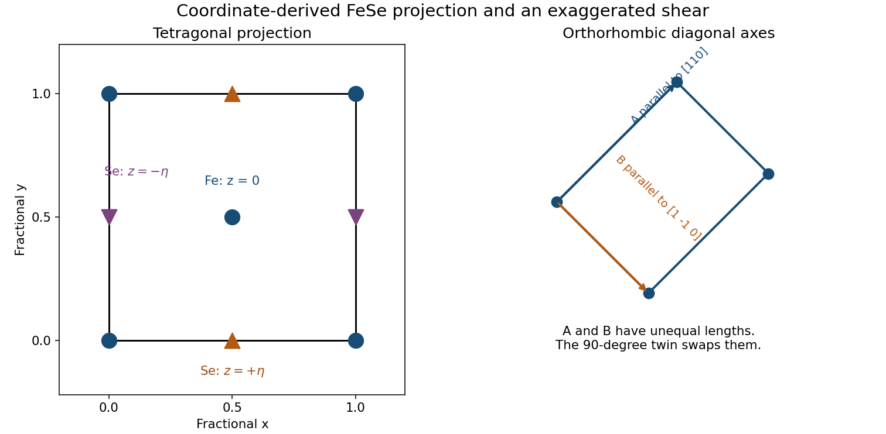

<h1 id="1/b/solution">Solution</h1>

↑ **Parent:** [B](../b.md)

Take the square projection cell $0\leq x,y\leq1$ and label the heights rather than erasing them in projection. The Fe positions appear at the cell corners and at $(1/2,1/2)$, both with $z=0$. The Se projections are $(1/2,0)$ at height $+\eta$ and $(0,1/2)$ at height $-\eta$, together with their periodic copies on opposite edges. These are distinct height classes even though the observer looks down the $z$ axis.

The corner Fe sites together count as one atom per cell, the central Fe as one, and each edge-shared Se projection contributes half at each of two equivalent edges. The count is therefore two Fe and two Se per [primitive tetragonal lattice](../../../../primitive-tetragonal-lattice.md) cell. The Fe sublattice has its shorter nearest-neighbor directions along the projected cell diagonals. The distinction between those directions and the conventional tetragonal axes matters for the distortion in [d](../d.md).

**[Figure 1](#1/b/image-fese-projection-with-selenium-heights-and-the-diagonal-orthorhombic-distortion). FeSe projection with selenium heights and the diagonal orthorhombic distortion**. Original coordinate-based projection and schematic distortion. Opposite selenium heights remain distinguished; the orthorhombic easy axes are rotated by 45 degrees from the conventional tetragonal axes. The distortion amplitude is exaggerated.

## ↑ Ancestors (12)

1. [B](../b.md)
2. [1](../../1.md)
3. [2015](../../../2015-split.md)
4. [Past exam of the condensed matter physics major option course of the University of Oxford](../../../split.md)
5. [Condensed matter physics major option course of the University of Oxford](../../../../condensed-matter-physics-major-option-course-of-the-university-of-oxford.md)
6. [Year 4 of the physics course of the University of Oxford](../../../../year-4-of-the-physics-course-of-the-university-of-oxford.md)
7. [Physics course of the University of Oxford](../../../../physics-course-of-the-university-of-oxford.md)
8. [Undergraduate course of the University of Oxford](../../../../undergraduate-course-of-the-university-of-oxford.md)
9. [Course of the University of Oxford](../../../../course-of-the-university-of-oxford.md)
10. [University of Oxford](../../../../university-of-oxford-split.md)
11. [List of universities](../../../../list-of-universities.md)
12. [Codex Wiki](../../../../split.md)
