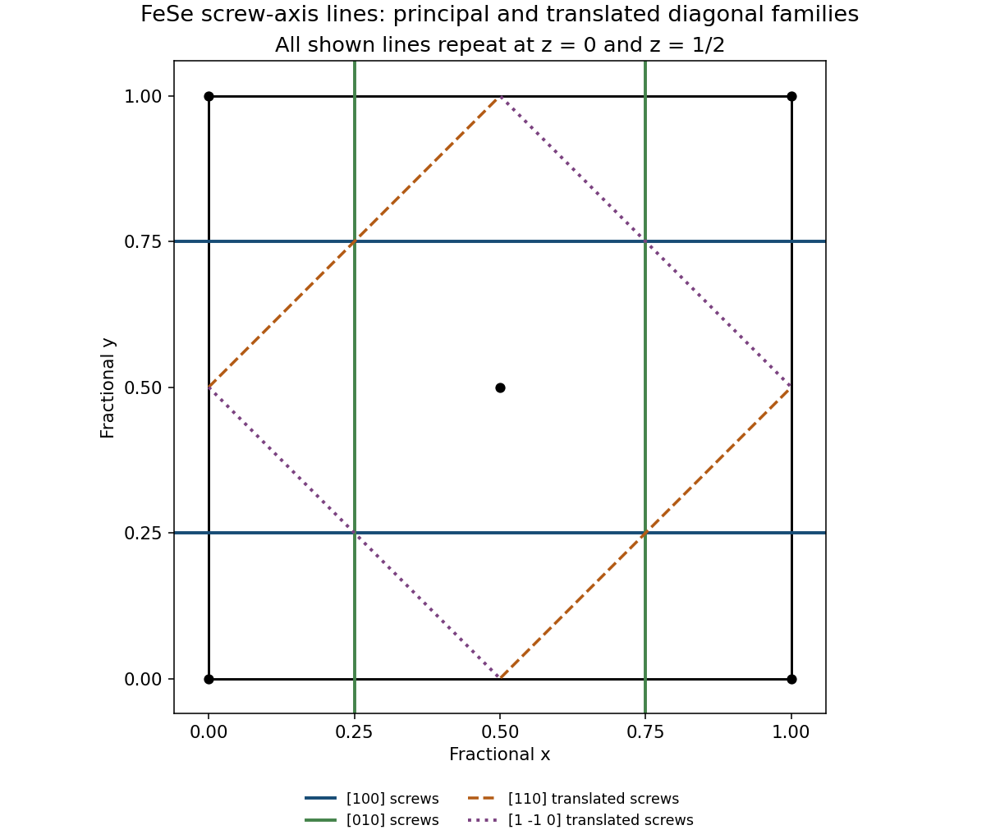

<h1 id="1/c/a/solution">Solution</h1>

↑ **Parent:** [A](../a.md)

A representative half-turn-plus-translation operation about an axis parallel to $x$ is

$$
g_x:(x,y,z)\mapsto(x+\tfrac12,\tfrac12-y,-z).
$$

It rotates about the line $y=1/4,z=0$ and translates by $a/2$ along $x$. It exchanges the two Fe sites, and maps $(1/2,0,\eta)$ onto $(0,1/2,-\eta)$ modulo a [lattice translation](../../../../../lattice-translation.md). Likewise,

$$
g_y:(x,y,z)\mapsto(\tfrac12-x,y+\tfrac12,-z)
$$

is a $2_1$ screw about $x=1/4,z=0$. Including translated equivalents gives the principal-axis screw lines

$$
\boxed{\begin{aligned}
[100]:&\quad y=\tfrac14+\tfrac m2,\ z=\tfrac n2,\\
[010]:&\quad x=\tfrac14+\tfrac m2,\ z=\tfrac n2,
\end{aligned}\qquad m,n\in\mathbb Z.}
$$

Thus the cell contains lines at the quarter and three-quarter coordinates, in both the $z=0$ and $z=1/2$ levels.

For completeness, translated diagonal twofold operations also produce diagonal $2_1$ screw lines. The operations $(x,y,z)\mapsto(y+1,x,-z)$ and $(x,y,z)\mapsto(1-y,-x,-z)$ preserve the same basis. Their axial translations are $(1/2,1/2,0)$ and $(1/2,-1/2,0)$, half the primitive repeats along the corresponding diagonal directions. Their lines are

$$
\boxed{\begin{aligned}
[110]:&\quad x-y=\tfrac12+m,\ z=\tfrac n2,\\
[1\bar10]:&\quad x+y=\tfrac12+m,\ z=\tfrac n2.
\end{aligned}}
$$

Diagonal lines with integer $x\mp y$ instead support pure twofold rotations. Listing only rotational parts modulo primitive translations would hide these shifted screw lines. There is no fractional screw advance along $z$: every Fe site has integer $z$, so a symmetry taking the Fe layer into itself requires an integer vertical translation. Proper fourfold axes parallel to $z$ are therefore not $4_1$, $4_2$, or $4_3$ screws in this structure. All these statements can be checked directly on the four supplied coordinates without choosing an alternative tabulated origin.[P4/nmm, full Hermann-Mauguin symbol and origin-setting information; coordinate operations here are derived in the supplied origin](../../../../../symmetry-relations-for-space-group-129-by-international-union-of-crystallography.md)

**[Figure 2](#1/c/a/image-principal-and-translated-diagonal-screw-lines-in-the-fese-basal-cell). Principal and translated diagonal screw lines in the FeSe basal cell**. Original symmetry-element diagram derived from explicit affine operations. Solid horizontal and vertical guides mark principal-axis 21 screws; dashed diagonal guides mark translated diagonal 21 screws. The same line families occur at z equal to zero and one half.

## ↑ Ancestors (13)

1. [A](../a.md)
2. [C](../../c.md)
3. [1](../../../1.md)
4. [2015](../../../../2015-split.md)
5. [Past exam of the condensed matter physics major option course of the University of Oxford](../../../../split.md)
6. [Condensed matter physics major option course of the University of Oxford](../../../../../condensed-matter-physics-major-option-course-of-the-university-of-oxford.md)
7. [Year 4 of the physics course of the University of Oxford](../../../../../year-4-of-the-physics-course-of-the-university-of-oxford.md)
8. [Physics course of the University of Oxford](../../../../../physics-course-of-the-university-of-oxford.md)
9. [Undergraduate course of the University of Oxford](../../../../../undergraduate-course-of-the-university-of-oxford.md)
10. [Course of the University of Oxford](../../../../../course-of-the-university-of-oxford.md)
11. [University of Oxford](../../../../../university-of-oxford-split.md)
12. [List of universities](../../../../../list-of-universities.md)
13. [Codex Wiki](../../../../../split.md)
