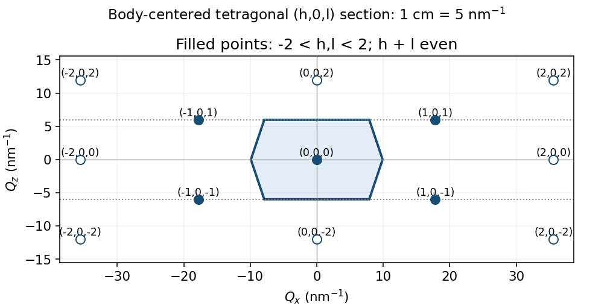

<h1 id="2/b/a/solution">Solution</h1>

↑ **Parent:** [A](../a.md)

For the body-centered tetragonal direct lattice, conventional reciprocal labels $(h,k,l)$ are integer triples satisfying $h+k+l$ even. This follows because the extra translation $(1/2,1/2,1/2)$ must have phase one for a [reciprocal lattice vector](../../../../../reciprocal-lattice-vector.md). In the $k=0$ section the condition is $h+l$ even. The reciprocal steps are

$$
\boxed{a^*=\frac{2\pi}{0.353}=17.799\ \mathrm{nm^{-1}},\qquad
c^*=\frac{2\pi}{1.05}=5.984\ \mathrm{nm^{-1}}.}
$$

Within the strict index window $-2<h,l<2$, the reciprocal points are $(h,l)=(0,0)$ and $(\pm1,\pm1)$. The neighboring $(\pm2,0)$ and $(0,\pm2)$ points lie on the excluded boundary but are useful for constructing the zone bisectors.

At the requested drawing scale, one conventional step in $h$ is $a^*/5=3.560$ cm and one step in $l$ is $c^*/5=1.197$ cm. Thus the four off-origin included points have drawing coordinates $(\pm3.560,\pm1.197)$ cm. Keeping these unequal physical scales avoids drawing a fictitious square reciprocal section.

**[Figure 3](#2/b/a/image-physical-h-zero-l-reciprocal-section-and-its-first-brillouin-zone-boundary). Physical h-zero-l reciprocal section and its first Brillouin-zone boundary**. Original Wigner-Seitz construction using the actual reciprocal lengths. Filled points satisfy h plus l even; open boundary points assist the construction outside the strict requested index window. The hexagon is the section of the three-dimensional first zone.

## ↑ Ancestors (13)

1. [A](../a.md)
2. [B](../../b.md)
3. [2](../../../2.md)
4. [2015](../../../../2015-split.md)
5. [Past exam of the condensed matter physics major option course of the University of Oxford](../../../../split.md)
6. [Condensed matter physics major option course of the University of Oxford](../../../../../condensed-matter-physics-major-option-course-of-the-university-of-oxford.md)
7. [Year 4 of the physics course of the University of Oxford](../../../../../year-4-of-the-physics-course-of-the-university-of-oxford.md)
8. [Physics course of the University of Oxford](../../../../../physics-course-of-the-university-of-oxford.md)
9. [Undergraduate course of the University of Oxford](../../../../../undergraduate-course-of-the-university-of-oxford.md)
10. [Course of the University of Oxford](../../../../../course-of-the-university-of-oxford.md)
11. [University of Oxford](../../../../../university-of-oxford-split.md)
12. [List of universities](../../../../../list-of-universities.md)
13. [Codex Wiki](../../../../../split.md)
