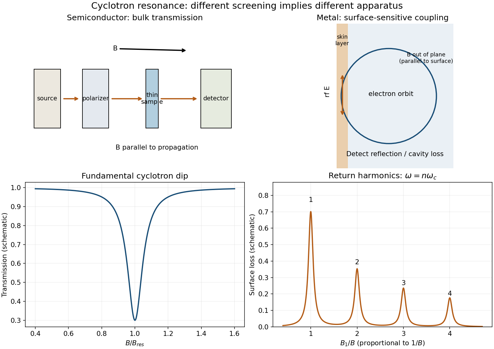

<h1 id="5/d/solution">Solution</h1>

↑ **Parent:** [D](../d.md)

In a low-carrier-density semiconductor use a thin, cold sample in a transmission spectrometer. Direct microwave or far-infrared radiation through it, commonly with propagation parallel to $\mathbf B$ and electric field transverse to it. Sweep $B$ at fixed frequency and detect transmitted power. The active [circular polarization](../../../../circular-polarization.md) shows an absorption peak, or transmission dip, near $B_{\rm res}=m^*\omega/e$. Resolving it requires a long enough scattering time, $\omega_c\tau\gtrsim1$.

A metal's large [plasma frequency](../../../../plasma-frequency.md) usually prevents that radiation from sampling its bulk directly. In [surface cyclotron resonance in a metal](../../../../surface-cyclotron-resonance-in-a-metal.md), put $\mathbf B$ approximately parallel to a clean metal surface and excite an rf electric field in the [skin depth](../../../../skin-depth.md), transverse to $\mathbf B$. Electron orbits extend into the bulk and repeatedly return to that layer. Coherent energy absorption occurs when the rf phase repeats on a return, including harmonics $\omega=n\omega_c$. Measure cavity loss, reflected power, or surface impedance rather than attempting ordinary bulk transmission. The characteristic regime has [cyclotron radius](../../../../cyclotron-radius.md) larger than the [skin depth](../../../../skin-depth.md) and sufficiently specular, long-lived orbits.

For the spherical parabolic band the metal harmonic fields are

$$
\boxed{B_n=\frac{m^*\omega}{ne},\qquad n=1,2,\ldots.}
$$

They are evenly spaced in $1/B$, with amplitudes and widths determined by surface geometry and scattering. A semiconductor generally gives the simple bulk fundamental, whereas the metal can show this harmonic series in a surface-loss signal. For an anisotropic real [Fermi surface](../../../../fermi-surface.md) the measured mass is the appropriate [cyclotron effective mass](../../../../cyclotron-effective-mass.md) rather than necessarily every component of a transport effective-mass tensor. These classical resonance harmonics are distinct from the Landau-level [quantum oscillations](../../../../quantum-oscillation.md) in [c](../../6/c.md).

**[Figure 4](#5/d/image-bulk-transmission-and-surface-cyclotron-resonance-measurements). Bulk transmission and surface cyclotron-resonance measurements**. Original schematic arrangements and illustrative field-scan signals. The semiconductor exhibits a bulk transmission dip; a metal is probed through skin-layer losses with harmonic resonance positions. Signal shapes are schematic rather than experimental data.

## ↑ Ancestors (12)

1. [D](../d.md)
2. [5](../../5.md)
3. [2015](../../../2015-split.md)
4. [Past exam of the condensed matter physics major option course of the University of Oxford](../../../split.md)
5. [Condensed matter physics major option course of the University of Oxford](../../../../condensed-matter-physics-major-option-course-of-the-university-of-oxford.md)
6. [Year 4 of the physics course of the University of Oxford](../../../../year-4-of-the-physics-course-of-the-university-of-oxford.md)
7. [Physics course of the University of Oxford](../../../../physics-course-of-the-university-of-oxford.md)
8. [Undergraduate course of the University of Oxford](../../../../undergraduate-course-of-the-university-of-oxford.md)
9. [Course of the University of Oxford](../../../../course-of-the-university-of-oxford.md)
10. [University of Oxford](../../../../university-of-oxford-split.md)
11. [List of universities](../../../../list-of-universities.md)
12. [Codex Wiki](../../../../split.md)
