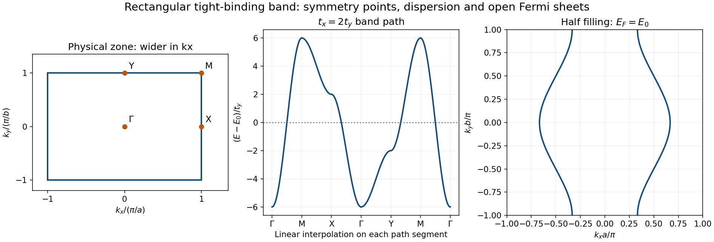

<h1 id="6/a/solution">Solution</h1>

↑ **Parent:** [A](../a.md)

Choose orthonormal localized orbitals $|\mathbf R\rangle$. The on-site energy is $E_0=\langle\mathbf R|H|\mathbf R\rangle$, and the sign convention in the question defines $t(\mathbf T)=-\langle\mathbf R|H|\mathbf R+\mathbf T\rangle$. [Bloch state](../../../../bloch-state.md) diagonalizes this translationally invariant hopping problem. For real, inversion-symmetric nearest-neighbor amplitudes, $t(\pm a\hat x)=t_x$ and $t(\pm b\hat y)=t_y$, so the exponential pairs yield

$$
\boxed{E(\mathbf k)=E_0-2t_x\cos(k_xa)-2t_y\cos(k_yb).}
$$

The first zone is the rectangle $|k_x|\leq\pi/a$, $|k_y|\leq\pi/b$, wider in $k_x$ because $a<b$. Use $\Gamma=(0,0)$, $X=(\pi/a,0)$, $Y=(0,\pi/b)$ and $M=(\pi/a,\pi/b)$.

For positive $t_y=t$ and $t_x=2t$, the four corner energies and the requested path are

$$
\boxed{E_\Gamma=E_0-6t,\quad E_M=E_0+6t,\quad
E_X=E_0+2t,\quad E_Y=E_0-2t;\qquad
\Gamma\to M\to X\to\Gamma\to Y\to M\to\Gamma.}
$$

Along a path parametrized in reduced coordinates $x=k_xa$, $y=k_yb$, the full curve is simply $E-E_0=-4t\cos x-2t\cos y$. In particular the two appearances of $\Gamma$ and the two diagonal traversals must have consistent endpoint energies.[§2.1.1, localized orbitals and hopping sign convention; chapter 2, Bloch-band construction](../../../../solid-state-physics-by-david-tong.md) A reversed hopping sign changes which point is the band minimum; the usual positive-hopping convention is stated explicitly here.

**[Figure 5](#6/a/image-rectangular-tight-binding-zone-the-specified-band-path-and-half-filled-fermi-lines). Rectangular tight-binding zone, the specified band path and half-filled Fermi lines**. Original evaluation for tx equal to twice ty. Reduced coordinates identify the symmetry points; the physical reciprocal cell is wider along kx when a is less than b. The Fermi lines are open in the repeated-zone picture.

## ↑ Ancestors (12)

1. [A](../a.md)
2. [6](../../6.md)
3. [2015](../../../2015-split.md)
4. [Past exam of the condensed matter physics major option course of the University of Oxford](../../../split.md)
5. [Condensed matter physics major option course of the University of Oxford](../../../../condensed-matter-physics-major-option-course-of-the-university-of-oxford.md)
6. [Year 4 of the physics course of the University of Oxford](../../../../year-4-of-the-physics-course-of-the-university-of-oxford.md)
7. [Physics course of the University of Oxford](../../../../physics-course-of-the-university-of-oxford.md)
8. [Undergraduate course of the University of Oxford](../../../../undergraduate-course-of-the-university-of-oxford.md)
9. [Course of the University of Oxford](../../../../course-of-the-university-of-oxford.md)
10. [University of Oxford](../../../../university-of-oxford-split.md)
11. [List of universities](../../../../list-of-universities.md)
12. [Codex Wiki](../../../../split.md)
