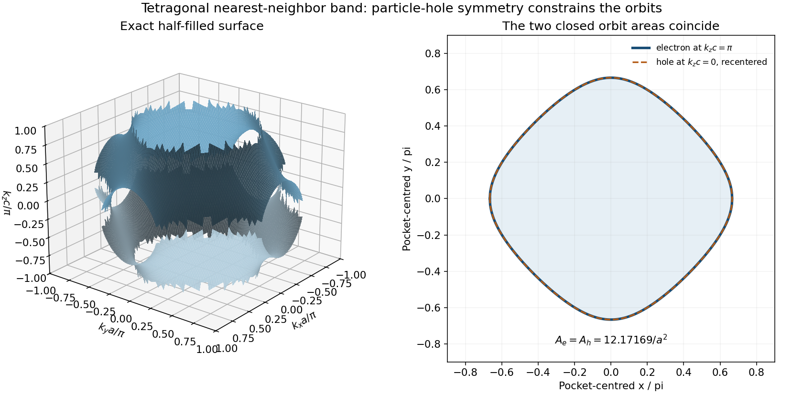

<h1 id="6/b/solution">Solution</h1>

↑ **Parent:** [B](../b.md)

One orbital per primitive cell supplies two states per [wave vector](../../../../wavevector.md) when [spin](../../../../spin.md) is included. A monovalent metal therefore half-fills this band. Nearest-neighbor hopping on the bipartite rectangular lattice has $E(\mathbf k+\mathbf Q)=2E_0-E(\mathbf k)$ for $\mathbf Q=(\pi/a,\pi/b)$, fixing the half-filled [Fermi energy](../../../../fermi-energy.md) at

$$
\boxed{E_F=E_0.}
$$

For $t_x=2t_y>0$, the two [Fermi surface](../../../../fermi-surface.md) obey

$$
\boxed{\cos(k_xa)=-\tfrac12\cos(k_yb),\qquad
k_xa=\pm\arccos[-\tfrac12\cos(k_yb)].}
$$

They are corrugated open sheets in an extended-zone description, with $|k_xa|$ ranging from $\pi/3$ to $2\pi/3$. They are not a small circular pocket centered at the band bottom. The same $\mathbf Q$ maps one Fermi line onto its nested partner. A density-wave or Peierls-like modulation at that [wave vector](../../../../wavevector.md) can open additional gaps at the [Fermi energy](../../../../fermi-energy.md). The unperturbed single-orbital band does not acquire those new gaps without a symmetry-breaking modulation or another coupling; ordinary lattice Bragg effects are already built into its dispersion.

For the three-dimensional tetragonal version set $t_x=t_y=t$, $t_z=t/2$, $a=b<c$. The corresponding half-filled surface is

$$
\boxed{E_F=E_0,\qquad \cos(k_xa)+\cos(k_ya)+\tfrac12\cos(k_zc)=0.}
$$

It is a corrugated periodic surface, not a sphere. At $k_z=\pi/c$ its regular closed contour is electron-like around $\Gamma$, with $\cos(k_xa)+\cos(k_ya)=1/2$; at $k_z=0$ the closed contour is hole-like around $M$, with the sum $-1/2$. The topology switches through the square-lattice separatrix at $k_zc=\pm\pi/2$. Drawing one simple weakly warped cylindrical pocket across every section misses that feature of the half-filled cosine band.

Angle-resolved photoemission can directly map the dispersion and occupied [Fermi surface](../../../../fermi-surface.md). Angular quantum-oscillation measurements test its closed extremal cross sections and cyclotron masses; momentum-density probes such as positron annihilation or Compton scattering give a complementary bulk test. The different techniques constrain different features rather than merely providing interchangeable pictures.

**[Figure 6](#6/b/image-half-filled-tetragonal-cosine-band-fermi-surface-and-its-symmetry-related-closed-orbits). Half-filled tetragonal cosine-band Fermi surface and its symmetry-related closed orbits**. Original surface of cos x plus cos y plus one half cos z equal to zero. An electron contour at kz c equal to pi and a hole contour at kz c equal to zero have equal closed-orbit areas by particle-hole symmetry.

## ↑ Ancestors (12)

1. [B](../b.md)
2. [6](../../6.md)
3. [2015](../../../2015-split.md)
4. [Past exam of the condensed matter physics major option course of the University of Oxford](../../../split.md)
5. [Condensed matter physics major option course of the University of Oxford](../../../../condensed-matter-physics-major-option-course-of-the-university-of-oxford.md)
6. [Year 4 of the physics course of the University of Oxford](../../../../year-4-of-the-physics-course-of-the-university-of-oxford.md)
7. [Physics course of the University of Oxford](../../../../physics-course-of-the-university-of-oxford.md)
8. [Undergraduate course of the University of Oxford](../../../../undergraduate-course-of-the-university-of-oxford.md)
9. [Course of the University of Oxford](../../../../course-of-the-university-of-oxford.md)
10. [University of Oxford](../../../../university-of-oxford-split.md)
11. [List of universities](../../../../list-of-universities.md)
12. [Codex Wiki](../../../../split.md)
