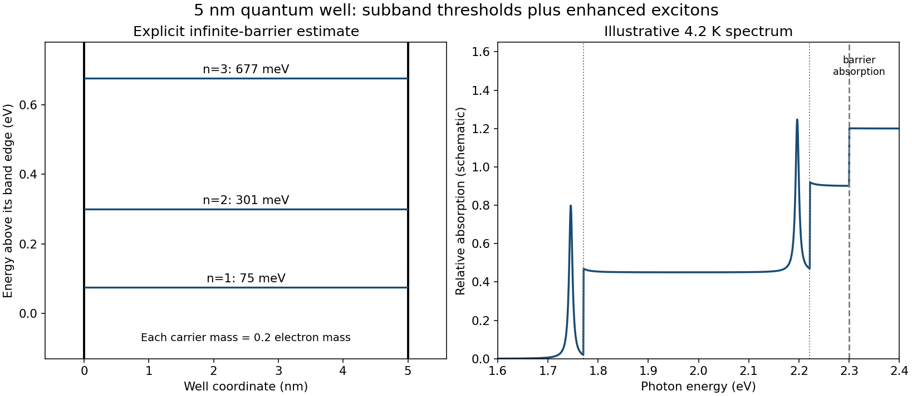

<h1 id="7/c/solution">Solution</h1>

↑ **Parent:** [C](../c.md)

Assume type-I confinement of both carriers, and first use an [infinite square well](../../../../infinite-square-well.md) as an explicit estimate. For thickness $L=5$ nm and each carrier mass $0.2m_e$, confinement measured from the corresponding well band edge is

$$
\boxed{E_n^e=E_n^h=\frac{\pi^2\hbar^2n^2}{2(0.2m_e)L^2}
=75.2n^2\ \mathrm{meV}.}
$$

Thus the first three infinite-well levels are approximately $75$, $301$ and $677$ meV for each carrier. Interband envelope overlap favors matching quantum numbers when the electron and hole well profiles are the same. Ignoring [exciton binding energy](../../../../exciton-binding-energy.md) initially, their absorption thresholds are

$$
\boxed{E_{{\rm opt},n}=E_g+E_n^e+E_n^h
\simeq1.770\ \mathrm{eV},\quad2.222\ \mathrm{eV},\quad2.974\ \mathrm{eV},\ldots.}
$$

The first two lie in the requested optical window. Two-dimensional subband joint densities of states produce step-like onsets, with excitonic peaks just below them, rather than only a bulk three-dimensional onset. Confinement strengthens electron–hole binding: the ideal strict-two-dimensional hydrogen ground binding is $4R^*\simeq40$ meV, while a finite-width well interpolates toward the bulk value near $10$ meV. The $5$ nm width is comparable to the bulk [exciton](../../../../exciton.md) radius, so neither limiting binding value is exact. A schematic based on the infinite-well estimate therefore has first [exciton](../../../../exciton.md) peaks around $1.73$–$1.76$ eV and $2.18$–$2.21$ eV, followed by their subband continua; the $2.3$ eV barrier absorption is another feature near the top of the requested window.

**The barrier gap alone does not specify the finite confinement energies.** Under type-I alignment it supplies only $\Delta E_c+\Delta E_v\simeq2.3-1.62=0.68$ eV. It does not give their division or the barrier [effective masses](../../../../band-effective-mass.md), and a larger gap by itself does not prove type-I alignment. Infinite-well levels are consequently estimates, not uniquely determined measured levels.

For a concrete conditional comparison, assigning equal $0.34$ eV electron and hole barriers and taking the same mass on both sides gives [finite square well](../../../../finite-square-well.md) levels $44.1$, $169.4$ and $331.7$ meV per carrier. These follow from $z\tan z=\sqrt{z_0^2-z^2}$ for even levels and $-z\cot z=\sqrt{z_0^2-z^2}$ for odd levels, with $z=kL/2$, $z_0=(L/2)\sqrt{2m^*V_0}/\hbar$. The corresponding unbound-pair optical thresholds would be $1.708$, $1.959$ and $2.283$ eV before [exciton](../../../../exciton.md) shifts. This example is deliberately conditional and demonstrates why band offsets must not be invented to make a unique [finite square well](../../../../finite-square-well.md) spectrum. The requested schematic below states which approximation it uses.

**[Figure 7](#7/c/image-conditional-quantum-well-levels-and-a-low-temperature-subband-absorption-sketch). Conditional quantum-well levels and a low-temperature subband absorption sketch**. Original infinite-barrier estimate for a 5 nm well with equal carrier masses. The optical sketch uses two subband thresholds and illustrative exciton peaks; it is not a reconstruction of the source bulk spectrum or a unique prediction without band-offset data.

## ↑ Ancestors (12)

1. [C](../c.md)
2. [7](../../7.md)
3. [2015](../../../2015-split.md)
4. [Past exam of the condensed matter physics major option course of the University of Oxford](../../../split.md)
5. [Condensed matter physics major option course of the University of Oxford](../../../../condensed-matter-physics-major-option-course-of-the-university-of-oxford.md)
6. [Year 4 of the physics course of the University of Oxford](../../../../year-4-of-the-physics-course-of-the-university-of-oxford.md)
7. [Physics course of the University of Oxford](../../../../physics-course-of-the-university-of-oxford.md)
8. [Undergraduate course of the University of Oxford](../../../../undergraduate-course-of-the-university-of-oxford.md)
9. [Course of the University of Oxford](../../../../course-of-the-university-of-oxford.md)
10. [University of Oxford](../../../../university-of-oxford-split.md)
11. [List of universities](../../../../list-of-universities.md)
12. [Codex Wiki](../../../../split.md)
