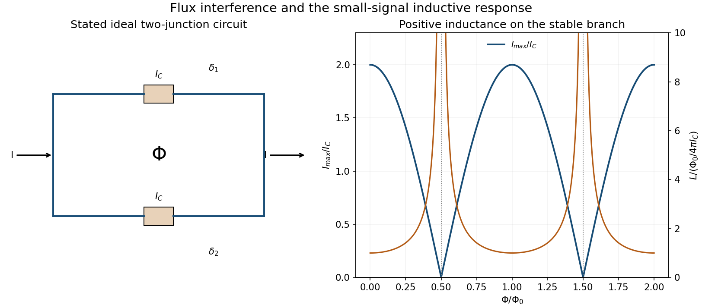

<h1 id="8/c/solution">Solution</h1>

↑ **Parent:** [C](../c.md)

Let $\delta_1$ and $\delta_2$ be gauge-invariant phase drops across the two identical junctions, oriented between the same terminal phases. Their currents obey the [DC Josephson effect](../../../../dc-josephson-effect.md): $I_1=I_C\sin\delta_1$ and $I_2=I_C\sin\delta_2$. For negligible loop [self-inductance](../../../../self-inductance.md) and no additional phase drops in the arms, [fluxoid](../../../../fluxoid.md) consistency fixes their difference modulo $2\pi$:

$$
\delta_1-\delta_2=2\pi\frac{\Phi}{\Phi_0}.
$$

Define the mean terminal phase $\delta=(\delta_1+\delta_2)/2$ and $\phi=\pi\Phi/\Phi_0$. Then $\delta_{1,2}=\delta\pm\phi$ and the two parallel branch currents add:

$$
\boxed{I=I_C[\sin(\delta+\phi)+\sin(\delta-\phi)]
=2I_C\cos\!\left(\frac{\pi\Phi}{\Phi_0}\right)\sin\delta.}
$$

Consequently the maximum magnitude of the current is $2I_C|\cos\phi|$, not a negative critical current when the cosine changes sign. The phase shifts by $\pi$ between such stable branches. Junction asymmetry or appreciable self-generated flux modifies the simplest interference pattern, so the stated idealization is required before treating $\Phi$ as an externally prescribed flux.

**[Figure 8](#8/c/image-two-junction-superconducting-interference-and-its-stable-inductive-response). Two-junction superconducting interference and its stable inductive response**. Original circuit-level diagram of the stated ideal two-junction model, with a flux-dependent critical-current envelope and stable small-signal inductance. It does not reconstruct the missing source raster components.

## ↑ Ancestors (12)

1. [C](../c.md)
2. [8](../../8.md)
3. [2015](../../../2015-split.md)
4. [Past exam of the condensed matter physics major option course of the University of Oxford](../../../split.md)
5. [Condensed matter physics major option course of the University of Oxford](../../../../condensed-matter-physics-major-option-course-of-the-university-of-oxford.md)
6. [Year 4 of the physics course of the University of Oxford](../../../../year-4-of-the-physics-course-of-the-university-of-oxford.md)
7. [Physics course of the University of Oxford](../../../../physics-course-of-the-university-of-oxford.md)
8. [Undergraduate course of the University of Oxford](../../../../undergraduate-course-of-the-university-of-oxford.md)
9. [Course of the University of Oxford](../../../../course-of-the-university-of-oxford.md)
10. [University of Oxford](../../../../university-of-oxford-split.md)
11. [List of universities](../../../../list-of-universities.md)
12. [Codex Wiki](../../../../split.md)
