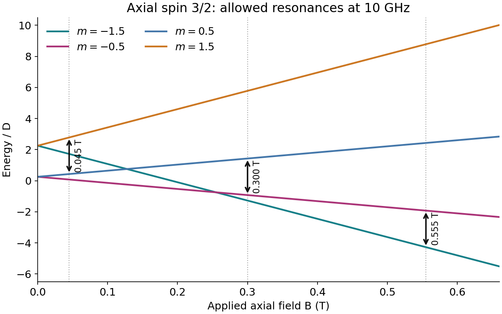
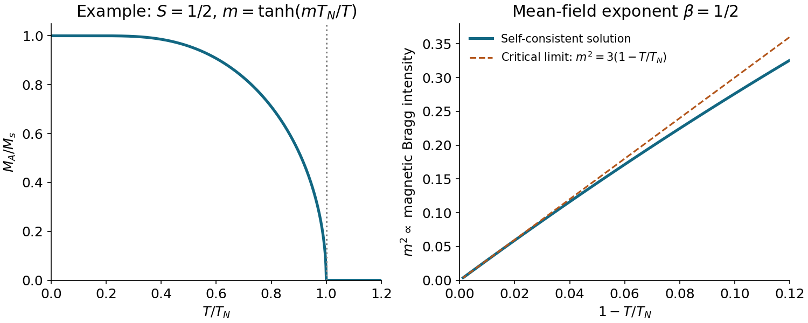
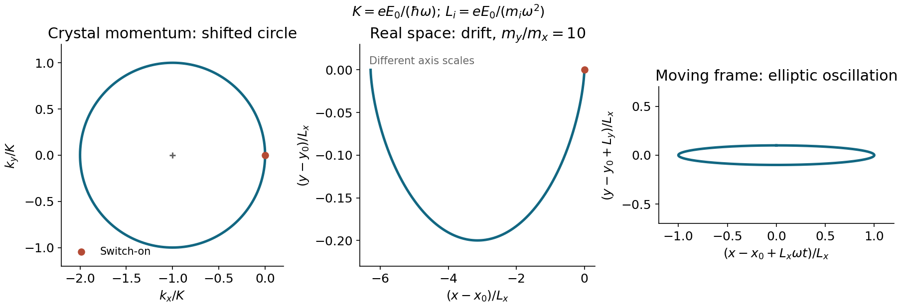
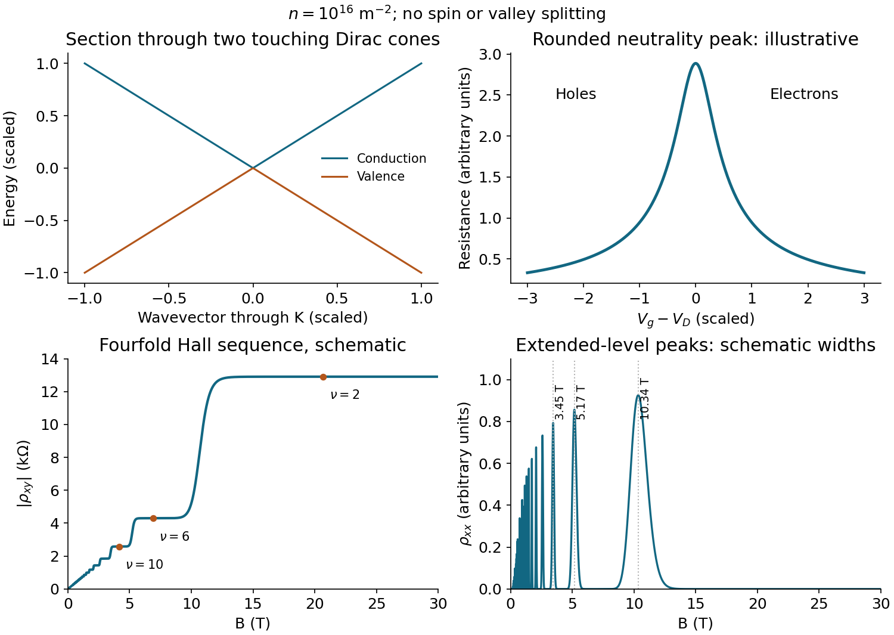

# 2016

↑ **Parent:** [Past exam of the condensed matter physics major option course of the University of Oxford](../past-exam-of-the-condensed-matter-physics-major-option-course-of-the-university-of-oxford.md)

Source paper: [https://www.whatdotheyknow.com/request/physics_past_exam_papers_2015_16/response/973997/attach/3/Cowell%20Attachment.zip?cookie_passthrough=1.](https://www.whatdotheyknow.com/request/physics_past_exam_papers_2015_16/response/973997/attach/3/Cowell%20Attachment.zip?cookie_passthrough=1.) The dated cover identifies the Part C Major Option sitting of 15 June 2016. All eight options are treated below.

**Table of contents**

- [1](#1)
  - [a](#1/a)
    - [Solution](#1/a/solution)
  - [b](#1/b)
    - [Solution](#1/b/solution)
  - [c](#1/c)
    - [Solution](#1/c/solution)
  - [d](#1/d)
    - [Solution](#1/d/solution)
- [2](#2)
  - [a](#2/a)
    - [Solution](#2/a/solution)
  - [b](#2/b)
    - [Solution](#2/b/solution)
  - [c](#2/c)
    - [Solution](#2/c/solution)
  - [d](#2/d)
    - [Solution](#2/d/solution)
  - [e](#2/e)
    - [Solution](#2/e/solution)
- [3](#3)
  - [a](#3/a)
    - [i](#3/a/i)
      - [Solution](#3/a/i/solution)
    - [ii](#3/a/ii)
      - [Solution](#3/a/ii/solution)
  - [b](#3/b)
    - [Solution](#3/b/solution)
  - [c](#3/c)
    - [Solution](#3/c/solution)
- [4](#4)
  - [Solution](#4/solution)
- [5](#5)
  - [Solution](#5/solution)
  - [a](#5/a)
    - [Solution](#5/a/solution)
  - [b](#5/b)
    - [Solution](#5/b/solution)
- [6](#6)
  - [Solution](#6/solution)
- [7](#7)
  - [Solution](#7/solution)
- [8](#8)
  - [a](#8/a)
    - [Solution](#8/a/solution)
  - [b](#8/b)
    - [Solution](#8/b/solution)
  - [c](#8/c)
    - [Solution](#8/c/solution)
  - [d](#8/d)
    - [Solution](#8/d/solution)
  - [e](#8/e)
    - [Solution](#8/e/solution)

## 1

↑ **Parent:** [2016](2016.md)

<h3 id="1/a">a</h3>

↑ **Parent:** [1](#1)

<h4 id="1/a/solution">Solution</h4>

↑ **Parent:** [A](#1/a)

Away from an absorption edge, the scalar [atomic scattering factor](../quantum-scattering.md#atomic-scattering-factor) is the [Fourier transform](../fourier-transform.md) of an approximately spherical, real atomic [electron density](../chemistry.md#electron-density). Opposite points contribute conjugate phases, so their sum is real. In [Thomson scattering](../cosmic-microwave-background-anisotropy.md#thomson-scattering) the electronic response is also effectively in phase with the driving field in this nonabsorbing approximation. Near an absorption edge, resonantly driven electronic excitations introduce a phase lag and absorption. The [atomic scattering factor](../quantum-scattering.md#atomic-scattering-factor) becomes $f_0+f'+if''$, with $f''$ describing the absorptive component and $f'$ its dispersive companion. The sign of the imaginary part depends on the time and scattering-phase conventions; here it is the source's $+if''$ convention. This discussion concerns scalar charge scattering, without magnetic or tensor resonant contributions.

<h3 id="1/b">b</h3>

↑ **Parent:** [1](#1)

<h4 id="1/b/solution">Solution</h4>

↑ **Parent:** [B](#1/b)

Use fractional [coordinates](../vector-space.md#coordinate-linear-algebra) and the [structure factor](../quantum-scattering.md#structure-factor) convention

$$
F(\mathbf h)=\sum_j f_j e^{2\pi i\mathbf h\cdot\mathbf r_j},\qquad I(\mathbf h)\propto |F(\mathbf h)|^2.
$$

For real [atomic scattering factors](../quantum-scattering.md#atomic-scattering-factor), $F(-\mathbf h)=F(\mathbf h)^*$, immediately proving [Friedel's law](../physical-chemistry.md#friedel-s-law). If an inversion centre is chosen as origin, each site at $\mathbf r_j$ has an identical partner at $-\mathbf r_j$, with the same possibly complex [atomic scattering factor](../quantum-scattering.md#atomic-scattering-factor). Each pair contributes $2f_j\cos(2\pi\mathbf h\cdot\mathbf r_j)$; sites fixed by inversion modulo a [lattice translation](../quantum-scattering.md#lattice-translation) also have even phase factors at reciprocal-lattice vectors. Hence

$$
\boxed{F(-\mathbf h)=F(\mathbf h),\qquad I(-\mathbf h)=I(\mathbf h)}
$$

even for scalar [anomalous X-ray scattering](../physical-chemistry.md#anomalous-x-ray-scattering) in a centrosymmetric structure. This last equality is an equality of amplitudes, not generally complex conjugacy.

<h3 id="1/c">c</h3>

↑ **Parent:** [1](#1)

<h4 id="1/c/solution">Solution</h4>

↑ **Parent:** [C](#1/c)

Write $F_x(\mathbf h)=f_x S_x(h,k,l)$, where the four-site orbit has [structure factor](../quantum-scattering.md#structure-factor)

$$
\begin{aligned}
S_x(h,k,l)={}&e^{2\pi ix(h+k+l)}+(-1)^{h+l}e^{2\pi ix(-h-k+l)}\\
&+(-1)^{k+l}e^{2\pi ix(-h+k-l)}+(-1)^{h+k}e^{2\pi ix(h-k-l)}.
\end{aligned}
$$

A cyclic permutation of $h,k,l$ fixes the first term and permutes the remaining three. Thus $S_x(k,l,h)=S_x(h,k,l)$. Substituting $-h,-k,l$ exchanges the first and second exponentials and the third and fourth, with the common coefficient $(-1)^{h+l}$:

$$
\boxed{S_x(-h,-k,l)=e^{-i\pi(h+l)}S_x(h,k,l)}.
$$

The two forms of this phase, $e^{+i\pi(h+l)}$ and $e^{-i\pi(h+l)}$, agree for integer indices. Multiplication by a unit-modulus phase preserves intensity, irrespective of whether $f_x$ is real or complex. Since the phase is independent of $x$ and atomic species, it also multiplies the total [structure factor](../quantum-scattering.md#structure-factor) of the crystal.

<h3 id="1/d">d</h3>

↑ **Parent:** [1](#1)

<h4 id="1/d/solution">Solution</h4>

↑ **Parent:** [D](#1/d)

With $A=S_{x_{\rm Si}}(h,k,l)$ and $B=S_{x_{\rm Mn}}(h,k,l)$,

$$
F=f_{\rm Si}A+(f+if'')B.
$$

For $l=0$, the transformation in part c maps $(h,k,0)$ onto its [Friedel pair](../physical-chemistry.md#friedel-pair) with only a phase factor. Cyclic permutations give the same result when either other index vanishes. [Friedel's law](../physical-chemistry.md#friedel-s-law) therefore survives for every such reflection, including any systematic absences.

For the $(111)$ reflection set $t=2\pi x$. Then

$$
S_x(111)=e^{3it}+3e^{-it}=4(\cos^3t-i\sin^3t).
$$

Since the purely positional sums obey $S_x(-\mathbf h)=S_x(\mathbf h)^*$, the [scalar resonant Friedel-pair intensity difference](../physical-chemistry.md#scalar-resonant-friedel-pair-intensity-difference) is

$$
\boxed{I(\mathbf h)-I(-\mathbf h)=4f_{\rm Si}f''\operatorname{Im}(AB^*)}
$$

up to the same positive experimental scale factor. In particular,

$$
\operatorname{Im}(AB^*)=16\left(\cos^3t_{\rm Si}\sin^3t_{\rm Mn}-\sin^3t_{\rm Si}\cos^3t_{\rm Mn}\right).
$$

Different positional phases can therefore produce a nonzero resonant intensity difference at $(111)$, allowing the opposite structural handednesses to be distinguished. **The claimed violation is generic, not an unconditional identity:** the source supplies no numerical internal [coordinates](../vector-space.md#coordinate-linear-algebra). For a concrete noncentrosymmetric counterexample, take $x_{\rm Si}=1/8$ and $x_{\rm Mn}=5/8$. Their orbit sums at $(111)$ are $\sqrt2(1-i)$ and $-\sqrt2(1-i)$, so the difference vanishes even if $f''\ne0$; each generic chemical orbit is noncentrosymmetric, so this cancellation does not require [inversion symmetry](../bloch-s-theorem.md#inversion-symmetry). Accidental cancellation, or $f''=0$, must be excluded before asserting a violation for a particular specimen.

## 2

↑ **Parent:** [2016](2016.md)

<h3 id="2/a">a</h3>

↑ **Parent:** [2](#2)

<h4 id="2/a/solution">Solution</h4>

↑ **Parent:** [A](#2/a)

Under spatial inversion the [electric polarization](../electromagnetism.md#polarization-density), a [polar vector](../vector-space.md#polar-vector), changes from $\mathbf P$ to $-\mathbf P$. [Neumann's principle](../euclidean-geometry.md#neumann-s-principle) requires an equilibrium property of a phase retaining [inversion symmetry](../bloch-s-theorem.md#inversion-symmetry) to be unchanged. Thus $\mathbf P=-\mathbf P$, forcing $\mathbf P=0$: a centrosymmetric phase cannot itself be [ferroelectric](../engineering.md#ferroelectricity). A transition can, of course, remove that [symmetry](../physics.md#symmetry-physics).

For an inversion-symmetric parent phase the [Landau theory](../critical-phenomenon.md#landau-theory) [free energy](../thermodynamic-potential.md#thermodynamic-free-energy) satisfies $F(\mathbf P)=F(-\mathbf P)$. Every polynomial term of odd total degree changes sign and must have zero coefficient. Restricting to one fixed direction gives an even scalar expansion in $P$.

<h3 id="2/b">b</h3>

↑ **Parent:** [2](#2)

<h4 id="2/b/solution">Solution</h4>

↑ **Parent:** [B](#2/b)

For the full prism [point group](../euclidean-geometry.md#point-group), a threefold rotation eliminates any invariant basal component of a [polar vector](../vector-space.md#polar-vector), while the horizontal mirror eliminates its axial component. Therefore the phase preserving all of $D_{3h}$ is nonpolar, despite lacking inversion. A polar phase would have to break some of these symmetries.

The indicated six vertex directions comprise three basal directions and their horizontal-mirror partners. Crucially, this orbit does not contain the negatives of those vectors. Choose $z$ along the prism and $x$ toward one basal vertex. The cubic polynomial

$$
\mathcal I_3=P_x(P_x^2-3P_y^2)
$$

is invariant under the prism's rotations and mirrors. Along a vertex direction $\mathbf P=P\widehat{\mathbf n}$ with a nonzero basal component, it is proportional to $P^3$, so odd scalar terms are symmetry-allowed. Along the prism axis the horizontal mirror instead sends $P_z\mapsto-P_z$, forcing an even [free energy](../thermodynamic-potential.md#thermodynamic-free-energy). Merely omitting inversion is insufficient to decide either polarity or the allowed invariants.

<h3 id="2/c">c</h3>

↑ **Parent:** [2](#2)

<h4 id="2/c/solution">Solution</h4>

↑ **Parent:** [C](#2/c)

Differentiating the [Landau theory](../critical-phenomenon.md#landau-theory) [free energy](../thermodynamic-potential.md#thermodynamic-free-energy) gives

$$
F'=P[a(T-T_c)-bP+cP^2],\qquad F''=a(T-T_c)-2bP+3cP^2.
$$

Its stationary values are

$$
\boxed{P_0=0,\qquad P_\pm=\frac{b\pm\sqrt{b^2-4ac(T-T_c)}}{2c}}
$$

when the discriminant is nonnegative. At $P_0$, the curvature is $a(T-T_c)$: a local minimum above $T_c$ and a local maximum below it. Exactly at $T_c$, $F'''(0)=-2b\ne0$, so the origin is a stationary inflection point, not a stable minimum.

At a nonzero stationary point, eliminating $T-T_c$ yields $F''=P(2cP-b)$. Between $T_c$ and the upper [spinodal](../critical-phenomenon.md#spinodal), $P_+$ is a minimum and $P_-$ a maximum. Below $T_c$, $P_-<0$ becomes another local minimum, while $P_+>0$ is the lower minimum. Thus loss of local stability at $T_c$ is distinct from the equilibrium transition [temperature](../temperature.md).

<h3 id="2/d">d</h3>

↑ **Parent:** [2](#2)

<h4 id="2/d/solution">Solution</h4>

↑ **Parent:** [D](#2/d)

The two nonzero stationary points merge when their discriminant vanishes, giving the upper [spinodal](../critical-phenomenon.md#spinodal)

$$
\boxed{T_1=T_c+\frac{b^2}{4ac},\qquad \kappa_1=\frac14}.
$$

At a nonzero stationary point, $a(T-T_c)=bP-cP^2$, so its [free energy](../thermodynamic-potential.md#thermodynamic-free-energy) reduces to $F=P^3(b/6-cP/4)$. Equality with $F(0)=0$ therefore requires $P=2b/(3c)$. Substitution gives

$$
\boxed{T_2=T_c+\frac{2b^2}{9ac},\quad \kappa_2=\frac29,\quad P=0\ \text{or}\ \frac{2b}{3c}}.
$$

Both have positive curvature $2b^2/(9c)$ at coexistence. The intervening maximum is at $P=b/(3c)$. For $T_2<T<T_1$ the positive-polarization minimum is [metastable](../critical-phenomenon.md#metastability); for $T_c<T<T_2$ the zero-polarization minimum is [metastable](../critical-phenomenon.md#metastability).

<h3 id="2/e">e</h3>

↑ **Parent:** [2](#2)

<h4 id="2/e/solution">Solution</h4>

↑ **Parent:** [E](#2/e)

In equilibrium without [hysteresis](../critical-phenomenon.md#hysteresis), the system selects the lower free-energy minimum. At $T_2$ the [order parameter](../critical-phenomenon.md#order-parameter) jumps between $0$ and $2b/(3c)$, which identifies a [first-order phase transition](../thermodynamic-potential.md#first-order-phase-transition). Differentiating the minimized [free energy](../thermodynamic-potential.md#thermodynamic-free-energy) does not add a $dP/dT$ contribution because $F'=0$. Thus the polarization-dependent [entropy](../entropy.md) is $S=-aP^2/2$, giving

$$
S_{\rm ordered}-S_{\rm disordered}=-\frac{2ab^2}{9c^2}.
$$

The heat absorbed on heating from the ordered to the disordered phase is

$$
\boxed{Q_l=\frac{2ab^2T_2}{9c^2}}.
$$

The same amount is released on cooling. If $\Delta S$ is defined in the opposite direction, the signed transition heat is correspondingly negative.

## 3

↑ **Parent:** [2016](2016.md)

<h3 id="3/a">a</h3>

↑ **Parent:** [3](#3)

<h4 id="3/a/i">i</h4>

↑ **Parent:** [A](#3/a)

<h5 id="3/a/i/solution">Solution</h5>

↑ **Parent:** [I](#3/a/i)

For a partially filled $3d$ shell, [electron](../physics.md#electron)–[electron](../physics.md#electron) Coulomb repulsion and [Hund's rules](../chemistry.md#hund-s-rules) first favour particular total [spin](../angular-momentum-operator.md#spin) and orbital terms. The [crystal field splitting](../chemistry.md#crystal-field-splitting) is substantial because these orbitals overlap the ligand environment; it normally exceeds the [spin-orbit coupling](../atomic-physics.md#spin-orbit-interaction) and often quenches the orbital moment. Competition between the splitting and the [electron pairing energy](../chemistry.md#electron-pairing-energy) determines high-spin versus low-spin filling. A common hierarchy is Coulomb term energies, then crystal-field and Hund-exchange scales, then [spin](../angular-momentum-operator.md#spin)–orbit and weak-field Zeeman energies; the relative sizes of crystal-field splitting and pairing are material-dependent. Hyperfine coupling, if the nucleus carries [spin](../angular-momentum-operator.md#spin), adds a smaller splitting. An isolated ion has no inter-ion exchange ordering field.

<h4 id="3/a/ii">ii</h4>

↑ **Parent:** [A](#3/a)

<h5 id="3/a/ii/solution">Solution</h5>

↑ **Parent:** [Ii](#3/a/ii)

For a partially filled $4f$ shell, the outer $5s$ and $5p$ shells shield the localized orbitals from the ligands. [Coulomb interactions](../electrostatics.md#coulomb-interaction) establish $L,S$ through [Hund's rules](../chemistry.md#hund-s-rules), and [spin-orbit coupling](../atomic-physics.md#spin-orbit-interaction) usually exceeds the much smaller [crystal field splitting](../chemistry.md#crystal-field-splitting). First form a ground $J$ multiplet using $\mathbf J=\mathbf L+\mathbf S$, then split that multiplet by the crystal environment. The orbital contribution is therefore generally retained, and the [g-factor](../electromagnetism.md#g-factor-physics) is a multiplet Landé factor rather than an almost spin-only value. Weak external Zeeman and hyperfine interactions can subsequently resolve the remaining states. Exceptions with $J=0$ or unusual valence require separate treatment.

<h3 id="3/b">b</h3>

↑ **Parent:** [3](#3)

<h4 id="3/b/solution">Solution</h4>

↑ **Parent:** [B](#3/b)

The [tetrahedral crystal field splitting](../chemistry.md#tetrahedral-crystal-field-splitting) places the two $e$ orbitals below the three $t_2$ orbitals. In the weak-field, high-spin limit the occupancy is $e^2t_2^1$, with $S=3/2$. Its lowest cubic term is $^4T_1$: an orbital triplet, before [spin](../angular-momentum-operator.md#spin) degeneracy is counted. In the hypothetical sufficiently strong-field limit the occupancy is $e^3$, with $S=1/2$ and an orbital doublet $^2E$. This latter limit requires overcoming pairing/Hund energy; ordinary tetrahedral oxide complexes generally remain high-spin.

Both orbital degeneracies permit a [Jahn-Teller effect](../chemistry.md#jahn-teller-effect), so a regular tetrahedron is not a stable static equilibrium in the elementary adiabatic treatment. The sign of a particular distortion requires an [electron](../physics.md#electron)–lattice coupling model, not just the degeneracy count. To make that dependence explicit, let $Q>0$ stretch $z$ while contracting $x,y$. In a leading point-charge quadrupole model write the shifts

$$
\begin{array}{c|ccccc}
\text{orbital}&d_{xy}&d_{xz}&d_{yz}&d_{z^2}&d_{x^2-y^2}\\ \hline
\delta\epsilon&-2gQ&gQ&gQ&2gQ&-2gQ
\end{array}\qquad(g>0).
$$

In the high-spin configuration the two $e$ shifts cancel. For $Q>0$ the remaining [electron](../physics.md#electron) selects $d_{xy}$, gaining $-2gQ$; for $Q<0$ it selects the $d_{xz},d_{yz}$ doublet, gaining $gQ$. Adding $KQ^2/2$ gives a tetragonally **elongated** minimum at $Q=2g/K$, with energy gain $2g^2/K$, versus only $g^2/(2K)$ along the compressed branch. The elongated branch has an orbital singlet. This is the usual elementary elongation argument; quantitative coupling includes higher crystal-field multipoles and configuration mixing.

For the strong-field $e^3$ configuration the lower $e$ orbital is doubly occupied. The shift of the three [electrons](../physics.md#electron) is $-2g|Q|$, so the same model has **both** an elongated and a compressed minimum, $Q=\pm2g/K$, with equal stabilization. Elongation favours double occupation of $d_{x^2-y^2}$; compression favours double occupation of $d_{z^2}$. This [tetrahedral doublet distortion-sign ambiguity](../chemistry.md#tetrahedral-doublet-distortion-sign-ambiguity) prevents a unique choice from the supplied data. For example, a small symmetry-allowed cubic elastic invariant $A Q_\theta(Q_\theta^2-3Q_\epsilon^2)$ selects opposite tetragonal signs when $A$ changes sign, while leaving the regular-site electronic configuration unchanged. Higher couplings or host constraints are needed to choose. Dynamic motion between equivalent minima may also restore an average regular shape without stabilizing the undistorted adiabatic configuration.

Once a static axial distortion removes the orbital degeneracy, second-order [spin-orbit coupling](../atomic-physics.md#spin-orbit-interaction) produces a time-reversal-even quadratic [spin](../angular-momentum-operator.md#spin) [Hamiltonian operator](../quantum-system.md#hamiltonian-quantum-mechanics). The residual tetragonal [symmetry](../physics.md#symmetry-physics) requires equal $x,y$ coefficients. Dropping a multiple of $S(S+1)$ leaves $H_{\rm an}=DS_z^2$ for the weak-field $S=3/2$ state. The sign and magnitude of $D$ depend on excited-state splittings. For the strong-field $S=1/2$ Kramers doublet, $S_z^2=1/4$ is constant: this term cannot cause zero-field splitting, although the Zeeman [g-factor](../electromagnetism.md#g-factor-physics) can be anisotropic.

<h3 id="3/c">c</h3>

↑ **Parent:** [3](#3)

<h4 id="3/c/solution">Solution</h4>

↑ **Parent:** [C](#3/c)

Take dimensionless [spin](../angular-momentum-operator.md#spin) operators and $H=DS_z^2+g\mu_BBS_z$, with $g>0$. The four [wavefunctions](../wave-function.md) are $|m\rangle$, $m=-3/2,-1/2,1/2,3/2$, with

$$
\boxed{E_m=Dm^2+g\mu_BBm}.
$$

At zero field they form doublets at $D/4$ and $9D/4$. A transverse microwave [magnetic field](../magnetic-field.md) drives $\Delta m=\pm1$ transitions. When $h\nu>2D$, their positive resonance fields in ascending order are

$$
B_1=\frac{h\nu-2D}{g\mu_B},\quad B_2=\frac{h\nu}{g\mu_B},\quad B_3=\frac{h\nu+2D}{g\mu_B}.
$$

They connect $(1/2,3/2)$, $(-1/2,1/2)$, and $(-3/2,-1/2)$, respectively. Thus

$$
\boxed{g=2.382,\quad D=0.425h\nu=2.82\times10^{-24}\ \mathrm J=0.0176\ \mathrm{meV},\quad B_3=0.555\ \mathrm T}.
$$

Here $D/h=4.25\ \mathrm{GHz}$ and the zero-field doublet gap is $2D$.

At lower frequency it is essential to use absolute energy gaps, not discard a transition after its levels cross. For $0<h\nu'<2D$, the distinct candidate positive fields are

$$
\frac{h\nu'}{g\mu_B},\quad \frac{2D-h\nu'}{g\mu_B},\quad \frac{2D+h\nu'}{g\mu_B}.
$$

The first two coincide when

$$
\boxed{\nu'=D/h=4.25\ \mathrm{GHz}}.
$$

This [axial spin-three-halves resonance coincidence](../physics.md#axial-spin-three-halves-resonance-coincidence) leaves two distinct resonance positions, at $0.1275$ and $0.3825\ \mathrm T$, with two transitions superposed at the lower position. At $\nu'=2D/h$ there are also only two _strictly positive-field_ lines, but an additional zero-field resonance remains; this is a different counting convention. Observable intensities also require thermal occupation of the relevant lower levels.

**[Figure 1](#3/c/image-axial-spin-three-halves-levels-and-the-three-high-frequency-resonance-fields). Axial spin-three-halves levels and the three high-frequency resonance fields**.

## 4

↑ **Parent:** [2016](2016.md)

<h3 id="4/solution">Solution</h3>

↑ **Parent:** [4](#4)

For [competing exchanges on a body-centred cubic antiferromagnet](../angular-momentum-operator.md#competing-exchanges-on-a-body-centred-cubic-antiferromagnet), use the [Heisenberg model](../angular-momentum-operator.md#heisenberg-model) convention $H=\sum_{\langle ij\rangle}J_{ij}\mathbf S_i\cdot\mathbf S_j$, with each bond counted once, dimensionless [spins](../angular-momentum-operator.md#spin), and positive [antiferromagnetic](../electromagnetism.md#antiferromagnetism) $J$. There are eight nearest and six next-nearest neighbours. Bond counting in the two classical collinear structures gives

$$
\frac{E_{\rm I}}N=S^2(-4J_1+3J_2),\qquad \frac{E_{\rm II}}N=-3J_2S^2.
$$

For type II the eight $J_1$ contributions cancel, while all six $J_2$ bonds are antiparallel. Their crossing yields $c=2/3$. One can also exclude a lower spiral within the classical bilinear model: writing $u_i=\cos(q_i a/2)$ gives

$$
J(\mathbf q)=8J_1u_xu_yu_z+4J_2(u_x^2+u_y^2+u_z^2)-6J_2.
$$

For a favourable sign of the product, $u_x^2+u_y^2+u_z^2\ge3|u_xu_yu_z|^{2/3}\ge3|u_xu_yu_z|$. Hence when $J_2\ge2J_1/3$ its minimum is at $u_x=u_y=u_z=0$, the type-II ordering vectors. When $J_2\le2J_1/3$, compare with the type-I value and use $3-\sum u_i^2\le3(1-|u_xu_yu_z|)$ to obtain the complementary bound. Thus

$$
\boxed{J_2/J_1>2/3\ \Longrightarrow\ \text{classical type-II order}}.
$$

This is a classical/mean-field energy comparison; an exact quantum [ground state](../quantum-mechanics.md#ground-state) is not generally a collinear product state.

For type I a magnetic cell is the simple cube of side $a$, with opposite moments at $\mathbf0$ and $a(1,1,1)/2$. Its [magnetic structure factor](../electromagnetism.md#magnetic-structure-factor) is proportional to $1-e^{i\pi(h+k+l)}$. Allowed magnetic reflections have integer $h,k,l$ with $h+k+l$ odd. The first two families are $(100)$ and $(111)$, with symmetry-equivalent members understood.

For type II choose magnetic primitive translations $a(1,1,0)$, $a(1,0,1)$ and $a(0,1,1)$, enclosing four [spins](../angular-momentum-operator.md#spin) in volume $2a^3$. Equivalently, a side-$2a$ cube is a convenient nonprimitive magnetic cell. On each original simple-cubic sublattice the moment at $a\mathbf n$ is proportional to $(-1)^{n_x+n_y+n_z}$. Accordingly,

$$
(h,k,l)=(p+1/2,q+1/2,r+1/2),\qquad p,q,r\in\mathbb Z.
$$

The translated body-centre basis gives $1+e^{i\pi(h+k+l)}=1\pm i$, so there is no further extinction. The first two families are $(1/2,1/2,1/2)$ and $(3/2,1/2,1/2)$. The neutron polarization factor may additionally suppress a reflection for a particular moment direction; the stated rules are the positional selection rules.

Each sublattice has number density $n_A=1/a^3$ and [saturation magnetization](../statistical-physics.md#saturation-magnetization) $M_s=g\mu_BS/a^3$. Replacing neighbouring [spins](../angular-momentum-operator.md#spin) by their averages makes their exchange energy equivalent to a molecular [magnetic field](../magnetic-field.md). Its minus sign expresses [antiferromagnetic](../electromagnetism.md#antiferromagnetism) exchange, not an externally applied field. Since $\langle S_B\rangle=M_B/(n_Ag\mu_B)$,

$$
\boxed{\lambda_{AB}=\frac{8J_1a^3}{g^2\mu_B^2},\quad \lambda_{AA}=\frac{6J_2a^3}{g^2\mu_B^2}}.
$$

For $M_B=-M_A$, $B_{\rm mf}=(\lambda_{AB}-\lambda_{AA})M_A$. Linearizing the [Brillouin magnetization formula](../electromagnetism.md#brillouin-magnetization-formula) gives

$$
\boxed{k_BT_N=\frac{S(S+1)}3(8J_1-6J_2)}.
$$

The [g-factor](../electromagnetism.md#g-factor-physics) cancels because exchange is specified in energy units. A convention with $2J\mathbf S_i\cdot\mathbf S_j$ doubles these exchange energies and $T_N$.

Let $m=M_A/M_s$, $A=(S+1)/(3S)$ and let $b_B>0$ denote the cubic coefficient of the [Brillouin magnetization formula](../electromagnetism.md#brillouin-magnetization-formula). The argument is $y=(T_N/T)m/A$. Thus $m=A y-b_B y^3$ implies

$$
m^2=\frac{A^3}{b_B}\left(\frac T{T_N}\right)^3\left(\frac{T_N}T-1\right)\sim\frac{A^3}{b_B}\frac{T_N-T}{T_N}.
$$

Consequently $\boxed{\beta=1/2}$ in [mean-field theory](../statistical-physics.md#mean-field-theory). The positive branch falls from saturation at zero [temperature](../temperature.md) to zero at $T_N$ and remains zero above it. An elastic magnetic neutron-reflection intensity scales as $I\propto M_A^2$; a log–log fit against $T_N-T$ has slope $2\beta$. Background subtraction and a suitable critical interval are needed. Fluctuations can change the measured exponent from its mean-field value; uniform bulk [magnetization](../electromagnetism.md#magnetization) vanishes for a compensated [antiferromagnet](../electromagnetism.md#antiferromagnetism) and is not itself this [order parameter](../critical-phenomenon.md#order-parameter).

**[Figure 2](#4/image-sublattice-magnetization-and-its-square-near-a-mean-field-antiferromagnetic-transition). Sublattice magnetization and its square near a mean-field antiferromagnetic transition**.

## 5

↑ **Parent:** [2016](2016.md)

<h3 id="5/solution">Solution</h3>

↑ **Parent:** [5](#5)

For a periodic single-electron [Hamiltonian operator](../quantum-system.md#hamiltonian-quantum-mechanics), [Bloch's theorem](../bloch-s-theorem.md) gives

$$
\psi_{b\mathbf k}(\mathbf r)=e^{i\mathbf k\cdot\mathbf r}u_{b\mathbf k}(\mathbf r),\quad u_{b\mathbf k}(\mathbf r+\mathbf R)=u_{b\mathbf k}(\mathbf r),\quad \psi_{b\mathbf k}(\mathbf r+\mathbf R)=e^{i\mathbf k\cdot\mathbf R}\psi_{b\mathbf k}(\mathbf r).
$$

Two bands at the same $\mathbf k$ have the same translation [eigenvalues](../linear-operator-theory.md#eigenvalue) but different cell-periodic [eigenfunctions](../linear-operator-theory.md#eigenfunction), generally different energies and different orbital/nodal character. They may be chosen orthogonal even at a band degeneracy. The basis choices are treated in the two scoped branches below.

For a slowly varying external potential $U(\mathbf r)$, the semiclassical wavepacket [Hamiltonian](../hamiltonian-mechanics.md#hamiltonian) is $\epsilon_b(\mathbf k)+U(\mathbf r)$. Hamilton's equation for the conjugate variables $\mathbf r,\hbar\mathbf k$ gives $\hbar\dot{\mathbf k}=-\nabla U=\mathbf F$. Equivalently the electric perturbation changes the translation phase at the rate $q\mathbf E\cdot\mathbf R/\hbar$. This is the single-band acceleration theorem, requiring a slowly varying field and negligible interband tunnelling/scattering; it refers to [crystal momentum](../bloch-s-theorem.md#crystal-momentum), not free-space mechanical momentum.

Let $e>0$ and $K=eE_0/(\hbar\omega)$. Integrating from the specified initial condition $\mathbf k(0)=0$ gives, with the first field alone,

$$
\boxed{k_x=K(\cos\omega t-1),\qquad k_y=0}.
$$

With both components switched on,

$$
\boxed{k_x=K(\cos\omega t-1),\qquad k_y=-K\sin\omega t}.
$$

This is a [circle](../topology.md#circle) centred at $(-K,0)$, not at the band minimum. Since $v_i=\hbar k_i/m_i^*$, integration gives

$$
\boxed{x-x_0=\frac{eE_0}{m_x^*\omega^2}(\sin\omega t-\omega t),\quad y-y_0=\frac{eE_0}{m_y^*\omega^2}(\cos\omega t-1)}.
$$

The [switch-on drift in a circularly driven parabolic band](../bloch-s-theorem.md#switch-on-drift-in-a-circularly-driven-parabolic-band) accompanies unequal transverse scales: it is a stretched cycloid. In a frame moving with that drift, the oscillation is an [ellipse](../euclidean-geometry.md#ellipse) with semiaxis ratio $m_y^*/m_x^*\gg1$. A closed real-space [ellipse](../euclidean-geometry.md#ellipse) would require different initial momentum. Indeed, after one period $x-x_0=-2\pi eE_0/(m_x^*\omega^2)\ne0$, an explicit check against that interpretation.

Writing $\theta=\omega t$, the kinetic energy above the band minimum is

$$
\epsilon-\epsilon_\Gamma=\frac{e^2E_0^2}{2\omega^2}\left[\frac{(1-\cos\theta)^2}{m_x^*}+\frac{\sin^2\theta}{m_y^*}\right].
$$

For $m_x^*<m_y^*$ it is largest at $\theta=\pi$, with value $2e^2E_0^2/(m_x^*\omega^2)$. Equating this to the optical-phonon energy gives the emission threshold estimate

$$
\boxed{E_{0,\max}\simeq\frac\omega e\sqrt{\frac{m_x^*\hbar\omega_{\rm LO}}2}=5.80\times10^5\ \mathrm{V\,m^{-1}}}.
$$

This treats the optical branch as approximately dispersionless and assumes a momentum-allowed final state, a cold initial [electron](../physics.md#electron), and negligible [phonon](../quantum-ideal-gas-statistics.md#phonon) absorption. It is the amplitude of each Cartesian field component; the circular field has constant magnitude $E_0$. A steady periodic orbit centred at $\mathbf k=0$ would instead give twice this amplitude, but fails the stated switch-on condition.

**[Figure 3](#5/image-shifted-circular-crystal-momentum-orbit-and-drifting-anisotropic-real-space-path). Shifted circular crystal-momentum orbit and drifting anisotropic real-space path**.

<h3 id="5/a">a</h3>

↑ **Parent:** [5](#5)

<h4 id="5/a/solution">Solution</h4>

↑ **Parent:** [A](#5/a)

The [nearly-free electron model](../bloch-s-theorem.md#nearly-free-electron-model) expands the [Bloch state](../bloch-s-theorem.md#bloch-state) in [plane waves](../wave-function.md#plane-wave),

$$
\phi_{\mathbf k+\mathbf G}(\mathbf r)=V^{-1/2}e^{i(\mathbf k+\mathbf G)\cdot\mathbf r},\qquad \psi_{b\mathbf k}=\sum_{\mathbf G}c_{b\mathbf k}(\mathbf G)\phi_{\mathbf k+\mathbf G}.
$$

All basis functions have the same translation [eigenvalues](../linear-operator-theory.md#eigenvalue) because $e^{i\mathbf G\cdot\mathbf R}=1$. A weak periodic potential mixes them most strongly near Bragg degeneracies and opens [band gaps](../bloch-s-theorem.md#band-gap). Delocalized $s,p$ conduction states of simple metals, such as sodium and aluminium, are typical applications; the approximation need not describe tightly bound core states.

<h3 id="5/b">b</h3>

↑ **Parent:** [5](#5)

<h4 id="5/b/solution">Solution</h4>

↑ **Parent:** [B](#5/b)

The [tight-binding model](../bloch-s-theorem.md#tight-binding) uses Bloch sums of localized atomic-like or Wannier orbitals,

$$
\phi_{\alpha\mathbf k}(\mathbf r)=\frac1{\sqrt N}\sum_{\mathbf R}e^{i\mathbf k\cdot\mathbf R}\varphi_\alpha(\mathbf r-\mathbf R-\boldsymbol\tau_\alpha),\qquad \psi_{b\mathbf k}=\sum_\alpha c_{b\alpha}(\mathbf k)\phi_{\alpha\mathbf k}.
$$

Including $\boldsymbol\tau_\alpha$ in the phase is an equivalent basis convention. Overlap and hopping between these localized orbitals create dispersive bands. Narrow transition-metal $d$ bands and the bonding/antibonding bands of covalent solids are natural examples; [graphene](../chemical-substance.md#graphene)'s $p_z$ bands are another. The model can be accurate beyond weak hopping when enough orbitals and [hopping integrals](../bloch-s-theorem.md#hopping-integral) are retained.

## 6

↑ **Parent:** [2016](2016.md)

<h3 id="6/solution">Solution</h3>

↑ **Parent:** [6](#6)

The conduction and valence dispersions are two cones touching at the Dirac point, with slopes $\pm\hbar v_F$. Here $\mathbf k$ is measured relative to one valley centre. Each cone has a [density of states](../quantum-ideal-gas-statistics.md#density-of-states) proportional to $|E|$, which vanishes at the touching energy. Gate-induced carriers satisfy approximately $n=C_g(V_g-V_D)/e$ per unit area. Negative and positive offsets from $V_D$ produce [holes](../quantum-mechanics.md#electron-hole) and [electrons](../physics.md#electron), respectively. Away from neutrality a simple [charge carrier mobility](../electric-charge.md#charge-carrier-mobility) model gives $\sigma\simeq e\mu|n|$, so resistance decreases on either side of a maximum near $V_D$. Disorder, [electron](../physics.md#electron)–[hole](../quantum-mechanics.md#electron-hole) puddles, contacts and quantum transport round the peak; the cone dispersion alone fixes neither its height nor its width, nor does it require exact [electron](../physics.md#electron)–[hole](../quantum-mechanics.md#electron-hole) [symmetry](../physics.md#symmetry-physics) in a real device.

A direct derivation of the magnetic spectrum starts from the single-valley Dirac [Hamiltonian operator](../quantum-system.md#hamiltonian-quantum-mechanics) $H=v_F(\sigma_x\pi_x+\sigma_y\pi_y)$. Introduce oscillator operators using the [magnetic length](../quantum-theory.md#magnetic-length) $\ell_B=\sqrt{\hbar/(e|B|)}$. Up to exchanging sublattices or valleys,

$$
H=\frac{\sqrt2\hbar v_F}{\ell_B}\begin{pmatrix}0&a\\a^\dagger&0\end{pmatrix},\quad [a,a^\dagger]=1.
$$

Squaring gives adjacent oscillator number operators, hence

$$
\boxed{E_j=\operatorname{sgn}(j)v_F\sqrt{2e\hbar|B|\,|j|},\quad j\in\mathbb Z,\quad E_0=0}.
$$

The positive expression printed in the source describes the [electron](../physics.md#electron) branch only; the negative-energy partners must also be included. The same square-root dependence follows from quantizing circular orbit area, with the Dirac [Berry phase](../quantum-mechanics.md#berry-phase) cancelling the usual half-integer offset.

Each [spin](../angular-momentum-operator.md#spin) and valley contributes $Ae|B|/h$ states in area $A$. Including two [spins](../angular-momentum-operator.md#spin) and two valleys gives $N_{\rm LL}=4Ae|B|/h$, or areal degeneracy $4e|B|/h$. The zero-energy level is half-filled at charge neutrality: the carrier density counts departures from that state.

For $n=10^{16}\ \mathrm{m^{-2}}$, the [filling factor](../quantum-theory.md#filling-factor-quantum-hall-effect) and [fourfold graphene Hall sequence](../relativistic-electromagnetism.md#fourfold-graphene-hall-sequence) are

$$
\nu=\frac{nh}{eB}=\frac{41.3567\ \mathrm T}{B},\qquad \nu_N=4(N+1/2)=2,6,10,14,\ldots .
$$

In a plateau, $\rho_{xx}\simeq0$ and $|\rho_{xy}|=h/(\nu_Ne^2)$. The Hall sign reverses between [electron](../physics.md#electron) and [hole](../quantum-mechanics.md#electron-hole) doping; the sketch uses its magnitude to avoid tensor-index sign conventions. Representative plateau-centre fields are $20.68$, $6.893$, $4.136$ and $2.954\ \mathrm T$ for $\nu=2,6,10,14$. Between plateaux, crossing extended states in broadened levels gives longitudinal peaks and Hall steps. Their ideal filling-centre positions have $\nu=4j$, namely

$$
\boxed{B_j=\frac{10.3392\ \mathrm T}{j},\qquad j=1,2,3,\ldots .}
$$

Thus peaks near $10.34$, $5.17$ and $3.45\ \mathrm T$ separate the first prominent plateaux as field increases. Many weak oscillations accumulate toward zero field and are damped there. Finite-width plateaux require localized states between extended-state energies; an exactly clean Landau spectrum does not by itself prescribe plateau widths. The illustration uses an explicitly schematic broadening, not inferred experimental widths.

At $6.5\ \mathrm T$, $\nu=6.36$, close to the $\nu=6$ plateau. With $v_F=10^6\ \mathrm{m\,s^{-1}}$, $E_1=92.5\ \mathrm{meV}$ and $E_2=130.8\ \mathrm{meV}$. The relevant adjacent gap near the [chemical potential](../chemical-potential.md) is therefore $\Delta=E_2-E_1\simeq38.3\ \mathrm{meV}$, rather than the gap from the zero level. Resolving levels requires quantum-lifetime broadening $\hbar/\tau_q\lesssim\Delta$ and thermal broadening appreciably smaller than $\Delta$, giving the order-of-magnitude limits

$$
\boxed{\tau_q\gtrsim1.7\times10^{-14}\ \mathrm s,\qquad T\lesssim\Delta/k_B\simeq4.4\times10^2\ \mathrm K}.
$$

The upper [temperature](../temperature.md) is an energy-scale estimate, not a guaranteed sharp-feature [temperature](../temperature.md). For oscillation amplitudes the thermal damping factor is $X/\sinh X$, $X=2\pi^2 k_BT/(\hbar\omega_c^*)$, with $\hbar\omega_c^*=\hbar eBv_F^2/E_F\simeq36.7\ \mathrm{meV}$ and $E_F=\hbar v_F\sqrt{\pi n}$. Requiring $X\lesssim1$ gives the more conservative scale $T\lesssim22\ \mathrm K$ for little thermal damping. Visible weaker features may persist above that scale; their actual cutoff depends on resolution, disorder and temperature-dependent scattering. The transport lifetime and [quantum lifetime](../physics.md#quantum-lifetime) also need not coincide.

**[Figure 4](#6/image-dirac-dispersion-a-rounded-neutrality-resistance-peak-and-schematic-graphene-magnetoresistivity). Dirac dispersion, a rounded neutrality resistance peak, and schematic graphene magnetoresistivity**.

## 7

↑ **Parent:** [2016](2016.md)

<h3 id="7/solution">Solution</h3>

↑ **Parent:** [7](#7)

For $N$ ion pairs per unit volume, a relative displacement $x$ produces ionic polarization $P=Nqx$. Solving the driven [Lorentz oscillator model](../permittivity.md#lorentz-oscillator-model) with the source's $e^{-i\omega t}$ convention gives

$$
x=\frac{qE/\mu}{\omega_{\rm TO}^2-\omega^2-i\gamma\omega},\qquad \boxed{\epsilon_r(\omega)=\epsilon_\infty+\frac{Nq^2/(\epsilon_0\mu)}{\omega_{\rm TO}^2-\omega^2-i\gamma\omega}}.
$$

The constant $\epsilon_\infty$ includes the fast electronic response: infinity here means well above the [phonon](../quantum-ideal-gas-statistics.md#phonon) band but below electronic resonances. Writing $\Delta\epsilon=\epsilon_s-\epsilon_\infty$ makes the numerator $\Delta\epsilon\,\omega_{\rm TO}^2$. In an undamped longitudinal mode the bulk displacement field vanishes without an external free charge, so a nonzero [electric field](../electric-field.md) requires $\epsilon_r(\omega_{\rm LO})=0$. Therefore

$$
\omega_{\rm LO}^2=\omega_{\rm TO}^2\left(1+\frac{\Delta\epsilon}{\epsilon_\infty}\right),\qquad \boxed{\frac{\epsilon_s}{\epsilon_\infty}=\frac{\omega_{\rm LO}^2}{\omega_{\rm TO}^2}}.
$$

This is the [Lyddane-Sachs-Teller relation](../permittivity.md#lyddane-sachs-teller-relation) for the single polar mode.

At normal incidence from vacuum the [Fresnel equations](../electromagnetic-wave.md#fresnel-equations) give

$$
R=\left|\frac{\sqrt{\epsilon_r}-1}{\sqrt{\epsilon_r}+1}\right|^2.
$$

Below the transverse resonance the dielectric response increases, raising reflectivity. Between the transverse and longitudinal frequencies the undamped dielectric function is negative, giving an evanescent transmitted wave and nearly total reflection: the [Reststrahlen band](../quantum-ideal-gas-statistics.md#reststrahlen-effect). Above the longitudinal edge it becomes small and positive, passing through $\epsilon_r\simeq1$ at the reflectivity minimum and eventually approaching its electronic background.

Reading the original graph to its limited precision gives $\hbar\omega_{\rm TO}\simeq30\ \mathrm{meV}$ and $\hbar\omega_{\rm LO}\simeq37\ \mathrm{meV}$, hence $\omega_{\rm TO}\simeq4.6\times10^{13}\ \mathrm{s^{-1}}$ and $\omega_{\rm LO}\simeq5.6\times10^{13}\ \mathrm{s^{-1}}$. Extrapolating the low-energy reflectivity to roughly $R(0)\simeq0.25$ gives

$$
\epsilon_s\simeq\left(\frac{1+\sqrt{R(0)}}{1-\sqrt{R(0)}}\right)^2\simeq9,\qquad \epsilon_\infty\simeq9\left(\frac{30}{37}\right)^2\simeq5.9.
$$

Values around $9$–$10$ and $5.5$–$6.5$ are appropriate to this graphical estimate. Neither the dip near $39\ \mathrm{meV}$ nor the finite-energy right endpoint represents the high-frequency asymptote; treating that endpoint as $R(\infty)$ would underestimate $\epsilon_\infty$.

At $\omega=\omega_{\rm TO}$, $\epsilon_r=\epsilon_\infty+iA$ with $A=\Delta\epsilon\,\omega_{\rm TO}/\gamma$. Weak damping gives $A\gg\epsilon_\infty$, so for the complex [refractive index](../electromagnetic-wave.md#refractive-index) $n+i\kappa$,

$$
n\simeq\kappa\simeq\sqrt{A/2},\quad R=\frac{(n-1)^2+\kappa^2}{(n+1)^2+\kappa^2},\quad \frac{1-R}{1+R}=\frac{2n}{n^2+\kappa^2+1}\simeq\frac1n.
$$

Squaring and substituting $A$ proves

$$
\boxed{\frac\gamma{\omega_{\rm TO}}\simeq\frac{\Delta\epsilon}{2}\left(\frac{1-R_{\rm TO}}{1+R_{\rm TO}}\right)^2}.
$$

Use the reflectivity at the estimated transverse resonance, not automatically the plateau maximum. A representative reading $R_{\rm TO}\simeq0.9$, with $\Delta\epsilon\simeq3.1$, gives $\gamma/\omega_{\rm TO}\simeq0.0043$, $\gamma\simeq2.0\times10^{11}\ \mathrm{s^{-1}}$ and

$$
\boxed{\tau_{\rm energy}=1/\gamma\sim5\ \mathrm{ps}}.
$$

Graphical uncertainty in the transverse edge makes this only a few-picosecond estimate: readings $R_{\rm TO}\simeq0.85$–$0.93$ give approximately $2$–$11\ \mathrm{ps}$. The displacement amplitude decays as $e^{-\gamma t/2}$ and has lifetime $2/\gamma$; [phonon](../quantum-ideal-gas-statistics.md#phonon) occupation/energy decays as $e^{-\gamma t}$ and has lifetime $1/\gamma$. Anharmonic forces allow an [optical phonon](../quantum-ideal-gas-statistics.md#optical-phonon) to decay into two lower-energy [phonons](../quantum-ideal-gas-statistics.md#phonon) when energy and [crystal momentum](../bloch-s-theorem.md#crystal-momentum) are conserved. Spontaneous decay can persist at low [temperature](../temperature.md); defects and [electron](../physics.md#electron)–[phonon](../quantum-ideal-gas-statistics.md#phonon) scattering can add further linewidth.

## 8

↑ **Parent:** [2016](2016.md)

<h3 id="8/a">a</h3>

↑ **Parent:** [8](#8)

<h4 id="8/a/solution">Solution</h4>

↑ **Parent:** [A](#8/a)

In [BCS theory](../fermi-liquid.md#bcs-theory), an [electron](../physics.md#electron) distorts the positively charged lattice, and the retarded response can attract another [electron](../physics.md#electron). Within a phonon-energy shell around the [Fermi surface](../fermi-liquid.md#fermi-surface), the effective attraction can overcome the screened Coulomb repulsion and destabilize the normal Fermi sea toward [Cooper pairs](../fermi-liquid.md#cooper-pair). In conventional elemental [superconductors](../superconductivity.md#superconductor) the pairs predominantly join time-reversed states of opposite momentum and [spin](../angular-momentum-operator.md#spin), forming a [spin](../angular-momentum-operator.md#spin) singlet.

In the weak-coupling approximation,

$$
\boxed{k_BT_c\simeq1.14\hbar\omega_D\exp[-1/(N(0)V_{\rm eff})]}.
$$

Here $N(0)$ is the appropriate single-spin [density of states](../quantum-ideal-gas-statistics.md#density-of-states) and $V_{\rm eff}>0$ the effective attractive interaction in a consistent normalization. Both the [phonon](../quantum-ideal-gas-statistics.md#phonon) scale and the exponential coupling matter. A large Fermi-level [density of states](../quantum-ideal-gas-statistics.md#density-of-states), often associated with partially filled narrow $d$ bands, can raise $T_c$; weak coupling or a small [density of states](../quantum-ideal-gas-statistics.md#density-of-states) can suppress it even in a good conductor. With force constants and coupling fixed, $\omega_D\propto M^{-1/2}$ gives the conventional isotope trend. This is not a universal monotonic ranking of elements by atomic mass: [phonon](../quantum-ideal-gas-statistics.md#phonon) stiffness, [electron](../physics.md#electron)–[phonon](../quantum-ideal-gas-statistics.md#phonon) matrix elements, Coulomb effects and magnetism vary between elements. Magnetic pair breaking helps explain why some elements do not follow a naive density-of-states expectation.

<h3 id="8/b">b</h3>

↑ **Parent:** [8](#8)

<h4 id="8/b/solution">Solution</h4>

↑ **Parent:** [B](#8/b)

Let $m,q,n_s$ denote pair mass, charge and number density, respectively. A uniform-phase condensate in the stated gauge has zero [canonical momentum](../hamiltonian-mechanics.md#canonical-momentum) $m\mathbf v_s+q\mathbf A=0$. Therefore

$$
\mathbf j_s=n_sq\mathbf v_s=-\frac{n_sq^2}{m}\mathbf A,\qquad \nabla\times\mathbf j_s=-\frac{n_sq^2}{m}\mathbf B.
$$

For static fields, $\nabla\times\mathbf B=\mu_0\mathbf j_s$ and $\nabla\cdot\mathbf B=0$. Taking a curl and using the vector identity for a double curl gives

$$
-\nabla^2\mathbf B=-\frac{\mu_0n_sq^2}{m}\mathbf B,\qquad \boxed{\nabla^2\mathbf B=\frac{\mathbf B}{\lambda^2},\quad\lambda=\sqrt{\frac m{\mu_0n_sq^2}}}.
$$

For electronic pairs, $m\simeq2m_e$ and $q=-2e$, while $n_s$ is the pair density, not twice that density. In a general gauge the [canonical momentum](../hamiltonian-mechanics.md#canonical-momentum) is $\hbar\nabla\theta$; taking the curl away from vortices gives the same London equation.

<h3 id="8/c">c</h3>

↑ **Parent:** [8](#8)

<h4 id="8/c/solution">Solution</h4>

↑ **Parent:** [C](#8/c)

The competition between magnetic screening over the [London penetration depth](../magnetic-field.md#london-penetration-depth) $\lambda$ and condensate recovery over the [superconducting coherence length](../superconductivity.md#superconducting-coherence-length) $\xi$ is measured by the [Ginzburg-Landau parameter](../superconductivity.md#ginzburg-landau-parameter) $\kappa=\lambda/\xi$. In the single-component local theory the boundary is $\kappa=1/\sqrt2$. For $\kappa<1/\sqrt2$, a normal–superconducting interface has positive energy: a [type-I superconductor](../superconductivity.md#type-i-superconductor) favours macroscopic regions and a thermodynamic critical field $H_c$. Demagnetizing fields may create an intermediate state of normal and superconducting domains.

For $\kappa>1/\sqrt2$ the interface energy is negative. A [type-II superconductor](../superconductivity.md#type-ii-superconductor) admits flux vortices between the lower and upper critical fields, with normal-like cores of size $\xi$ and circulating screening currents over $\lambda$. Each singly quantized vortex carries $\Phi_0=h/(2e)$; a vortex lattice and pinning-controlled irreversible response can occur. Pairing strength, carrier density, [Fermi velocity](../quantum-ideal-gas-statistics.md#fermi-velocity) and impurity scattering affect these lengths; $T_c$ alone does not determine the type. The stated boundary is the standard Ginzburg–Landau result near $T_c$.

<h3 id="8/d">d</h3>

↑ **Parent:** [8](#8)

<h4 id="8/d/solution">Solution</h4>

↑ **Parent:** [D](#8/d)

For a laterally infinite slab in a parallel field there is no demagnetizing correction. The field has only its applied direction, varies with $x$, and satisfies $B''=B/\lambda^2$. Reflection [symmetry](../physics.md#symmetry-physics) gives $B'(0)=0$, and continuity gives $B(\pm a)=B_a$. Thus

$$
\boxed{\frac{B(x)}{B_a}=\frac{\cosh(x/\lambda)}{\cosh(a/\lambda)}}.
$$

Uniformly for $|x|\le a\ll\lambda$, expanding numerator and denominator to second order yields

$$
\boxed{\frac{B(x)}{B_a}=\frac{2\lambda^2+x^2}{2\lambda^2+a^2}+O((a/\lambda)^4)}.
$$

Only a small fraction of the applied field is screened in this limit; the almost uniform internal field is the origin of the enhanced parallel critical field.

<h3 id="8/e">e</h3>

↑ **Parent:** [8](#8)

<h4 id="8/e/solution">Solution</h4>

↑ **Parent:** [E](#8/e)

Average the exact slab solution across its thickness:

$$
\overline B=B_a\frac\lambda a\tanh(a/\lambda),\qquad M=\frac{\overline B-B_a}{\mu_0}=-\frac{B_a}{\mu_0}\left[1-\frac{\tanh u}{u}\right],\quad u=a/\lambda.
$$

For $u\ll1$, $M\simeq-B_a a^2/(3\mu_0\lambda^2)$. The zero-field condensation [free energy](../thermodynamic-potential.md#thermodynamic-free-energy) per volume is $-B_C^2/(2\mu_0)$. Neglecting normal-state magnetic susceptibility, the Gibbs free-energy difference at fixed applied field follows from $d(G_s-G_n)/dB_a=-M$:

$$
G_s-G_n=-\frac{B_C^2}{2\mu_0}+\frac{B_a^2}{2\mu_0}\left(1-\frac{\tanh u}{u}\right).
$$

Equating it to zero gives the constant-$\lambda$ estimate for the [parallel critical field of a thin London slab](../magnetic-field.md#parallel-critical-field-of-a-thin-london-slab)

$$
\boxed{\frac{B_{\parallel C}}{B_C}=\left(1-\frac{\tanh(a/\lambda)}{a/\lambda}\right)^{-1/2}\simeq\frac{\sqrt3\lambda}{a}}.
$$

The enhancement is equivalently $\sqrt{12}\lambda/d$ for total thickness $d=2a$. It is an estimate assuming an intact, spatially uniform condensate density up to the transition. Field-induced pair suppression, the paramagnetic limiting field, and failure of bulk local electrodynamics in an extremely thin film limit an unlimited extrapolation as $a\to0$.

## ↑ Ancestors (9)

1. [Past exam of the condensed matter physics major option course of the University of Oxford](../past-exam-of-the-condensed-matter-physics-major-option-course-of-the-university-of-oxford.md)
2. [Condensed matter physics major option course of the University of Oxford](../university-of-oxford.md#condensed-matter-physics-major-option-course-of-the-university-of-oxford)
3. [Year 4 of the physics course of the University of Oxford](../university-of-oxford.md#year-4-of-the-physics-course-of-the-university-of-oxford)
4. [Physics course of the University of Oxford](../university-of-oxford.md#physics-course-of-the-university-of-oxford)
5. [Undergraduate course of the University of Oxford](../university-of-oxford.md#undergraduate-course-of-the-university-of-oxford)
6. [Course of the University of Oxford](../university-of-oxford.md#course-of-the-university-of-oxford)
7. [University of Oxford](../university-of-oxford.md)
8. [List of universities](../README.md#list-of-universities)
9. [Codex Wiki](../README.md)
