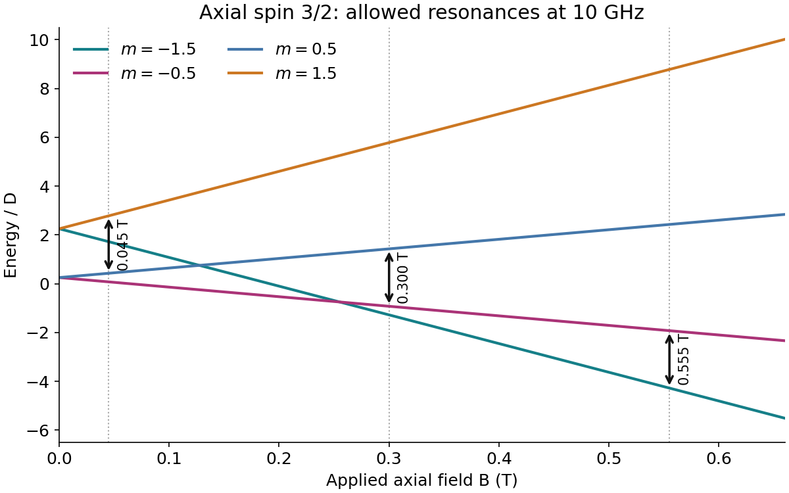

<h1 id="3/c/solution">Solution</h1>

↑ **Parent:** [C](../c.md)

Take dimensionless [spin](../../../../spin.md) operators and $H=DS_z^2+g\mu_BBS_z$, with $g>0$. The four [wavefunctions](../../../../wave-function-split.md) are $|m\rangle$, $m=-3/2,-1/2,1/2,3/2$, with

$$
\boxed{E_m=Dm^2+g\mu_BBm}.
$$

At zero field they form doublets at $D/4$ and $9D/4$. A transverse microwave [magnetic field](../../../../magnetic-field-split.md) drives $\Delta m=\pm1$ transitions. When $h\nu>2D$, their positive resonance fields in ascending order are

$$
B_1=\frac{h\nu-2D}{g\mu_B},\quad B_2=\frac{h\nu}{g\mu_B},\quad B_3=\frac{h\nu+2D}{g\mu_B}.
$$

They connect $(1/2,3/2)$, $(-1/2,1/2)$, and $(-3/2,-1/2)$, respectively. Thus

$$
\boxed{g=2.382,\quad D=0.425h\nu=2.82\times10^{-24}\ \mathrm J=0.0176\ \mathrm{meV},\quad B_3=0.555\ \mathrm T}.
$$

Here $D/h=4.25\ \mathrm{GHz}$ and the zero-field doublet gap is $2D$.

At lower frequency it is essential to use absolute energy gaps, not discard a transition after its levels cross. For $0<h\nu'<2D$, the distinct candidate positive fields are

$$
\frac{h\nu'}{g\mu_B},\quad \frac{2D-h\nu'}{g\mu_B},\quad \frac{2D+h\nu'}{g\mu_B}.
$$

The first two coincide when

$$
\boxed{\nu'=D/h=4.25\ \mathrm{GHz}}.
$$

This [axial spin-three-halves resonance coincidence](../../../../axial-spin-three-halves-resonance-coincidence.md) leaves two distinct resonance positions, at $0.1275$ and $0.3825\ \mathrm T$, with two transitions superposed at the lower position. At $\nu'=2D/h$ there are also only two _strictly positive-field_ lines, but an additional zero-field resonance remains; this is a different counting convention. Observable intensities also require thermal occupation of the relevant lower levels.

**[Figure 1](#3/c/image-axial-spin-three-halves-levels-and-the-three-high-frequency-resonance-fields). Axial spin-three-halves levels and the three high-frequency resonance fields**.

## ↑ Ancestors (12)

1. [C](../c.md)
2. [3](../../3.md)
3. [2016](../../../2016-split.md)
4. [Past exam of the condensed matter physics major option course of the University of Oxford](../../../split.md)
5. [Condensed matter physics major option course of the University of Oxford](../../../../condensed-matter-physics-major-option-course-of-the-university-of-oxford.md)
6. [Year 4 of the physics course of the University of Oxford](../../../../year-4-of-the-physics-course-of-the-university-of-oxford.md)
7. [Physics course of the University of Oxford](../../../../physics-course-of-the-university-of-oxford.md)
8. [Undergraduate course of the University of Oxford](../../../../undergraduate-course-of-the-university-of-oxford.md)
9. [Course of the University of Oxford](../../../../course-of-the-university-of-oxford.md)
10. [University of Oxford](../../../../university-of-oxford-split.md)
11. [List of universities](../../../../list-of-universities.md)
12. [Codex Wiki](../../../../split.md)
