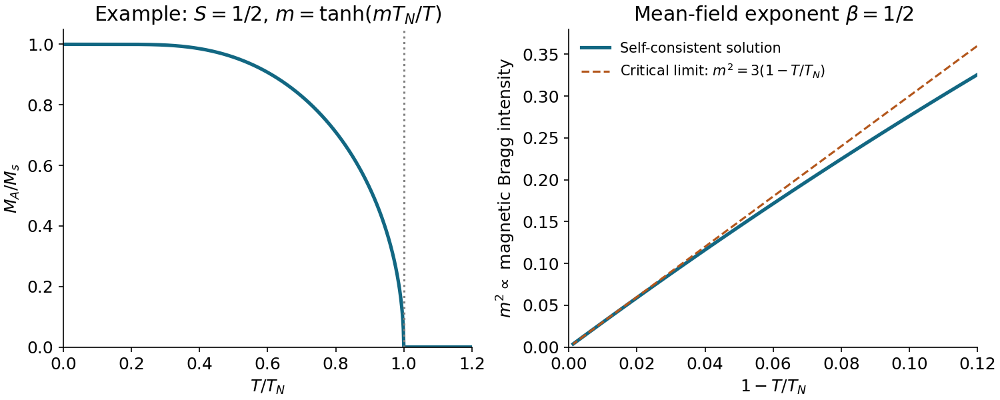

<h1 id="4/solution">Solution</h1>

↑ **Parent:** [4](../4.md)

For [competing exchanges on a body-centred cubic antiferromagnet](../../../competing-exchanges-on-a-body-centred-cubic-antiferromagnet.md), use the [Heisenberg model](../../../heisenberg-model.md) convention $H=\sum_{\langle ij\rangle}J_{ij}\mathbf S_i\cdot\mathbf S_j$, with each bond counted once, dimensionless [spins](../../../spin.md), and positive [antiferromagnetic](../../../antiferromagnetism.md) $J$. There are eight nearest and six next-nearest neighbours. Bond counting in the two classical collinear structures gives

$$
\frac{E_{\rm I}}N=S^2(-4J_1+3J_2),\qquad \frac{E_{\rm II}}N=-3J_2S^2.
$$

For type II the eight $J_1$ contributions cancel, while all six $J_2$ bonds are antiparallel. Their crossing yields $c=2/3$. One can also exclude a lower spiral within the classical bilinear model: writing $u_i=\cos(q_i a/2)$ gives

$$
J(\mathbf q)=8J_1u_xu_yu_z+4J_2(u_x^2+u_y^2+u_z^2)-6J_2.
$$

For a favourable sign of the product, $u_x^2+u_y^2+u_z^2\ge3|u_xu_yu_z|^{2/3}\ge3|u_xu_yu_z|$. Hence when $J_2\ge2J_1/3$ its minimum is at $u_x=u_y=u_z=0$, the type-II ordering vectors. When $J_2\le2J_1/3$, compare with the type-I value and use $3-\sum u_i^2\le3(1-|u_xu_yu_z|)$ to obtain the complementary bound. Thus

$$
\boxed{J_2/J_1>2/3\ \Longrightarrow\ \text{classical type-II order}}.
$$

This is a classical/mean-field energy comparison; an exact quantum [ground state](../../../ground-state.md) is not generally a collinear product state.

For type I a magnetic cell is the simple cube of side $a$, with opposite moments at $\mathbf0$ and $a(1,1,1)/2$. Its [magnetic structure factor](../../../magnetic-structure-factor.md) is proportional to $1-e^{i\pi(h+k+l)}$. Allowed magnetic reflections have integer $h,k,l$ with $h+k+l$ odd. The first two families are $(100)$ and $(111)$, with symmetry-equivalent members understood.

For type II choose magnetic primitive translations $a(1,1,0)$, $a(1,0,1)$ and $a(0,1,1)$, enclosing four [spins](../../../spin.md) in volume $2a^3$. Equivalently, a side-$2a$ cube is a convenient nonprimitive magnetic cell. On each original simple-cubic sublattice the moment at $a\mathbf n$ is proportional to $(-1)^{n_x+n_y+n_z}$. Accordingly,

$$
(h,k,l)=(p+1/2,q+1/2,r+1/2),\qquad p,q,r\in\mathbb Z.
$$

The translated body-centre basis gives $1+e^{i\pi(h+k+l)}=1\pm i$, so there is no further extinction. The first two families are $(1/2,1/2,1/2)$ and $(3/2,1/2,1/2)$. The neutron polarization factor may additionally suppress a reflection for a particular moment direction; the stated rules are the positional selection rules.

Each sublattice has number density $n_A=1/a^3$ and [saturation magnetization](../../../saturation-magnetization.md) $M_s=g\mu_BS/a^3$. Replacing neighbouring [spins](../../../spin.md) by their averages makes their exchange energy equivalent to a molecular [magnetic field](../../../magnetic-field-split.md). Its minus sign expresses [antiferromagnetic](../../../antiferromagnetism.md) exchange, not an externally applied field. Since $\langle S_B\rangle=M_B/(n_Ag\mu_B)$,

$$
\boxed{\lambda_{AB}=\frac{8J_1a^3}{g^2\mu_B^2},\quad \lambda_{AA}=\frac{6J_2a^3}{g^2\mu_B^2}}.
$$

For $M_B=-M_A$, $B_{\rm mf}=(\lambda_{AB}-\lambda_{AA})M_A$. Linearizing the [Brillouin magnetization formula](../../../brillouin-magnetization-formula.md) gives

$$
\boxed{k_BT_N=\frac{S(S+1)}3(8J_1-6J_2)}.
$$

The [g-factor](../../../g-factor-physics.md) cancels because exchange is specified in energy units. A convention with $2J\mathbf S_i\cdot\mathbf S_j$ doubles these exchange energies and $T_N$.

Let $m=M_A/M_s$, $A=(S+1)/(3S)$ and let $b_B>0$ denote the cubic coefficient of the [Brillouin magnetization formula](../../../brillouin-magnetization-formula.md). The argument is $y=(T_N/T)m/A$. Thus $m=A y-b_B y^3$ implies

$$
m^2=\frac{A^3}{b_B}\left(\frac T{T_N}\right)^3\left(\frac{T_N}T-1\right)\sim\frac{A^3}{b_B}\frac{T_N-T}{T_N}.
$$

Consequently $\boxed{\beta=1/2}$ in [mean-field theory](../../../mean-field-theory.md). The positive branch falls from saturation at zero [temperature](../../../temperature-split.md) to zero at $T_N$ and remains zero above it. An elastic magnetic neutron-reflection intensity scales as $I\propto M_A^2$; a log–log fit against $T_N-T$ has slope $2\beta$. Background subtraction and a suitable critical interval are needed. Fluctuations can change the measured exponent from its mean-field value; uniform bulk [magnetization](../../../magnetization.md) vanishes for a compensated [antiferromagnet](../../../antiferromagnetism.md) and is not itself this [order parameter](../../../order-parameter.md).

**[Figure 2](#4/image-sublattice-magnetization-and-its-square-near-a-mean-field-antiferromagnetic-transition). Sublattice magnetization and its square near a mean-field antiferromagnetic transition**.

## ↑ Ancestors (11)

1. [4](../4.md)
2. [2016](../../2016-split.md)
3. [Past exam of the condensed matter physics major option course of the University of Oxford](../../split.md)
4. [Condensed matter physics major option course of the University of Oxford](../../../condensed-matter-physics-major-option-course-of-the-university-of-oxford.md)
5. [Year 4 of the physics course of the University of Oxford](../../../year-4-of-the-physics-course-of-the-university-of-oxford.md)
6. [Physics course of the University of Oxford](../../../physics-course-of-the-university-of-oxford.md)
7. [Undergraduate course of the University of Oxford](../../../undergraduate-course-of-the-university-of-oxford.md)
8. [Course of the University of Oxford](../../../course-of-the-university-of-oxford.md)
9. [University of Oxford](../../../university-of-oxford-split.md)
10. [List of universities](../../../list-of-universities.md)
11. [Codex Wiki](../../../split.md)
