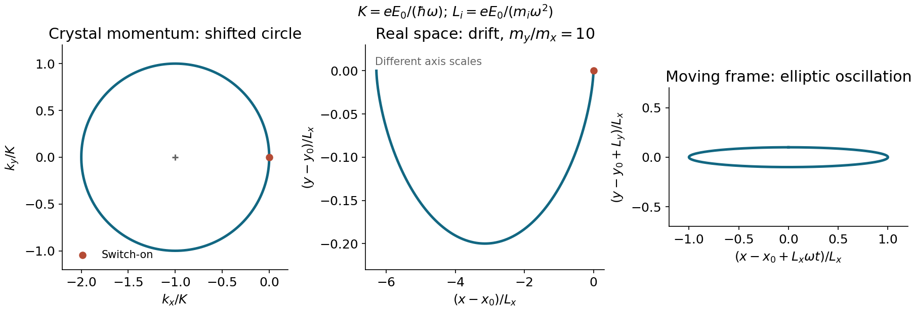

<h1 id="5/solution">Solution</h1>

↑ **Parent:** [5](../5.md)

For a periodic single-electron [Hamiltonian operator](../../../hamiltonian-quantum-mechanics.md), [Bloch's theorem](../../../bloch-s-theorem-split.md) gives

$$
\psi_{b\mathbf k}(\mathbf r)=e^{i\mathbf k\cdot\mathbf r}u_{b\mathbf k}(\mathbf r),\quad u_{b\mathbf k}(\mathbf r+\mathbf R)=u_{b\mathbf k}(\mathbf r),\quad \psi_{b\mathbf k}(\mathbf r+\mathbf R)=e^{i\mathbf k\cdot\mathbf R}\psi_{b\mathbf k}(\mathbf r).
$$

Two bands at the same $\mathbf k$ have the same translation [eigenvalues](../../../eigenvalue.md) but different cell-periodic [eigenfunctions](../../../eigenfunction.md), generally different energies and different orbital/nodal character. They may be chosen orthogonal even at a band degeneracy. The basis choices are treated in the two scoped branches below.

For a slowly varying external potential $U(\mathbf r)$, the semiclassical wavepacket [Hamiltonian](../../../hamiltonian.md) is $\epsilon_b(\mathbf k)+U(\mathbf r)$. Hamilton's equation for the conjugate variables $\mathbf r,\hbar\mathbf k$ gives $\hbar\dot{\mathbf k}=-\nabla U=\mathbf F$. Equivalently the electric perturbation changes the translation phase at the rate $q\mathbf E\cdot\mathbf R/\hbar$. This is the single-band acceleration theorem, requiring a slowly varying field and negligible interband tunnelling/scattering; it refers to [crystal momentum](../../../crystal-momentum.md), not free-space mechanical momentum.

Let $e>0$ and $K=eE_0/(\hbar\omega)$. Integrating from the specified initial condition $\mathbf k(0)=0$ gives, with the first field alone,

$$
\boxed{k_x=K(\cos\omega t-1),\qquad k_y=0}.
$$

With both components switched on,

$$
\boxed{k_x=K(\cos\omega t-1),\qquad k_y=-K\sin\omega t}.
$$

This is a [circle](../../../circle.md) centred at $(-K,0)$, not at the band minimum. Since $v_i=\hbar k_i/m_i^*$, integration gives

$$
\boxed{x-x_0=\frac{eE_0}{m_x^*\omega^2}(\sin\omega t-\omega t),\quad y-y_0=\frac{eE_0}{m_y^*\omega^2}(\cos\omega t-1)}.
$$

The [switch-on drift in a circularly driven parabolic band](../../../switch-on-drift-in-a-circularly-driven-parabolic-band.md) accompanies unequal transverse scales: it is a stretched cycloid. In a frame moving with that drift, the oscillation is an [ellipse](../../../ellipse.md) with semiaxis ratio $m_y^*/m_x^*\gg1$. A closed real-space [ellipse](../../../ellipse.md) would require different initial momentum. Indeed, after one period $x-x_0=-2\pi eE_0/(m_x^*\omega^2)\ne0$, an explicit check against that interpretation.

Writing $\theta=\omega t$, the kinetic energy above the band minimum is

$$
\epsilon-\epsilon_\Gamma=\frac{e^2E_0^2}{2\omega^2}\left[\frac{(1-\cos\theta)^2}{m_x^*}+\frac{\sin^2\theta}{m_y^*}\right].
$$

For $m_x^*<m_y^*$ it is largest at $\theta=\pi$, with value $2e^2E_0^2/(m_x^*\omega^2)$. Equating this to the optical-phonon energy gives the emission threshold estimate

$$
\boxed{E_{0,\max}\simeq\frac\omega e\sqrt{\frac{m_x^*\hbar\omega_{\rm LO}}2}=5.80\times10^5\ \mathrm{V\,m^{-1}}}.
$$

This treats the optical branch as approximately dispersionless and assumes a momentum-allowed final state, a cold initial [electron](../../../electron.md), and negligible [phonon](../../../phonon.md) absorption. It is the amplitude of each Cartesian field component; the circular field has constant magnitude $E_0$. A steady periodic orbit centred at $\mathbf k=0$ would instead give twice this amplitude, but fails the stated switch-on condition.

**[Figure 3](#5/image-shifted-circular-crystal-momentum-orbit-and-drifting-anisotropic-real-space-path). Shifted circular crystal-momentum orbit and drifting anisotropic real-space path**.

## ↑ Ancestors (11)

1. [5](../5.md)
2. [2016](../../2016-split.md)
3. [Past exam of the condensed matter physics major option course of the University of Oxford](../../split.md)
4. [Condensed matter physics major option course of the University of Oxford](../../../condensed-matter-physics-major-option-course-of-the-university-of-oxford.md)
5. [Year 4 of the physics course of the University of Oxford](../../../year-4-of-the-physics-course-of-the-university-of-oxford.md)
6. [Physics course of the University of Oxford](../../../physics-course-of-the-university-of-oxford.md)
7. [Undergraduate course of the University of Oxford](../../../undergraduate-course-of-the-university-of-oxford.md)
8. [Course of the University of Oxford](../../../course-of-the-university-of-oxford.md)
9. [University of Oxford](../../../university-of-oxford-split.md)
10. [List of universities](../../../list-of-universities.md)
11. [Codex Wiki](../../../split.md)
