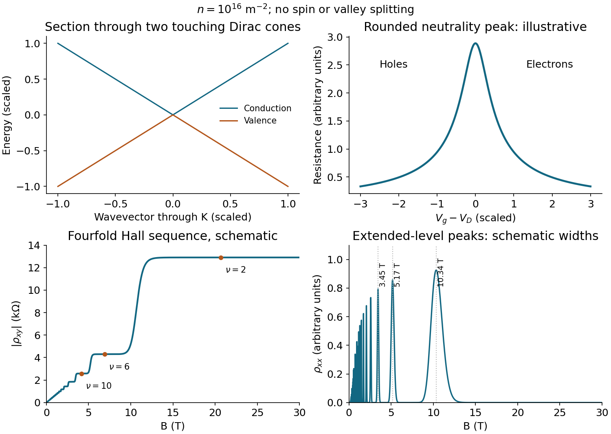

<h1 id="6/solution">Solution</h1>

↑ **Parent:** [6](../6.md)

The conduction and valence dispersions are two cones touching at the Dirac point, with slopes $\pm\hbar v_F$. Here $\mathbf k$ is measured relative to one valley centre. Each cone has a [density of states](../../../density-of-states.md) proportional to $|E|$, which vanishes at the touching energy. Gate-induced carriers satisfy approximately $n=C_g(V_g-V_D)/e$ per unit area. Negative and positive offsets from $V_D$ produce [holes](../../../electron-hole.md) and [electrons](../../../electron.md), respectively. Away from neutrality a simple [charge carrier mobility](../../../charge-carrier-mobility.md) model gives $\sigma\simeq e\mu|n|$, so resistance decreases on either side of a maximum near $V_D$. Disorder, [electron](../../../electron.md)–[hole](../../../electron-hole.md) puddles, contacts and quantum transport round the peak; the cone dispersion alone fixes neither its height nor its width, nor does it require exact [electron](../../../electron.md)–[hole](../../../electron-hole.md) [symmetry](../../../symmetry-physics.md) in a real device.

A direct derivation of the magnetic spectrum starts from the single-valley Dirac [Hamiltonian operator](../../../hamiltonian-quantum-mechanics.md) $H=v_F(\sigma_x\pi_x+\sigma_y\pi_y)$. Introduce oscillator operators using the [magnetic length](../../../magnetic-length.md) $\ell_B=\sqrt{\hbar/(e|B|)}$. Up to exchanging sublattices or valleys,

$$
H=\frac{\sqrt2\hbar v_F}{\ell_B}\begin{pmatrix}0&a\\a^\dagger&0\end{pmatrix},\quad [a,a^\dagger]=1.
$$

Squaring gives adjacent oscillator number operators, hence

$$
\boxed{E_j=\operatorname{sgn}(j)v_F\sqrt{2e\hbar|B|\,|j|},\quad j\in\mathbb Z,\quad E_0=0}.
$$

The positive expression printed in the source describes the [electron](../../../electron.md) branch only; the negative-energy partners must also be included. The same square-root dependence follows from quantizing circular orbit area, with the Dirac [Berry phase](../../../berry-phase.md) cancelling the usual half-integer offset.

Each [spin](../../../spin.md) and valley contributes $Ae|B|/h$ states in area $A$. Including two [spins](../../../spin.md) and two valleys gives $N_{\rm LL}=4Ae|B|/h$, or areal degeneracy $4e|B|/h$. The zero-energy level is half-filled at charge neutrality: the carrier density counts departures from that state.

For $n=10^{16}\ \mathrm{m^{-2}}$, the [filling factor](../../../filling-factor-quantum-hall-effect.md) and [fourfold graphene Hall sequence](../../../fourfold-graphene-hall-sequence.md) are

$$
\nu=\frac{nh}{eB}=\frac{41.3567\ \mathrm T}{B},\qquad \nu_N=4(N+1/2)=2,6,10,14,\ldots .
$$

In a plateau, $\rho_{xx}\simeq0$ and $|\rho_{xy}|=h/(\nu_Ne^2)$. The Hall sign reverses between [electron](../../../electron.md) and [hole](../../../electron-hole.md) doping; the sketch uses its magnitude to avoid tensor-index sign conventions. Representative plateau-centre fields are $20.68$, $6.893$, $4.136$ and $2.954\ \mathrm T$ for $\nu=2,6,10,14$. Between plateaux, crossing extended states in broadened levels gives longitudinal peaks and Hall steps. Their ideal filling-centre positions have $\nu=4j$, namely

$$
\boxed{B_j=\frac{10.3392\ \mathrm T}{j},\qquad j=1,2,3,\ldots .}
$$

Thus peaks near $10.34$, $5.17$ and $3.45\ \mathrm T$ separate the first prominent plateaux as field increases. Many weak oscillations accumulate toward zero field and are damped there. Finite-width plateaux require localized states between extended-state energies; an exactly clean Landau spectrum does not by itself prescribe plateau widths. The illustration uses an explicitly schematic broadening, not inferred experimental widths.

At $6.5\ \mathrm T$, $\nu=6.36$, close to the $\nu=6$ plateau. With $v_F=10^6\ \mathrm{m\,s^{-1}}$, $E_1=92.5\ \mathrm{meV}$ and $E_2=130.8\ \mathrm{meV}$. The relevant adjacent gap near the [chemical potential](../../../chemical-potential-split.md) is therefore $\Delta=E_2-E_1\simeq38.3\ \mathrm{meV}$, rather than the gap from the zero level. Resolving levels requires quantum-lifetime broadening $\hbar/\tau_q\lesssim\Delta$ and thermal broadening appreciably smaller than $\Delta$, giving the order-of-magnitude limits

$$
\boxed{\tau_q\gtrsim1.7\times10^{-14}\ \mathrm s,\qquad T\lesssim\Delta/k_B\simeq4.4\times10^2\ \mathrm K}.
$$

The upper [temperature](../../../temperature-split.md) is an energy-scale estimate, not a guaranteed sharp-feature [temperature](../../../temperature-split.md). For oscillation amplitudes the thermal damping factor is $X/\sinh X$, $X=2\pi^2 k_BT/(\hbar\omega_c^*)$, with $\hbar\omega_c^*=\hbar eBv_F^2/E_F\simeq36.7\ \mathrm{meV}$ and $E_F=\hbar v_F\sqrt{\pi n}$. Requiring $X\lesssim1$ gives the more conservative scale $T\lesssim22\ \mathrm K$ for little thermal damping. Visible weaker features may persist above that scale; their actual cutoff depends on resolution, disorder and temperature-dependent scattering. The transport lifetime and [quantum lifetime](../../../quantum-lifetime.md) also need not coincide.

**[Figure 4](#6/image-dirac-dispersion-a-rounded-neutrality-resistance-peak-and-schematic-graphene-magnetoresistivity). Dirac dispersion, a rounded neutrality resistance peak, and schematic graphene magnetoresistivity**.

## ↑ Ancestors (11)

1. [6](../6.md)
2. [2016](../../2016-split.md)
3. [Past exam of the condensed matter physics major option course of the University of Oxford](../../split.md)
4. [Condensed matter physics major option course of the University of Oxford](../../../condensed-matter-physics-major-option-course-of-the-university-of-oxford.md)
5. [Year 4 of the physics course of the University of Oxford](../../../year-4-of-the-physics-course-of-the-university-of-oxford.md)
6. [Physics course of the University of Oxford](../../../physics-course-of-the-university-of-oxford.md)
7. [Undergraduate course of the University of Oxford](../../../undergraduate-course-of-the-university-of-oxford.md)
8. [Course of the University of Oxford](../../../course-of-the-university-of-oxford.md)
9. [University of Oxford](../../../university-of-oxford-split.md)
10. [List of universities](../../../list-of-universities.md)
11. [Codex Wiki](../../../split.md)
