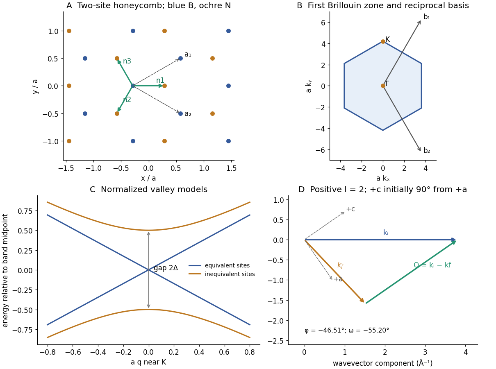
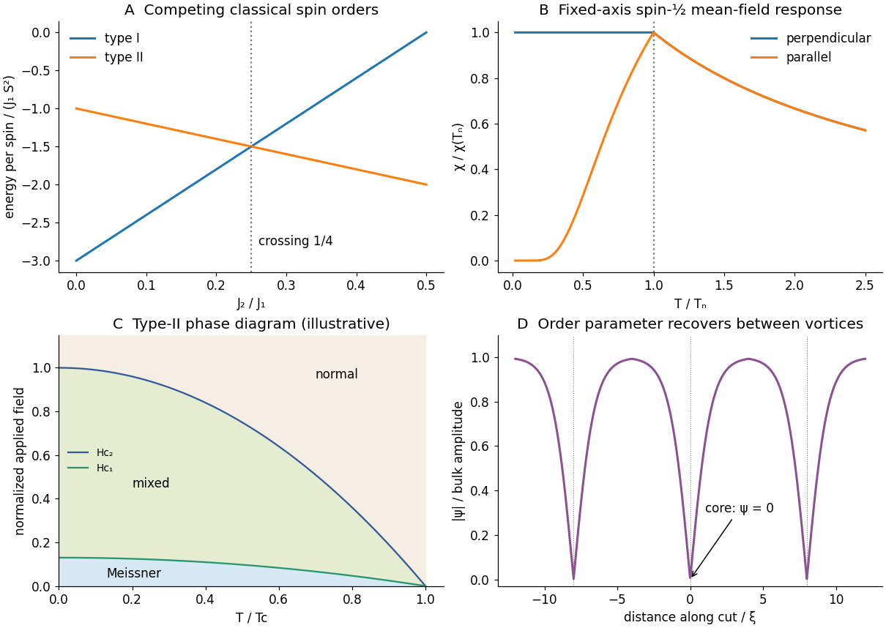
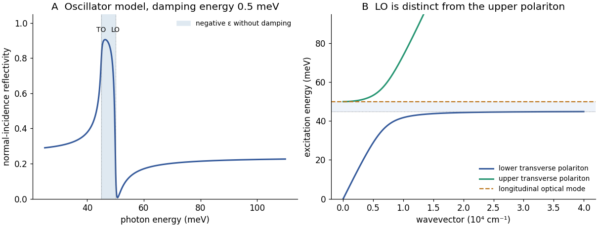
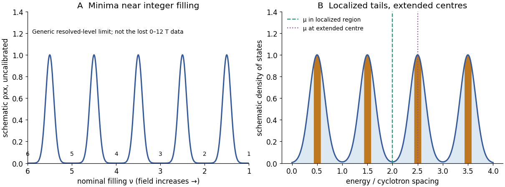

# 2018

↑ **Parent:** [Past exam of the condensed matter physics major option course of the University of Oxford](../past-exam-of-the-condensed-matter-physics-major-option-course-of-the-university-of-oxford.md)

Source paper: [https://www.whatdotheyknow.com/request/oxford_physics_past_papers_2/response/2340696/attach/6/Physics%20Papers%202017.pdf?cookie_passthrough=1#page=36](https://www.whatdotheyknow.com/request/oxford_physics_past_papers_2/response/2340696/attach/6/Physics%20Papers%202017.pdf?cookie_passthrough=1#page=36)

The original cover identifies 15 June 2018 despite the bundle filename. All six questions are treated. The missing Hall-voltage graph prevents the numerical [calibration](../differential-geometry.md#calibration-differential-geometry) and field-specific assignments in Question 6; affected solutions contain explicit TODOs. Readings of the surviving graphs are approximate.

**Table of contents**

- [1](#1)
  - [a](#1/a)
    - [Solution](#1/a/solution)
  - [b](#1/b)
    - [i](#1/b/i)
      - [Solution](#1/b/i/solution)
    - [ii](#1/b/ii)
      - [Solution](#1/b/ii/solution)
    - [iii](#1/b/iii)
      - [Solution](#1/b/iii/solution)
  - [c](#1/c)
    - [i](#1/c/i)
      - [Solution](#1/c/i/solution)
    - [ii](#1/c/ii)
      - [Solution](#1/c/ii/solution)
- [2](#2)
  - [a](#2/a)
    - [Solution](#2/a/solution)
  - [b](#2/b)
    - [Solution](#2/b/solution)
  - [c](#2/c)
    - [Solution](#2/c/solution)
  - [d](#2/d)
    - [Solution](#2/d/solution)
- [3](#3)
  - [a](#3/a)
    - [Solution](#3/a/solution)
  - [b](#3/b)
    - [Solution](#3/b/solution)
  - [c](#3/c)
    - [Solution](#3/c/solution)
  - [d](#3/d)
    - [Solution](#3/d/solution)
- [4](#4)
  - [a](#4/a)
    - [Solution](#4/a/solution)
  - [b](#4/b)
    - [Solution](#4/b/solution)
  - [c](#4/c)
    - [Solution](#4/c/solution)
  - [d](#4/d)
    - [Solution](#4/d/solution)
- [5](#5)
  - [a](#5/a)
    - [Solution](#5/a/solution)
  - [b](#5/b)
    - [Solution](#5/b/solution)
  - [c](#5/c)
    - [Solution](#5/c/solution)
  - [d](#5/d)
    - [Solution](#5/d/solution)
- [6](#6)
  - [a](#6/a)
    - [Solution](#6/a/solution)
  - [b](#6/b)
    - [Solution](#6/b/solution)
  - [c](#6/c)
    - [Solution](#6/c/solution)
    - [i](#6/c/i)
      - [Solution](#6/c/i/solution)
    - [ii](#6/c/ii)
      - [Solution](#6/c/ii/solution)
  - [d](#6/d)
    - [Solution](#6/d/solution)

## 1

↑ **Parent:** [2018](2018.md)

<h3 id="1/a">a</h3>

↑ **Parent:** [1](#1)

<h4 id="1/a/solution">Solution</h4>

↑ **Parent:** [A](#1/a)

A [phonon](../quantum-ideal-gas-statistics.md#phonon) is one quantum of a [normal vibrational mode](../wave-equation.md#normal-mode) of a [crystal](../thermodynamics.md#crystal). In the [harmonic approximation](../lagrangian-mechanics.md#harmonic-approximation), each mode with [wavevector](../elasticity-physics.md#wavevector) $\mathbf q$, branch index $s$ and [angular frequency](../lagrangian-mechanics.md#angular-frequency) $\omega_s(\mathbf q)$ is an [oscillator](../wave.md#oscillator) with energies $\hbar\omega_s(n+1/2)$. A [phonon](../quantum-ideal-gas-statistics.md#phonon) changes the occupation $n$ by one; it is not a particular atom moving through the solid.

For a three-dimensional [primitive cell](../quantum-scattering.md#primitive-unit-cell) containing $r$ atoms there are $3r$ branches. Three [acoustic branches](../quantum-ideal-gas-statistics.md#acoustic-phonon-branch) approach zero frequency as $\mathbf q\to0$: at zero [wavevector](../elasticity-physics.md#wavevector) they represent rigid translations, with all [basis](../physical-chemistry.md#crystal-motif) atoms displaced together. Their small-[wavevector](../elasticity-physics.md#wavevector) frequencies usually grow linearly with [wavevector](../elasticity-physics.md#wavevector). The remaining $3r-3$ [optical branches](../quantum-ideal-gas-statistics.md#optical-phonon-branch) have internal relative motion of [basis](../physical-chemistry.md#crystal-motif) atoms and generally nonzero zone-centre frequencies. The names reflect their coupling to radiation in suitable polar [crystals](../thermodynamics.md#crystal), not a rule that every optical mode must be infrared active. Acoustic and [optical branches](../quantum-ideal-gas-statistics.md#optical-phonon-branch) can each have longitudinal or transverse polarizations.

<h3 id="1/b">b</h3>

↑ **Parent:** [1](#1)

<h4 id="1/b/i">i</h4>

↑ **Parent:** [B](#1/b)

<h5 id="1/b/i/solution">Solution</h5>

↑ **Parent:** [I](#1/b/i)

Each atom supplies three displacement coordinates. Translational invariance gives three [acoustic branches](../quantum-ideal-gas-statistics.md#acoustic-phonon-branch) for either structure, leaving

$$
\boxed{\begin{array}{c|cc}
 &\text{acoustic}&\text{optical}\\
\text{tetragonal, }r=4&3&9\\
\text{orthorhombic, }r=8&3&21
\end{array}}
$$

These count branches at a general [wavevector](../elasticity-physics.md#wavevector); a doubly degenerate pair still counts as two modes. The stated atom counts refer to primitive cells, so no additional centring factor is needed.

<h4 id="1/b/ii">ii</h4>

↑ **Parent:** [B](#1/b)

<h5 id="1/b/ii/solution">Solution</h5>

↑ **Parent:** [Ii](#1/b/ii)

To obtain a [crystal](../thermodynamics.md#crystal)'s [point group](../euclidean-geometry.md#point-group), discard the translation parts of its space-group operations. A screw becomes a [rotation](../riemannian-geometry.md#rotation-mathematics) and a glide becomes a mirror. Thus the tetragonal group's $4/n$, $2_1/m$ and $2/m$ operations give

$$
\boxed{4/mmm\equiv D_{4h}.}
$$

For the orthorhombic structure the three perpendicular twofold/glide or screw/mirror directions give

$$
\boxed{mmm\equiv D_{2h}.}
$$

The primitive [Bravais lattice](../quantum-scattering.md#bravais-lattice) symbol does not itself add a point operation; the fractional translations matter for the [space group](../physical-chemistry.md#space-group) but disappear from this point-group reduction.

<h4 id="1/b/iii">iii</h4>

↑ **Parent:** [B](#1/b)

<h5 id="1/b/iii/solution">Solution</h5>

↑ **Parent:** [Iii](#1/b/iii)

At the zone centre, the [dynamical matrix](../wave-equation.md#dynamical-matrix) commutes with the point-group representation on displacements. An [irreducible representation](../representation-theory.md#irreducible-representation) of [dimension](../vector-space.md#dimension-vector-space) two enforces a doublet; distinct one-dimensional representations need not have equal frequencies. The tetragonal [point group](../euclidean-geometry.md#point-group) $D_{4h}$ has two-dimensional $E_g$ and $E_u$ representations, so [optical modes](../quantum-ideal-gas-statistics.md#optical-phonon) transforming that way are doubly degenerate at the centre. Atomic positions and the displacement representation would be needed to assign every [optical branch](../quantum-ideal-gas-statistics.md#optical-phonon-branch) to a particular representation; the point-group label alone is not a complete mode decomposition.

For propagation along the tetragonal fourfold axis, the two transverse acoustic polarizations transform together and have equal [sound speeds](../compressible-flow.md#speed-of-sound) and frequencies. For example $\omega_{{\rm TA},x}=\omega_{{\rm TA},y}\simeq v_T|q_z|$, whereas the longitudinal speed is independent. An optical doublet may split away from the centre along a direction whose [little group](../special-relativity.md#little-group) has only one-dimensional representations. It need not remain degenerate at every nearby [wavevector](../elasticity-physics.md#wavevector).

All [irreducible representations](../representation-theory.md#irreducible-representation) of $D_{2h}$ are one-dimensional, so the orthorhombic [point group](../euclidean-geometry.md#point-group) enforces no analogous optical doublet or equality of transverse [sound speeds](../compressible-flow.md#speed-of-sound). The three acoustic frequencies are nevertheless all zero at the exact centre in both [crystals](../thermodynamics.md#crystal), because of translations; that common zero is not evidence that their slopes are equal. Accidental equalities remain possible. For a polar [crystal](../thermodynamics.md#crystal), a direction-dependent macroscopic [electric field](../electric-field.md) also distinguishes longitudinal from transverse infrared-active limits; an analytic zone-centre [symmetry](../physics.md#symmetry-physics) classification alone does not remove LO–TO splitting.

<h3 id="1/c">c</h3>

↑ **Parent:** [1](#1)

<h4 id="1/c/i">i</h4>

↑ **Parent:** [C](#1/c)

<h5 id="1/c/i/solution">Solution</h5>

↑ **Parent:** [I](#1/c/i)

For [neutron](../neutron.md) [energy](../energy.md) loss, $E_f=30-20=10\,\mathrm{meV}$. Write $\mathbf Q=\mathbf k_i-\mathbf k_f$. The [neutron](../neutron.md) dispersion $E=\hbar^2k^2/(2m_n)$, or $E[\mathrm{meV}]=2.0721\,k[\mathrm{\mathring A^{-1}}]^2$, gives

$$
k_i=3.805\,\mathrm{\mathring A^{-1}},\qquad k_f=2.197\,\mathrm{\mathring A^{-1}}.
$$

A triangle of these [wavevectors](../elasticity-physics.md#wavevector) exists if

$$
|k_i-k_f|\le Q\le k_i+k_f,
\qquad1.608\le Q\le6.002\,\mathrm{\mathring A^{-1}}.
$$

With $c=4.50\,\mathrm{\mathring A}$, the requested [momentum](../momentum.md) transfers have $Q=(2\pi/c)|l|=1.3963|l|\,\mathrm{\mathring A^{-1}}$. Consequently

$$
\boxed{l=\pm2,\ \pm3,\ \pm4\quad\text{are kinematically accessible}.}
$$

For example $|l|=1$ is too small even for forward scattering at these unequal [neutron](../neutron.md) energies, and $|l|=5$ exceeds the backscattering maximum. This identifies accessible [reciprocal lattice](../quantum-scattering.md#reciprocal-lattice) points, not guaranteed nonzero intensity: a one-[phonon](../quantum-ideal-gas-statistics.md#phonon) [structure factor](../quantum-scattering.md#structure-factor) contains the atomic scattering lengths, [eigenvectors](../linear-operator-theory.md#eigenvector) and factors $\mathbf Q\cdot\mathbf e_j$. A transverse [eigenvector](../linear-operator-theory.md#eigenvector) perpendicular to $\mathbf Q$ may be invisible, and [basis](../physical-chemistry.md#crystal-motif) interference can cause extinctions. The supplied geometry and cell constants do not specify that full intensity selection rule.

<h4 id="1/c/ii">ii</h4>

↑ **Parent:** [C](#1/c)

<h5 id="1/c/ii/solution">Solution</h5>

↑ **Parent:** [Ii](#1/c/ii)

For $l=2$, $Q=2.7925\,\mathrm{\mathring A^{-1}}$. The scattering triangle gives

$$
\cos\phi=\frac{k_i^2+k_f^2-Q^2}{2k_ik_f},\qquad\boxed{|\phi|=46.51^\circ.}
$$

To state signed sample angles without an implicit axis convention, take the incident beam along $+x$, positive angular [rotation](../riemannian-geometry.md#rotation-mathematics) counterclockwise, and at $\omega=0$ choose $+a$ along $+x$ and $+c$ along $+y$. Then

$$
\mathbf k_i=k_i(1,0),\quad\mathbf k_f=k_f(\cos\phi,\sin\phi),\quad
\hat{\mathbf c}=(-\sin\omega,\cos\omega).
$$

The positive-$l$ condition is the vector equation $\mathbf k_i-\mathbf k_f=Q\hat{\mathbf c}$. Put

$$
\beta=\tan^{-1}\frac{k_f\sin|\phi|}{k_i-k_f\cos\phi}=34.80^\circ.
$$

The two detector sides then give, modulo full [rotations](../riemannian-geometry.md#rotation-mathematics),

$$
\boxed{(\omega,\phi)=(-55.20^\circ,-46.51^\circ)
\quad\text{or}\quad(-124.80^\circ,+46.51^\circ).}
$$

These pairs obey the stated same-sense sign convention and transfer [momentum](../momentum.md) along $+c$. The lower-right panel below illustrates the first choice. If the initial $+c$ direction is chosen on the opposite side of $+a$, a commonly used positive-angle pair is $(55.20^\circ,46.51^\circ)$. Merely taking absolute values without fixing that [crystal](../thermodynamics.md#crystal)-axis convention can exchange $l=+2$ and $l=-2$. The measurable scattering angle and the vector-triangle construction are invariant.

**[Figure 1](#1/c/ii/image-honeycomb-geometry-reciprocal-space-hexagon-sublattice-band-gap-and-a-signed-neutron-scattering-triangle). Honeycomb geometry, reciprocal-space hexagon, sublattice band gap and a signed neutron-scattering triangle**. Original calculations and schematic geometry. Lattice panels use $a=1$; the band panel compares normalized two-sublattice models. The neutron panel uses the explicit signed-axis convention of Question 1(c)(ii).

## 2

↑ **Parent:** [2018](2018.md)

<h3 id="2/a">a</h3>

↑ **Parent:** [2](#2)

<h4 id="2/a/solution">Solution</h4>

↑ **Parent:** [A](#2/a)

The vectors from the B atom to its three nearest N neighbours can be chosen as

$$
\boxed{\mathbf n_1=\left(\frac a{\sqrt3},0\right),\quad
\mathbf n_2=\left(-\frac a{2\sqrt3},-\frac a2\right),\quad
\mathbf n_3=\left(-\frac a{2\sqrt3},\frac a2\right).}
$$

Indeed $\mathbf n_1=\mathbf d_N-\mathbf d_B$, $\mathbf n_2=\mathbf n_1-\mathbf a_1$ and $\mathbf n_3=\mathbf n_1-\mathbf a_2$. All three have length $a/\sqrt3$. Repeating the two-site [basis](../physical-chemistry.md#crystal-motif) over $\mathbf R=m\mathbf a_1+n\mathbf a_2$ produces the honeycomb pattern in the first panel of the original figure in [solution](#1/c/ii/solution).

Solving $\mathbf a_i\cdot\mathbf b_j=2\pi\delta_{ij}$ gives

$$
\boxed{\mathbf b_1=\left(\frac{2\pi}{\sqrt3a},\frac{2\pi}a\right),\quad
\mathbf b_2=\left(\frac{2\pi}{\sqrt3a},-\frac{2\pi}a\right).}
$$

The [first Brillouin zone](../bloch-s-theorem.md#first-brillouin-zone) is the Wigner–Seitz hexagon of this [reciprocal lattice](../quantum-scattering.md#reciprocal-lattice). Its vertices are $(0,\pm4\pi/(3a))$ and $(\pm2\pi/(\sqrt3a),\pm2\pi/(3a))$, with independent signs in the latter set. The centre is $\Gamma=(0,0)$; one inequivalent corner is $K=(0,4\pi/(3a))$, with $K'=-K$. Corners related by a [reciprocal lattice](../quantum-scattering.md#reciprocal-lattice) translation are equivalent, leaving two inequivalent valleys.

<h3 id="2/b">b</h3>

↑ **Parent:** [2](#2)

<h4 id="2/b/solution">Solution</h4>

↑ **Parent:** [B](#2/b)

A [linear combination of atomic orbitals](../chemistry.md#linear-combination-of-atomic-orbitals) expands a [crystal](../thermodynamics.md#crystal) wavefunction in localized orbitals on all sites,

$$
\Psi_{\mathbf k}(\mathbf r)=\sum_{\mathbf R,\alpha,\eta}c_{\alpha\eta}(\mathbf k)
 e^{i\mathbf k\cdot(\mathbf R+\mathbf d_\alpha)}
 \varphi_{\alpha\eta}(\mathbf r-\mathbf R-\mathbf d_\alpha).
$$

Here $\alpha$ labels the [basis](../physical-chemistry.md#crystal-motif) site, $\eta$ the retained [atomic orbitals](../chemistry.md#atomic-orbital) and $\mathbf R=m\mathbf a_1+n\mathbf a_2$. For the two-band model retain one relevant orbital on each B or N atom, usually the out-of-plane $p_z$ orbital, and neglect other orbital manifolds. Define normalized Bloch sums for $N_c$ cells,

$$
\Phi_\alpha(\mathbf k,\mathbf r)=\frac1{\sqrt{N_c}}\sum_{m,n}
 e^{i\mathbf k\cdot(m\mathbf a_1+n\mathbf a_2+\mathbf d_\alpha)}
 \varphi_\alpha(\mathbf r-m\mathbf a_1-n\mathbf a_2-\mathbf d_\alpha),
 \quad\alpha=B,N.
$$

Then $\Psi=\alpha_B\Phi_B+\alpha_N\Phi_N$. Bloch periodicity puts the same two coefficients in every cell. We adopt the stated [orthonormality](../inner-product.md#orthonormal-set), neglect longer-range hopping, and approximate the diagonal [matrix](../vector-space.md#matrix) elements by the supplied atomic energies $\epsilon_B,\epsilon_N$. More generally the [crystal](../thermodynamics.md#crystal) environment shifts these on-site energies, so equality with isolated-atom expectation values is an additional [tight-binding approximation](../bloch-s-theorem.md#tight-binding).

For equal real nearest-neighbour transfer [integral](../integral.md) $t_{\rm nn}$, this phase convention gives

$$
\gamma(\mathbf k)=\sum_{j=1}^3e^{i\mathbf k\cdot\mathbf n_j},\qquad
H(\mathbf k)=\begin{pmatrix}\epsilon_B&t_{\rm nn}\gamma\\t_{\rm nn}\gamma^*&\epsilon_N\end{pmatrix}.
$$

The secular determinant is $(\epsilon_B-E)(\epsilon_N-E)-t_{\rm nn}^2|\gamma|^2=0$. Thus

$$
\boxed{E_\pm(\mathbf k)=\frac{\epsilon_B+\epsilon_N}{2}
\pm\sqrt{\frac{(\epsilon_B-\epsilon_N)^2}{4}+t_{\rm nn}^2|\gamma|^2}.}
$$

Since $(\epsilon_B-\epsilon_N)^2/4=(\epsilon_B+\epsilon_N)^2/4-\epsilon_B\epsilon_N$, this is the requested algebraic form. A hopping-sign convention or rephasing of the Bloch sums changes off-diagonal phases but not these [eigenvalues](../linear-operator-theory.md#eigenvalue). Explicitly,

$$
\gamma=e^{ik_xa/\sqrt3}+2e^{-ik_xa/(2\sqrt3)}\cos(k_ya/2),\quad
|\gamma|^2=1+4\cos^2(k_ya/2)+4\cos(k_ya/2)\cos(\sqrt3ak_x/2).
$$

<h3 id="2/c">c</h3>

↑ **Parent:** [2](#2)

<h4 id="2/c/solution">Solution</h4>

↑ **Parent:** [C](#2/c)

At a valley $K$, $\gamma(K)=1+2\cos(2\pi/3)=0$. For [h-BN](../chemical-substance.md#hexagonal-boron-nitride) the inequivalent sublattice energies therefore leave the direct two-[band gap](../bloch-s-theorem.md#band-gap)

$$
\boxed{E_g=|\epsilon_B-\epsilon_N|.}
$$

[Graphene](../chemical-substance.md#graphene)'s equivalent carbon sites instead have $\epsilon_B=\epsilon_N$ in this model, so the two bands touch at the valleys. Near a valley, $|\gamma(K+\mathbf q)|\simeq(\sqrt3a/2)|\mathbf q|$: [graphene](../chemical-substance.md#graphene) has approximately linear, gapless [Dirac cones](../bloch-s-theorem.md#dirac-cone) while h-BN has gapped band edges. The model panel in the original figure in [solution](#1/c/ii/solution) displays this distinction.

First, undoped h-BN is an [electrical insulator](../permittivity.md#electrical-insulator) with thermally suppressed carriers, whereas neutral [graphene](../chemical-substance.md#graphene) is a zero-gap semimetal whose transport is readily changed by gating. Disorder, [temperature](../temperature.md) and contacts still affect its measured conductivity. Second, h-BN suppresses interband absorption below its large gap and is transparent over much of the visible range, whereas [graphene](../chemical-substance.md#graphene) permits low-[energy](../energy.md) interband absorption unless occupations block it. A quantitative optical threshold in real h-BN also involves additional bands and strong excitonic effects; a two-orbital model should not be presented as a numerical prediction of its complete optical spectrum.

<h3 id="2/d">d</h3>

↑ **Parent:** [2](#2)

<h4 id="2/d/solution">Solution</h4>

↑ **Parent:** [D](#2/d)

[Angle-resolved photoemission spectroscopy](../physical-chemistry.md#angle-resolved-photoemission-spectroscopy) illuminates a surface with [photons](../quantum-mechanics.md#photon) of known [energy](../energy.md) and measures the [kinetic energy](../energy.md#kinetic-energy) and emission direction of the escaping [electrons](../physics.md#electron). Referencing the initial binding [energy](../energy.md) to the [Fermi level](../quantum-ideal-gas-statistics.md#fermi-level) gives

$$
\boxed{E_B=h\nu_{\rm light}-\Phi-E_{\rm kin},\qquad
k_\parallel=\frac{\sqrt{2m_eE_{\rm kin}}}{\hbar}\sin\theta.}
$$

Here $\Phi$ is the sample/analyser work-function reference appropriate to the calibrated [energy](../energy.md) scale, and $\theta$ is the emission angle from the surface normal. Parallel [crystal momentum](../bloch-s-theorem.md#crystal-momentum) is conserved modulo a surface [reciprocal lattice](../quantum-scattering.md#reciprocal-lattice) vector; measuring two angular coordinates maps the two in-plane [momentum](../momentum.md) components.

Sweeping angle and [energy](../energy.md) traces the occupied spectral weight and its dispersion. In a quasi-two-dimensional sheet, no detailed free-[electron](../physics.md#electron) model of the perpendicular final-state [momentum](../momentum.md) is required to map the in-plane bands. Peaks reflect the occupied single-particle [spectral function](../quantum-field-theory.md#spectral-function), multiplied by Fermi occupation and photoemission [matrix](../vector-space.md#matrix) elements and broadened by finite lifetimes and resolution. Ordinary photoemission does not directly measure empty conduction bands; a gap may need complementary information. A clean surface, vacuum and charge control are especially important for an insulating specimen.

## 3

↑ **Parent:** [2018](2018.md)

<h3 id="3/a">a</h3>

↑ **Parent:** [3](#3)

<h4 id="3/a/solution">Solution</h4>

↑ **Parent:** [A](#3/a)

Use the explicit convention $H=J_1\sum_{\langle ij\rangle}\mathbf S_i\cdot\mathbf S_j+J_2\sum_{\langle\langle ij\rangle\rangle}\mathbf S_i\cdot\mathbf S_j$, counting every bond once and taking dimensionless [spins](../angular-momentum-operator.md#spin) of length $S$. On the [simple cubic lattice](../quantum-scattering.md#primitive-cubic-lattice) there are six nearest and twelve face-diagonal next-nearest neighbours.

For type I all six nearest bonds are antiparallel and all twelve next-nearest bonds parallel, so $E_I/N=S^2(-3J_1+6J_2)$. Choose the parallel direction of type II as $z$. It has two parallel and four antiparallel nearest bonds, and four parallel $xy$ face diagonals but eight antiparallel $xz,yz$ diagonals. Thus $E_{II}/N=S^2(-J_1-2J_2)$ and

$$
\frac{E_{II}-E_I}{N}=2S^2(J_1-4J_2).
$$

Consequently, for the stated antiferromagnetic exchanges,

$$
\boxed{\text{type I: }J_2/J_1<1/4;\quad
\text{type II: }J_2/J_1>1/4;\quad\text{degenerate at }1/4.}
$$

This comparison is also consistent with the full classical spiral [energy](../energy.md). With $u_i=\cos(q_ia)$,

$$
E(\mathbf q)/(NS^2)=J_1(u_x+u_y+u_z)+2J_2(u_xu_y+u_yu_z+u_zu_x).
$$

It is affine in each $u_i\in[-1,1]$, so some minimum occurs at a cube vertex, giving the competing collinear states above. At the boundary, the coefficient of $u_z$ vanishes for $u_x=u_y=-1$, producing the larger degeneracy $(\pi/a,\pi/a,q_z)$ and permutations. It is not an isolated two-state crossing. The first panel of the model figure below shows the competing energies.

**[Figure 2](#3/a/image-competing-antiferromagnetic-energies-mean-field-susceptibilities-a-type-ii-phase-diagram-and-vortex-cores). Competing antiferromagnetic energies, mean-field susceptibilities, a type-II phase diagram and vortex cores**. Original illustrative models. Susceptibilities use spin-one-half mean-field theory, fields in the phase diagram are normalized, and the order-parameter profile is a schematic cut through separated vortex cores.

<h3 id="3/b">b</h3>

↑ **Parent:** [3](#3)

<h4 id="3/b/solution">Solution</h4>

↑ **Parent:** [B](#3/b)

For type I, a [magnetic unit cell](../thermodynamics.md#magnetic-unit-cell) uses the magnetic Bravais translations $(0,a,a)$, $(a,0,a)$ and $(a,a,0)$. They form an [FCC lattice](../quantum-scattering.md#face-centered-cubic-lattice) with conventional cubic parameter $2a$. A two-[spin](../angular-momentum-operator.md#spin) [basis](../physical-chemistry.md#crystal-motif) is an up [spin](../angular-momentum-operator.md#spin) at $(0,0,0)$ and a down [spin](../angular-momentum-operator.md#spin) at $(a,0,0)$, or fractional conventional coordinates $(0,0,0)$ and $(1/2,0,0)$. Every translation preserves the parity of $n_x+n_y+n_z$.

At $\mathbf Q=(2\pi/a)(h,k,l)$, the FCC translation sum allows $h,k,l$ all integers or all half-odd-integers. The [spin](../angular-momentum-operator.md#spin) [basis](../physical-chemistry.md#crystal-motif) contributes $S[1-e^{2\pi ih}]$, which removes the integer set and leaves

$$
\boxed{\text{type I: }(h,k,l)=(n+\tfrac12,m+\tfrac12,p+\tfrac12).}
$$

Equivalently the [spin](../angular-momentum-operator.md#spin) field is $S(-1)^{n_x+n_y+n_z}$, so [magnetic Bragg peaks](../electromagnetism.md#magnetic-bragg-peak) are nuclear reciprocal vectors shifted by $(1/2,1/2,1/2)$.

For type II with parallel [spins](../angular-momentum-operator.md#spin) along $z$, use $(a,a,0)$, $(-a,a,0)$ and $(0,0,a)$ as magnetic translations: a primitive tetragonal cell with side lengths $\sqrt2a,\sqrt2a,a$, containing an up [spin](../angular-momentum-operator.md#spin) at zero and a down [spin](../angular-momentum-operator.md#spin) at $(a,0,0)$. The reciprocal translations have $h,k$ both integers or both half-odd-integers, with $l$ integer. The same [basis](../physical-chemistry.md#crystal-motif) factor removes the integer-$h$ set:

$$
\boxed{\text{type II, parallel }z:\ (h,k,l)=(n+\tfrac12,m+\tfrac12,p).}
$$

This also follows from $S(-1)^{n_x+n_y}$. Other domains permute the three coordinate directions. A magnetic [neutron](../neutron.md) cross section further multiplies these [lattice](../quantum-scattering.md#bravais-lattice) conditions by the [magnetic form factor](../electromagnetism.md#magnetic-form-factor) and by the component of ordered moment perpendicular to $\mathbf Q$; that polarization factor can suppress an otherwise allowed peak.

<h3 id="3/c">c</h3>

↑ **Parent:** [3](#3)

<h4 id="3/c/solution">Solution</h4>

↑ **Parent:** [C](#3/c)

Keep the once-per-bond Hamiltonian convention of part (a). Let each sublattice [magnetization](../electromagnetism.md#magnetization) be its [magnetic moment](../electromagnetism.md#magnetic-dipole-moment) _per total physical volume_, so the density of B-sublattice [spins](../angular-momentum-operator.md#spin) is $1/(2a^3)$. Writing their moments as $\boldsymbol\mu=g\mu_B\mathbf S$ fixes

$$
\langle\mathbf S_B\rangle=\frac{2a^3}{g\mu_B}\mathbf M_B.
$$

The exchange [energy](../energy.md) of one A [spin](../angular-momentum-operator.md#spin) is $6J_1\mathbf S_A\cdot\langle\mathbf S_B\rangle=-\boldsymbol\mu_A\cdot\mathbf B_{\rm mf}$, giving

$$
\boxed{\mathbf B_{\rm mf}=-\lambda\mathbf M_B,\qquad
\lambda=\frac{12J_1a^3}{(g\mu_B)^2}>0.}
$$

A convention using $2J_1$ per bond would double this coefficient; defining [magnetization](../electromagnetism.md#magnetization) per sublattice volume instead changes its normalization. The definitions above make the total [magnetization](../electromagnetism.md#magnetization) $\mathbf M=\mathbf M_A+\mathbf M_B$.

For equal fixed sublattice magnitudes $M_0$, put $\mathbf M_A=M_0(\sin\theta,0,\cos\theta)$ and $\mathbf M_B=M_0(\sin\theta,0,-\cos\theta)$, with the external field along $+x$. The effective A-site field is $(B_\perp-\lambda M_0\sin\theta,0,\lambda M_0\cos\theta)$. Its alignment with $\mathbf M_A$ requires $B_\perp=2\lambda M_0\sin\theta$, so

$$
\boxed{\theta=\arcsin\frac{B_\perp}{2\lambda M_0}\simeq\frac{B_\perp}{2\lambda M_0},\quad
M_\perp=2M_0\sin\theta=\frac{B_\perp}\lambda,\quad
\chi_\perp=\frac{M_\perp}{H_\perp}=\frac{\mu_0}\lambda.}
$$

The last equality uses the externally imposed vacuum field $B_\perp=\mu_0H_\perp$ and neglects demagnetizing corrections. Canting costs exchange [energy](../energy.md) but need not change the magnitude of either sublattice moment. The result holds before saturation and assumes the ordered axis is maintained when defining a transverse response.

<h3 id="3/d">d</h3>

↑ **Parent:** [3](#3)

<h4 id="3/d/solution">Solution</h4>

↑ **Parent:** [D](#3/d)

Below $T_N$, a small perpendicular field produces canting of the two ordered sublattices. In the isotropic two-sublattice mean-field model, the induced component is $B_\perp/\lambda$: the reduced ordered moment at higher [temperature](../temperature.md) tilts more easily and the two effects cancel. Thus $\chi_\perp$ remains constant until the transition.

A field parallel to the maintained ordering axis instead increases the magnitude of one sublattice [magnetization](../electromagnetism.md#magnetization) and decreases the other. At zero [temperature](../temperature.md) saturated localized [spins](../angular-momentum-operator.md#spin) have essentially no such amplitude response in this model, so $\chi_\parallel\to0$. Thermal population changes make it easier to redistribute the longitudinal moments as [temperature](../temperature.md) rises, giving the growing longitudinal susceptibility that meets $\chi_\perp$ at $T_N$. These directions presume the domain or a weak anisotropy fixes the ordered axis; in a perfectly isotropic freely rotating sample the Néel vector can reorient.

Above $T_N$ there is no chosen magnetic axis, so the response is isotropic. Antiferromagnetic correlations oppose uniform [magnetization](../electromagnetism.md#magnetization), giving the mean-field [Curie–Weiss](../electromagnetism.md#curie-weiss-law) form

$$
\boxed{\chi(T)=\frac{C}{T+T_N},\qquad
C=\frac{\mu_0(g\mu_B)^2S(S+1)}{3k_Ba^3},\quad
k_BT_N=2J_1S(S+1).}
$$

At $T_N$ it equals $C/(2T_N)=\mu_0/\lambda$, consistent with the transverse branch; at large [temperature](../temperature.md) it decreases as $1/T$. A negative Weiss [temperature](../temperature.md) characterizes this uniform antiferromagnetic response, rather than a ferromagnetic divergence at positive $T_N$. The illustrative mean-field curves in [solution](#3/a/solution) make these limits visible.

## 4

↑ **Parent:** [2018](2018.md)

<h3 id="4/a">a</h3>

↑ **Parent:** [4](#4)

<h4 id="4/a/solution">Solution</h4>

↑ **Parent:** [A](#4/a)

Seek the steady forced displacement as $x=x_0e^{-i\omega t}$. The [oscillator](../wave.md#oscillator) equation gives

$$
x_0=\frac{qE_0/\mu}{\omega_{\rm TO}^2-\omega^2-i\gamma\omega}.
$$

For $n$ ion pairs per volume, the ionic polarization is $P_{\rm ion}=nqx$. Add the electronic polarization $\epsilon_0(\epsilon_\infty-1)E$, assumed frequency-independent over this infrared range. The complex [relative permittivity](../quantum-mechanics.md#relative-permittivity) is therefore

$$
\epsilon_r(\omega)=\epsilon_\infty+
\frac{nq^2/(\epsilon_0\mu)}{\omega_{\rm TO}^2-\omega^2-i\gamma\omega}.
$$

For a longitudinal free oscillation without external free charge, $\mathbf k\cdot\mathbf D=0$ and the longitudinal [electric field](../electric-field.md) requires $\epsilon_r(\omega_{\rm LO})=0$ in the lossless limit. Hence

$$
\omega_{\rm LO}^2-\omega_{\rm TO}^2=\frac{nq^2}{\epsilon_0\mu\epsilon_\infty}.
$$

Eliminating the microscopic [oscillator](../wave.md#oscillator) strength gives

$$
\boxed{\epsilon_r(\omega)=\epsilon_\infty
\frac{\omega_{\rm LO}^2-\omega^2-i\gamma\omega}
{\omega_{\rm TO}^2-\omega^2-i\gamma\omega}.}
$$

Here $\omega_{\rm LO}$ denotes the undamped longitudinal frequency; with finite [damping](../wave-equation.md#damping) the zero is at a complex frequency. The sign of the imaginary term follows the stated $e^{-i\omega t}$ convention and gives positive absorptive $\operatorname{Im}\epsilon_r$ for $\omega>0$, $\gamma>0$. At zero frequency the same model yields the [Lyddane-Sachs-Teller relation](../permittivity.md#lyddane-sachs-teller-relation) $\epsilon_r(0)/\epsilon_\infty=\omega_{\rm LO}^2/\omega_{\rm TO}^2$. The high-frequency limit here is above the [phonon](../quantum-ideal-gas-statistics.md#phonon) resonance but below electronic resonances, not arbitrarily high [photon](../quantum-mechanics.md#photon) [energy](../energy.md).

<h3 id="4/b">b</h3>

↑ **Parent:** [4](#4)

<h4 id="4/b/solution">Solution</h4>

↑ **Parent:** [B](#4/b)

At normal incidence from vacuum the [reflectivity](../radiometry.md#reflectance) is

$$
R=\left|\frac{\sqrt{\epsilon_r}-1}{\sqrt{\epsilon_r}+1}\right|^2,
$$

with the passive branch of the [complex refractive index](../electromagnetic-wave.md#complex-refractive-index). Below the optical resonance the real [permittivity](../permittivity.md) rises towards its pole and [reflectance](../radiometry.md#reflectance) increases. Between the TO and LO frequencies, the lossless [permittivity](../permittivity.md) is negative; the wave is evanescent and the [reflectivity](../radiometry.md#reflectance) is unity in that idealization. Finite [damping](../wave-equation.md#damping) rounds and reduces this [reststrahlen band](../quantum-ideal-gas-statistics.md#reststrahlen-effect). Above the LO edge, positive [permittivity](../permittivity.md) returns and [reflectivity](../radiometry.md#reflectance) can become very small when the [refractive index](../electromagnetic-wave.md#refractive-index) is near one, before rising towards its electronic-background value.

Reading the surviving source graph to its available precision gives

$$
\boxed{\hbar\omega_{\rm TO}\simeq45\,\mathrm{meV},\quad
\hbar\omega_{\rm LO}\simeq50\,\mathrm{meV},\quad
\omega_{\rm TO}\simeq6.84\times10^{13}\,\mathrm{s^{-1}},\quad
\omega_{\rm LO}\simeq7.60\times10^{13}\,\mathrm{s^{-1}}.}
$$

These are band-edge estimates, not a high-precision [damping](../wave-equation.md#damping) fit. The minimum immediately above the band is not exactly the LO zero: for zero [damping](../wave-equation.md#damping) $\epsilon_r=1$ occurs at $\omega^2=(\epsilon_\infty\omega_{\rm LO}^2-\omega_{\rm TO}^2)/(\epsilon_\infty-1)>\omega_{\rm LO}^2$.

The high-[energy](../energy.md) plotted tail near $90\,\mathrm{meV}$ has $R\simeq0.22$. Ignoring residual [phonon](../quantum-ideal-gas-statistics.md#phonon) dispersion gives $n\simeq(1+\sqrt R)/(1-\sqrt R)=2.77$ and $\epsilon\simeq7.65$. Correcting with the finite-[energy](../energy.md) [oscillator](../wave.md#oscillator) ratio gives

$$
\boxed{\epsilon_\infty\simeq7.65\frac{90^2-45^2}{90^2-50^2}\simeq8.3.}
$$

Thus a background of order $8$–$9$ is supported; equating the still-dispersive tail exactly to the asymptotic background would slightly underestimate it. The original model curves below use these approximate energies, without copying or fitting individual source data points.

**[Figure 3](#4/b/image-infrared-reflection-and-the-distinct-transverse-polariton-and-longitudinal-optical-mode). Infrared reflection and the distinct transverse polariton and longitudinal optical mode**. Original oscillator-model curves with illustrative damping. Polariton branches are calculated independently of the measured points; the flat LO line is not the upper transverse polariton branch.

<h3 id="4/c">c</h3>

↑ **Parent:** [4](#4)

<h4 id="4/c/solution">Solution</h4>

↑ **Parent:** [C](#4/c)

For a transverse electromagnetic [plane wave](../wave-function.md#plane-wave) in a nonmagnetic medium, [Maxwell's equations](../maxwell-equations.md) give $c^2k^2=\omega^2\epsilon_r(\omega)$. Set [damping](../wave-equation.md#damping) to zero and define $u=c^2k^2/\epsilon_\infty$. Substitution yields

$$
u(\omega_{\rm TO}^2-\omega^2)=\omega^2(\omega_{\rm LO}^2-\omega^2),
$$

so $\omega^4-(\omega_{\rm LO}^2+u)\omega^2+u\omega_{\rm TO}^2=0$. Therefore the two [phonon polariton](../quantum-mechanics.md#phonon-polariton) branches are

$$
\boxed{\omega_\pm^2(k)=\frac12\left[\omega_{\rm LO}^2+u
\pm\sqrt{(\omega_{\rm LO}^2+u)^2-4u\omega_{\rm TO}^2}\right].}
$$

Take the nonnegative square root for the positive physical frequencies. At $k=0$, $\omega_-=0$ and $\omega_+=\omega_{\rm LO}$. At small [wavevector](../elasticity-physics.md#wavevector) the lower branch is [photon](../quantum-mechanics.md#photon)-like with velocity $c/\sqrt{\epsilon_r(0)}$; at large [wavevector](../elasticity-physics.md#wavevector) it approaches $\omega_{\rm TO}$ from below. The upper branch ultimately becomes [photon](../quantum-mechanics.md#photon)-like with velocity $c/\sqrt{\epsilon_\infty}$. There is no real propagating transverse branch with frequency strictly between $\omega_{\rm TO}$ and $\omega_{\rm LO}$ in this lossless bulk model. Coupling changes the eigenmodes from a bare [photon](../quantum-mechanics.md#photon) crossing a flat [oscillator](../wave.md#oscillator) into mixed [normal modes](../wave-equation.md#normal-mode).

<h3 id="4/d">d</h3>

↑ **Parent:** [4](#4)

<h4 id="4/d/solution">Solution</h4>

↑ **Parent:** [D](#4/d)

In [Raman scattering](../optics.md#raman-scattering), the [photon](../quantum-mechanics.md#photon) transfers $\hbar\omega=\hbar(\omega_i-\omega_s)$ and $\mathbf q=\mathbf k_i-\mathbf k_s$ to a collective excitation. Changing scattering geometry selects different $q$ and probes its dispersion.

The open circles rise and then flatten near $45\,\mathrm{meV}$: they trace the lower transverse [phonon polariton](../quantum-mechanics.md#phonon-polariton) branch. It is strongly dispersive on its [photon](../quantum-mechanics.md#photon)-like side, then becomes predominantly TO-[phonon](../quantum-ideal-gas-statistics.md#phonon)-like and approaches the TO [energy](../energy.md) at larger [wavevector](../elasticity-physics.md#wavevector). The open triangles stay near $50\,\mathrm{meV}$ and are the nearly nondispersive longitudinal [optical phonon](../quantum-ideal-gas-statistics.md#optical-phonon). Longitudinal motion creates its own polarization field and is shifted above the transverse resonance. It does not hybridize with a propagating transverse [photon](../quantum-mechanics.md#photon) in the same way, and it should not be misidentified as the upper transverse [polariton](../quantum-mechanics.md#polariton) branch, which rises with [wavevector](../elasticity-physics.md#wavevector). Raman tensor and polarization selection rules determine which excitation is visible.

**Scale qualification:** the source horizontal label appears to print $10^{-4}\,\mathrm{cm^{-1}}$. Taken literally, one plotted unit would have vacuum [photon](../quantum-mechanics.md#photon) [energy](../energy.md) only $\hbar c\times0.01\,\mathrm{m^{-1}}\simeq2\times10^{-6}\,\mathrm{meV}$, inconsistent with the observed tens of meV and the dispersive [polariton](../quantum-mechanics.md#polariton). The physically compatible scale is of order $10^4\,\mathrm{cm^{-1}}$; the qualitative branch identification does not require silently treating the printed negative exponent as correct. The original model figure in [solution](#4/b/solution) explicitly labels its calculated [wavevector](../elasticity-physics.md#wavevector) scale.

## 5

↑ **Parent:** [2018](2018.md)

<h3 id="5/a">a</h3>

↑ **Parent:** [5](#5)

<h4 id="5/a/solution">Solution</h4>

↑ **Parent:** [A](#5/a)

In weak-coupling [BCS theory](../fermi-liquid.md#bcs-theory), a useful scale is

$$
\boxed{k_BT_c\simeq1.14\hbar\omega_D\exp\left[-\frac1{N(0)V_{\rm eff}}\right].}
$$

Here the [phonon](../quantum-ideal-gas-statistics.md#phonon) spectrum sets the attractive-interaction cutoff, $N(0)$ is the consistently defined Fermi-level [density of states](../quantum-ideal-gas-statistics.md#density-of-states) and $V_{\rm eff}$ the effective pairing attraction after repulsion is accounted for. Light hydrogen supports high vibrational frequencies; strong [electron](../physics.md#electron)–[phonon](../quantum-ideal-gas-statistics.md#phonon) coupling and favourable metallic [density of states](../quantum-ideal-gas-statistics.md#density-of-states) can raise $T_c$. Pressure changes bonding, phase stability, electronic structure and [phonon](../quantum-ideal-gas-statistics.md#phonon) frequencies. It is not simply an independent multiplier in this expression. In a real strongly coupled hydride, [Eliashberg theory](../fermi-liquid.md#eliashberg-theory) uses the full [spectral function](../quantum-field-theory.md#spectral-function) and a screened Coulomb pseudopotential; the elementary exponential is a mechanism guide rather than a controlled quantitative fit to $203\,\mathrm K$.

Measure a four-terminal resistance that falls below the instrumental bound, and test that a [magnetic field](../magnetic-field.md) suppresses the transition. Independently detect diamagnetic screening and, where feasible, field-cooled flux expulsion or an AC susceptibility signal with controlled cell background. A resistance drop alone can reflect contact changes or a filamentary path; a consistent magnetic response is important evidence for [superconductivity](../superconductivity.md). A reproducible isotope shift upon replacing hydrogen by deuterium tests the involvement of [lattice motion](../quantum-ideal-gas-statistics.md#phonon), although it is not by itself proof of [superconductivity](../superconductivity.md).

Extreme-pressure samples are microscopic and enclosed in a diamond-anvil cell. Reliable separate electrical contacts, homogeneous pressure, pressure [calibration](../differential-geometry.md#calibration-differential-geometry) during cooling, chemical stability and the tiny magnetic signal relative to the anvils and gasket are practical difficulties. Structural identification matters because a sulfur-rich hydrogen compound formed under pressure need not retain the starting stoichiometry.

**Historical correction:** the original primary report associates the $203\,\mathrm K$ transition with pressures near $155\,\mathrm{GPa}$, while roughly $90\,\mathrm{GPa}$ is the metallization scale, not that same transition point. The printed pairing of $203\,\mathrm K$ with $90\,\mathrm{GPa}$ should not be treated as an established measured pair. The statement about the highest conventional transition [temperature](../temperature.md) is also a historical statement in this 2018 examination.[Primary 2015 report: metallization near 90 GPa, high-temperature transition near 155 GPa, transport, magnetic and isotope evidence](../physics-bibliography.md#conventional-superconductivity-at-203-kelvin-at-high-pressures-in-the-sulfur-hydride-system-by-a-p-drozdov-and-others)

<h3 id="5/b">b</h3>

↑ **Parent:** [5](#5)

<h4 id="5/b/solution">Solution</h4>

↑ **Parent:** [B](#5/b)

For an ideal long specimen with negligible [demagnetizing field](../statistical-physics.md#demagnetizing-field), the Meissner state has $B=\mu_0(H+M)=0$, so $M=-H$. A [type-I superconductor](../superconductivity.md#type-i-superconductor) retains this response up to its thermodynamic critical field $H_c(T)$ and then enters the normal state, where the small normal magnetic response can be neglected. Nonzero [demagnetizing fields](../statistical-physics.md#demagnetizing-field) can create an intermediate state and broaden the measured transition.

A [type-II superconductor](../superconductivity.md#type-ii-superconductor) is fully screening only below $H_{c1}(T)$. Between $H_{c1}$ and $H_{c2}$, magnetic flux enters as quantized vortices and the reversible [magnetization](../electromagnetism.md#magnetization) remains diamagnetic but decreases in magnitude towards zero at $H_{c2}$. Above $H_{c2}$ the bulk is normal. Ginzburg–Landau theory distinguishes the types at $\kappa=1/\sqrt2$, not at $\kappa=1$; the later condition in the source merely restricts its estimate.

The $H$–$T$ sketch has two increasing-width regions below $T_c$: Meissner below the lower boundary, mixed [vortex](../critical-phenomenon.md#phase-vortex) state between the two boundaries, and normal state above the upper boundary. Both critical fields vanish at $T_c$. The phase-diagram panel of the original figure in [solution](#3/a/solution) shows this topology; its normalized field curves are illustrative, not a fit to the source [magnetization](../electromagnetism.md#magnetization) loop.

<h3 id="5/c">c</h3>

↑ **Parent:** [5](#5)

<h4 id="5/c/solution">Solution</h4>

↑ **Parent:** [C](#5/c)

The displayed horizontal variable is $\mu_0H$ in tesla. The source formulas written with a flux quantum actually have the [dimensions](../vector-space.md#dimension-vector-space) of [magnetic flux density](../magnetic-field.md), so define $B_{c1}=\mu_0H_{c1}$ and $B_{c2}=\mu_0H_{c2}$ when applying them:

$$
B_{c1}\simeq\frac{\Phi_0}{4\pi\lambda^2}\ln\kappa,\qquad
B_{c2}=\frac{\Phi_0}{2\pi\xi^2},\qquad\kappa=\lambda/\xi.
$$

From the onset of curvature away from the low-field line in panel A, $B_{c1}$ is roughly $0.06\,\mathrm T$ with uncertainty of order $0.01\,\mathrm T$. Panel B's branches approach the normal background over approximately $2$–$3\,\mathrm T$; use $B_{c2}\simeq2.5\,\mathrm T$ as a coarse central estimate. Resolving irreversible loop closure from the true thermodynamic upper field, and correcting demagnetization, would require better data and geometry. These readings support scales, not precise material constants.

The upper field gives

$$
\boxed{\xi=\sqrt{\frac{\Phi_0}{2\pi B_{c2}}}\simeq11.5\,\mathrm{nm}.}
$$

The [leading-log critical-field inversion](../superconductivity.md#leading-log-critical-field-inversion) starts by dividing the two field formulas to eliminate $\xi$:

$$
\frac{B_{c1}}{B_{c2}}=\frac{\ln\kappa}{2\kappa^2}\simeq0.024.
$$

The large-$\kappa$ solution is $\kappa\simeq6.15$, hence

$$
\boxed{\lambda\simeq71\,\mathrm{nm},\qquad\xi\sim10\text{–}13\,\mathrm{nm},\quad\lambda\text{ of order }70\text{–}80\,\mathrm{nm}.}
$$

The penetration-depth range is an indicative graph/model scale, not a propagated confidence interval. There is a mathematical ambiguity worth making explicit: $f(\kappa)=\ln\kappa/(2\kappa^2)$ rises from zero at one, peaks at $\sqrt e$, then falls. The same central ratio also gives $\kappa\simeq1.055$ and $\lambda\simeq12.1\,\mathrm{nm}$, so the printed restriction $\kappa>1$ alone does not select a unique solution. The leading-log lower-field formula is intended for appreciably large $\kappa$, which motivates the $\kappa\simeq6$ branch; near one it needs the omitted core-[energy](../energy.md) correction. Even the larger-branch estimate has systematic uncertainty from that approximation.

$\lambda$ is the [London penetration depth](../magnetic-field.md#london-penetration-depth), the magnetic screening scale, while $\xi$ is the [superconducting coherence length](../superconductivity.md#superconducting-coherence-length), the recovery scale of the superconducting [order parameter](../critical-phenomenon.md#order-parameter) after spatial suppression. In the mixed state the complex [order parameter](../critical-phenomenon.md#order-parameter) vanishes in [vortex](../critical-phenomenon.md#phase-vortex) cores of radius of order $\xi$, recovers between separated cores and winds in phase by $2\pi$ around each singly quantized [vortex](../critical-phenomenon.md#phase-vortex). Currents and [magnetic field](../magnetic-field.md) spread over scale $\lambda$; [vortex](../critical-phenomenon.md#phase-vortex) density grows with the mean internal field according to $n_v\Phi_0=\overline B$. Near $H_{c2}$ cores overlap and the order-parameter amplitude becomes small throughout the sample. A schematic core profile appears in [solution](#3/a/solution).

The [hysteresis](../critical-phenomenon.md#hysteresis) is not the reversible equilibrium [magnetization](../electromagnetism.md#magnetization): defects pin vortices, so entry and exit leave different spatial flux distributions. Macroscopic currents oppose changes in flux, trapped vortices give remanence, and depinning and creep depend on history and [temperature](../temperature.md). Surface barriers can also contribute. The loop width probes an irreversible current scale, but its conversion to [current density](../electric-charge.md#current-density) additionally needs sample geometry and an appropriate critical-state model.

<h3 id="5/d">d</h3>

↑ **Parent:** [5](#5)

<h4 id="5/d/solution">Solution</h4>

↑ **Parent:** [D](#5/d)

For a long cylindrical wire carrying axial current $I$, [Ampère's law](../maxwell-equations.md#ampere-s-circuital-law) gives $B_s=\mu_0I/(2\pi a)$ at its surface. With $a\gg\lambda$, the current resides mainly in a shell of thickness $\lambda$. If “critical” denotes the first equilibrium entry of vortices in an otherwise Meissner wire, set $B_s=B_{c1}$:

$$
\boxed{I_{c,\rm entry}=\frac{2\pi aB_{c1}}{\mu_0},\qquad
\overline J_{c,\rm entry}=\frac{I_c}{\pi a^2}=\frac{2B_{c1}}{\mu_0a}
\simeq\frac{9.5\times10^4}{a[\mathrm m]}\,\mathrm{A\,m^{-2}}.}
$$

The dependence on $a$ is necessary because no numerical radius is supplied. The _local_ surface [current density](../electric-charge.md#current-density) at this entry scale is different:

$$
\boxed{j_{s,\rm entry}\simeq\frac{B_{c1}}{\mu_0\lambda}\sim6.8\times10^{11}\,\mathrm{A\,m^{-2}}.}
$$

Its conversion to the cross-section average is $\overline J\simeq(2\lambda/a)j_s$. Treating the shell [current density](../electric-charge.md#current-density) as uniform over the entire thick wire would overestimate its total current by $a/(2\lambda)$.

**Meaning of a maximum:** in a type-II material, first [vortex](../critical-phenomenon.md#phase-vortex) entry need not be the measured dissipative transport limit. Pinned vortices can sustain greater current, whereas freely moving vortices generate voltage. The [hysteresis](../critical-phenomenon.md#hysteresis) loop indicates pinning, but no geometry-dependent pinning force or transport criterion is given, so a unique practical maximum cannot be deduced solely from $\lambda,\xi$ and $a$.

For comparison, the intrinsic homogeneous Ginzburg–Landau [depairing](../superconductivity.md#superconducting-depairing-current-density) scale follows from $j(q)=\Phi_0q(1-\xi^2q^2)/(2\pi\mu_0\lambda^2)$. Maximizing at $q=1/(\sqrt3\xi)$ gives

$$
\boxed{j_d=\frac{\Phi_0}{3\sqrt3\pi\mu_0\lambda^2\xi}\sim1.8\times10^{12}\,\mathrm{A\,m^{-2}}.}
$$

This is a local, approximately uniform-flow theoretical scale, not the average [current density](../electric-charge.md#current-density) throughout a thick self-field wire. Surface barriers, nonlinear screening, [vortex](../critical-phenomenon.md#phase-vortex) motion and [temperature](../temperature.md) determine how that scale relates to its actual critical current. Thus the entry estimate, local shell density and intrinsic [depairing](../superconductivity.md#superconducting-depairing-current-density) limit answer distinct physical criteria; the source's word “maximum” does not supply the missing pinning information.

## 6

↑ **Parent:** [2018](2018.md)

<h3 id="6/a">a</h3>

↑ **Parent:** [6](#6)

<h4 id="6/a/solution">Solution</h4>

↑ **Parent:** [A](#6/a)

A sufficiently clean [two-dimensional electron gas](../quantum-ideal-gas-statistics.md#two-dimensional-electron-gas) at low [temperature](../temperature.md) in a perpendicular [magnetic field](../magnetic-field.md) has quantized orbital [Landau levels](../quantum-theory.md#landau-level). In the integer quantum Hall regime, the [longitudinal resistivity](../electric-charge.md#longitudinal-sheet-resistivity) is nearly zero while the Hall resistance has plateaux

$$
\boxed{|R_{xy}|=\frac{h}{p e^2},\qquad p\in\mathbb N.}
$$

The Hall sign depends on carrier charge and lead convention. Fractional plateaux can occur in strongly interacting states, but the following single-particle counting and [calibration](../differential-geometry.md#calibration-differential-geometry) use the integer effect.

One resolved [spin](../angular-momentum-operator.md#spin) branch of a [Landau level](../quantum-theory.md#landau-level) has one state per flux quantum $h/e$: in area $A$, its guiding-centre degeneracy is $AeB_z/h$ for positive $B_z$. Defining the nominal [filling factor](../quantum-theory.md#filling-factor-quantum-hall-effect) as the number of [electrons](../physics.md#electron) per available orbital state gives

$$
\nu=\frac{N_SA}{AeB_z/h},\qquad\boxed{N_S=\frac{\nu eB_z}{h}.}
$$

The same count follows in Landau gauge: a $2\pi/L_y$ increment in $k_y$ moves the orbit centre by $2\pi\ell_B^2/L_y$, giving $A/(2\pi\ell_B^2)=AeB_z/h$ states. Include each [spin](../angular-momentum-operator.md#spin) branch separately; an unresolved [spin](../angular-momentum-operator.md#spin)-degenerate orbital level contains twice this count, and common plateau indices are then even.

**Plateau qualification:** $\nu$ as defined by density is continuous when $B_z$ changes at fixed $N_S$. The integer plateau index $p$ can remain unchanged over a field interval because localized states accommodate the changing occupation. Therefore $N_S=peB_z/h$ is not an exact identity across an entire plateau. It is the ideal filled-level relation, often used approximately at a suitable plateau centre; confusing the nominal filling with the plateau index would contradict fixed density.

The plateau resistance realizes the [von Klitzing constant](../relativistic-electromagnetism.md#von-klitzing-constant) $R_K=h/e^2\simeq25812.8\,\Omega$, divided by a known integer. A four-terminal Hall measurement with negligible longitudinal voltage and contacts in the quantized regime supplies a reproducible resistance reference, which can be compared to other resistors using precision bridges. Its robustness comes from the quantized transport state, not from measuring the [Hall bar](../relativistic-electromagnetism.md#hall-bar)'s width accurately.

<h3 id="6/b">b</h3>

↑ **Parent:** [6](#6)

<h4 id="6/b/solution">Solution</h4>

↑ **Parent:** [B](#6/b)

The [Hall-plateau voltmeter calibration](../relativistic-electromagnetism.md#hall-plateau-voltmeter-calibration) is obtained as follows. Let $D_p$ be a plateau height in displayed units after any voltage offset is removed, with identified integer plateau index $p$. The true [Hall voltage](../relativistic-electromagnetism.md#hall-voltage) is $I_xR_K/p$, so the [calibration](../differential-geometry.md#calibration-differential-geometry) factor would be

$$
\boxed{\lambda=\frac{I_xR_K}{pD_p}
=\frac{3.8719\times10^{-4}}{pD_p}\,\mathrm{V/(displayed\ unit)}.}
$$

The nominal current is $15\,\mathrm{nA}$. If several plateau heights are available, their inverse-integer ratios help identify indices and a fit of $D_p$ against $1/p$ can separate a constant offset from the gain. Reversing [magnetic field](../magnetic-field.md) and antisymmetrizing the voltage also removes an even offset. A unique absolute index should not be asserted solely from an unspecified sequence of steps.

For an established exact integer $p$ and independent current and height errors,

$$
\boxed{\left(\frac{\delta\lambda}{\lambda}\right)^2
=\left(\frac{0.3}{15}\right)^2+\left(\frac{\delta D_p}{D_p}\right)^2.}
$$

The current alone contributes $2\%$ relative uncertainty; it is a common [calibration](../differential-geometry.md#calibration-differential-geometry) uncertainty and does not average away by fitting more plateaux. Voltage-offset uncertainty and deviations from quantization must also be included where relevant. The $25\pm2\,\mu\mathrm m$ width cancels because the Hall _voltage_ divided by current is a sheet Hall resistance; it would enter the transverse [electric field](../electric-field.md), not this [calibration](../differential-geometry.md#calibration-differential-geometry).

**TODO — missing source data:** the held PDF's last-page stream refers to an absent `/Im6` graphic, and its recovery log reports an unknown XObject. The supplied TeX records the same source gap. No plateau heights, labels or axis values survive, so neither a numerical $D_p$ nor a unique $p$ can be read. The numerical voltmeter [calibration](../differential-geometry.md#calibration-differential-geometry) and its complete graph-reading error cannot be supplied without that graph; the formula and known $2\%$ current contribution above are determined.

<h3 id="6/c">c</h3>

↑ **Parent:** [6](#6)

<h4 id="6/c/solution">Solution</h4>

↑ **Parent:** [C](#6/c)

As [magnetic field](../magnetic-field.md) grows from zero, a clean [two-dimensional electron gas](../quantum-ideal-gas-statistics.md#two-dimensional-electron-gas) first has an ordinary finite [longitudinal resistivity](../electric-charge.md#longitudinal-sheet-resistivity), then develops Shubnikov–de Haas oscillations as broadened [Landau levels](../quantum-theory.md#landau-level) pass the [chemical potential](../chemical-potential.md). Thermal and disorder broadening obscure the low-field oscillations; their visibility grows when the level spacing exceeds those broadening scales. In a well-developed integer quantum Hall regime, $\rho_{xx}$ has minima close to zero on Hall plateaux and maxima during transitions between them, when extended states cross the [chemical potential](../chemical-potential.md). Detailed peak heights and envelopes depend on disorder and scattering and are not fixed by quantization alone.

At fixed density the nominal filling is $\nu(B)=N_Sh/(eB)$, so level-filling features are approximately periodic in $1/B$, with period $e/(N_Sh)$ for resolved [spin](../angular-momentum-operator.md#spin) levels or $2e/(N_Sh)$ for an unresolved [spin](../angular-momentum-operator.md#spin) pair. Increasing $B$ lowers the filling; [spin](../angular-momentum-operator.md#spin) splitting can create additional odd-index features. The original schematic below shows these relations without pretending to reconstruct the missing data.

**TODO — missing source graph:** the actual $0$–$12\,\mathrm T$ positions and integer plateau labels require $N_S$ or surviving plateau fields from part (b). Neither is provided independently. Thus a uniquely labelled field-axis sketch for this sample cannot be completed. The following DOS diagram distinguishes extended centres and localized tails generically; its chemical-potential markers are illustrative and do not stand for the requested 8 T or 10 T assignments.

**[Figure 4](#6/c/image-generic-longitudinal-oscillations-and-broadened-landau-levels-without-inventing-the-missing-hall-data). Generic longitudinal oscillations and broadened Landau levels without inventing the missing Hall data**. Original qualitative illustration. The horizontal filling scale is dimensionless and is not a reconstruction of the missing 0–12 T graph. Chemical-potential positions in the DOS panel illustrate two regimes, with no assignment to 8 T or 10 T.

<h4 id="6/c/i">i</h4>

↑ **Parent:** [C](#6/c)

<h5 id="6/c/i/solution">Solution</h5>

↑ **Parent:** [I](#6/c/i)

At $B_z=10\,\mathrm T$, the nominal filling is

$$
\boxed{\nu_{10}=\frac{N_Sh}{10e},\qquad
E_{n,\sigma}=\hbar\frac{eB_z}{m^*}(n+\tfrac12)+\sigma\frac{g^*\mu_BB_z}{2}.}
$$

A labelled density-of-states picture has disorder-broadened peaks at these orbital and [spin](../angular-momentum-operator.md#spin) energies, localized tails and extended states near their centres. A [chemical potential](../chemical-potential.md) in the localized region corresponds to a Hall plateau and small [longitudinal resistivity](../electric-charge.md#longitudinal-sheet-resistivity); passing through an extended-state centre corresponds to a transition.

**TODO — missing density/plateau assignment:** there is no basis for choosing one of those positions at 10 T without the missing Hall graph. For example $N_S=4.84\times10^{15}\,\mathrm{m^{-2}}$ gives nominal $\nu_{10}\simeq2$, whereas $N_S=6.04\times10^{15}\,\mathrm{m^{-2}}$ gives $\nu_{10}\simeq2.5$. In an ideal resolved-level picture the first can put the [chemical potential](../chemical-potential.md) between filled levels, while the second leaves a level partly filled. Both are compatible with the surviving current and width, demonstrating why the requested placement is undetermined.

<h4 id="6/c/ii">ii</h4>

↑ **Parent:** [C](#6/c)

<h5 id="6/c/ii/solution">Solution</h5>

↑ **Parent:** [Ii](#6/c/ii)

At $B_z=8\,\mathrm T$,

$$
\boxed{\nu_8=\frac{N_Sh}{8e}=\frac54\nu_{10}.}
$$

The cyclotron spacing is $\hbar e(8\,\mathrm T)/m^*$, smaller than at 10 T, and each resolved level's degeneracy per area is also reduced by $4/5$. Thus the same carrier density occupies more levels. This ratio is determined without the missing graph, but it does not specify whether the [chemical potential](../chemical-potential.md) lies in a localized tail or an extended-state centre.

**TODO — missing density/plateau assignment:** a numerical index and chemical-potential marker at 8 T require the unavailable density information. For example the first illustrative density in part (i) gives $\nu_8\simeq2.5$, while $N_S=3.87\times10^{15}\,\mathrm{m^{-2}}$ instead gives $\nu_8\simeq2$. These produce different schematic placements even though both satisfy every surviving sample parameter. Unresolved [spin](../angular-momentum-operator.md#spin) degeneracy and disorder add further qualifications; no unique 8 T label should be invented.

<h3 id="6/d">d</h3>

↑ **Parent:** [6](#6)

<h4 id="6/d/solution">Solution</h4>

↑ **Parent:** [D](#6/d)

A perfectly clean two-dimensional system has sharply degenerate [Landau levels](../quantum-theory.md#landau-level) and integer filling only at isolated fields for fixed density. Real disorder broadens each level into a band, with states localized in the tails and extended states near its centre. When the [chemical potential](../chemical-potential.md) moves through a localized region, changing field can change the occupation of those localized states without changing the number of conducting extended channels. The Hall conductance then remains $pe^2/h$ and the [Hall voltage](../relativistic-electromagnetism.md#hall-voltage) at fixed current remains $I_xh/(pe^2)$ over a finite field interval.

In the same regime, separated edge channels and localized bulk states suppress dissipative backscattering, so $\rho_{xx}$ is very small. At a transition the [chemical potential](../chemical-potential.md) reaches the next band of extended states; longitudinal conduction rises and the Hall conductance changes to another integer. This is a mobility-gap explanation: a plateau does not require the [density of states](../quantum-ideal-gas-statistics.md#density-of-states) itself to vanish, nor does it require the carrier density to grow linearly with field. Low [temperature](../temperature.md), sufficient mobility and suitable contacts are needed to resolve it.

This physical explanation is determined by the surviving question text. Particular measured plateau heights and widths cannot be quoted because the source graph is absent, as recorded in part (b).

## ↑ Ancestors (9)

1. [Past exam of the condensed matter physics major option course of the University of Oxford](../past-exam-of-the-condensed-matter-physics-major-option-course-of-the-university-of-oxford.md)
2. [Condensed matter physics major option course of the University of Oxford](../university-of-oxford.md#condensed-matter-physics-major-option-course-of-the-university-of-oxford)
3. [Year 4 of the physics course of the University of Oxford](../university-of-oxford.md#year-4-of-the-physics-course-of-the-university-of-oxford)
4. [Physics course of the University of Oxford](../university-of-oxford.md#physics-course-of-the-university-of-oxford)
5. [Undergraduate course of the University of Oxford](../university-of-oxford.md#undergraduate-course-of-the-university-of-oxford)
6. [Course of the University of Oxford](../university-of-oxford.md#course-of-the-university-of-oxford)
7. [University of Oxford](../university-of-oxford.md)
8. [List of universities](../README.md#list-of-universities)
9. [Codex Wiki](../README.md)
