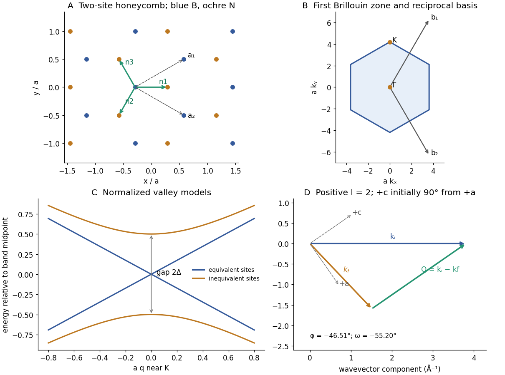

<h1 id="1/c/ii/solution">Solution</h1>

↑ **Parent:** [Ii](../ii.md)

For $l=2$, $Q=2.7925\,\mathrm{\mathring A^{-1}}$. The scattering triangle gives

$$
\cos\phi=\frac{k_i^2+k_f^2-Q^2}{2k_ik_f},\qquad\boxed{|\phi|=46.51^\circ.}
$$

To state signed sample angles without an implicit axis convention, take the incident beam along $+x$, positive angular [rotation](../../../../../rotation-mathematics.md) counterclockwise, and at $\omega=0$ choose $+a$ along $+x$ and $+c$ along $+y$. Then

$$
\mathbf k_i=k_i(1,0),\quad\mathbf k_f=k_f(\cos\phi,\sin\phi),\quad
\hat{\mathbf c}=(-\sin\omega,\cos\omega).
$$

The positive-$l$ condition is the vector equation $\mathbf k_i-\mathbf k_f=Q\hat{\mathbf c}$. Put

$$
\beta=\tan^{-1}\frac{k_f\sin|\phi|}{k_i-k_f\cos\phi}=34.80^\circ.
$$

The two detector sides then give, modulo full [rotations](../../../../../rotation-mathematics.md),

$$
\boxed{(\omega,\phi)=(-55.20^\circ,-46.51^\circ)
\quad\text{or}\quad(-124.80^\circ,+46.51^\circ).}
$$

These pairs obey the stated same-sense sign convention and transfer [momentum](../../../../../momentum-split.md) along $+c$. The lower-right panel below illustrates the first choice. If the initial $+c$ direction is chosen on the opposite side of $+a$, a commonly used positive-angle pair is $(55.20^\circ,46.51^\circ)$. Merely taking absolute values without fixing that [crystal](../../../../../crystal.md)-axis convention can exchange $l=+2$ and $l=-2$. The measurable scattering angle and the vector-triangle construction are invariant.

**[Figure 1](#1/c/ii/image-honeycomb-geometry-reciprocal-space-hexagon-sublattice-band-gap-and-a-signed-neutron-scattering-triangle). Honeycomb geometry, reciprocal-space hexagon, sublattice band gap and a signed neutron-scattering triangle**. Original calculations and schematic geometry. Lattice panels use $a=1$; the band panel compares normalized two-sublattice models. The neutron panel uses the explicit signed-axis convention of Question 1(c)(ii).

## ↑ Ancestors (13)

1. [Ii](../ii.md)
2. [C](../../c.md)
3. [1](../../../1.md)
4. [2018](../../../../2018-split.md)
5. [Past exam of the condensed matter physics major option course of the University of Oxford](../../../../split.md)
6. [Condensed matter physics major option course of the University of Oxford](../../../../../condensed-matter-physics-major-option-course-of-the-university-of-oxford.md)
7. [Year 4 of the physics course of the University of Oxford](../../../../../year-4-of-the-physics-course-of-the-university-of-oxford.md)
8. [Physics course of the University of Oxford](../../../../../physics-course-of-the-university-of-oxford.md)
9. [Undergraduate course of the University of Oxford](../../../../../undergraduate-course-of-the-university-of-oxford.md)
10. [Course of the University of Oxford](../../../../../course-of-the-university-of-oxford.md)
11. [University of Oxford](../../../../../university-of-oxford-split.md)
12. [List of universities](../../../../../list-of-universities.md)
13. [Codex Wiki](../../../../../split.md)

## ← Incoming links (2)

- [Solution](../../../2/a/solution.md)
- [Solution](../../../2/c/solution.md)
