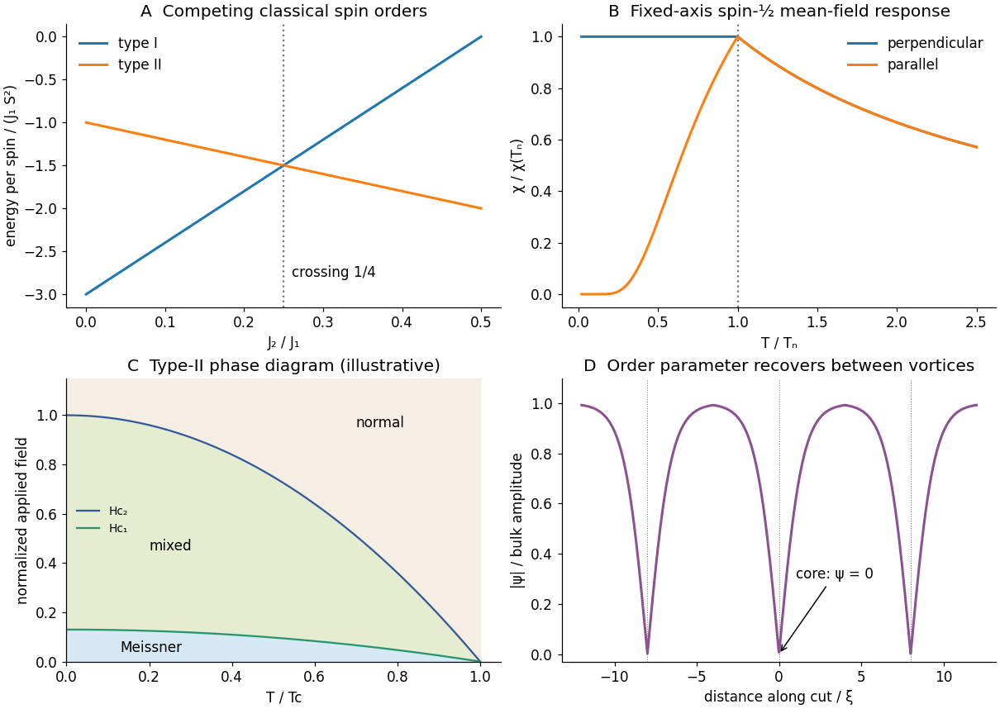

<h1 id="3/a/solution">Solution</h1>

↑ **Parent:** [A](../a.md)

Use the explicit convention $H=J_1\sum_{\langle ij\rangle}\mathbf S_i\cdot\mathbf S_j+J_2\sum_{\langle\langle ij\rangle\rangle}\mathbf S_i\cdot\mathbf S_j$, counting every bond once and taking dimensionless [spins](../../../../spin.md) of length $S$. On the [simple cubic lattice](../../../../primitive-cubic-lattice.md) there are six nearest and twelve face-diagonal next-nearest neighbours.

For type I all six nearest bonds are antiparallel and all twelve next-nearest bonds parallel, so $E_I/N=S^2(-3J_1+6J_2)$. Choose the parallel direction of type II as $z$. It has two parallel and four antiparallel nearest bonds, and four parallel $xy$ face diagonals but eight antiparallel $xz,yz$ diagonals. Thus $E_{II}/N=S^2(-J_1-2J_2)$ and

$$
\frac{E_{II}-E_I}{N}=2S^2(J_1-4J_2).
$$

Consequently, for the stated antiferromagnetic exchanges,

$$
\boxed{\text{type I: }J_2/J_1<1/4;\quad
\text{type II: }J_2/J_1>1/4;\quad\text{degenerate at }1/4.}
$$

This comparison is also consistent with the full classical spiral [energy](../../../../energy-split.md). With $u_i=\cos(q_ia)$,

$$
E(\mathbf q)/(NS^2)=J_1(u_x+u_y+u_z)+2J_2(u_xu_y+u_yu_z+u_zu_x).
$$

It is affine in each $u_i\in[-1,1]$, so some minimum occurs at a cube vertex, giving the competing collinear states above. At the boundary, the coefficient of $u_z$ vanishes for $u_x=u_y=-1$, producing the larger degeneracy $(\pi/a,\pi/a,q_z)$ and permutations. It is not an isolated two-state crossing. The first panel of the model figure below shows the competing energies.

**[Figure 2](#3/a/image-competing-antiferromagnetic-energies-mean-field-susceptibilities-a-type-ii-phase-diagram-and-vortex-cores). Competing antiferromagnetic energies, mean-field susceptibilities, a type-II phase diagram and vortex cores**. Original illustrative models. Susceptibilities use spin-one-half mean-field theory, fields in the phase diagram are normalized, and the order-parameter profile is a schematic cut through separated vortex cores.

## ↑ Ancestors (12)

1. [A](../a.md)
2. [3](../../3.md)
3. [2018](../../../2018-split.md)
4. [Past exam of the condensed matter physics major option course of the University of Oxford](../../../split.md)
5. [Condensed matter physics major option course of the University of Oxford](../../../../condensed-matter-physics-major-option-course-of-the-university-of-oxford.md)
6. [Year 4 of the physics course of the University of Oxford](../../../../year-4-of-the-physics-course-of-the-university-of-oxford.md)
7. [Physics course of the University of Oxford](../../../../physics-course-of-the-university-of-oxford.md)
8. [Undergraduate course of the University of Oxford](../../../../undergraduate-course-of-the-university-of-oxford.md)
9. [Course of the University of Oxford](../../../../course-of-the-university-of-oxford.md)
10. [University of Oxford](../../../../university-of-oxford-split.md)
11. [List of universities](../../../../list-of-universities.md)
12. [Codex Wiki](../../../../split.md)

## ← Incoming links (3)

- [Solution](../d/solution.md)
- [Solution](../../5/b/solution.md)
- [Solution](../../5/c/solution.md)
