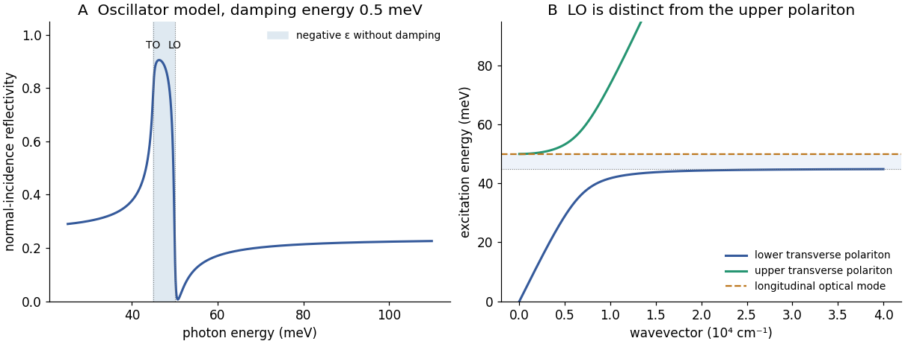

<h1 id="4/b/solution">Solution</h1>

↑ **Parent:** [B](../b.md)

At normal incidence from vacuum the [reflectivity](../../../../reflectance.md) is

$$
R=\left|\frac{\sqrt{\epsilon_r}-1}{\sqrt{\epsilon_r}+1}\right|^2,
$$

with the passive branch of the [complex refractive index](../../../../complex-refractive-index.md). Below the optical resonance the real [permittivity](../../../../permittivity-split.md) rises towards its pole and [reflectance](../../../../reflectance.md) increases. Between the TO and LO frequencies, the lossless [permittivity](../../../../permittivity-split.md) is negative; the wave is evanescent and the [reflectivity](../../../../reflectance.md) is unity in that idealization. Finite [damping](../../../../damping.md) rounds and reduces this [reststrahlen band](../../../../reststrahlen-effect.md). Above the LO edge, positive [permittivity](../../../../permittivity-split.md) returns and [reflectivity](../../../../reflectance.md) can become very small when the [refractive index](../../../../refractive-index.md) is near one, before rising towards its electronic-background value.

Reading the surviving source graph to its available precision gives

$$
\boxed{\hbar\omega_{\rm TO}\simeq45\,\mathrm{meV},\quad
\hbar\omega_{\rm LO}\simeq50\,\mathrm{meV},\quad
\omega_{\rm TO}\simeq6.84\times10^{13}\,\mathrm{s^{-1}},\quad
\omega_{\rm LO}\simeq7.60\times10^{13}\,\mathrm{s^{-1}}.}
$$

These are band-edge estimates, not a high-precision [damping](../../../../damping.md) fit. The minimum immediately above the band is not exactly the LO zero: for zero [damping](../../../../damping.md) $\epsilon_r=1$ occurs at $\omega^2=(\epsilon_\infty\omega_{\rm LO}^2-\omega_{\rm TO}^2)/(\epsilon_\infty-1)>\omega_{\rm LO}^2$.

The high-[energy](../../../../energy-split.md) plotted tail near $90\,\mathrm{meV}$ has $R\simeq0.22$. Ignoring residual [phonon](../../../../phonon.md) dispersion gives $n\simeq(1+\sqrt R)/(1-\sqrt R)=2.77$ and $\epsilon\simeq7.65$. Correcting with the finite-[energy](../../../../energy-split.md) [oscillator](../../../../oscillator.md) ratio gives

$$
\boxed{\epsilon_\infty\simeq7.65\frac{90^2-45^2}{90^2-50^2}\simeq8.3.}
$$

Thus a background of order $8$–$9$ is supported; equating the still-dispersive tail exactly to the asymptotic background would slightly underestimate it. The original model curves below use these approximate energies, without copying or fitting individual source data points.

**[Figure 3](#4/b/image-infrared-reflection-and-the-distinct-transverse-polariton-and-longitudinal-optical-mode). Infrared reflection and the distinct transverse polariton and longitudinal optical mode**. Original oscillator-model curves with illustrative damping. Polariton branches are calculated independently of the measured points; the flat LO line is not the upper transverse polariton branch.

## ↑ Ancestors (12)

1. [B](../b.md)
2. [4](../../4.md)
3. [2018](../../../2018-split.md)
4. [Past exam of the condensed matter physics major option course of the University of Oxford](../../../split.md)
5. [Condensed matter physics major option course of the University of Oxford](../../../../condensed-matter-physics-major-option-course-of-the-university-of-oxford.md)
6. [Year 4 of the physics course of the University of Oxford](../../../../year-4-of-the-physics-course-of-the-university-of-oxford.md)
7. [Physics course of the University of Oxford](../../../../physics-course-of-the-university-of-oxford.md)
8. [Undergraduate course of the University of Oxford](../../../../undergraduate-course-of-the-university-of-oxford.md)
9. [Course of the University of Oxford](../../../../course-of-the-university-of-oxford.md)
10. [University of Oxford](../../../../university-of-oxford-split.md)
11. [List of universities](../../../../list-of-universities.md)
12. [Codex Wiki](../../../../split.md)

## ← Incoming links (1)

- [Solution](../d/solution.md)
