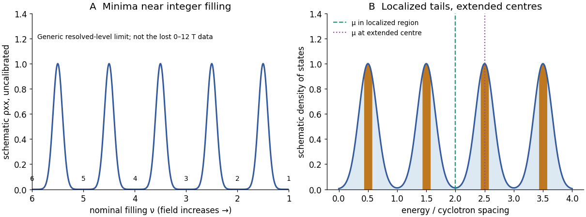

<h1 id="6/c/solution">Solution</h1>

↑ **Parent:** [C](../c.md)

As [magnetic field](../../../../magnetic-field-split.md) grows from zero, a clean [two-dimensional electron gas](../../../../two-dimensional-electron-gas.md) first has an ordinary finite [longitudinal resistivity](../../../../longitudinal-sheet-resistivity.md), then develops Shubnikov–de Haas oscillations as broadened [Landau levels](../../../../landau-level.md) pass the [chemical potential](../../../../chemical-potential-split.md). Thermal and disorder broadening obscure the low-field oscillations; their visibility grows when the level spacing exceeds those broadening scales. In a well-developed integer quantum Hall regime, $\rho_{xx}$ has minima close to zero on Hall plateaux and maxima during transitions between them, when extended states cross the [chemical potential](../../../../chemical-potential-split.md). Detailed peak heights and envelopes depend on disorder and scattering and are not fixed by quantization alone.

At fixed density the nominal filling is $\nu(B)=N_Sh/(eB)$, so level-filling features are approximately periodic in $1/B$, with period $e/(N_Sh)$ for resolved [spin](../../../../spin.md) levels or $2e/(N_Sh)$ for an unresolved [spin](../../../../spin.md) pair. Increasing $B$ lowers the filling; [spin](../../../../spin.md) splitting can create additional odd-index features. The original schematic below shows these relations without pretending to reconstruct the missing data.

**TODO — missing source graph:** the actual $0$–$12\,\mathrm T$ positions and integer plateau labels require $N_S$ or surviving plateau fields from part (b). Neither is provided independently. Thus a uniquely labelled field-axis sketch for this sample cannot be completed. The following DOS diagram distinguishes extended centres and localized tails generically; its chemical-potential markers are illustrative and do not stand for the requested 8 T or 10 T assignments.

**[Figure 4](#6/c/image-generic-longitudinal-oscillations-and-broadened-landau-levels-without-inventing-the-missing-hall-data). Generic longitudinal oscillations and broadened Landau levels without inventing the missing Hall data**. Original qualitative illustration. The horizontal filling scale is dimensionless and is not a reconstruction of the missing 0–12 T graph. Chemical-potential positions in the DOS panel illustrate two regimes, with no assignment to 8 T or 10 T.

## ↑ Ancestors (12)

1. [C](../c.md)
2. [6](../../6.md)
3. [2018](../../../2018-split.md)
4. [Past exam of the condensed matter physics major option course of the University of Oxford](../../../split.md)
5. [Condensed matter physics major option course of the University of Oxford](../../../../condensed-matter-physics-major-option-course-of-the-university-of-oxford.md)
6. [Year 4 of the physics course of the University of Oxford](../../../../year-4-of-the-physics-course-of-the-university-of-oxford.md)
7. [Physics course of the University of Oxford](../../../../physics-course-of-the-university-of-oxford.md)
8. [Undergraduate course of the University of Oxford](../../../../undergraduate-course-of-the-university-of-oxford.md)
9. [Course of the University of Oxford](../../../../course-of-the-university-of-oxford.md)
10. [University of Oxford](../../../../university-of-oxford-split.md)
11. [List of universities](../../../../list-of-universities.md)
12. [Codex Wiki](../../../../split.md)
