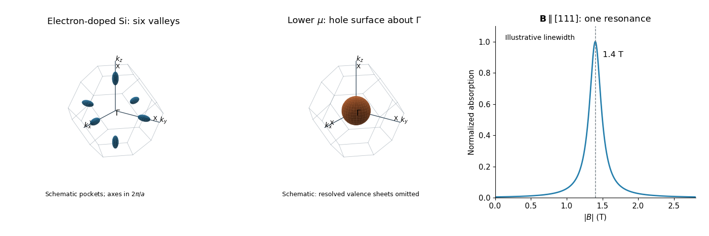

<h1 id="2/d/ii/solution">Solution</h1>

↑ **Parent:** [Ii](../ii.md)

For $\mathbf B\parallel[111]$, its squared projection onto the long axis of every valley is $1/3$. All six valleys therefore have the same [cyclotron effective mass](../../../../../cyclotron-effective-mass.md):

$$
\boxed{m_{111}=\sqrt{\frac{3m_1^2m_2}{2m_1+m_2}}\simeq0.28m_e.}
$$

At the fixed photon energy,

$$
\boxed{B_{111}=\frac{m_{111}\omega}{e}\simeq1.4\,\mathrm T.}
$$

Thus the two-peak spectrum is replaced by one peak near $1.4\,\mathrm T$. The source does not determine the linewidth or absolute oscillator strength for the new direction; the sketch below shows only a normalized illustrative line at the computed position.

**[Figure 1](#2/d/ii/image-silicon-valley-geometry-and-the-single-resonance-for-a-111-field). Silicon valley geometry and the single resonance for a $[111]$ field**. Original schematic. Left: six electron [Fermi surface](../../../../../fermi-surface.md) pockets near the X faces of the face-centred-cubic [first Brillouin zone](../../../../../first-brillouin-zone.md). Middle: a schematic hole surface about $\Gamma$ after lowering the [chemical potential](../../../../../chemical-potential-split.md) into the [valence band](../../../../../valence-band.md); its radius and warping are not inferred from the damaged source. Right: a unit-height illustrative absorption line at the calculated $[111]$ resonance; the width is chosen for readability and is not predicted.

## ↑ Ancestors (13)

1. [Ii](../ii.md)
2. [D](../../d.md)
3. [2](../../../2.md)
4. [2019](../../../../2019-split.md)
5. [Past exam of the condensed matter physics major option course of the University of Oxford](../../../../split.md)
6. [Condensed matter physics major option course of the University of Oxford](../../../../../condensed-matter-physics-major-option-course-of-the-university-of-oxford.md)
7. [Year 4 of the physics course of the University of Oxford](../../../../../year-4-of-the-physics-course-of-the-university-of-oxford.md)
8. [Physics course of the University of Oxford](../../../../../physics-course-of-the-university-of-oxford.md)
9. [Undergraduate course of the University of Oxford](../../../../../undergraduate-course-of-the-university-of-oxford.md)
10. [Course of the University of Oxford](../../../../../course-of-the-university-of-oxford.md)
11. [University of Oxford](../../../../../university-of-oxford-split.md)
12. [List of universities](../../../../../list-of-universities.md)
13. [Codex Wiki](../../../../../split.md)
