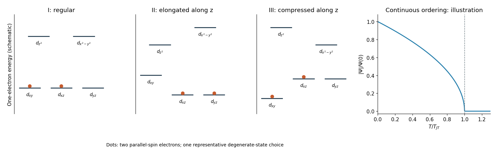

<h1 id="4/b/iii/solution">Solution</h1>

↑ **Parent:** [Iii](../iii.md)

For axial compression along $z$, the ordering is reversed: $d_{xy}$ lies below the $d_{xz},d_{yz}$ doublet, and $d_{x^2-y^2}$ lies below $d_{z^2}$ within $e_g$. One electron occupies $d_{xy}$ and the other occupies either $d_{xz}$ or $d_{yz}$, with parallel spins in the weak-distortion regime. The orbital degeneracy is therefore two, with $S=1$.

The retained orbital degeneracy allows further symmetry lowering and explains why this compressed arrangement does not provide the fully quenched equilibrium of the elongated case in the specified simple model.

**[Figure 2](#4/b/iii/image-octahedral-d-level-splitting-and-a-continuous-jahn-teller-order-parameter). Octahedral d-level splitting and a continuous Jahn-Teller order parameter**. Original small-distortion schematic. The three level panels show the regular, elongated, and compressed one-electron orbital orderings; colored dots mark the high-spin $d^2$ occupation, including one representative choice within a degenerate doublet. Level spacings are illustrative. The last panel plots a normalized square-root mean-field [order parameter](../../../../../order-parameter.md), not measured data or a claim that its exponent is fixed by the source.

## ↑ Ancestors (13)

1. [Iii](../iii.md)
2. [B](../../b.md)
3. [4](../../../4.md)
4. [2019](../../../../2019-split.md)
5. [Past exam of the condensed matter physics major option course of the University of Oxford](../../../../split.md)
6. [Condensed matter physics major option course of the University of Oxford](../../../../../condensed-matter-physics-major-option-course-of-the-university-of-oxford.md)
7. [Year 4 of the physics course of the University of Oxford](../../../../../year-4-of-the-physics-course-of-the-university-of-oxford.md)
8. [Physics course of the University of Oxford](../../../../../physics-course-of-the-university-of-oxford.md)
9. [Undergraduate course of the University of Oxford](../../../../../undergraduate-course-of-the-university-of-oxford.md)
10. [Course of the University of Oxford](../../../../../course-of-the-university-of-oxford.md)
11. [University of Oxford](../../../../../university-of-oxford-split.md)
12. [List of universities](../../../../../list-of-universities.md)
13. [Codex Wiki](../../../../../split.md)
